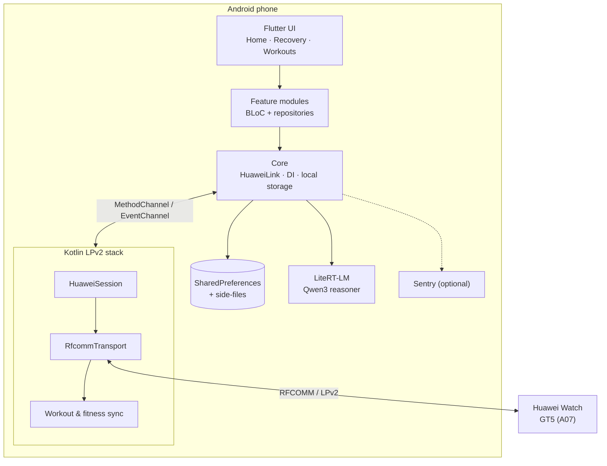

<div align="center">

# Fathom

**Local-first swim & fitness companion for the Huawei Watch GT5 (A07)** — direct Bluetooth sync, on-device coaching, no Huawei Health Kit.

<br/>


<br/>


<p><em>Package name: <code>fitness_os</code> · Android-first · RFCOMM / LPv2</em></p>

</div>

---

## Why Fathom

Most Huawei watch apps route your health data through vendor cloud services. **Fathom** pairs your phone directly with a **GT5 (A07)** over Classic Bluetooth, speaks the watch’s **LPv2** protocol from a custom Kotlin stack, and keeps workouts, sleep, and vitals on the device. Swimming is the north star—lap-level analytics, deterministic diagnoses, and an **offline-first coach**—but the same sync path supports strength, running, racket sports, and dozens of other workout types.

---

## Features

| Area | What you get |
|------|----------------|
| 🔗 **Direct watch sync** | Gate A pair/reconnect and Gate B workout history over **RFCOMM**—no Huawei Health Kit dependency |
| 🏊 **Swim Bible v0** | Canonical lap data, P0 metrics (pace, SWOLF, stroke rate), session analytics, trends, and evidence-backed diagnoses |
| 🤖 **On-device coach** | **Qwen3 0.6B** via **LiteRT-LM** (`flutter_gemma`); deterministic rules when the model isn’t installed |
| 😴 **Sleep & recovery** | TruSleep-backed sessions, hypnogram, sleep HR windows, and composed **recovery time** |
| ❤️ **Daily vitals** | Fitness totals, daily HR series, and Home KPIs from local stores |
| 🏋️ **Multi-sport history** | Labeled sessions for pool swim, run, strength, badminton, and **30+** mapped Huawei sport codes |
| 🍽️ **Food logging** | Photo-based meal capture, schedules, and day export under Recovery |
| 📋 **Programs** | Structured training programs with progress and scorecards |
| 🛡️ **Privacy-aware observability** | Optional **Sentry** with `SentryPrivacyScrub`—health payloads and MACs stripped before upload |
| 📤 **Diagnostics export** | Local JSON export for debugging without shipping raw health data to third parties |

---

## Architecture



**Sync planes (high level):** **Gate A** — discover, authenticate (HiChain), remember device. **Gate B** — workout count → totals → enrichment (pace / swim segments). **Activity** — sleep, daily HR, fitness totals. Pairing secrets stay in native `HuaweiSecretStore`; Flutter never persists auth material in prefs.

Deeper diagrams: [`docs/onboarding/HLD.md`](docs/onboarding/HLD.md) · Living architecture: [`docs/architecture/README.md`](docs/architecture/README.md)

---

## Tech stack

| Layer | Technologies |
|-------|----------------|
| **UI** | Flutter 3.9+, Material 3, `blueprint_ui` design system, `flutter_bloc`, `fl_chart` |
| **On-device ML** | `flutter_gemma` + `flutter_gemma_litertlm`, Qwen3 0.6B `.litertlm` weights |
| **Android native** | Kotlin 17, RFCOMM, custom LPv2 framing/crypto/sync (`android/.../huawei/`) |
| **Local data** | `shared_preferences`, feature side-files, GetIt DI |
| **Observability** | `sentry_flutter` + Dart/Kotlin breadcrumbs (optional) |
| **Tooling** | `flutter_lints`, Dart + Gradle unit tests, GitHub Actions app distribution |

---

## Privacy

- **Local-first:** Workouts, sleep, HR, and coach output live on the phone unless you opt into optional features.
- **No cloud health pipeline by default:** Sync is phone ↔ watch; optional backend write path is documented separately and requires an explicit build-time key.
- **Sentry hardening:** `beforeSend` / `beforeBreadcrumb` hooks drop forbidden keys (HR series, sleep sessions, raw workouts, secrets) and redact MAC-like strings in free text.
- **On-device LLM:** Coach inference runs locally after you download model weights; no API key required for the primary reasoner path.

Details: [`docs/sentry-setup.md`](docs/sentry-setup.md) · [`.env.example`](.env.example)

---

## Getting started

### Prerequisites

- **Flutter SDK** `^3.9.2` (see `pubspec.yaml`; LiteRT native assets need a recent stable Flutter)
- **Android SDK** with **minSdk 24+** (see `android/app/build.gradle.kts`)
- Physical **Huawei Watch GT5 (A07)** for end-to-end sync testing

### Run (local storage only)

```bash
flutter pub get
flutter run
```

### Optional: Sentry in debug/release

```bash
cp .env.example .env
# Set SENTRY_DSN (and optionally SENTRY_FORCE=true for debug)
flutter run --dart-define-from-file=.env
```

### Build APK

```bash
flutter build apk

# Optional: enable features via dart-define (never commit secrets)
flutter build apk --dart-define-from-file=.env
```

### Test & analyze

```bash
flutter test
flutter analyze
cd android && ./gradlew test
```

New feature scaffold: `./create_feature.sh <name>`. Full contributor flow: [`ONBOARDING.md`](ONBOARDING.md).

---

## Project structure

```
fitness_os/
├── lib/
│   ├── app/              # bootstrap, shell (Home | Recovery | Workouts), routing
│   ├── core/             # HuaweiLink, DI, observability, storage
│   └── features/         # home, vitals, workout_history, device_pairing, food, programs, …
├── packages/blueprint_ui/ # Fathom design tokens & components
├── android/.../huawei/   # LPv2 session, RFCOMM, sync, crypto
├── docs/
│   ├── onboarding/       # HLD / LLD + Excalidraw
│   ├── wire-specs/       # Owned protocol notes (internal reference)
│   └── plans/            # Product & execution plans
└── test/                 # Dart tests (mirrors lib/)
```

---

## Roadmap

| Milestone | Status |
|-----------|--------|
| Gate A pair / reconnect (RFCOMM, no Health runtime) | ✅ Shipped |
| Gate B workout history + swim enrichment | ✅ Shipped |
| Swim Bible pipeline (evidence → diagnosis → recommendations → reasoner) | ✅ Shipped |
| Qwen3 on-device reasoner (LiteRT-LM) | ✅ Shipped |
| Sleep / TruSleep vitals + recovery composition | ✅ Shipped |
| W5 — reliability harden & Swim Bible v0 freeze | 🔄 In progress |
| Overnight physio summaries (HRV, sleep HR, SpO₂ probes) | 🔬 Experimental |
| GT5 Lite Wearable on-watch UI spike | 🔬 Spike (`wearable/`) |

Living status: [`docs/status/AUTO_DRIVE.md`](docs/status/AUTO_DRIVE.md) · Product roadmap: [`docs/plans/2026-07-23-001-product-roadmap-swim-bible-v0.md`](docs/plans/2026-07-23-001-product-roadmap-swim-bible-v0.md)

---

## Learn more

| Doc | Purpose |
|-----|---------|
| [`ONBOARDING.md`](ONBOARDING.md) | Developer onboarding & key files |
| [`docs/onboarding/HLD.md`](docs/onboarding/HLD.md) | System context & feature map |
| [`docs/onboarding/LLD.md`](docs/onboarding/LLD.md) | Pairing, sync, and native stack detail |
| [`docs/backend.md`](docs/backend.md) | Optional backend sync (off by default) |

---

<div align="center">

**Fathom** — understand your training, keep your data.

</div>