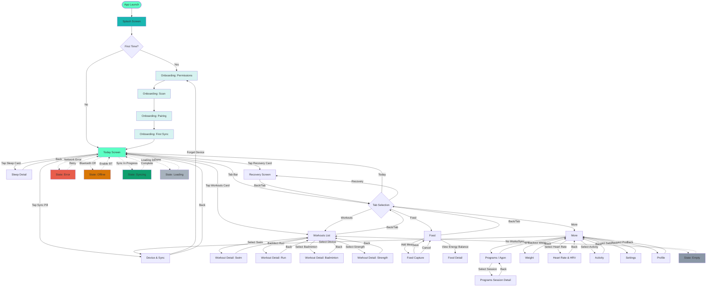

# Fitness OS Navigation Flow

## Complete screen-to-screen navigation map with transitions



---

## Screen Inventory

### Onboarding Flow (First-Time Users)
1. **Splash Screen** → App logo, loading indicator
2. **Onboarding: Permissions** → Location, Bluetooth, Notifications grants
3. **Onboarding: Scan** → BLE device discovery list
4. **Onboarding: Pairing** → Authentication progress
5. **Onboarding: First Sync** → Initial data pull progress

### Primary Navigation (Tab Bar)
1. **Today** (Home)
2. **Workouts**
3. **Recovery**
4. **Food**
5. **More** (Settings, Profile, Device, Programs, Weight, etc.)

### Today Screen Drill-Downs
- **Sleep Detail** ← Tap "Last Night" card
- **Recovery** ← Tap "Recovery" card (or tab bar)
- **Workouts List** ← Tap "Today's Workouts" card (or tab bar)
- **Device & Sync** ← Tap "Synced Xm ago" pill

### Workouts Drill-Downs
- **Workout Detail: Swim** ← Tap swim session
  - Displays: distance, duration, pace, strokes, SWOLF, lap breakdown, HR zones, training load
- **Workout Detail: Run** ← Tap run session
  - Displays: distance, duration, pace, cadence, splits, HR zones, training load
- **Workout Detail: Badminton** ← Tap badminton session
  - Displays: duration, calories, HR zones, training load, anaerobic TE
- **Workout Detail: Strength** ← Tap strength session
  - Displays: duration, sets/reps estimate, training load, recovery time

### Food Drill-Downs
- **Food Capture** ← Tap "Add Meal" button
  - Camera capture, manual entry, slot selection (breakfast/lunch/dinner/snack)
- **Food Detail** ← Tap energy balance card
  - Daily calorie breakdown, meal list with photos

### More Menu Drill-Downs
- **Programs (Agon)** ← Tap "Programs" in More
  - Weekly calendar, chore list (due/done/skipped)
  - **Programs Session Detail** ← Tap session
    - WU/Main/CD block breakdown, effort zones, rest intervals
- **Weight** ← Tap "Weight" in More
  - Current weight, 7/30/90-day trend chart, manual entry
- **Heart Rate & HRV** ← Tap "Heart Rate" in More
  - 24h HR curve, resting HR trend, max/min, HRV samples
- **Activity** ← Tap "Activity" in More
  - Steps chart (7/30-day), calories chart, distance estimate
- **Device & Sync** ← Tap "Watch" in More (or sync pill on Today)
  - Watch name, battery, connection status, last sync time, feature arm status
- **Settings** ← Tap "Settings" in More
  - Auto-tracking toggles, notifications, theme, forget device, about
- **Profile** ← Tap "Profile" in More
  - Name, photo, biometrics, goals

### States (Overlays & Modals)
- **Loading** → Spinner overlay during data fetch
- **Empty** → Illustrated empty state (e.g. "No workouts yet")
- **Error** → Error message with retry button
- **Offline** → Bluetooth off or watch disconnected banner
- **Syncing** → Progress indicator with cancel button

---

## Navigation Patterns

### Back Navigation
- **Hardware Back Button** (Android): Returns to previous screen in stack
- **Back Arrow** (Top-left): Visible on all detail screens, returns to parent
- **Tab Bar**: Resets to top-level screen of that tab (Today, Workouts, Recovery, Food, More)

### Deep Linking
All screens support deep links for:
- Notifications (e.g. "Sync complete" → Today)
- Program reminders (e.g. "Session due today" → Programs Session Detail)
- Widget taps (e.g. Sleep widget → Sleep Detail)

### Gesture Navigation
- **Swipe Back** (iOS/Android): Supported on all detail screens
- **Pull to Refresh** (Today, Workouts, Food): Triggers manual sync

---

## Transition Animations

### Screen Transitions
- **Forward (drill-down)**: Slide-in from right, 300ms ease-out
- **Back**: Slide-out to right, 300ms ease-out
- **Tab switch**: Cross-fade, 200ms ease-out
- **Modal (states)**: Fade-in with scale (0.95 → 1.0), 300ms ease-out

### Micro-Interactions
- **Button press**: Scale to 0.95, 100ms ease-out
- **Card tap**: Subtle scale to 0.98, 100ms ease-out
- **Pull to refresh**: Elastic bounce, 400ms ease-out
- **Loading spinner**: Continuous rotation, 1s linear

---

## User Flow Examples

### Example 1: First-Time User Setup
```
App Launch → Splash (2s) → Onboarding: Permissions → Grant Location → Grant BT 
→ Onboarding: Scan → Select "WATCH GT5 Pro" → Onboarding: Pairing (auth) 
→ Onboarding: First Sync (sleep, workouts, HR, totals) → Today
```

### Example 2: Morning Routine Check
```
App Launch (returning user) → Today → Tap "Last Night" sleep card 
→ Sleep Detail (review score, stages, efficiency) → Back to Today 
→ Tap "Recovery" card → Recovery Screen (check readiness) → Tab to Workouts 
→ Review yesterday's sessions
```

### Example 3: Post-Workout Review
```
App Launch → Today → Tap "Today's Workouts" → Workouts List 
→ Tap latest swim session → Workout Detail: Swim (review laps, HR zones, SWOLF) 
→ Back to Workouts → Tab to Recovery → Check updated recovery time
```

### Example 4: Food Logging
```
App Launch → Today → Tab to Food → Tap "Add Meal" → Food Capture (take photo) 
→ Select "Lunch" slot → Enter manual kcal (optional) → Save 
→ Food Screen (view energy balance: calories in - calories out)
```

### Example 5: Program Check-In (Agon)
```
App Launch → Today → Tab to More → Tap "Programs" → Programs Screen (weekly calendar) 
→ Tap today's due session → Programs Session Detail (review WU/Main/CD blocks) 
→ After workout, session auto-links to completed swim → Check off as "Done"
```

### Example 6: Sync & Device Management
```
App Launch → Today → Tap "Synced 2m ago" pill → Device & Sync Screen 
(battery 78%, connected, last sync time) → Tap "Sync Now" → Syncing State 
→ Sync completes → Back to Today (updated data)
```

---

## Entry Points

### App Icon Launch
- **First-time users**: Splash → Onboarding: Permissions
- **Returning users (paired)**: Splash → Today
- **Returning users (unpaired)**: Splash → Onboarding: Scan (skip permissions if granted)

### Widget Taps
- **Sleep Widget**: → Sleep Detail
- **Recovery Widget**: → Recovery Screen
- **Steps Widget**: → Activity Screen

### Notifications
- **"Sync complete"**: → Today
- **"Session due today"**: → Programs Session Detail
- **"7-day streak!"**: → Today (no modal)

### Deep Links (from External Apps)
- `fitnesssos://today` → Today
- `fitnesssos://workouts/{workoutNumber}` → Workout Detail
- `fitnesssos://programs/{sessionId}` → Programs Session Detail
- `fitnesssos://sleep` → Sleep Detail

---

## Tab Bar Behavior

### Persistent Tab Bar
- Visible on all **top-level screens** (Today, Workouts, Recovery, Food, More)
- Hidden on **detail screens** (Sleep Detail, Workout Detail, etc.)
- Hidden on **onboarding screens** and **state overlays**

### Active Tab Indication
- **Visual**: Accent color icon + label
- **Behavior**: Tapping active tab scrolls to top (if scrolled down)

### Tab Memory
- Each tab remembers its scroll position when switched away
- Returning to a tab restores scroll position (unless deep link resets it)

---

## Error Handling & Recovery

### No Internet Connection
- **Offline State**: Banner at top "No internet connection"
- **Behavior**: Show cached data, disable sync button
- **Recovery**: Auto-dismiss banner when connection restored

### Bluetooth Off
- **Offline State**: Banner at top "Bluetooth is off"
- **Behavior**: Show cached data, link to system BT settings
- **Recovery**: Auto-dismiss banner when BT enabled

### Watch Disconnected
- **Offline State**: Banner at top "Watch disconnected"
- **Behavior**: Show cached data, offer "Reconnect" button
- **Recovery**: Tap "Reconnect" → Device & Sync → Auto-reconnect flow

### Sync Failed
- **Error State**: Toast "Sync failed. Tap to retry."
- **Behavior**: Keep showing last successful sync data
- **Recovery**: Tap toast → Retry sync

### Empty States
- **No Workouts Yet**: Illustration + "Sync your watch to see workouts"
- **No Sleep Data**: Illustration + "Wear your watch tonight to track sleep"
- **No Meals Today**: Illustration + "Tap + to log your first meal"

---

## Accessibility Navigation

### Screen Reader Support
- All screens have descriptive labels (e.g. "Today screen, showing sleep score 84")
- All interactive elements announce their purpose (e.g. "Sleep card, tap to view details")
- Tab bar items announce "Tab 1 of 5: Today, selected"

### Keyboard Navigation
- Tab bar: `Tab` cycles through tabs, `Enter` activates
- Lists: `↑↓` navigates rows, `Enter` drills down
- Back button: `Esc` returns to previous screen

### Voice Control
- "Go to Today" → Today screen
- "Open Sleep Detail" → Sleep Detail screen
- "Show Workouts" → Workouts List screen
- "Sync Now" → Triggers manual sync

---

**End of Flow Map**
