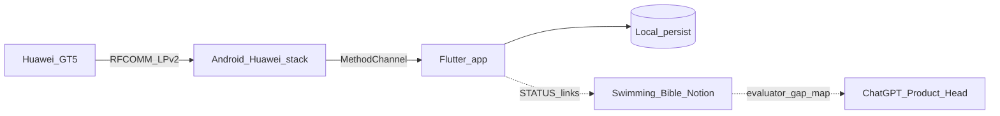
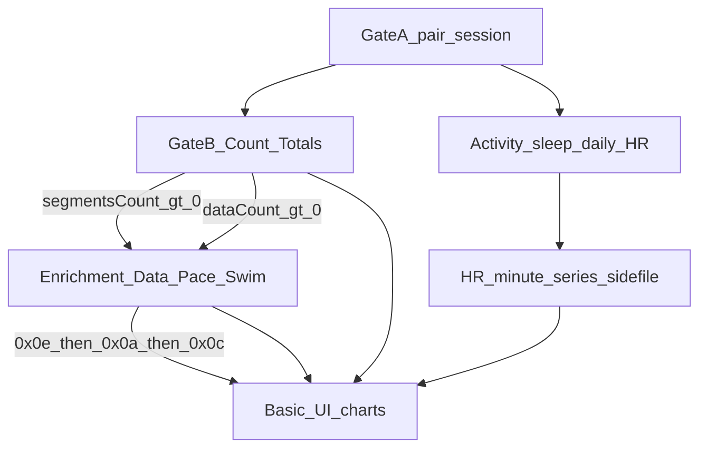
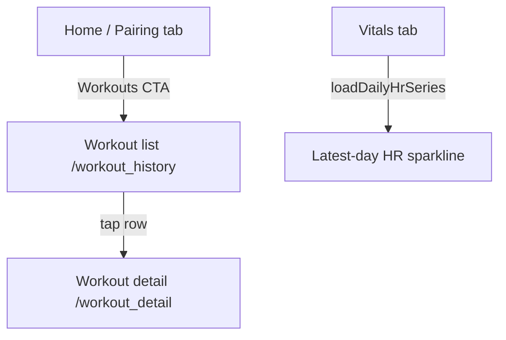

# Fitness OS Architecture (living)

**Goal this horizon (5 weeks):** Swimming Bible v0 in-app — enrichment → metrics → diagnosis → recs → LLM coach shell. Direct LPv2 only (Health Kit dropped). Owner 25m probe = W0 gate. Roadmap: `docs/plans/2026-07-23-001-product-roadmap-swim-bible-v0.md`.

## System context

## Sync data planes

## Module map

| Layer | Path | Role |
|-------|------|------|
| Wire framing | `android/.../HuaweiFraming.kt` | LPv2 TLV |
| Workout Sync | `android/.../HuaweiWorkoutSync.kt` | Count→Totals→enrichment (0x0e/0x0a/0x0c) |
| Fitness Sync | `android/.../HuaweiFitnessDataSync.kt` | Sleep / HR / enable |
| Session | `android/.../HuaweiSession.kt` | Auth + sync entry |
| Flutter bridge | `lib/core/huawei/` | Link + DTOs |
| Workouts UI | `lib/features/workout_history/` | List + detail |
| Vitals UI | `lib/features/vitals/` | Enable + HR/sleep |
| HR series side-files | `{applicationSupport}/vitals/hr_series/{dayKey}.json` | Per-minute HR (no-backup); day summaries stay in prefs |
| Status | `docs/status/` | Monitor progress |

## Rules

- No AGPL paste from Gadgetbridge — oracle only.
- Enrichment parsers may ship behind count gates; do not claim observed until owner capture.
- Prefer local no-backup files for series; SharedPreferences for summaries.

## UI navigation (basic)

