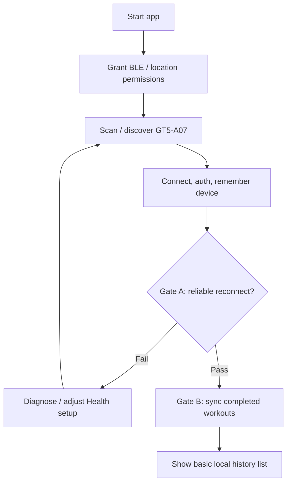

# Huawei GT5 Companion MVP (Pair + Sync)

## Summary

An Android-only companion for a Huawei Watch GT5-A07 that proves direct pairing without Huawei Health. Gate A requires connect plus reliable reconnect; Gate B then syncs any completed workouts that can be decoded into a basic local history list. Gadgetbridge smoke validation on this watch is **confirmed** — custom protocol work is unblocked.

---

## Problem Frame

Today, workout and device access for the GT5-A07 go through Huawei Health. That creates a vendor dependency and blocks a vendor-independent Fitness OS bet: whether a companion can own the radio link and history sync directly.

This Fitness OS repo is still greenfield, but the owner has **confirmed Gadgetbridge works with this GT5-A07** — so hardware/protocol feasibility is proven on-device. Remaining risk is reproducing that stack inside Fitness OS (transport, auth, reconnect, workout decode), not inventing Huawei’s protocol from zero.

Source product brief: [MVP PRD - Direct Huawei GT Companion](https://app.notion.com/p/MVP-PRD-Direct-Huawei-GT-Companion-3a0fce68824e819d8e9ffac8b7ade066).

---

## Actors

- A1. Owner: The sole user of this MVP; owns the GT5-A07 and the Android test phone
- A2. Watch (GT5-A07): The single supported device; source of connection state and completed workout history
- A3. Huawei Health: External app on the same phone; treated as a test-setup obstacle, not a product dependency

---

## Key Flows

- F1. First-time pair
  - **Trigger:** Owner launches the app with no remembered device
  - **Actors:** A1, A2
  - **Steps:** Grant required permissions → discover GT5-A07 → connect → complete Huawei auth/bond handshake → confirm connected state → persist device identity for later reconnect
  - **Outcome:** Watch is authenticated, connected, and remembered; Gate A reconnect tests can begin
  - **Covered by:** R1, R2, R3, R4, R13

- F2. Reliable reconnect (Gate A)
  - **Trigger:** App was previously paired; owner returns after app kill, phone reboot, or Bluetooth toggle
  - **Actors:** A1, A2
  - **Steps:** App restores remembered device → attempts reconnect without a full re-scan → shows connected or clear failure state
  - **Outcome:** Connection restores without repeating first-time pairing; Gate A can be marked passed only when all three interrupt cases succeed
  - **Covered by:** R4, R5, R6

- F3. Workout history sync (Gate B)
  - **Trigger:** Gate A has passed and owner requests sync (or sync runs when connected, once Gate A is unlocked)
  - **Actors:** A1, A2
  - **Steps:** Establish authenticated session as required by the watch → download available completed workouts → persist locally → show a basic list of whatever fields decoded
  - **Outcome:** At least some completed workouts appear in local history when the protocol allows; sparse fields are acceptable
  - **Covered by:** R7, R8, R9, R10

- F4. Huawei Health / auth recovery setup
  - **Trigger:** Direct pairing fails, auth negotiation fails, or connection is unstable while Health may own the link
  - **Actors:** A1, A3
  - **Steps:** Follow the ordered recovery in R11 (disable Health → auth-key / account-ID path → unlink or factory reset as last resorts) → record which path worked
  - **Outcome:** Experiment notes capture the working setup; Health is not required at runtime by the companion
  - **Covered by:** R11

- F5. Gadgetbridge smoke validation (pre-build) — **DONE**
  - **Trigger:** Before investing in Fitness OS pairing code for Gate A
  - **Actors:** A1, A2
  - **Steps:** Install Gadgetbridge on the Android test phone → apply R11 Health setup → discover device matching `huawei watch gt 5-…` → pair → verify reconnect → sync workouts once
  - **Outcome:** **Confirmed 2026-07-17** — Gadgetbridge works with the owner’s GT5-A07; custom Gate A implementation is unblocked
  - **Covered by:** R13

---

## Requirements

**Platform and device**
- R1. The MVP targets Android only; iOS is out of definition of done
- R2. The only supported watch for this MVP is Huawei Watch GT5-A07

**Gate A — Pair and reconnect**
- R3. The owner can discover and connect to the GT5-A07 over Huawei’s companion radio stack (community evidence: Bluetooth Classic SDP session used by Watch GT 5 in Gadgetbridge; not GATT-only) without using Huawei Health as a runtime dependency
- R4. After a successful first pair, the app remembers the device so reconnect does not require repeating the full first-time scan-and-select flow
- R5. When the app was previously paired, reconnect must succeed after each of: app process kill, phone reboot, and Bluetooth toggle off/on
- R6. The UI must show clear connection state: disconnected, connecting, connected, and reconnect-failed

**Gate B — Workout sync**
- R7. Gate B must not be treated as done until Gate A (R5) has passed
- R8. Once Gate A has passed, the owner can sync completed workouts from the watch
- R9. Synced workouts persist locally and remain viewable offline after sync
- R10. The history UI is a basic list of decodeable workouts (prefer type, date, and duration when available); missing fields for a given workout are allowed

**Experiment procedure**
- R11. Pairing tests follow this recovery order and record the winning path in experiment notes:
  1. Disable / force-stop Huawei Health (strip permissions if it auto-restarts)
  2. If auth fails with “Authentication key negotiation failed” (or equivalent): enter the 17-digit Huawei account `userId` as auth key **without unpairing in Health** (account-ID path), *or* factory-reset the watch for a clean no-vendor pair
  3. If still failing: enable Health only long enough to unlink the watch, then disable Health again and retry
  4. Never treat an active Health session as supported coexistence for this MVP
- R13. **Satisfied (2026-07-17):** Owner confirmed Gadgetbridge works with this GT5-A07. Keep that result in experiment notes; re-run only if firmware, phone, or Health setup changes break the link

**Feasibility outcome**
- R12. At project end for this cut, produce an evidence-backed recommendation for the pairing+sync bet: GO (continue Fitness OS on direct protocol), PIVOT (e.g. Health APIs), or STOP — Gate A alone may justify an interim PIVOT/STOP even if Gate B is incomplete. R13 passed; remaining evidence comes from Fitness OS Gate A/B, not protocol invention risk

---

## Acceptance Examples

- AE1. **Covers R3, R4, R6.** Given Health is disabled and permissions are granted, when the owner scans and selects the GT5-A07, the app reaches connected state and remembers the device for the next launch.
- AE2. **Covers R5, R6.** Given a remembered paired device, when the owner force-stops the app and reopens it, the app reconnects without requiring a full re-pair, or shows reconnect-failed with a clear next action.
- AE3. **Covers R5.** Given a remembered paired device, when Bluetooth is toggled off then on, the app restores connection (or clearly fails) without forgetting the device.
- AE4. **Covers R5.** Given a remembered paired device, when the phone reboots and the owner opens the app, reconnect works without repeating first-time pairing.
- AE5. **Covers R7, R8, R10.** Given Gate A has not passed, when the owner attempts workout sync, sync is blocked or clearly marked unavailable until Gate A passes.
- AE6. **Covers R8, R9, R10.** Given Gate A passed and the watch has completed workouts, when the owner syncs, at least one workout appears in the local list with whatever fields decoded, and remains visible offline.
- AE7. **Covers R11.** Given pairing fails with Health disabled, when the owner tries the next recovery step (account ID auth key, factory reset, or unlink), the experiment notes record which path unblocked pairing.
- AE8. **Covers R13.** **Passed (2026-07-17):** Owner confirmed Gadgetbridge works with the GT5-A07 on the test phone.

---

## Success Criteria

- The owner can leave Huawei Health disabled (or recovered via the documented auth-key / reset / unlink paths) and still connect to the GT5-A07 from this app
- Gate A is demonstrably true across app kill, phone reboot, and Bluetooth toggle
- Gate B shows that completed workout history can be downloaded and listed locally, even if fields are sparse
- Gadgetbridge smoke on this exact watch is confirmed (R13) — custom protocol work is not blocked on invention
- A downstream planner can implement without inventing product behavior: gates, platform, device, sync bar, Health recovery, and community reference map are explicit
- The cut ends with a GO / PIVOT / STOP recommendation supported by what actually worked or failed

---

## Scope Boundaries

- iOS support
- Multi-vendor / multi-watch architecture as an MVP goal (Garmin, Amazfit, etc.)
- Sport-specific detail screens (route maps, splits, pace charts, SWOLF, strength set breakdowns)
- Requiring Running, Strength, and Swimming to each have complete field coverage
- Coexistence with an *active* Huawei Health session as a hard product requirement
- Polished Settings beyond what pairing, permissions, and sync need
- Production Fitness OS ecosystem features beyond this feasibility companion

---

## Key Decisions

- **Two-gate companion (Approach A):** Prove connect + reliable reconnect before treating workout sync as in-progress work, so pairing failures are not confused with sync-protocol failures
- **Android only:** Matches the fastest path for Huawei radio work and the PRD’s primary deliverable surface
- **Any decodeable workouts:** Proves history sync without committing to full sport-detail UX from the Notion PRD
- **Health recovery is experiment procedure, not product dependency:** Disable first; use account-ID auth or factory reset before unlink; companion must not require Health at runtime
- **Single device:** GT5-A07 only for this MVP; treat as Watch GT 5 family (Gadgetbridge smoke confirmed)
- **Gadgetbridge-first validation:** **Done** — Gadgetbridge works on this watch (R13); Fitness OS may proceed to Gate A implementation
- **Study Gadgetbridge; do not ship its code blindly:** Gadgetbridge is AGPL-3.0 — use it as protocol reference and test oracle; licensing for any derived implementation is a planning/legal decision, not an excuse to skip the reference

---

## Dependencies / Assumptions

- **Community + on-device proof:** Watch GT 5 / GT 5 Pro are supported in Gadgetbridge ([PR #4155](https://codeberg.org/Freeyourgadget/Gadgetbridge/pulls/4155)); **owner confirmed Gadgetbridge works with GT5-A07 (2026-07-17)**
- **Transport assumption (critical):** Gadgetbridge maps Watch GT 5 to `HuaweiWatchGT5Coordinator` → **`HuaweiBRCoordinator` / `HuaweiBRSupport`** (Bluetooth Classic socket over Huawei SDP UUID `82FF3820-8411-400C-B85A-55BDB32CF060`), not GATT-only `HuaweiLESupport`. Discovery still uses Huawei service UUID `…FE86`. Planning must not assume a pure-BLE Flutter plugin is sufficient
- **Name match:** Gadgetbridge recognizes advertised names matching `huawei watch gt 5-` / `huawei watch gt 5 pro-` (case-insensitive). GT5-A07 should advertise in that family
- **Auth is mandatory after connect:** link params → crypto challenge (`GetAuthRequest`) → bond params/bond; optional Huawei account `userId` (17-digit) when the watch was previously bound to Health — see [pairing guide](https://gadgetbridge.org/basics/pairing/huawei-honor-pairing/)
- **Workout sync protocol exists:** service id `0x17` with count/totals/data/pace/swim-segment requests; Huawei syncs **all workouts since last successful sync**; stuck sync often needs disconnect/reconnect ([Huawei specifics](https://gadgetbridge.org/internals/topics/huawei-honor-specifics/))
- **Minimal list fields are available in community parsers:** totals commonly expose type, start/end, duration, distance, calories (device/workout dependent)
- Disabling Health may be insufficient; account-ID auth, factory reset, or unlink may be required
- The existing `fitness_os` Flutter app is a greenfield scaffold (UI/DI shell present; no Huawei radio/protocol work verified yet)
- Local persistence of remembered device and synced workouts is required for R4/R5/R9 (mechanism left to planning)
- Gadgetbridge is **AGPL-3.0**; Fitness OS may study behavior and reimplement, but copying source has copyleft implications

---

## Community Evidence & Working Instructions

### What the community already proved

| Source | Finding for this MVP |
|--------|----------------------|
| [Gadgetbridge Huawei devices](https://gadgetbridge.org/gadgets/wearables/huawei-honor/) | Watch GT 5 + GT 5 Pro: mostly supported, no-vendor pair |
| [Huawei/Honor feature matrix](https://gadgetbridge.org/basics/topics/huawei-honor/) | Workout sync includes HR, GPS track, calories, swim metrics, etc. (per workout/device) |
| [Huawei pairing](https://gadgetbridge.org/basics/pairing/huawei-honor-pairing/) | Pair without Health; recover after Health with account ID or factory reset |
| [Huawei specifics](https://gadgetbridge.org/internals/topics/huawei-honor-specifics/) | Bulk workout sync; stuck sync → reconnect; don’t sync activity+workouts together |
| [XDA Health alternatives](https://xdaforums.com/t/huawei-health-app-alternative.4566405/) | Users treat Gadgetbridge as the FOSS Health replacement for GT/Fit |
| [huawei-hr-overlay](https://github.com/fishuvn/huawei-hr-overlay) | Only live HR broadcast — **not** a workout-history path; do not use as Gate B reference |

### Gadgetbridge map (study order for planning / implementation)

Primary repo: [Freeyourgadget/Gadgetbridge](https://codeberg.org/Freeyourgadget/Gadgetbridge) (GitHub mirror also exists).

1. **Device entry:** `devices/huawei/huaweiwatchgt5/HuaweiWatchGT5Coordinator.java` — GT 5 + GT 5 Pro name patterns; **BR** coordinator
2. **Transport:** `service/devices/huawei/HuaweiBRSupport.java` — SDP service `UUID_SERVICE_HUAWEI_SDP`, socket buffer, delegates to `HuaweiSupportProvider`
3. **Shared protocol core:** `HuaweiSupportProvider.java` — initialize → authenticate → configure; workout fetch orchestration
4. **Auth:** `requests/GetAuthRequest.java`, `GetBondParamsRequest.java`, `GetBondRequest.java` + `devices/huawei/HuaweiCrypto.java`
5. **Framing:** `HuaweiPacket.java`, `HuaweiTLV.java`, magic/`PROTOCOL_VERSION` in `HuaweiConstants.java`
6. **Workouts:** `packets/Workout.java` + `requests/GetWorkoutCountRequest.java`, `GetWorkoutTotalsRequest.java`, `GetWorkoutDataRequest.java`, … + `HuaweiWorkoutGbParser.java`
7. **Tests as oracles:** `app/src/test/.../devices/huawei/` (`TestHuaweiPacket`, `TestHuaweiTLV`, `TestHuaweiCrypto`, `packets/TestWorkout`)

### Owner playbook — make Gate A/B actually work

**Step 0 — Smoke with Gadgetbridge (R13) — DONE 2026-07-17**

Owner confirmed Gadgetbridge works with this GT5-A07. Re-run only if firmware, phone OS, or Health setup changes break pairing. Keep Gadgetbridge installed as a comparison oracle while building Fitness OS Gate A.

**Step 1 — Gate A in Fitness OS**

- Target the same transport Gadgetbridge uses for GT 5 (classic SDP session + Huawei packet/auth), not a GATT-only toy connect
- Persist MAC / identity for reconnect; surface disconnected / connecting / connected / reconnect-failed / auth-failed
- Keep Health disabled during tests; treat auth-failed as a first-class state with R11 recovery hints

**Step 2 — Gate B in Fitness OS (only after Gate A)**

- Implement workout count → totals (enough for type/date/duration/distance when present) before pace/GPS luxury fields
- Expect multi-workout bulk sync; on hang, disconnect/reconnect then retry (community pattern)
- Prefer a real on-watch completed workout over tiny test sessions (short sessions may not be stored)

**Step 3 — Debug kit if Fitness OS diverges from Gadgetbridge**

- Enable Android **Bluetooth HCI snoop**, capture Gadgetbridge pair+sync vs Fitness OS attempt, compare in Wireshark (`btatt` / RFCOMM as applicable) — [GB Bluetooth docs](https://gadgetbridge.org/internals/development/bluetooth/)
- Use nRF Connect only for discovery/advertising sanity checks; it will not complete Huawei auth

### Account ID recovery (when Health was used before)

From Gadgetbridge docs — obtain 17-digit `userId` via one of:

- Huawei Cloud site cookies (`userId`) while logged in
- Rooted phone: Health `login_data.xml` → `old_user_id`
- Non-root: `adb logcat` search for `huid=`

Then disable Health permissions/app, enter the key in the companion’s auth setting, reconnect.

---

## Outstanding Questions

### Deferred to Planning

- [Affects R3][Technical] Flutter/Android classic Bluetooth (RFCOMM/SDP) approach for Huawei BR — plugin vs platform channel vs thin native module
- [Affects R3, R8][Needs research] Which auth mode (HiChain / pin / account) the GT5-A07 negotiates on first pair vs after Health — capture from Gadgetbridge logs / HCI snoop while Fitness OS Gate A is built
- [Affects R8, R10][Needs research] Minimal Workout totals TLV subset that yields a useful basic list on this firmware
- [Affects R5][Technical] How should “remembered device” and auto-reconnect behave when the OS Bluetooth bond is missing or Health re-bonds mid-test?
- [Affects R7][Technical] Should Gate A “passed” be an explicit in-app unlock state, or a documented manual checklist before enabling sync in the build?
- [Affects all][Needs research] AGPL compliance strategy if any Gadgetbridge-derived code is used vs clean-room reimplementation from observed behavior + docs
