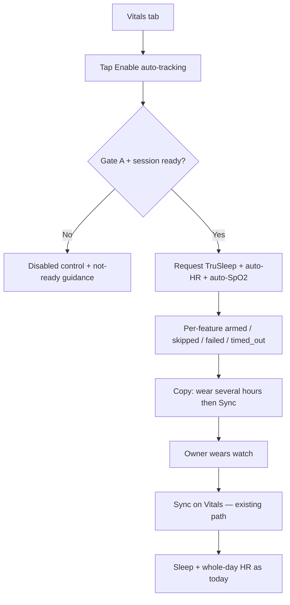

# Vitals: one-tap auto-tracking enable

## Summary

Add a single **Enable auto-tracking** control on the Vitals tab that arms the paired GT5 for automatic collection of **TruSleep, continuous heart rate, and SpO2** — the fixed FitnessData enable set for this cut — with honest per-feature outcomes. The button is an arm ritual and status surface, not a SpO2/stress dashboard; Sync remains the path that pulls sleep + whole-day HR into Vitals. Soft enables inside Sync stay as a fallback and must not overwrite or contradict the last explicit Enable result.

Related product context: Vitals tab (sleep + whole-day HR) already exists; Sync already soft-requests TruSleep + auto-HR as a side effect (not SpO2). Catalog honesty (`docs/catalogs/gt5-a07-full-metrics.md`) and FitnessData wire-spec (`docs/wire-specs/huawei-br-gt5-fitness-data.md`) define known enables vs matrix-only claims.

---

## Problem Frame

Whole-day HR often stays empty after Sync for several reasons: soft enables for TruSleep/auto-HR are easy to miss, SpO2 is never soft-enabled today, and Enable failures are collapsed into a single Sync `enableSkipped` flag. Owners need one obvious control that requests the known auto-track enables, shows what actually armed, and teaches the wear → Sync path — without implying Enable alone guarantees non-empty series (fresh HR consent may not backfill; emission can still be absent after wear).

Matrix-advertised metrics (stress, HRV, arrhythmia, PAI, emotions) are catalog honesty constraints for this cut, not live Vitals toggles. The companion must not claim they are on.

---

## Actors

- A1. Owner: Sole user; uses Vitals to arm tracking and later Sync history
- A2. Watch (GT5-A07): Receives enable requests; may accept, skip (unsupported), fail (NACK/error), or time out per feature
- A3. Companion session: Gate A–ready encrypted link required before enables run

---

## Key Flows

- F1. One-tap arm
  - **Trigger:** Owner taps Enable auto-tracking on Vitals when Gate A has passed and an encrypted session is ready
  - **Actors:** A1, A2, A3
  - **Steps:** Acquire shared product Sync lock → request the fixed enable set → show per-feature and overall outcome → show wear → Sync next-step copy → leave existing sleep/HR lists unchanged
  - **Outcome:** Watch is armed for every enable that reached `armed`; owner sees skips/failures/timeouts; SpO2 `armed` means command-ack only (not shown in app yet)
  - **Covered by:** R1, R2, R3, R4, R5, R8, R13, R14

- F2. Not ready / busy
  - **Trigger:** Session not ready, or Sync/Enable/workout Sync already in flight
  - **Actors:** A1, A3
  - **Steps:** Do not send enable frames → Keep Enable visible but disabled when not ready (same pattern as Sync); if busy, reject with busy copy → prior arm state and Vitals history unchanged
  - **Outcome:** No silent mutation; no wipe of Vitals stores
  - **Covered by:** R2, R6, R11, R15

- F3. Wear then Sync (existing)
  - **Trigger:** After a successful or partial arm, owner wears the watch and uses Vitals Sync
  - **Actors:** A1, A2
  - **Steps:** Unchanged Sync path pulls sleep + whole-day HR; Sync soft-enables remain fallback only when no successful explicit arm exists for that feature this pairing
  - **Outcome:** Interval HR may appear after wear; empty HR copy respects last Enable outcome (AE5)
  - **Covered by:** R9, R10, R16

- F4. Re-arm
  - **Trigger:** Owner taps Enable again after a prior run (success, partial, or failure)
  - **Actors:** A1, A2, A3
  - **Steps:** Idempotent full-set re-request when ready; idle copy reflects last run without claiming live watch state
  - **Outcome:** New last-run panel replaces the previous one
  - **Covered by:** R17

---

## Requirements

**Control and placement**
- R1. Vitals tab exposes one **Enable auto-tracking** control distinct from Sync. Placement: Enable above Sync as the arm action; Sync remains the history pull. Status strip / last-run panel sits under Enable — not a metric dashboard
- R2. Enable is always visible when a paired device exists; **disabled** with not-ready guidance until Gate A has passed and an encrypted session is ready (no watch writes). Match Sync’s disabled + blocked-message pattern
- R3. One tap requests the **fixed** armable enable set for this cut (R8) without per-feature toggles

**Honesty and outcomes**
- R4. After the run, UI shows overall result plus **per-feature** outcome using: `armed` | `skipped` (unsupported / no capability) | `failed` (explicit NACK/error) | `timed_out` (no response). Overall: all armed | partial | none armed
- R5. Never claim success for a feature the companion did not successfully arm. Never imply matrix-only metrics (stress, HRV, arrhythmia, PAI, emotions — catalog matrix-only list) are on. This cut does **not** attempt those metrics
- R6. If Sync, workout Sync, or Enable is in flight, the other rejects immediately as busy — do not queue silent retries. Product rule only; implementation uses the **shared** Sync single-flight lock (native SoT)
- R7. Partial success is allowed: some features armed, others skipped/failed/timed_out; overall status reflects partial, not fake all-ok
- R13. While Enable is running: Enable shows in-progress copy and is disabled; Sync is also busy/disabled; leaving the tab does not cancel; completion replaces running with the last-run panel
- R14. After success or partial: always surface next-step copy — wear for several hours, then Sync; Enable never implies series appear immediately; note fresh auto-HR may not backfill historical minutes
- R15. Busy, not-ready, and Enable error paths leave Vitals sleep/HR stores untouched
- R16. Empty Sync copy precedence: if last Enable reported auto-HR `armed` → empty HR uses wear/emission copy (not “enable failed”); if Enable skipped/failed/timed_out for auto-HR → point owner to Enable; if never Enable-run → prompt Enable before blaming emission. Sync soft-enable must not clear or contradict last Enable per-feature outcomes
- R17. Re-tap always allowed when ready (full-set idempotent retry). Idle copy reflects last run (“Last enable: partial — tap to retry”) without claiming live watch state. No separate “already on” detection this cut

**Enable set (product contract)**
- R8. This cut’s enable set is **exactly**: TruSleep, auto continuous HR, and auto SpO2. All three are **mandatory attempts** when ready; honest `skipped` / `failed` / `timed_out` are allowed. Skin temp and other wire-known enables are **out** of this button until a new requirements delta. Planning verifies payloads, caps, and result-code mapping — not set membership
- R9. Soft enables that already run inside Sync remain as a **fallback** only when no successful explicit arm exists for that feature this pairing; they must not replace the explicit Enable control, hide Enable failures, or imply SpO2 was soft-armed (Sync does not soft-enable SpO2 today)
- R10. This cut is **arm-only**: Enable does not fetch or persist SpO2 / stress / HRV / arrhythmia series into Vitals UI. Sync continues to show sleep + whole-day HR only. SpO2 `armed` is command-ack only with copy that it is not shown in the app yet

**Safety and privacy**
- R11. Enable runs require the same readiness bar as Sync (Gate A + session). Forget Device is blocked while the shared Sync/Enable lock is held; on successful Forget, clear persisted last-enable status
- R12. Logs and experiments record enable command presence / result codes only — never commit full vitals series from enable probing
- R18. Persist last Enable overall + per-feature outcomes across app restarts until a newer run or Forget. UI claims “last enable result,” not durable live watch state (reconnect re-arm is deferred)

---

## Success Criteria

- When session is ready, one Vitals control **attempts** TruSleep + auto-HR + auto-SpO2 and reports per-feature `armed` / `skipped` / `failed` / `timed_out` (all three `armed` is the happy path, not a day-1 guarantee if the watch soft-skips)
- SpO2 appears in the enable-result list when attempted; if `armed`, copy states tracking was requested on the watch and is not shown in Vitals yet
- After arm + wear + Sync, empty whole-day HR is not blamed on a failed Enable when auto-HR reported `armed` (AE5); Enable success/partial always teaches wear → Sync
- UI never shows stress / HRV / arrhythmia / PAI / emotions as enabled
- Busy / not-ready / error paths never mutate the watch incorrectly or wipe Vitals history
- Sync soft-enable no longer collapses Enable’s distinct failures into a single ambiguous story that hides the last explicit Enable result

---

## Scope Boundaries

**In scope**
- One Enable auto-tracking CTA on Vitals (above Sync) + durable last-run result panel
- Fixed enable set: TruSleep, auto-HR, auto-SpO2 with per-feature honest outcomes
- Shared product Sync lock + FeatureUpload hard-off for the Enable critical section
- Empty-state / Sync copy precedence vs last Enable
- Persist last-run status until Forget or newer run

**Out of scope / non-goals**
- SpO2, stress, HRV, arrhythmia, PAI, or skin-temp **product charts** on Vitals
- Live / realtime HR overlay
- Auto-enable on every reconnect without owner action
- Turning on features only available through Huawei Health settings UI with no companion command
- Attempting matrix-only metrics (stress, HRV, arrhythmia, PAI, emotions) on this CTA
- Skin temp or other non-must FitnessData enables on this CTA
- Claiming catalog score promotions from enable alone (still needs wear + Sync capture budgets)
- Guaranteeing non-empty HR/SpO2 series from Enable alone
- iOS / Huawei Health SDK

### Deferred for later
- Expanding Vitals UI to display SpO2 (and other) series after Sync
- Re-arm on reconnect if the watch drops enables
- FeatureUpload / health-feature package negotiation — research only if required to arm TruSleep, auto-HR, or auto-SpO2; otherwise stay deferred
- Skin temp enable and any additional wire-known enables (new requirements delta)

### Outside this product's identity
- Derivation / analytics platform over vitals streams
- Medical claims for arrhythmia / pulse-wave detection

---

## Key Decisions

- **Arm-only, not a new dashboard:** Enable turns tracking on; Sync remains the history path; Vitals display stays sleep + whole-day HR; SpO2 arm is intentional prep with “not shown in app yet” copy
- **Fixed three-feature set:** TruSleep + auto-HR + auto-SpO2 only. No planning-time expansion; matrix features hard-excluded this cut
- **Primary problem = discoverability + honesty:** Soft Sync enables already exist for TruSleep/HR; this cut makes arming explicit, adds SpO2 attempt, and separates outcome honesty — it does not guarantee empty-HR disappears
- **`armed` = confirmed enable ACK:** Planning defines RESULT_OK / equivalent per command; do not treat “any response frame” as armed. Prefer under-claim over over-claim
- **Shared Sync lock:** Enable shares the existing product Sync single-flight lock and FeatureUpload hard-off; sibling lock is not an option
- **Disabled when not ready:** Match Sync — visible, disabled, guidance — not a tap-to-reject path
- **Last-run persists across restarts:** Status is “last enable result,” not live watch state; reconnect re-arm deferred
- **Explicit Enable SoT over Sync soft-enable:** Soft enable is fallback only when no successful explicit arm for that feature this pairing
- **Partial success OK:** Prefer arming what we can over failing the whole batch when one feature skips

---

## Alternatives Considered

| Approach | Why not chosen |
|----------|----------------|
| Rely only on Sync soft-enables | Easy to miss; SpO2 never attempted; Failed collapsed into `enableSkipped` |
| Per-feature toggles for every metric | Higher carrying cost; owner asked for one button |
| Also ship SpO2 UI this cut | Separate product surface; expands Sync persist scope; deferred |
| Drop SpO2 until display cut | Rejected — owner wants SpO2 tracking armed now; accept command-ack-only honesty |
| Open-ended “any wire-known enable” | Scope hatch; freeze to three commands |
| Sibling lock for Enable | Conflicts with native Sync single-flight / radio serialization |

---

## Acceptance Examples

- AE1. Gate A ready → tap Enable → TruSleep, auto-HR, and auto-SpO2 each report `armed` or honest `skipped` / `failed` / `timed_out` → sleep/HR lists unchanged until Sync → next-step wear copy shown
- AE2. Session not ready → Enable visible but disabled with not-ready guidance; no enable frames sent
- AE3. Sync in flight → Enable busy/disabled; Sync continues; no overlapping enable
- AE4. Auto-SpO2 skips, TruSleep + HR arm → overall partial; UI does not show all-ok; SpO2 row does not claim app display
- AE5. After auto-HR `armed` + multi-hour wear → Sync may still show empty HR if watch emitted none; copy uses wear/emission language, not “enable failed”
- AE6. Enable in flight → Sync rejects as busy with “wait for enable” copy
- AE7. Mid-batch disconnect → overall partial/failed with truth for completed features; remaining marked `failed` or `timed_out`; prompt reconnect then retry Enable
- AE8. Forget Device while Enable running → blocked until idle; after Forget, last-enable status cleared

---

## Dependencies / Assumptions

- Vitals tab + `syncActivity` already ship (sleep + whole-day HR)
- FitnessData enable commands for TruSleep (`0x16`), auto-HR (`0x17`), and auto-SpO2 (`0x24`) are the fixed set; planning verifies payloads/caps/RESULT_OK mapping against GT5-A07
- Catalog scores stress/HRV/emotions/PAI/sleep RR as matrix-only (**0**) until a captured frame — product UI must not contradict that
- Fresh auto-HR consent may not backfill historical minutes; owner still needs wear time after arm (existing wire-spec note)
- Existing Sync `requestEnable` collapses outcomes too aggressively for R4 — Enable needs distinct result parsing (planning)

---

## Outstanding Questions

### Resolve Before Planning
- None — product policy settled in Key Decisions (fixed set, arm-only SpO2 prep, shared lock, disabled-when-not-ready, persisted last-run)

### Deferred to Planning
- [Affects R4, R8][Needs research] Exact enable request/response shapes, capability-bit preconditions, and RESULT_OK (or equivalent) mapping for TruSleep / auto-HR / auto-SpO2 — define operational `armed`
- [Affects R8][Needs research] Whether FeatureUpload health packages are **required** to arm TruSleep, auto-HR, or auto-SpO2 (blocking only); otherwise leave FeatureUpload alone
- [Affects R4][Technical] Dedicated enable API vs extending Sync helper — must return distinct per-feature outcomes (not Sync’s collapsed `enableSkipped`)
- [Affects R1][Technical] Exact layout tokens within existing Vitals screen (status strip vs compact list under Enable) without inventing metric cards

---

## Next Steps

-> `/ce:plan` for structured implementation planning against this requirements doc
