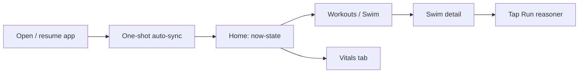

# Fathom — Companion Brand, IA, and Productization Requirements

## Summary

Rename and productize the GT5 companion as **Fathom**: a calm, local-first sports analytics companion that starts with swim depth (Evidence → Diagnosis → Recommendation → on-device reasoner) and stays sport-agnostic as Run/Strength arrive later. This cut locks brand, Home IA, auto-sync posture, swim detail behavior, and chart direction — without requiring always-on background sync theater.

---

## Problem Frame

Swim Bible analytics (W0–W4) and Qwen3 on-device reasoning already work. The gap is companion productization: a coherent brand, a calm Home that answers “what’s true now,” and a design system that can carry multi-sport without becoming a dashboard.

Working name “Fitness OS” no longer matches positioning. Charts and Home prototypes exist under `docs/design/home-prototype/`; Flutter UI is not yet restyled.

---

## Locked Decisions

### Brand
- **Name:** Fathom (locked)
- **Tone:** instrument / analyst — depth, measure, understanding
- **Positioning:** calm companion for session truth, not a loud coach dashboard
- **Sport scope:** swim-first product; brand remains sport-agnostic

### Logo / motif — LOCKED 2026-07-25 (owner + Design Head)
- **Wordmark:** geometric SVG **Fa** + owner Discobolus asset as the **T** + **hom** (`docs/design/assets/discobolus.png`, oval base kept, watermark text removed)
- Discobolus shares the Fa/hom letter line box (baseline-aligned); light letter-spacing between **a · mark · h** (`margin: 0 0.12em` on the mark slot)
- **Splash (playable):** Discobolus enters → settles to letter height as T → Fa/hom assemble → hold (`docs/design/logo.html`)
- **App icon:** bold letter **F** only — never the athlete
- Tone: subtle mythic, premium instrument — not cartoon, crypto, or purple-glow AI slop

**Design Head constraints (still apply)**
1. Mark remains readable at small sizes; athlete-as-T must not hurt word legibility
2. Figure is the T in the wordmark / splash — not a competing everyday icon
3. Prefer flat single-colour treatment for chrome; source asset may carry highlight lines

**Production constraints**
1. Primary wordmark identifiable at 16–24 px height
2. Document and enforce minimum clear space + min reproduction size
3. Canonical review surface: `docs/design/logo.html`

### Information architecture
- Bottom tabs: **Home | Vitals | Workouts**
- Workouts: top sport tabs (Swim now; Run / Strength later)
- **Home = calm “now” mix only:**
  - sync / connected health
  - vitals snapshot
  - one swim takeaway
  - today’s totals (calories, steps, workout time)
- **Home never:** graphs, vitals history, full diagnosis lists, reasoner settings

> **Supersession (2026-09-12):** Conflicting Home bullets above (swim-only takeaway; absolute never-graphs; KPI strip without multi-sport entry) yield to [`docs/brainstorms/2026-09-12-home-today-instrument-requirements.md`](../brainstorms/2026-09-12-home-today-instrument-requirements.md). Home is now a **Today instrument stack**: sleep → totals → body HR (≤1 tiny spark) → multi-sport session cards. Hypnogram, workout charts, calendars, diagnoses, reasoner, food, and composite scores remain off Home.
- **Swim detail:** identity + P0 + session charts + table + diagnoses + allow-listed recs; Reasoner via primary **Run reasoner** on click (not always open); invent-guard on laps by default

### Sync posture
- Auto-sync once on **open / resume / session-ready**
- **No** sticky foreground service / always-on tray for this cut (deferred)

### Charts / swim session analytics — LOCKED 2026-07-25 (owner + Product Head)
- **Canonical review surface:** `docs/design/swim-analytics.html` (+ hub `docs/design/index.html`)
- Charts live on **swim session detail** only — never as Home analytics graphs (Home may show one tiny today-HR spark per 2026-09-12)
- Stack (order locked): Pace bars → SWOLF area → Strokes bars → Pace+SWOLF normalized overlay; HR only if samples exist
- Session surface (top→bottom): Identity → P0 signals → charts → interval table → diagnoses → allow-listed recommendations → **Run reasoner** (on demand, never auto)
- Invent-guard: garbage laps **hidden by default** from P0 / charts / table; visible **Include filtered laps** toggle; all three stay synchronized
- Overlay: 0–1 normalized; rising pace = deterioration (no ambiguous dual-axis)
- Prefer Vortex-style mixed charts + activity calendar as later follow-through; research samples under `docs/design/chart-samples/` and `home-prototype/charts.html`
- Flutter follows this package (thin charts already on workout detail)

### Platform / stack (inherited locks)
- Direct LPv2 only; Health Kit dropped
- On-device reasoner: Qwen3 0.6B with offline rule fallback
- Invent-guard on recommendation IDs

---

## Actors

- A1. Owner — sole user; GT5-A07 + Android phone
- A2. Watch (GT5-A07) — workout + vitals source via LPv2
- A3. On-device reasoner — Qwen3 or offline rules; never invents rec IDs

---

## Key Flows

- F1. Launch / resume → one-shot sync → Home “now”
- F2. Home glance → today’s totals + one swim takeaway + connection health
- F3. Workouts → Swim list → swim detail (signals first; reasoner on demand)
- F4. Splash brand moment (Discobolus → T → Fathom) on cold start only

---

## Requirements

**Brand**
- R1. Product surfaces use the name **Fathom** (not Fitness OS) in user-visible chrome
- R2. Splash may use the full Discobolus→T motif; app icon and in-app marks remain wordmark-led
- R3. Brand assets stay sport-agnostic (no swim-only icon as the primary mark)

**Home**
- R4. Home shows connection/sync health, a vitals snapshot, one swim takeaway, and today’s totals
- R5. Home must not show graphs, vitals history, diagnosis lists, or reasoner settings
- R6. Home period stays Today-only for this cut

**Workouts / Swim**
- R7. Workouts uses top sport tabs; Swim is the only populated sport tab initially
- R8. Swim detail leads with identity + key signals; raw intervals are collapsed by default
- R9. Reasoner runs only after an explicit primary action (e.g. Run reasoner)

**Sync**
- R10. App triggers at most one automatic sync pass on open, resume, or session-ready
- R11. Sticky always-on FGS / persistent tray sync is out of scope for this cut

**Charts / DS**
- R12. Analytics screens prefer mixed-chart composition + activity calendar patterns already researched
- R13. Visual language follows pool-night DS (mint/amber accents, calm density) already prototyped

---

## Non-Goals

- Always-on background sync / sticky FGS
- Multi-sport content beyond Swim tab scaffolding
- Replacing Qwen3 reasoner or reopening Health Kit
- Reopening locked logo / Home IA / swim analytics package without an explicit owner unlock
- Redesigning Vitals history depth on Home

---

## Success Criteria

- Owner can explain Fathom’s job in one sentence: calm companion for what’s true now
- Home answers “now” without scrolling into analytics theater
- Splash communicates mythic/instrument tone; everyday icon remains legible wordmark-led at small sizes
- Auto-sync feels present on open without a permanent tray service
- Swim detail matches locked analytics package (charts + invent-guard + on-demand reasoner)
- Requirements are sufficient for Flutter productization execution

---

## Open / pending

- **None — design package LOCKED (owner 2026-07-25).** Covers logo/splash, Home IA + six states, design system tokens, and swim session analytics (`swim-analytics.html`). Flutter execution may proceed against these locks.

## Design Head plan review (2026-07-25)

**APPROVED WITH CHANGES** — see `docs/plans/2026-07-25-001-feat-fathom-brand-ia-productization-plan.md`

Must-fixes carried into plan: Home state precedence, frozen tab ownership, branding as design tokens; U4 before Home data trust; continuous prototype alignment.

---

## References

- Prototype: `docs/design/home-prototype/`
- Chart research: `docs/design/swim-graphs-research.md`, `docs/design/chart-samples/`
- Roadmap: `docs/plans/2026-07-23-001-product-roadmap-swim-bible-v0.md`
- Reasoner lock: `docs/plans/2026-07-24-002-qwen3-on-device-reasoner-lock.md`
