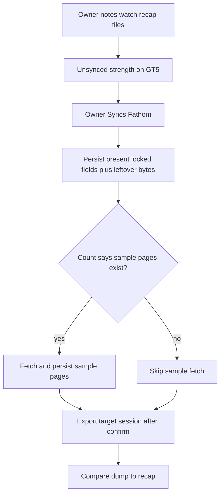

# GT5 strength session metrics — fetch, persist, export

## Summary

Sync the unsynced GT5 strength session so Fathom persists every locked session field that is actually present, plus leftover Totals bytes and (when Count says so) in-session HR samples. Recovery % and time-in-zone stay prove targets in the export, not session-truth tiles. A dedicated strength export is the prove artifact. Health stays closed.

---

## Problem Frame

Fathom’s Strength tab lists GT5 sessions (`type=140`) with duration and active calories. After a real session the watch recap also shows heart rate, zones, training load, training stress, recovery time, and a recovery figure that looks like a percent. The owner cannot open Huawei Health to compare — that bind wipes Fathom. Community catalogs already name load, recovery time, training stress (aerobic / anaerobic effect), and recovery-HR as session fields, but they were never confirmed on this watch, and Fathom currently drops unnamed Totals payload. Strength therefore looks calorie-only even when the watch may have sent more.

A later strength analytics screen is blocked on honesty: we do not yet know which recap tiles are on the wire, which can only be rebuilt from samples, and which are watch-only. This cut stops payload loss and yields one-session evidence. It does not close that question if this session has no samples or no leftover percent.

---

## Actors

- A1. Owner-athlete: Completes strength on the GT5, syncs Fathom, records recap tiles, judges the export against the watch recap
- A2. GT5-A07: Holds at least one unsynced strength session plus already-synced history
- A3. Fathom companion: Workout sync, persist, existing session detail, strength export

---

## Key Flows

- F1. Prove fetch on the unsynced session
  - **Trigger:** Owner runs workout Sync while the unsynced strength session is still on the watch
  - **Actors:** A1, A2, A3
  - **Steps:** Owner notes recap tiles → Sync → persist present locked Totals scalars + leftover bytes → fetch sample pages only if Count says they exist → persist those samples locally → owner exports the target session → compare dump to recap
  - **Outcome:** Export contains decoded locked fields that were present, leftover bytes for a recovery-% hunt, and samples or an honest “no sample pages” flag. Recovery % and zone minutes are not promoted to session-truth UI in this cut
  - **Covered by:** R1–R16
  - **Escape:** If Count/Totals fail, the watch dropped the session, or the companion bind is lost, the outcome is blocked/empty — not “fields proven absent.” Sample-page timeout must still keep Totals + leftovers.

---

## Requirements

**Fetch and persist**
- R1. Workout Sync must pull the unsynced strength session without requiring Huawei Health.
- R2. When Totals arrive for a strength session, persist each **locked Totals** field that is present; omit if absent. Do not require every locked name to appear.
- R3. Unnamed leftover Totals payload must be persisted **on-device as opaque bytes** so a later parse does not need a second watch fetch. Unnamed Totals keep is on the shared workout parser (not a strength-only fork). Git, logs, Sentry, and fixtures record identity/length only.
- R4. Keep the existing hint-gated sample fetch: request sample pages only when Count says they exist. Do not add a force-pull of empty Data/Pace. If those pages are fetched, persist the HR sample points on-device (not only page headers).
- R5. If sample-page fetch times out or is partial, still persist Totals scalars and leftover bytes. Do not drop the session or treat missing samples as proof that locked Totals fields were absent.
- R6. Set/rep breakdown is not expected and must not be invented if absent.

**Locked vs prove vs out**

| Metric | This cut | Honesty rule |
|--------|----------|----------------|
| Start / end / duration / session id | Locked Totals — persist if present | Already shown; already proven on GT5 strength |
| Active calories | Locked Totals — persist if present | Already shown in Fathom |
| Distance / steps | Locked Totals — persist if present | Often empty for indoor strength; empty is honest |
| Session HR min / max (peaks) | Locked Totals — persist if present | May show on existing detail (already a detail surface) |
| Session HR average | Locked samples — persist if samples exist | Derived from sample stream, not Totals peaks; export-only this cut |
| Training load | Locked Totals — persist if present | Export-only until recap confirms the mapping on this session |
| Training stress (aerobic / anaerobic effect) | Locked Totals — persist if present | Same as load. Canonical name; not a separate “training effect” field |
| Session recovery time | Locked Totals — persist if present | Per-session time-to-recover. Not rolling Workout-status recovery. Export-only until recap confirms |
| Training points | Locked Totals — persist if present | Persist if present; omit if absent; export-only until recap confirms |
| Recovery-HR blob (post-session HR) | Locked Totals — persist if present | Keep; do not chart this cut |
| In-session HR samples | Locked samples — fetch and persist if Count says pages exist | Needed for later zone analysis; not a detail chart this cut |
| Recovery % | Prove target | Hunt leftover **bytes** for a native session-scoped value. Never convert recovery time into a percent. If the recap figure is rolling Workout-status recovery, that tile is Out — leftover hunt must not be stretched to satisfy it |
| Time in HR zone | Prove target | No known native minutes field. This cut persists/exports samples; it does **not** reconstruct or label zone minutes as the watch’s. Reconstruction is post-export analysis |
| Rolling Workout-status recovery / 7-day load | Out | Watch-computed status, not this session’s export |
| Set / reps | Out | Expected absent on companion path |
| GPS / pace blocks / swim segments | Out | Not strength |

**Session truth vs invent**
- R7. This cut may show on existing session detail only fields Fathom already treats as session truth: duration, calories, and HR min/max peaks when decoded. Newly decoded community-named scalars (load, training stress, session recovery time, training points) stay in store + export until this session’s recap comparison confirms the mapping.
- R8. Recovery % must not appear in product UI this cut. A native leftover value, if found, is recorded in the prove dump as a candidate — not as the watch’s figure until recap confirms it is session-scoped.
- R9. Time-in-zone minutes must not appear in product UI this cut. If samples are missing, zone minutes are **unobserved this session**, not zero and not “watch does not send zones.”

**Export**
- R10. Owner must be able to export the **target** strength session from the Workouts strength path (a dedicated affordance). Default is that session, not the full strength history. All-sessions is an explicit extra action, not the default.
- R11. After a blocking confirm that the dump is sensitive non-anonymized health data, the export must include: decoded locked fields that were present, leftover **bytes** (so recovery % can be hunted offline), Count hints, and fetched HR samples or an honest “no sample pages” flag. Omit Huawei secrets, remembered MAC, and account id. Do not commit real exports to git.
- R12. Forget Device / companion wipe must delete leftover blobs, fetched sample pages, recovery-HR blobs, and any strength-export cache.

**Honesty**
- R13. Watch recap is the visual check. Huawei Health must not be opened for this work.
- R14. Companion honesty: a tile on the watch is not proof the field arrived over Bluetooth.
- R15. After one successful Totals pull, missing locked or prove fields are **unobserved this session**, not “GT5 strength never sends them.” Analytics stays blocked if this session has no samples and no leftover percent.
- R16. Companion bind loss (Health or another companion taking the watch) is the same blocked/empty outcome as Totals fail — not a claim that load/recovery were absent.

---

## Acceptance Examples

- AE1. **Covers R1, R2, R7.** Given an unsynced strength session, when the owner Syncs, Fathom stores duration, calories, HR min/max if present, and any other locked Totals fields that were present. Existing detail still shows duration/calories/HR peaks only; load / training stress / recovery time appear in the export, not as new truth tiles.
- AE2. **Covers R4, R9.** Given Count reports no sample pages, when Sync completes, Fathom does not force-fetch Data, and time-in-zone is unobserved this session — not a row of zeros.
- AE3. **Covers R3, R8, R11.** Given Totals contain unnamed leftover bytes, when the owner confirms and exports the target session, the dump includes those leftover bytes so recovery % can be hunted, and product UI shows no recovery %.
- AE4. **Covers R10, R11.** Given the target session is stored, when the owner uses the strength export affordance, they get that session’s dump after a sensitive-health confirm, without opening Reasoner settings, and without defaulting to all history.
- AE5. **Covers R4, R9, R11.** Given Count reports sample pages and HR samples persist, when the owner exports, the dump includes the samples (or equivalent points) so zone minutes can be reconstructed **offline**. Fathom does not label zone minutes as the watch’s.
- AE6. **Covers R5, R15, R16.** Given sample fetch times out after Totals succeeded, when Sync completes, locked Totals fields and leftovers remain stored; missing samples are unobserved this session, not proof that load/recovery were absent.
- AE7. **Covers F1 escape, R1, R16.** Given the watch dropped the unsynced session, Totals fail, or the companion bind is lost, when Sync completes, the outcome is blocked/empty, not a claim that load/recovery were proven absent.

---

## Success Criteria

- After one Sync of the unsynced session, the owner can export that session and see locked fields that were actually present — not calories-only because unnamed payload was dropped.
- Recovery % and time-in-zone have an honest **evidence** outcome each (native leftover candidate, samples available for later reconstruction, or unobserved this session) — never invented in UI.
- A downstream planner can implement without inventing: persist-if-present vs prove-target, hint-gated samples, leftover bytes vs git redaction, Health off-limits, export as the UI gate, existing detail does not gain unconfirmed community scalars.
- One empty session does not unlock a strength analytics screen.

---

## Scope Boundaries

- In scope: strength (`type=140`) persist-if-present of locked Totals fields; on-device leftover bytes; hint-gated sample persist; target-session export; prove evidence for recovery % and zone minutes; existing detail only for already-shown scalars
- Deferred: swim-class strength analytics (charts, zone UI, session-truth redesign) until export analysis
- Deferred: in-app zone reconstruction and labeling reconstructed minutes as the watch’s
- Deferred: showing load / training stress / session recovery time on session detail until recap confirms this session
- Deferred: using load/recovery to plan tomorrow’s hard/easy/rest
- Deferred: a second strength session if this one has no samples and no leftover percent
- Out: Huawei Health / HMS as oracle or SDK
- Out: set/rep breakdown UI
- Out: force-pull of empty Data/Pace
- Out: live HR overlay, iOS, other sports’ enrichment as part of this cut
- Out: inventing recovery % from recovery time; treating rolling Workout-status recovery as this session’s leftover hunt

---

## Key Decisions

- **Prove-then-show:** Fetch, persist, and export first. A new strength analytics surface waits on the dump. Existing detail does not inherit unconfirmed community names from the calories pattern.
- **Hint-gated samples:** Keep the existing Count gate; persist what that fetch already returns, including HR points.
- **Health stays closed:** Watch recap is the only visual check; Health would wipe the Fathom bind. Recap match is a one-shot owner comparison on this session, not a standing product rule for every future workout.
- **Session recovery time vs status recovery:** Locked field is per-session recovery time. Rolling Workout-status recovery / 7-day load is Out. Recap “recovery %” is unidentified until leftover hunt or owner notes say otherwise.
- **Zones:** Community parsers rebuild zone minutes from samples; this cut only retains samples. Reconstruction stays post-export.
- **Target-session export:** Dedicated Strength-path affordance after a health-data confirm. Default the unsynced/target session so the prove dump is shareable without dumping all history.
- **On-device bytes vs shareable dump:** Leftover bodies and HR samples may leave the device only in that owner-confirmed dump. Git/logs/Sentry/fixtures stay identity/length (and sample counts), never series.

---

## Dependencies / Assumptions

- An unsynced strength session is still on the GT5-A07 at Sync time (owner-stated). If the watch dropped it, F1 is blocked. Already-synced rows only gain leftover-keep if that Sync actually re-fetches their Totals — do not assume history is re-pulled.
- Community field names (load, session recovery time, training stress / aerobic / anaerobic effect, training points, recovery-HR, HR peaks) are the persist-if-present set; exact wire mapping is a planning concern and must stay clean-room (no AGPL paste).
- Zone reconstruction (later) may disagree with the watch if zone thresholds were set in Health and never written back. That is mismatch/unobserved, not a reason to open Health.
- Companion privacy: do not commit HR series, leftover bodies, recovery-HR series, or GPS to git, logs, Sentry, or fixtures.

---

## Outstanding Questions

### Deferred to Planning

- [Needs research] Whether this GT5 firmware puts a native session-scoped recovery-% value in leftover Totals, or only recovery time.
- [Needs research] Whether Count on the unsynced strength session reports sample pages.
- [Technical] On-device store for leftover bytes and HR sample points (must survive Forget wipe; must not be prefs-stripped).
- [Technical] Whether the Strength-path CTA wraps the existing app-data export filtered to the target session, or a narrower prove JSON — either must meet R11 redaction and confirm.
- [Needs research] Which recap tiles were visible on this session (owner notes) so leftover hunt is not used to explain a Workout-status % tile.
