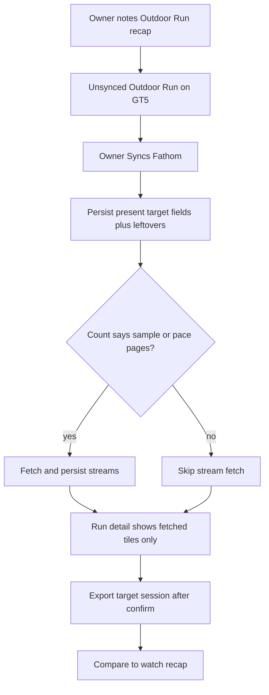

# GT5 running session metrics — fetch, Run summary, AI export

## Summary

Sync an Outdoor Run from the GT5 so Fathom persists every present field among the 15-tile target list, shows those fetched tiles (and pace/HR charts when the matching streams exist) on the existing Workouts Run path, and offers a session export for AI analysis. Missing tiles stay omitted. Session recovery is this-run recovery time plus aerobic/anaerobic training stress (and session load if present). Rolling Workout status and AI coaching stay out.

---

## Problem Frame

After an Outdoor Run the GT5 recap shows VO2 max, recovery time, training stress (aerobic and anaerobic), vertical oscillation, ground contact time, training load, splits, pace charts, in-run heart rate, heart-rate zones, altitude, cadence, steps, average stride, and balance. Today the owner only reads that recap on the watch. Fathom’s Workouts Run tab already lists run sessions, but session detail stays thin (duration / distance / steps / HR peaks when present). Community catalogs and Gadgetbridge docs name many of these as companion Totals or WorkoutData fields; official Health Kit does not expose most of them and opening Huawei Health would wipe the Fathom bind. Outdoor Run is still unobserved on this watch, so wire presence is unknown. Without a faithful off-wrist summary and an exportable session dump, recovery and form insight cannot leave the wrist, and later AI coaching has nothing honest to consume.

---

## Actors

- A1. Owner-athlete: Completes Outdoor Run on the GT5, notes recap tiles, Syncs Fathom, reviews Run summary, exports for AI
- A2. GT5-A07: Holds at least one unsynced Outdoor Run plus history
- A3. Fathom companion: Workout sync, persist, existing Run tab + session detail, run-session export

---

## Key Flows

- F1. Outdoor Run Sync → Run summary → AI export
  - **Trigger:** Owner Syncs while an unsynced Outdoor Run is still on the watch
  - **Actors:** A1, A2, A3
  - **Steps:** Owner notes watch recap tiles → Sync → persist present target Totals fields + leftover bytes → fetch sample and pace pages only if Count says they exist → persist those streams → Run detail shows only fetched target tiles/charts → owner exports the target session after sensitive-health confirm → compare dump/summary to recap
  - **Outcome:** Run detail and export reflect whatever of the 15-tile list actually arrived; missing tiles omitted / unobserved; Outdoor type frozen from Totals; Health never opened
  - **Covered by:** R1–R18
  - **Escape:** If Count/Totals fail, the watch dropped the session, or companion bind is lost → blocked/empty, not “tiles proven absent.” Partial sample/pace fetch still keeps Totals + leftovers.

---

## Requirements

**Fetch and persist**
- R1. Workout Sync must pull the unsynced Outdoor Run without requiring Huawei Health.
- R2. When Totals arrive for an Outdoor Run, persist each **target Totals** field that is present; omit if absent. Do not require every name in the 15-tile list to appear.
- R3. Unnamed leftover Totals payload must be persisted **on-device as opaque bytes** so later mapping (especially ambiguous load / form fields) does not need a second watch fetch. Leftover keep is on the shared workout parser. Git, logs, Sentry, and fixtures record identity/length only.
- R4. Keep hint-gated enrichment: request WorkoutData and Pace pages only when Count says they exist. Do not force-pull empty Data/Pace. Persist sample points and pace blocks on-device when fetched (not only page headers).
- R5. If sample or pace fetch times out or is partial, still persist Totals scalars and leftover bytes. Do not drop the session or treat missing streams as proof that Totals tiles were absent.
- R6. Freeze Outdoor Run type from on-device Totals for this prove session (catalog type conflict stays unresolved until that freeze).

**15-tile target list (this cut)**

| Watch tile | Expected surface (community / official) | This cut |
|------------|-------------------------------------------|----------|
| VO2 max | Totals VO2-like / maxMET | Persist + show if present; omit if absent |
| Recovery time | Totals session recovery time | Persist + show if present. Session-scoped only — not rolling Workout-status recovery |
| Training stress (aerobic + anaerobic) | Totals aerobic / anaerobic effect | Persist + show if present. Canonical name; not a separate “training effect” field |
| Training load | Totals session load (if present) | Persist + show if present as **session** load. Do not claim 7-day Workout-status load |
| Vertical oscillation | Unclear on companion path (may be newer form bit or watch-only) | Persist + show only if decoded; else omit / unobserved |
| Ground contact time | WorkoutData samples | Persist + show avg/series if samples present; omit if not |
| Splits | Pace blocks and/or derived from distance/time samples | Show when pace/sample data supports them; omit otherwise |
| Pace charts | Sample speed and/or Pace blocks | Chart only when stream fetched; no empty chart as “absent” |
| Heart rate during the run | WorkoutData HR samples | Chart/series when samples fetched; omit if Count says no pages |
| Heart rate zone | Totals zone type and/or native zone fields if present | Show only native fetched zone fields. Do **not** invent zone minutes as the watch’s |
| Altitude | Totals elev tags and/or sample altitude | Persist + show if present |
| Cadence | WorkoutData cadence / step rate | Persist + show if present |
| Steps | Totals steps | Persist + show if present |
| Avg stride | Sample step length / stride | Persist + show if present |
| Balance | Unclear (L/R landings or watch-only) | Persist + show only if decoded; else omit / unobserved |

**Run summary UI**
- R7. Use the existing Workouts **Run** tab and existing session detail — no new sport surface.
- R8. On Outdoor Run detail, show every target tile that was fetched/decoded for that session. Omit tiles that did not arrive. Never invent values to fill the 15.
- R9. Pace and in-run HR charts appear only when the matching streams were fetched. Missing streams → no chart (unobserved), not an empty series of zeros.
- R10. Heart-rate **zone minutes** must not be labeled as the watch’s unless a native minutes field was fetched. Sample-only sessions leave zone minutes unobserved in product UI (offline AI may still use exported samples).
- R11. Indoor Run sessions may still appear under the Run tab. They follow the same show-what-we-fetched rule; outdoor-leaning tiles (e.g. VO2, altitude) omitted when absent do not fail the Outdoor prove.

**Export**
- R12. Owner must be able to export the **target** Outdoor Run session from the Workouts Run path. Default is that session, not full run history. All-sessions is an explicit extra action, not the default.
- R13. After a blocking confirm that the dump is sensitive non-anonymized health data, the export must include: decoded target fields that were present, leftover bytes, Count hints, and fetched sample/pace data or honest “no pages” flags. Omit Huawei secrets, remembered MAC, and account id. Do not commit real exports to git.
- R14. Forget Device / companion wipe must delete leftover blobs, fetched sample/pace data, and any run-export cache.

**Honesty**
- R15. Watch recap is the visual check. Huawei Health must not be opened for this work.
- R16. A tile on the watch is not proof the field arrived over Bluetooth.
- R17. After one successful Outdoor Totals pull, missing target tiles are **unobserved this session**, not “GT5 never sends them.”
- R18. Companion bind loss is the same blocked/empty outcome as Totals fail — not a claim that recovery/form tiles were absent.

---

## Acceptance Examples

- AE1. **Covers R1, R2, R6, R8.** Given an unsynced Outdoor Run, when the owner Syncs, Fathom stores present target Totals fields, freezes Outdoor type from Totals, and Run detail shows those fields — omitting any of the 15 that did not arrive.
- AE2. **Covers R4, R9.** Given Count reports no sample or pace pages, when Sync completes, Fathom does not force-fetch Data/Pace, and pace/HR charts are absent (unobserved), not empty zeros.
- AE3. **Covers R4, R8, R9.** Given Count reports sample pages and HR/cadence/GCT persist, when the owner opens Run detail, in-run HR (and other present sample-backed tiles) appear; vertical oscillation and balance stay omitted if never decoded.
- AE4. **Covers R8, R10.** Given only HR samples and no native zone-minutes field, when Run detail renders, Fathom does not invent watch zone minutes; zone minutes remain unobserved in UI.
- AE5. **Covers R12, R13.** Given the target Outdoor Run is stored, when the owner uses the Run export affordance and confirms sensitive health data, they get that session’s dump (present fields + leftovers + streams or no-pages flags), not full history by default.
- AE6. **Covers R5, R17, R18.** Given sample fetch times out after Totals succeeded, when Sync completes, Totals fields and leftovers remain; missing charts/streams are unobserved this session, not proof recovery/load were absent.
- AE7. **Covers F1 escape, R1, R18.** Given the watch dropped the session, Totals fail, or bind is lost, when Sync completes, outcome is blocked/empty — not “tiles proven absent.”
- AE8. **Covers R11.** Given an Indoor Run later listed under Run, when detail opens, Fathom shows only fetched tiles for that session; omitted outdoor-leaning tiles do not invalidate the Outdoor prove.

---

## Success Criteria

- After one Outdoor Run Sync, the owner can open Fathom’s Run detail and see an off-wrist summary of whatever of the 15 tiles actually arrived — not calories/distance-only because payload was dropped.
- The owner can export that session for AI without opening Health, with leftovers and streams available for offline analysis.
- Missing tiles never appear as invented zeros or fake watch truth; each missing tile is omitted or explicitly unobserved.
- A downstream planner can implement without inventing: Outdoor-only prove, show-fetched summary, session vs rolling recovery/load, hint-gated streams, leftover keep, Health off-limits, export confirm/redaction.

---

## Scope Boundaries

- In scope: Outdoor Run prove; persist-if-present of the 15-tile target list; leftover Totals bytes; hint-gated sample/pace persist; existing Run tab + session detail summary of fetched tiles/charts; target-session AI export
- Deferred: rolling Workout-status training load and recovery-to-100%
- Deferred: AI coaching / improvement roadmap product (export enables later work)
- Deferred: inventing or labeling Fathom-derived zone minutes as the watch’s
- Deferred: requiring all 15 present before shipping the summary
- Deferred: Indoor as the Outdoor prove substitute
- Out: Huawei Health / HMS / Health Kit as oracle or SDK for this cut
- Out: new Run sport surface (reuse existing tab/detail)
- Out: force-pull of empty Data/Pace
- Out: live HR overlay, iOS, swim/strength enrichment as part of this cut
- Out: treating rolling Workout-status tiles as this session’s leftover hunt

---

## Key Decisions

- **Summary + export (Approach 1):** Show fetched target tiles on existing Run detail in the same cut as persist and AI export — not strength-style export-only for new scalars.
- **Show what we fetched:** The 15 tiles are the target checklist, not a completeness gate. Omit missing; never invent.
- **Outdoor-only first prove:** Type freeze and recap comparison use Outdoor Run. Indoor may list under Run with a thinner set.
- **Session recovery first:** This-run recovery time + aerobic/anaerobic training stress (+ session load if present). Rolling status is later (A now, A+B later).
- **Health stays closed:** Watch recap is the only visual check; Health would wipe the Fathom bind.
- **Charts gated on streams:** Pace/HR charts require fetched data; absence is unobserved, not empty proof.
- **Target-session export:** Run-path affordance after sensitive-health confirm; default the prove session.

---

## Dependencies / Assumptions

- An unsynced Outdoor Run is available on the GT5-A07 at Sync time (owner must seed if none exists). Catalog still marks Outdoor Run unobserved until this prove.
- Community / GB docs list companion paths for many form and recovery fields; official Health Kit running models are thinner and not usable here. Exact TLV mapping is a planning/clean-room concern (no AGPL paste).
- Vertical oscillation and balance may lack a named companion field on this firmware; unobserved is an acceptable outcome for those tiles.
- Watch “training load” may be session or 7-day status; this cut only surfaces session load when it arrives on the workout payload.
- Companion privacy: do not commit HR/form series, leftover bodies, GPS tracks, or real exports to git, logs, Sentry, or fixtures.

---

## Outstanding Questions

### Deferred to Planning

- [Needs research] Which of the 15 tiles appear on the wire for this Outdoor Run (Totals tags vs samples vs pace vs leftovers vs watch-only).
- [Needs research] Whether vertical oscillation maps to an existing sample field (e.g. swing-related) or a newer/unnamed bit — or is watch-only.
- [Needs research] Whether balance is L/R landing counts, a dedicated scalar, or watch-only.
- [Needs research] Whether session training load and training stress arrive as distinct Totals fields on this firmware.
- [Technical] On-device store for leftovers, sample points, and pace blocks (must survive Forget wipe).
- [Technical] Whether Run-path export wraps existing app-data export filtered to the target session or a narrower dump — either must meet R13 redaction and confirm.
- [Technical] How splits are presented when only Pace blocks vs only continuous samples arrive.
