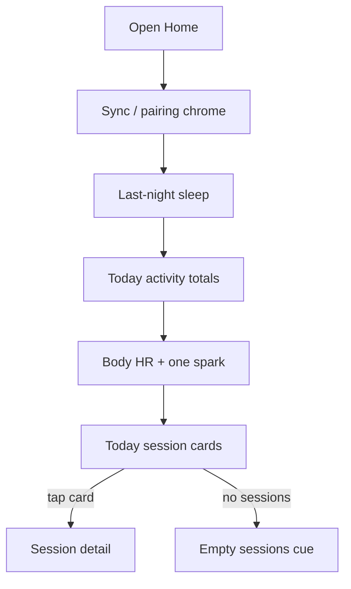

# Home — Today Instrument Revamp

## Summary

Revamp Fathom Home into a calm **Today stack**: last-night sleep, today’s activity totals, body HR (one tiny spark allowed), and multi-sport session cards with load/TE/recovery that open each session. This cut is an **instrument only** — honest attributable signals that can feed a future training + food decision model — not a planner, food advisor, or composite readiness score.

---

## Problem Frame

Home today is a thin “now” strip: sync chrome, calories/steps/workout time, min·avg·max HR, and a swim-only takeaway. Sleep, load/TE/recovery, run/strength sessions, and richer vitals already exist elsewhere (Recovery / Workouts), so the owner-athlete must bounce tabs to reconstruct “what today has been.”

The 2026-07-25 brand IA locked Home as calm now-state with a swim-first takeaway and a hard ban on graphs. That charter no longer matches the multi-sport product or the long-term need for a structured daily context surface a future model can read.

The pain is not missing sensors — it is missing a single honest day picture and multi-sport session entry on Home, without inventing coach scores the companion cannot ground.

---

## Actors

- A1. **Owner-athlete**: Sole user; opens Home for today’s picture and to enter sessions already done.
- A2. **Paired watch (GT5)**: Source of sleep, activity totals, HR, and workout sessions via sync (when paired and trusted).

---

## Key Flows

- F1. **Open Home — day picture**
  - **Trigger:** A1 opens or resumes the app on Home.
  - **Actors:** A1, A2 (via last sync)
  - **Steps:** Sync/pairing chrome resolves; Home renders Today stack from trusted local day data; missing blocks omit or show empty states without inventing values.
  - **Outcome:** A1 can answer “what today has been” without leaving Home for the summary layer.
  - **Covered by:** R1–R8, R12–R14

- F2. **Enter today’s session**
  - **Trigger:** A1 taps a today’s session card on Home.
  - **Actors:** A1
  - **Steps:** Navigate to that session’s existing detail (any sport present today); back returns to Home.
  - **Outcome:** Multi-sport entry from Home — not swim-only, not Workouts-tab-only.
  - **Covered by:** R9–R11

- F3. **Empty or partial day**
  - **Trigger:** No sessions yet, or some signal families missing after sync.
  - **Actors:** A1
  - **Steps:** Sleep / totals / HR still show when available; sessions area shows a clear empty cue; load/TE/recovery fields omit when absent (no fake zeros as claims).
  - **Outcome:** Home stays useful on rest days and early in the day.
  - **Covered by:** R8, R10, R13

---

## Requirements

**Today stack layout**
- R1. Home presents a single **Today** composition in fixed order: last-night sleep → today’s activity totals → body HR (optional one spark) → today’s session cards.
- R2. Home remains primarily **graph-free**: at most **one** tiny spark (today’s HR). No full charts, history lists, diagnosis lists, or reasoner settings on Home.
- R3. This revamp **supersedes** the 2026-07-25 Home charter items that conflict: swim-only takeaway; absolute “never graphs” (replaced by R2’s one-spark allowance); Home as KPI strip without multi-sport session entry.

**Sleep strip**
- R4. When last-night sleep is available, Home shows glanceable **duration** and **timing** (sleep window).
- R5. When a feel-on-wake answer already exists for that night’s session, Home may show it as a short attributable cue; do not add a new survey flow on Home in this cut.
- R6. Stage mix / hypnogram stay off Home (Recovery / sleep detail).

**Activity totals**
- R7. Home continues to show today’s **calories**, **steps**, and **workout time** from the existing trusted day totals path (or documented workout-sum fallback when totals are absent).
- R8. When a total is unavailable, omit or show an explicit empty state — do not invent population averages or “on track” claims in this cut.

**Body snapshot**
- R9. Home shows today’s HR snapshot as attributable numbers (min / avg / max or equivalent existing day rollup).
- R10. Home may include **one** tiny today-HR spark; no SpO₂ / stress / PAI on Home unless later honesty-proven and separately scoped.

**Today’s sessions**
- R11. Home lists **all** of today’s workouts across sports (not swim-only), each as a tappable card/row into that session’s detail.
- R12. Each session card shows identity cues (sport/type, key time or duration, and a primary distance/volume cue when relevant) plus **load / TE / recovery** fields **when present** on that session — plain numbers, not a composite score.
- R13. When there are no sessions today, Home shows a clear empty sessions state; sleep / totals / HR above remain when available.
- R14. Session cards replace the swim-only takeaway as the session entry path from Home.

**Instrument honesty (AI-ready foundation)**
- R15. Home shows **no** composite readiness, recovery, strain, or similar 0–100 (or opaque) scores in this cut.
- R16. Every Home metric must be attributable to a known local signal (sleep session, fitness totals, HR day rollup, or workout fields) — no invented coaching narrative that cannot be traced to those signals.
- R17. Copy may label missing data as missing; it must not imply a future planner or food advisor is active.

**Sync / pairing chrome**
- R18. Pairing and sync status remain on Home as supporting chrome (not the hero of the day picture), preserving the need to pair / sync / retry when those states apply.

---

## Acceptance Examples

- AE1. **Covers R1, R11, R14.** Given a day with a morning pool swim and an evening strength session after sync, when A1 opens Home, both sessions appear as cards above the fold enough to discover without opening Workouts, and the swim-only takeaway is gone.
- AE2. **Covers R12, R15.** Given a run session with load, aerobic/anaerobic effect, and recovery minutes present, when shown on Home, those appear as plain numbers on that card and no readiness/recovery composite score appears anywhere on Home.
- AE3. **Covers R8, R13.** Given a paired watch, successful sync, last-night sleep and HR present, but zero workouts today, when A1 opens Home, sleep and HR (and totals if present) still render and the sessions area shows an empty cue — not a fake session.
- AE4. **Covers R2, R10.** Given today HR samples exist, when Home renders the body block, at most one tiny HR spark is present and no sleep hypnogram or workout charts appear on Home.
- AE5. **Covers R5.** Given feel-on-wake already answered for last night, when Home shows the sleep strip, that answer may appear as a short cue; given it was never answered, Home does not force a survey on this screen.

---

## Success Criteria

- Opening Home answers “what has today been?” for sleep, totals, body HR, and sessions without tab-hopping for that summary layer.
- Any sport trained today is reachable from Home in one tap to session detail.
- A downstream planner can treat Home’s signals as structured, attributable inputs — not opaque scores or unverifiable coach copy.
- The 2026-07-25 Home conflicts named in R3 are explicitly replaced so design/Flutter do not diverge on charter.
- Planning can implement without inventing whether planner/food advice, composites, or full charts belong on Home (they do not in this cut).

---

## Scope Boundaries

- Workout **planning** / daily intensity prescription on Home (long-term vision — deferred).
- **Food guidance** (how much / what / prioritize) on Home (long-term vision — deferred).
- **Food totals / meals block** on Home this cut (food stays on Recovery / Food surfaces).
- Composite readiness / recovery / strain scores.
- Full charts, history calendars, diagnoses, reasoner settings on Home.
- Time-aware layout shifts (morning vs post-session modes) and session-first-only layout.
- Fitness / fatigue / form (CTL/ATL/TSB-style) PMC or ACWR on Home.
- New morning wellness survey UX on Home (Hooper-4 remains Recovery-scoped if/when shipped).
- SpO₂, stress, PAI, battery as Home heroes (unless separately honesty-scoped later).
- Changing bottom-tab IA (Home | Recovery | Workouts) beyond Home content.

---

## Key Decisions

- **Instrument only this cut:** Day summary + multi-sport entry + AI-ready signals; no planner or food advisor yet — because the long-term coach needs honest inputs before recommendations.
- **Approach A — Today stack:** Fixed order sleep → totals → HR → sessions — one mental model over session-first or time-aware variants.
- **Sessions as first-class cards** with per-card load/TE/recovery — not a separate “latest cue” and not Workouts-tab-only entry.
- **One tiny HR spark allowed;** no full charts — softens the old graph ban without dashboard clutter.
- **No composite scores** — attributable numbers only; aligns with Recovery v1 honesty and future model training.
- **Supersede conflicting 2026-07-25 Home charter items** (R3) rather than layering a second competing Home definition.
- **Feel-on-wake on Home only when already answered** — no new survey flow on Home.

---

## Dependencies / Assumptions

- Trusted local stores already exist (or will remain SoT) for: last-night sleep, fitness day totals, daily HR rollup/samples, and today’s `WorkoutSummary`-class sessions including load/TE/recovery when the watch provided them.
- Feel-on-wake persistence already exists for sleep sessions; Home only reads it when present.
- Session detail screens already exist per sport; Home navigates to them rather than inventing a new detail surface.
- Future training-plan and food-decision models are **out of this cut** but motivate keeping Home signals structured and attributable.
- Unverified until planning confirms exact field availability per sport: which sessions reliably expose load vs TE vs recovery minutes on device sync.

---

## Outstanding Questions

### Deferred to Planning

- [Affects R7, R12][Needs research] Exact SoT and formatting for workout-time KPI vs watch exercise minutes, and which load/TE/recovery fields to show per sport when only a subset exists.
- [Affects R10][Technical] Spark data source (day HR series vs rollup-only) and empty/sparse-sample behavior.
- [Affects R11][Technical] Ordering of today’s session cards (start time asc/desc) and deep-link target when multiple sessions share a type.
- [Affects R3][Technical] How design SoT (`home-states` / prototype) and brand IA doc should be amended so they cite this requirements doc as the new Home lock.
- [Affects R16][Needs research] Minimal structured “day context” shape worth persisting for a future model — product requires attributable signals; storage/API shape is planning’s job.
