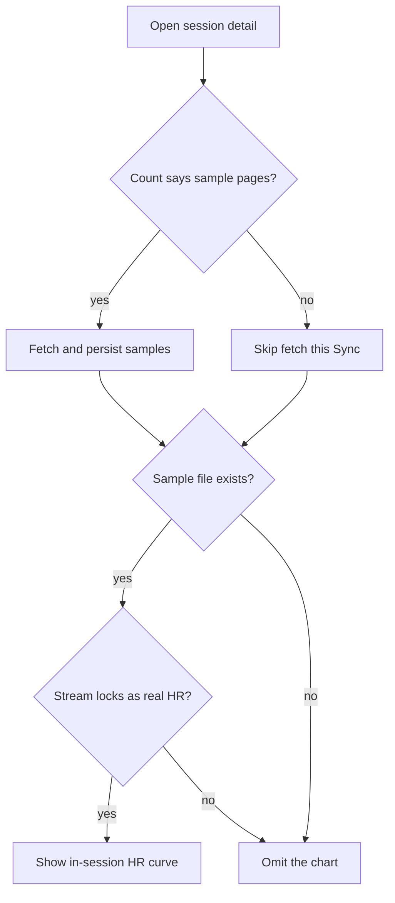

# GT5 swim and strength in-session HR curve

## Summary

After Workout Sync, swim and strength session detail show an in-session heart-rate curve when that workout’s sample stream locks as real HR — same companion sample path as running. If the stream never arrives or does not lock, the chart is omitted. Huawei Health stays closed.

---

## Problem Frame

The owner already reads an in-session HR curve on Fathom’s Run detail when samples exist. The GT5 watch history also shows heart rate for swimming and strength. Off-wrist, those two sports do not: swim detail hides HR with a “no sample stream” note and never draws a series even when samples exist; strength shows min–max tiles and can export samples, but has no time-series curve. The owner currently has to put the watch back on to see the shape of the session.

Official Health Kit documents optional exercise heart-rate statistics and instantaneous samples for swimming and for core/physical training when a Huawei watch is worn. That model is post-Health-sync. Opening Huawei Health wipes the Fathom companion bind, so it is not a fetch path. Community companion catalogs treat in-workout HR as a generic WorkoutData sample field whose presence depends on device and workout type — the same history command family as running, not a sport-specific HR API.

---

## Actors

- A1. Owner-athlete: Completes swim or strength on the GT5, Syncs Fathom, expects the same kind of in-session HR curve they already see on Run
- A2. GT5-A07: Holds swim and/or strength sessions with watch-history HR; may still hold unsynced sample pages
- A3. Fathom companion: Workout Sync, existing sample persist, swim and strength session detail

---

## Key Flows

- F1. Sync → lock → curve or omit
  - **Trigger:** Owner opens swim or strength session detail after Sync, or opens an already-stored session that has a sample file
  - **Actors:** A1, A2, A3
  - **Steps:** If Count says sample pages exist, companion fetches and persists them. Count-no skips fetch this Sync but still uses any already-stored sample file. Decode and lock as real in-session HR. Session detail shows the curve or omits it.
  - **Outcome:** Swim/strength detail matches running’s honesty: a curve only from a locked sample stream. No Health app. No invented points.
  - **Covered by:** R1–R6
  - **Escape:** If the session row never lands (Count/Totals fail, watch dropped the session, companion bind lost), omit — there is no session to chart. If sample fetch times out or is partial, still lock whatever sample file persisted; omit only when nothing lockable remains. Missing min/max totals do not block a plausible-bpm lock (R4). Do not treat omit as proof the watch never recorded HR.

---

## Requirements

**Fetch**
- R1. Workout Sync must pull swim and strength sample pages through the same Count-hinted WorkoutData path used for running, without opening Huawei Health.
- R2. Do not add a Health Kit, whole-day HR, or live-HR path to build this curve.

**Lock and chart**
- R3. When a swim or strength session has a sample stream that locks as real in-session HR, session detail must show an in-session HR curve of the same kind as running — including opening an already-stored session whose file locks, without a new Sync.
- R4. A stream locks as real HR only when decoded values are plausible bpm and, when that session already has min and/or max HR totals, the series agrees with those totals. If those totals are absent, plausible bpm is enough to lock. If decode fails or they disagree, omit the chart.

**Honesty**
- R5. Omit the curve when there is no lockable sample stream. Count-no, a timed-out, or a partial fetch is not itself a reason to omit if a persisted file still locks. Do not draw an empty chart as “HR absent,” and do not invent points from totals or from whole-day HR.
- R6. A session already stored without a sample file does not grow a curve until a later Sync pulls samples while the watch still holds them. That later Sync must still request sample pages when Count says they exist for that row. Missing samples on an old row is not proof the watch never recorded HR.

**Unchanged surfaces**
- R7. Existing min/max tiles and swim interval charts stay as they are. This cut does not add zone minutes, training load, recovery, or average HR as new session-truth tiles.
- R8. This cut is swim (pool and open water) and strength only. Running already has the curve.

---

## Acceptance Examples

- AE1. **Covers R1, R3, R4.** Given a swim session whose sample stream locks as real HR, when the owner opens session detail, an in-session HR curve is shown.
- AE2. **Covers R1, R3, R4.** Given a strength session whose sample stream locks as real HR, when the owner opens session detail, an in-session HR curve is shown.
- AE3. **Covers R5.** Given a swim or strength session with Count hint zero and no stored sample file, when the owner opens session detail, the HR curve is omitted — not an empty chart and not a claim that the watch never recorded HR.
- AE4. **Covers R4, R5.** Given sample bytes that do not decode to plausible HR, or that disagree with that session’s min/max totals, when the owner opens session detail, the curve is omitted.
- AE5. **Covers R6.** Given an already-stored swim or strength row with no sample file, when the owner opens it without a new Sync that still finds pages on the watch, the curve is omitted.
- AE6. **Covers R3, R5.** Given a partial or timed-out sample fetch that still persisted a file, when that file locks as real HR, the curve is shown.

---

## Success Criteria

- When a recent swim and a recent strength session lock, the owner sees the same kind of in-session HR curve they already see on Run, without opening Huawei Health or the watch history. When a stream does not lock, omit is the correct outcome — not a failed cut by itself.
- Planning can implement without inventing sports, fetch path, lock vs omit behavior, or what stays out (zones, load, whole-day fallback, Health Kit). The concrete lock test on owner sample files is planning research (R4), not a new product fork.

---

## Scope Boundaries

- Heart-rate zone minutes, training load, training stress, recovery time, and recovery %
- Whole-day / continuous HR as a fallback series for the session window
- Opening Huawei Health or using Health Kit APIs
- Live in-workout HR notify
- Other sports; running already has this chart
- Replacing swim interval charts or strength min–max tiles
- Re-deriving a curve from totals alone

---

## Key Decisions

- Curve, not recap summary tiles, is the first surface — min/max can already exist; the missing thing is the time series.
- Honesty lock over reuse-as-is — watch history proves HR exists for both sports, but a wrong curve is worse than none if swim/strength pack samples differently than run.
- Companion WorkoutData path, not Health Kit — official docs confirm the data model exists; Fathom cannot use Health as the fetch path.
- Both sports in one cut — the owner named this as the minimal needed thing.

---

## Dependencies / Assumptions

- Owner-confirmed: GT5 watch history shows heart rate for both swimming and strength.
- Verified: Workout Sync already requests WorkoutData pages when Count `dataCount > 0` for any workout type, and persists sample files when point bodies arrive. This cut does not invent that command family. Count-positive pages are not themselves proof those pages contain HR; lock (R4) is the HR proof.
- Verified: Run detail already decodes a locked sample layout into an HR curve; swim/strength do not chart a series today.
- Unverified until a lock attempt on owner files: whether swim (pool and open water) and strength sample packing matches the run layout, or needs a sport-specific decode that still yields the same curve. A type that does not lock omits; it does not invent a series.
- Official Health Kit lists optional `exerciseHeartRate` for swimming and core/physical training when a Huawei watch is worn; community companion docs list “HR for workout” as a generic sample field. Neither is a promotion of GT5 wire layout.

---

## Outstanding Questions

### Deferred to Planning

- [Affects R4][Needs research] What concrete lock test (bpm band, agreement with min/max, record shape) matches owner swim and strength sample files without inventing a series. Run’s existing decoder is a candidate, not a given.
- [Affects R1, R6][Technical] How the next Sync re-requests sample pages for historical swim/strength rows that still have Count pages on the watch but no stored sample file. Re-enrichment itself is in (R6); only the mechanism is planning.
