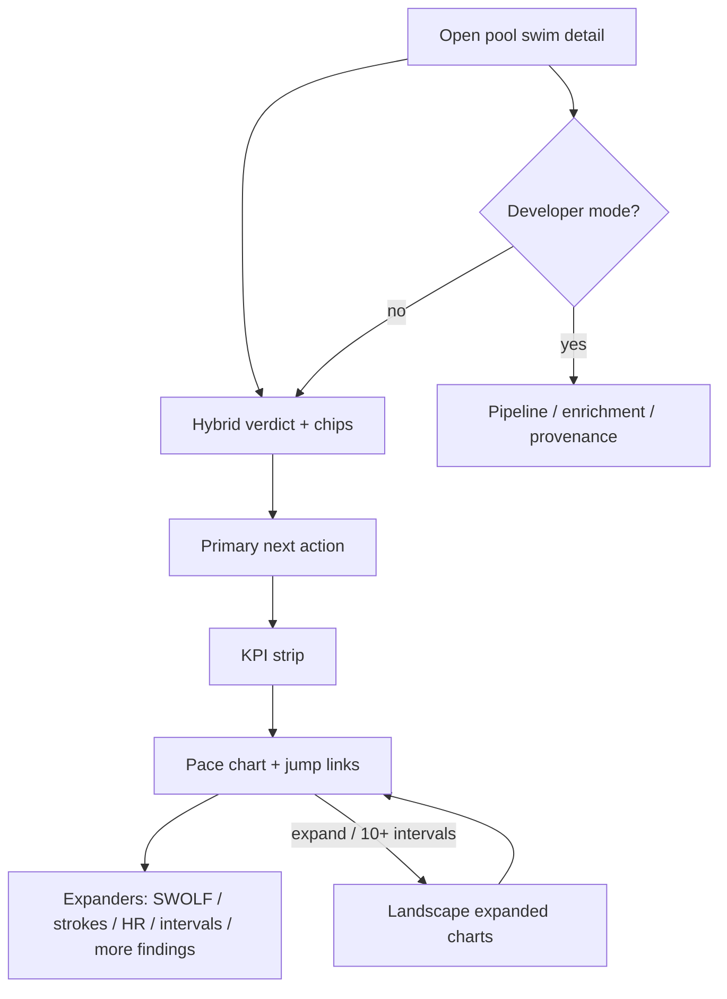

# Pool swim detail redesign — analyze & improve

## Summary

Fully revamp the pool swim session detail page from a developer data dump into a coach-led analyze-and-improve surface. First viewport delivers a hybrid session verdict (plain-language story + comparison chips), one next-action tip, and a compact KPI strip; pace chart and light jump links follow; secondary charts, intervals, and more findings use progressive disclosure; long sessions open charts in landscape expanded analysis. Debug plumbing and Run reasoner leave the athlete path. Programs stay deferred with a documented insight seam only.

---

## Problem Frame

Pool swim detail already computes valuable session truth — pace/SWOLF/stroke metrics, interval analytics, deterministic diagnoses, allow-listed recommendations, in-session HR when locked, and multi-series charts — but presents it as an instrument stack: enrichment counts, sync status, raw type IDs, “P0 metrics,” monospace metric footers, Qwen3/reasoner chrome, Dev columns, and “synced to table” copy. The owner-athlete opens the page after a swim to learn how it went and what to change next; instead they get a lab report. Proven swim apps (FORM HeadCoach 2.0, MySwimPro analytics) lead with insight + next focus and hero metrics, then progressive chart/table depth — not equal-weight dumps. A Programs feature is planned later; without it, the page must still deliver a clear session verdict and actionable tip today.

---

## Actors

- A1. Owner-athlete: Completes a GT5 pool swim, Syncs, opens session detail for a fast verdict and one concrete next-session cue; may dig into charts/intervals on longer reviews
- A2. Dig-deeper owner (same person, Developer mode): Needs enrichment/sync/parse/provenance surfaces when verifying pipeline honesty — not on the default path
- A3. Future Programs consumer (system seam, not a UI actor yet): Will later consume a stable session insight object (primary finding, tip, key metrics) without requiring catalog/plumbing UI on detail today

---

## Key Flows

- F1. Post-swim glance (first ~10–30s)
  - **Trigger:** A1 opens a pool swim detail after Sync
  - **Actors:** A1
  - **Steps:** Read hybrid verdict (story + chips) → read primary next action → scan KPI strip → optionally glance pace chart
  - **Outcome:** A1 can state what happened and what to try next without scrolling past the coaching fold or seeing debug chrome
  - **Covered by:** R1–R7, R20
  - **Escape:** If diagnoses/recs are empty (e.g. insufficient intervals), show an honest “not enough interval data for a coaching tip” state; still show KPIs and available charts

- F2. Chart analysis (portrait → landscape)
  - **Trigger:** A1 taps expand / open expanded analysis on a chart, or session has ≥10 intervals and uses the expanded entry
  - **Actors:** A1
  - **Steps:** Open landscape (or full-bleed) expanded chart view → switch series (pace / SWOLF / strokes / HR when present) → inspect intervals with readable x-axis → dismiss back to portrait detail
  - **Outcome:** Long sessions (10–40+ intervals) are analyzable without cramped portrait bars
  - **Covered by:** R8–R12
  - **Escape:** If a series is absent (e.g. HR not locked), omit that series from the switcher; do not invent points

- F3. Depth review
  - **Trigger:** A1 uses jump links or expanders for SWOLF/strokes/HR, intervals table, or more findings
  - **Actors:** A1
  - **Steps:** Jump to target section → review clean athletic columns / secondary charts → optionally expand more findings
  - **Outcome:** Full data remains available without dumping it above the fold
  - **Covered by:** R8–R9, R13–R15

- F4. Developer verification
  - **Trigger:** A2 enables Developer mode (settings flag or long-press entry — exact control left to planning)
  - **Actors:** A2
  - **Steps:** View enrichment/sync/type/parse/metric IDs / invent-guard notes as needed → disable mode to restore athlete UI
  - **Outcome:** Pipeline honesty is inspectable without poisoning the default review
  - **Covered by:** R16–R18

---

## Requirements

**Information architecture (athlete default)**
- R1. Pool swim detail uses a coach-led single scroll with light jump links (e.g. Charts, Intervals) — not a sticky multi-tab bar as the primary IA.
- R2. First viewport presents, in order: hybrid session verdict → primary next action → compact KPI strip. Pace chart is immediately below the fold / easily reachable without hunting.
- R3. Hybrid verdict = one plain-language session story line plus 2–3 comparison chips (e.g. vs recent swims on pace / SWOLF / volume). No single quality, readiness, or 0–100 score.
- R4. Primary next action is one allow-listed recommendation derived from deterministic diagnoses, with athlete-facing title and short why. No model names, ranking labels, chapter/Bible refs, or metric-ID footers on the default path.
- R5. KPI strip includes distance, duration (prefer swim/moving vs rest when available), avg pace, avg SWOLF; include avg/max HR only when in-session HR is locked per existing honesty rules. Omit missing metrics rather than inventing.
- R6. Additional diagnoses appear under collapsed “More findings” (or equivalent). Default shows one primary tip, not a High-badge farm.
- R7. Jump links scroll to Charts and Intervals (and optionally Findings) without changing the coach-led default order.

**Charts and intervals**
- R8. Default chart series is pace by interval (or length), with rest gaps not plotted as false “fast” pace. Other series (SWOLF, strokes per length, HR when locked) are secondary expanders or chip-switched views — not four equal-height charts fighting for attention.
- R9. Portrait chart layout on the detail main view must remain scannable for typical sessions; avoid overlapping x-axis labels for dense interval counts by summarizing ticks and relying on expanded mode for fine analysis.
- R10. Expanded chart mode opens in landscape (or equivalent full-bleed landscape-oriented analysis) so 10+ interval sessions can be inspected with readable axes and interaction.
- R11. Expanded mode is available for the chart series the athlete is viewing; when interval count ≥ 10, the expanded entry is prominently offered (not buried). Shorter sessions may still expand on demand.
- R12. Expanded mode supports switching among available series and dismissing back to the portrait detail position the athlete left.
- R13. Intervals table uses athletic columns only by default (identity/stroke cue, distance, time, strokes, SWOLF, pace — exact set in planning). No Dev/wire-index column on the athlete path.
- R14. Invent-guard continues to filter garbage/outlier laps from charts/table by default; athlete-facing copy stays plain (no monospace invent-guard explanations). Toggle to include filtered laps, if retained, lives in Developer mode or a clearly secondary control without pipeline jargon.
- R15. In-session HR curve remains omit-over-invent: show only when the sample stream locks; never show empty tutorial chrome or “no stream” as a hero card.

**Debug quarantine and reasoner removal**
- R16. Athlete default UI must not show: enrichment counts (data/pace/segments), Sync status lines, raw type codes (e.g. `6 (Pool swim)`), “P0 metrics” naming, “Evidence → Diagnosis (deterministic),” monospace `metrics:` footers, “synced to table,” Enrichment tags / Samples wire dumps, or Dev columns.
- R17. Those surfaces (as needed for dig-deeper) are available only in Developer mode, off by default.
- R18. Run reasoner / Qwen3 / offline-ranking UI is removed from swim detail entirely (not relocated to Developer mode as a product feature). Athlete tips use the deterministic allow-listed recommendation path only.
- R19. Type label in the athlete header uses human sport name only (e.g. “Pool swim #94”), never the numeric workout type ID.

**Honesty, copy, and Programs seam**
- R20. Confidence / coverage language, when needed, stays quiet and athlete-safe (e.g. omit HR KPI when unlocked). Do not decorate the page with “High” sticker farms or pipeline vocabulary.
- R21. Document a stable session insight contract for future Programs: primary finding, primary tip, key metrics, optional secondary findings — without shipping Programs UI, plan chips, or fake “add to plan” CTAs in this cut.
- R22. App Home remains chart-free; this redesign does not add swim charts to the Home tab.
- R23. Open-water swim (type 8) may share the same detail shell when canonical swim session data exists; pool-specific copy (pool length, laps) adapts or omits honestly when not applicable. Exact open-water parity gaps may be deferred in planning if data differs materially.

**Validation (pre- or parallel to full Flutter polish)**
- R24. Prefer a disposable PoL probe (timed insight + next action in ≤30s on 3 fixtures) before or early in implementation if hierarchy copy is uncertain — see Dependencies. Probe artifacts are not production UI.

---

## Acceptance Examples

- AE1. **Covers R2, R3, R4, R16, R18.** Given a completed pool swim with diagnoses and allow-listed recs, when A1 opens detail with Developer mode off, the first viewport shows a story line, comparison chips, one next-action tip, and KPIs — and does not show enrichment counts, Sync: ok, Type: 6, metric footers, or Run reasoner.
- AE2. **Covers R5, R15.** Given a swim with locked in-session HR samples, when A1 opens detail, HR appears in the KPI strip and/or HR chart expander; given a swim with no lockable HR stream, those HR surfaces are omitted (not empty charts).
- AE3. **Covers R8, R10, R11.** Given a swim with 40 paced intervals, when A1 opens detail, a pace chart is reachable without hunting; when they open expanded analysis, the chart presents in landscape with readable interval inspection.
- AE4. **Covers R6, R4.** Given multiple session diagnoses, when A1 is on the default path, one primary tip is visible; additional findings require expanding “More findings.”
- AE5. **Covers R13, R17.** Given Developer mode off, the intervals table has no Dev column; when Developer mode is on, dig-deeper columns/surfaces needed for verification may appear.
- AE6. **Covers R7.** Given a long scroll session, when A1 taps a jump link to Intervals, the page scrolls to the intervals section without switching into a tab-only IA that hides the verdict.

---

## Success Criteria

- After a typical pool swim, A1 can state the session story and the next-session tip within ~30 seconds without seeing debug chrome.
- Charts for 10+ interval sessions are usable in expanded landscape analysis (no unreadable overlapping tick soup as the only option).
- Default athlete UI contains zero of the banned debug strings listed in R16; dig-deeper remains reachable via Developer mode.
- Planning can implement without inventing first-viewport order, verdict shape, reasoner disposition, or Programs scope.
- Competitive bar: page feels closer to FORM-style insight→action→evidence than to a Garmin/Swim.com flat metric dump — while keeping Fathom invent-guard honesty (omit over invent; no readiness scores).

---

## Scope Boundaries

- No Programs / training-plan attachment UI, plan day completion, or seed-time marketplace flows in this cut (seam only — R21)
- No charts or coaching cards added to the app Home tab
- No quality / readiness / HRV percentage scores
- No Run reasoner / on-device LLM ranking UI on swim detail (removed, not polished)
- No Gemini / FAB local-AI-coach work in this brainstorm (separate coach track)
- No stroke Style coaching UI beyond existing capability gates
- Not a multi-user consumer SaaS redesign — dogfood owner-athlete remains the primary user
- Open-water-specific coaching narratives beyond shared shell parity may defer if data is thin
- Pixel-perfect cloning of MySwimPro/FORM visuals is not required; patterns are informational

---

## Key Decisions

- **Primary job = verdict (hybrid), not Programs:** Programs are deferred; first seconds answer “how did this go?” via story + comparison chips.
- **First viewport = verdict → next action → KPIs:** Coaching fold before deep evidence; pace chart immediately after for easy access on the detail main view.
- **Approach = coach-led scroll + light jump links:** Validated against FORM HeadCoach 2.0 and MySwimPro’s Splits>/section patterns without adopting a sticky tab bar.
- **Developer mode for plumbing:** Stronger quarantine than a soft partial-data chip; default stays clean.
- **Strip Run reasoner:** Product judgment that reasoner output is not yet useful; deterministic allow-listed tips only.
- **Landscape expand for long sessions:** ≥10 intervals get a prominent expanded/landscape analysis path; shorter sessions can still expand on demand.
- **No Home charts:** Explicitly not expanding scope to Home; “home screen” meant detail main view.
- **Full revamp, not MVP slice:** Ship the complete athlete IA (verdict through intervals + landscape), not a verdict-only experiment — with optional PoL for copy/hierarchy risk.

---

## Dependencies / Assumptions

- Existing Swim Bible compute remains the source of truth: canonical swim session / P0 metrics, session analytics, invent-guard, diagnoses, allow-listed recommendations, locked HR stream rules (`docs/brainstorms/2026-09-19-gt5-swim-strength-hr-curve-requirements.md`).
- Prior brand IA: session-truth instrument; invent-guard; omit over invent; Home stays chart-free; reasoner-on-demand is superseded for this page by reasoner removal (R18).
- Design reference `docs/design/swim-analytics.html` informed earlier instrument order; this redesign intentionally leads with coaching verdict over charts-first.
- Assumption: comparison chips can be computed from recent comparable pool swims already loadable via existing diagnosis/trends paths; exact window/filters are planning details.
- Assumption: landscape expanded chart is feasible within the current Flutter chart stack; library choice is planning.
- Recommended validation: PoL P1 (30s insight + next action) from discovery — disposable HTML, not production — if copy/hierarchy risk feels high before large UI investment.

### Research inputs (non-normative)

- Competitive/UX synthesis: FORM HeadCoach 2.0 (insight + next focus; demote dense tables), MySwimPro (KPI grid, stacked analytics, set→rep depth, Splits>), Garmin (expandable charts; rest-spike anti-pattern), r/Swimming (pace-first preference; dump aversion).
- Community visual pass (2026-10-08): FORM support pace-bar diagrams with rest annotations; MySwimPro Reddit workout summary KPI grid + Splits>; Garmin Reddit stacked charts with expand controls; r/Swimming stats thread prioritizing pace over SWOLF.

---

## Outstanding Questions

### Deferred to Planning

- [Affects R17][Technical] Exact Developer mode entry (settings toggle vs long-press vs existing diagnostics gate) and what minimal dig-deeper set must remain.
- [Affects R3][Needs research] Comparison chip baselines (last N pool swims, same pool length, stroke filters) and copy when history is thin.
- [Affects R8–R12][Technical] Chart interaction model in landscape (pan/zoom, interval scrubber, series chips) and orientation lock behavior on Android.
- [Affects R5][Technical] Whether swim vs rest duration is already available cleanly on `WorkoutSummary` / P0 path or needs derivation.
- [Affects R23][Needs research] How much open-water detail can honestly share the pool IA in v1.
- [Affects R24][Product process] Whether to run PoL P1 before Flutter work or in parallel with early vertical slice.
