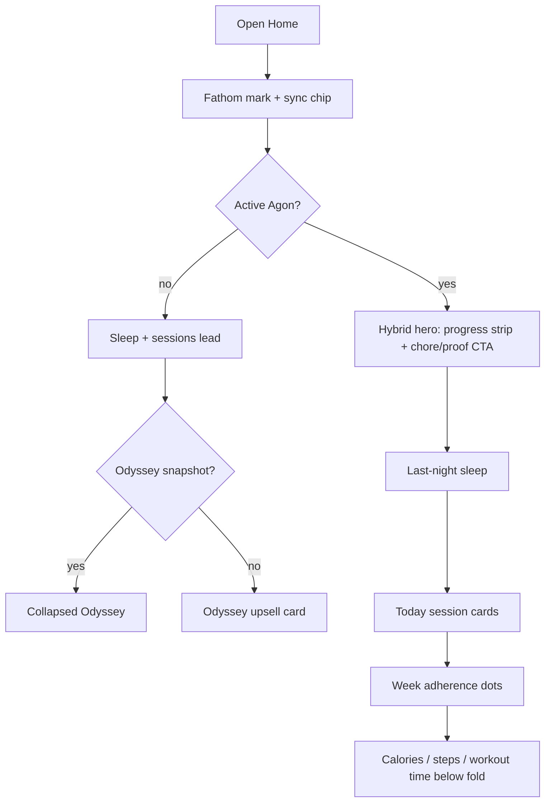

# Home redesign — Agon hybrid stack

## Problem Frame

The owner-athlete opens Fathom mainly to reach swim sessions, not Home. Home does not feel intuitive or rewarding enough to justify opening the app and allowing sync. Programs (Agon) exists but costs an extra click. Odyssey, streaks, Areté, Depth, and the habit/capability split are live or in-flight, yet Home still reads as a thin instrument strip without brand presence or a clear “what do I do / how am I progressing” pull.

Industry training apps (MySwimPro, Strava, Nike Run Club) put **personal progress + today’s training** before secondary vitals. Gamification research supports **informational competence cues and visible small wins on meaningful work** — not vanity open-counts or loss-framed daily streaks. Prior Home charter (`2026-09-12-home-today-instrument`) remains useful context but is **not binding** for this redesign.

## Actors

- A1. **Owner-athlete** (dogfood): Opens Home for a rewarding day picture and one-tap access to today’s training / sessions.
- A2. **Paired watch (GT5)**: Source of sleep, sessions, and activity totals via sync (sync reliability is out of scope for this cut).

## Key Flows

- F1. **Open Home — active Agon**  
  See brand + sync chip → hybrid hero (habit progress + today’s chore/proof primary CTA) → sleep → today’s sessions → week-adherence dots → demoted calories/steps. Tap chore enters Programs session without an intervening Programs hub hop.

- F2. **Open Home — no active Agon**  
  Day instrument leads (sleep + sessions). If Odyssey snapshot exists, show collapsed. If not, show Odyssey upsell card. Progress chrome does not invent an active chore.

- F3. **Enter today’s session**  
  Tap a today’s session card → existing session detail (any sport present today).

## Requirements

**Composition (Approach A)**
- R1. Home is a single **Agon hybrid stack** composition (not a social feed, not dual Today|Progress tabs).
- R2. First viewport presents, in order when data exists: header → hybrid hero (or no-Agon day lead) → sleep → today’s sessions → week-adherence dots.
- R3. Calories, steps, and workout-time totals are **demoted** below the fold (or a compact tertiary row that does not compete with R2).
- R4. This cut is a **full** redesign of the scoped surface — not a thin MVP strip.

**Header / brand**
- R5. Home shows a **small Fathom brand mark** (icon/wordmark) in the header.
- R6. Sync status appears as a **quiet chip** near the header (e.g. “synced Xm ago” / “syncing”). Full-screen blanking during sync is **not** fixed in this cut (separate track).

**Hybrid hero (active Agon)**
- R7. When an Agon is active, Home shows a glanceable **habit/progress strip**: weekly streak and/or Odyssey step and/or Areté–Depth level cues (informational, warm habit styling).
- R8. The **primary tap target** on Home with an active Agon is **today’s chore or next proof** — one tap into the training surface; no mandatory hop through a Programs hub first.
- R9. Habit-layer cues never decrement on Home; capability dates remain honest (align with Programs progress rules). No daily shame streak, leagues, or composite readiness score on Home.

**No Agon / rest**
- R10. With no active Agon, Home leads with the **day instrument** (sleep + today’s sessions), not a fake chore.
- R11. If an Odyssey snapshot exists, show it collapsed under the day lead.
- R12. If no Odyssey snapshot exists, show an **Odyssey upsell card** (start / resume journey), not empty chrome.

**Sleep**
- R13. When last-night sleep is available, Home shows glanceable duration and timing (sleep window). Stage hypnogram stays off Home.

**Today’s sessions**
- R14. Home lists **today’s multi-sport session cards** when present; tap opens existing session detail.
- R15. When no sessions yet, show a clear empty cue (rest / not yet trained) without inventing workouts.

**Week adherence**
- R16. Home shows a **week-adherence visual** (e.g. planned vs done dots for the athlete’s sessions/week target). This is the primary “chart/icon” identity on Home — not a full weekly-average history chart.
- R17. Full weekly averages / history charts stay on Workouts or Programs progress, not as Home heroes.

**Tone / non-goals on surface**
- R18. Rewards mark **training habit progress** (chore attempt, weekly streak floor, Odyssey), never “opened the app” alone.
- R19. At most light decorative motion on progress receipt; Home stays calm, not slot-machine.

## Success Criteria

- S1. Owner opens Home and can answer “what’s my progress?” and “what’s today’s training?” without leaving Home or opening Programs first.
- S2. Today’s chore/proof is reachable in **one tap** from Home when an Agon is active.
- S3. Sleep and today’s sessions are visible without tab-hopping; week adherence is glanceable.
- S4. No-Agon opens still feel intentional (day lead + Odyssey snapshot or upsell), not a dead end.
- S5. Owner subjectively prefers opening Home over jumping straight to swim history for a dogfood week (qualitative).

## Scope Boundaries

**In**
- Home layout, hierarchy, brand mark, Agon hybrid hero, sleep, session cards, week-adherence dots, Odyssey upsell/snapshot, demoted activity totals.

**Out**
- Sync reliability / destructive blanking loader (separate track).
- Local AI Coach, food logging, composite readiness, leagues, loss-framed daily streaks, purchasable freezes.
- Replacing Programs detail screens (Home deep-links into them).
- Flutter shipping in this brainstorm — HTML prototype is the design artifact; implementation via later `/ce-plan` / `/ce-work`.

**Deferred for later**
- Strength / running Agons on Home (same hybrid pattern when those programs exist).
- Optional hide-game-layer setting (already in Programs gamification research).

**Outside this product’s identity**
- Social feed Home, competitive leaderboards, punishing miss states.

## Key Decisions

- **Approach A — Agon hybrid stack**: progress reward + training action in one composition.
- **Fresh brainstorm**: Sept 12 Today-instrument doc is context only, not the binding charter.
- **First-screen body**: sleep + today’s sessions + week-adherence dots; calories/steps demoted.
- **Full cut** of this scoped surface.
- **No-Agon**: day instrument leads; Odyssey snapshot or upsell.
- **Brand**: small header mark.
- **Sync UX**: out of scope for this redesign cut.

## Dependencies / Assumptions

- Agon / Odyssey / streak / Areté–Depth objects exist or are shipping per Programs requirements.
- Owner is sole dogfood user; no multi-user Home variants.
- Watch sync continues to supply sleep and sessions; Home may show stale-but-visible data while sync runs (behavior detail deferred to planning; blanking fix still separate).

## Outstanding Questions

### Resolve Before Planning

_(none)_

### Deferred to Planning

- [Affects R6][Technical] Exact sync-chip states while blanking remains (prototype assumes quiet chip only).
- [Affects R7–R8][Needs research] Precise copy/hierarchy when chore day vs proof day vs rest-within-program.
- [Affects R16][Technical] Whether adherence dots bind to Agon sessions/week only or all sports this week.
- [Affects R3][Product polish] Compact tertiary vitals row vs strictly below fold.

## Alternatives Considered

- **B — Day timeline/feed**: weaker open-app reward; more scroll before chore.
- **C — Dual Today | Progress**: reintroduces a click for half the hybrid.

## Next Steps

- Prototype: `docs/design/home-redesign-prototype/index.html`
- Discovery / probes: research briefs under `docs/brainstorms/research/`
- `-> /ce:plan` for structured implementation planning when ready to ship Flutter
