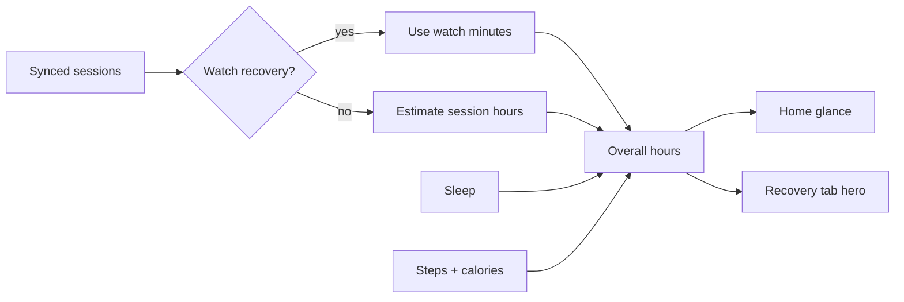

# Session + overall recovery hours

## Summary

Ship a hybrid recovery cut: prefer watch session recovery when present, estimate when absent (notably swimming, which Huawei omits on purpose), and expose **hours remaining until ready for hard work** from stacked workouts + sleep + day steps + day calories. Show a glance on Home and a top hero on the Recovery tab so Programs soft-warn and multi-sport dogfood have an honest fatigue clock — not a readiness score and not a weekly multi-program scheduler.

---

## Problem Frame

The owner toggles badminton, swimming, and strength. Strength and run sessions often carry watch `recoveryTime`; swimming often does not. Huawei’s own Workout status docs state Recovery / Training load may be unavailable for swimming (and some other modes), so the gap is product policy on-device, not a Fathom parse miss.

Today those session minutes stay isolated: they are not joined into a day-level “how long until hard work is sane?” signal, and they do not incorporate last-night sleep or waking activity (steps / calories). Programs soft-warn and future weekly multi-sport scheduling need a comparable fatigue input across sports; without an overall clock, swim days stay blind and Home cannot answer “am I still carrying load?” on a rest morning.

The North Star remains a food-aware weekly swim / badminton / strength schedule. That stays deferred until Programs proves out. This cut supplies the recovery substrate those later plans will consume.

---

## Actors

- A1. **Owner-athlete**: Checks hours remaining on Home and Recovery; uses it to avoid stacking hard sessions across sports.
- A2. **Paired watch (GT5)**: Source of session recovery when present, sleep, day steps/calories, and other session scalars via sync.
- A3. **Programs (consumer)**: Soft-warn and related dogfood may read the same overall hours signal; this cut does not redesign Programs UX.

---

## Key Flows

- F1. **Session with watch recovery**
  - **Trigger:** Sync lands a session that includes watch recovery minutes.
  - **Actors:** A2, A1
  - **Steps:** Persist watch recovery as SoT for that session → fold into overall hours → Home glance and Recovery hero update.
  - **Outcome:** Session shows watch recovery; overall hours reflect it; no overwrite by an estimator.
  - **Covered by:** R1, R3, R8–R10

- F2. **Session without watch recovery (e.g. swim)**
  - **Trigger:** Sync lands a session with absent recovery.
  - **Actors:** A2, A1
  - **Steps:** Estimate session recovery from available session signals → mark source quietly for detail → fold into overall hours.
  - **Outcome:** Session has usable recovery hours; athlete can open detail to see estimated vs watch.
  - **Covered by:** R2, R4, R8–R10

- F3. **Open Home / Recovery with no sessions today**
  - **Trigger:** Owner opens Home or Recovery after wake, before or without today’s workouts.
  - **Actors:** A1
  - **Steps:** Compute overall hours from leftover prior recovery + sleep + today’s steps/calories so far → show glance / hero (Whoop-like: recovery present without requiring today’s sessions) → empty session list stays empty.
  - **Outcome:** Hours remaining still visible; no fake readiness %; no invented workouts.
  - **Covered by:** R5–R7, R11–R12

---

## Requirements

**Per-session recovery**
- R1. When the watch provides session recovery for a workout, Fathom MUST use that value as SoT for that session and MUST NOT overwrite it with an estimate.
- R2. When session recovery is absent, Fathom MUST estimate session recovery hours from available session signals (duration and whatever intensity proxies are present — e.g. load, training effect, HR — plus sport-aware defaults when swim/HR is thin).
- R3. Estimated and watch-backed session recovery MUST share the same primary UI treatment; source (“estimated” / “watch”) appears only as a quiet cue on session detail (or equivalent secondary surface), not as loud chrome on cards.
- R4. Planning MUST document the hybrid estimator: prefer calibration against the owner’s watch-backed sessions when enough exist; otherwise fall back to published load→recovery heuristics. Huawei’s public rule that swimming often lacks Recovery/Training load MUST be cited so estimates are framed as Fathom fill, not “missing decode.”

**Overall hours remaining**
- R5. Fathom MUST compute a single **hours remaining until ready for hard work** from: stacked session recovery (watch or estimated), last-night sleep, and day steps + day calories.
- R6. Overall hours MUST update as time passes and as new sleep / activity / sessions land (countdown / recompute behavior — exact tick policy deferred to planning).
- R7. Overall hours MUST remain available when there are **no sessions today**, using leftover recovery + sleep + activity so far (Whoop-inspired presence; not a Whoop 0–100 score).
- R8. Overall hours are always a **Fathom composition**, even when every contributing session was watch-native. Product copy MUST NOT imply the watch emitted a single overall recovery %.

**Surfaces**
- R9. **Home** shows a glanceable hours-remaining cue near sleep (fatigue clock). Exact slot within the Agon hybrid stack is planning’s job, but it MUST NOT read as a composite readiness score (align with Home redesign: no opaque readiness %).
- R10. **Recovery tab** shows hours remaining as a **top hero above** existing subtabs (Sleep / Vitals / Food). Subtabs remain for contributors / history detail; this cut does not require a new Status subtab.
- R11. On rest / no-session mornings, Home’s empty session cue stays honest; hours remaining still show.

**Consumers and honesty**
- R12. The same overall hours signal MUST be available for Programs soft-warn / dogfood consumption; this cut does not mandate Programs UI redesign.
- R13. No opaque 0–100 recovery/readiness score; no green/yellow/red readiness band as the primary output of this cut.
- R14. Do not claim muscle-group or DOMS specificity from watch or estimate (shoulders from badminton + swim stay out).

---

## Acceptance Examples

- AE1. **Covers R1, R3.** Given a strength session with watch recovery 16h, when shown on session detail and folded into overall, the session uses 16h from watch and detail may quietly say “watch”; Home/Recovery show updated hours without an “estimated” badge on the primary glance.
- AE2. **Covers R2, R3, R4.** Given a pool swim with null watch recovery, when sync completes, the session has estimated recovery hours, detail can show “estimated,” and overall hours include that estimate.
- AE3. **Covers R5, R7, R9, R11.** Given last night’s sleep synced, leftover recovery from yesterday, and no workouts yet today, when the owner opens Home, hours remaining appear near sleep and today’s sessions show the empty/rest cue — not invented workouts.
- AE4. **Covers R8, R13.** Given only watch-backed sessions contributing, when overall hours display, copy still presents them as Fathom hours remaining — not “watch recovery score” or a 0–100 dial.
- AE5. **Covers R10.** Given the owner opens Recovery, hours remaining appear above the Sleep/Vitals/Food subtabs without requiring a new subtab to discover them.

---

## Success Criteria

- Owner can answer “roughly how long until hard work is sane?” from Home or Recovery without opening Huawei Health.
- Swim (and other watch-omitted) sessions no longer leave a blank recovery hole when an estimate is possible.
- Programs dogfood can consume overall hours for soft-warn experiments without inventing a parallel fatigue model.
- No athlete-facing readiness % or composite score ships in this cut.
- Downstream planning has enough product locks to choose a hybrid formula and Home/Recovery placement without re-litigating scope.

---

## Scope Boundaries

**In**
- Per-session watch-prefer / estimate-when-absent
- Overall hours from workouts + sleep + steps + calories
- Home glance + Recovery tab top hero
- Quiet source labeling on detail
- Algorithm research notes for hybrid estimator (Huawei public behavior + literature candidates)
- Signal available to Programs

**Out / deferred**
- Food as an input; food-aware weekly multi-program sync (North Star after Programs proves out)
- Readiness bands / opaque scores / Whoop-style % dial as primary UI
- Muscle- or joint-specific recovery maps
- Overwriting watch session recovery
- Redesigning Programs chore UX beyond consuming the signal
- Replacing Recovery v1 sleep/Hooper product locks with this clock (sleep remains an *input*; Hooper not required for this cut)

**Outside this product’s identity**
- Claiming medical/injury diagnosis or that Fathom matches Huawei’s internal swim exclusion reverse-engineered exactly

---

## Key Decisions

- **Approach C — Hybrid:** Watch SoT per session; estimate when absent; calibrate against watch-backed sessions when possible; literature heuristics otherwise.
- **Primary output:** Hours remaining until ready for hard work — not a readiness score.
- **Surfaces:** Home glance near sleep + Recovery top hero (confirmed over Status subtab / Sleep-only attach).
- **No-session days:** Still show hours (Whoop presence pattern; Fathom hours semantics).
- **Labeling:** Same primary look; quiet estimated/watch on detail only.
- **North Star deferred:** Weekly multi-sport schedule after Programs test.

---

## Dependencies / Assumptions

- Day steps and calories already surface on Home from FitnessTotals / session rollups; overall recovery may reuse those day totals (planning confirms grain and undercount caveats already noted in Home code comments).
- Sleep timing (and richer sleep fields where already owned on `main`) are available as overnight inputs; this cut does not reopen Recovery v1 physio ABSENT locks for inventing HRV-based Whoop clones.
- Huawei publicly excludes swimming from Recovery/Training load availability — estimates for swim are expected, not a sync bug.
- Home redesign forbids composite readiness scores on Home; hours remaining must stay framed as a fatigue clock.
- Badminton wire type labeling is still soft elsewhere in the repo; overall stacking does not require a named “badminton” label if the session carries recovery or an estimate.

---

## Outstanding Questions

### Deferred to Planning

- [Affects R2, R4][Needs research] Exact hybrid formula: which session signals map to hours; calibration window; swim defaults when HR/load thin; citation set (Huawei TruSport / support pages + TRIMP/TE literature).
- [Affects R6][Technical] Countdown tick policy (wall-clock decay vs recompute-on-sync only) and how leftover recovery combines across same-day multi-sport sessions (max vs additive vs Huawei-style remaining).
- [Affects R5][Technical] How sleep quality vs duration, and steps vs calories, weight the overall hours (direction and caps).
- [Affects R9][Technical] Precise Home slot in the Agon hybrid stack without competing with chore CTA or implying readiness score.
- [Affects R12][Technical] Programs soft-warn contract: threshold units (hours remaining) and copy that stays factual stacking, not coaching intensity.
