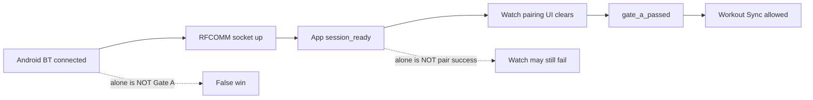
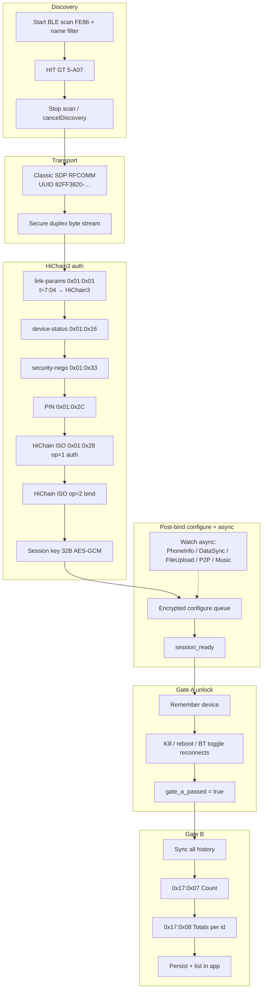
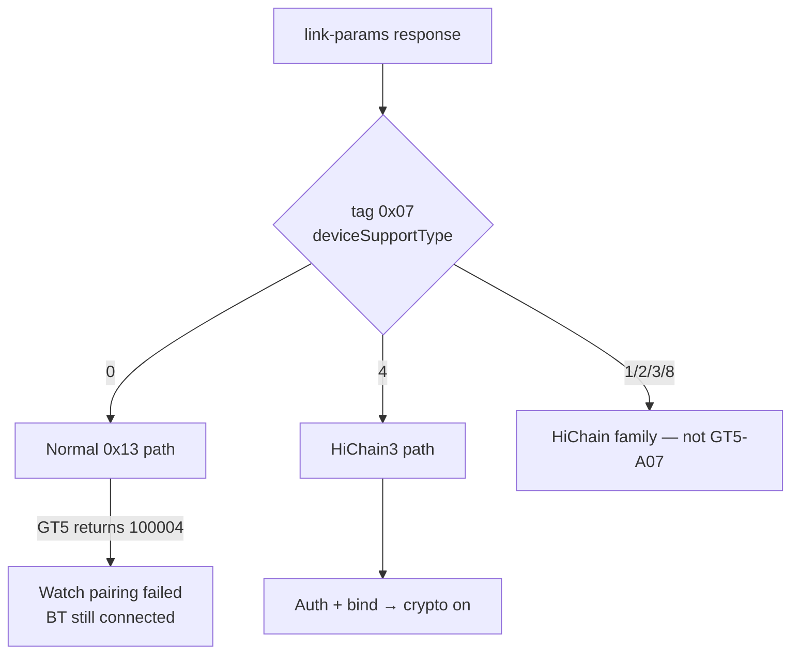
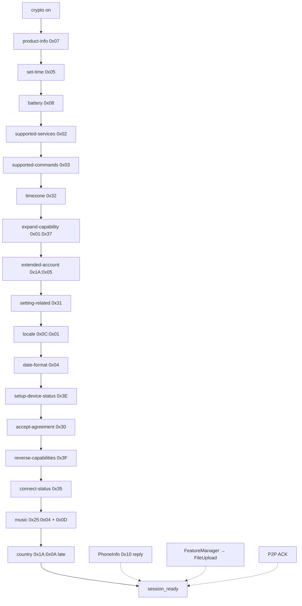
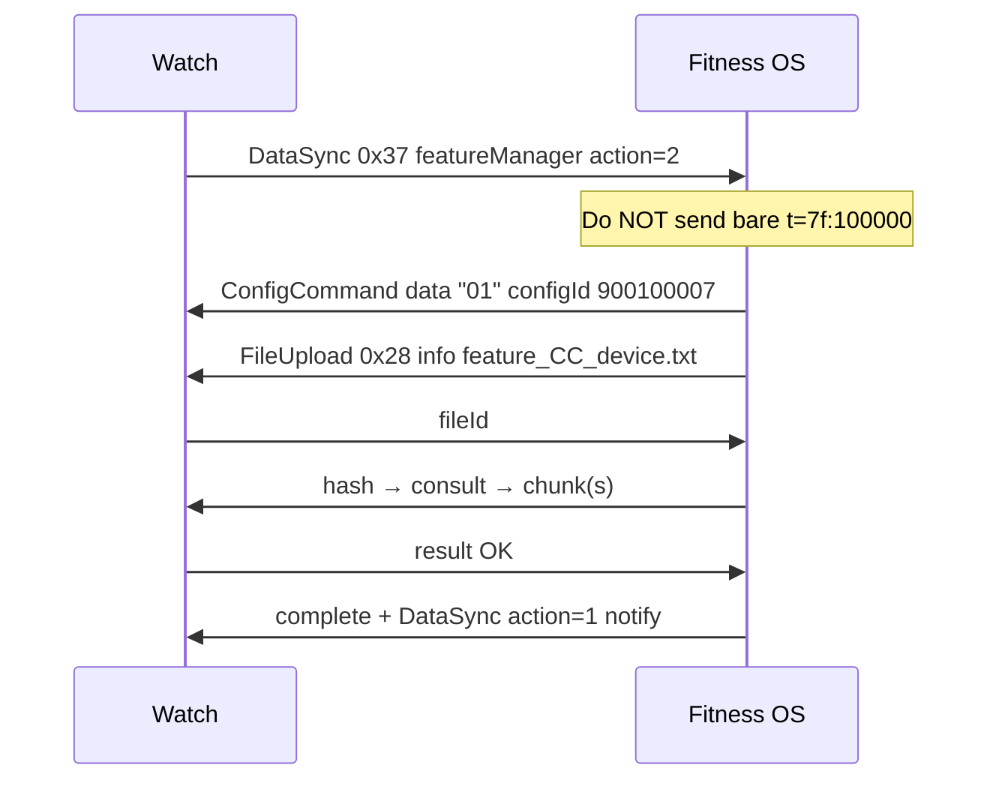
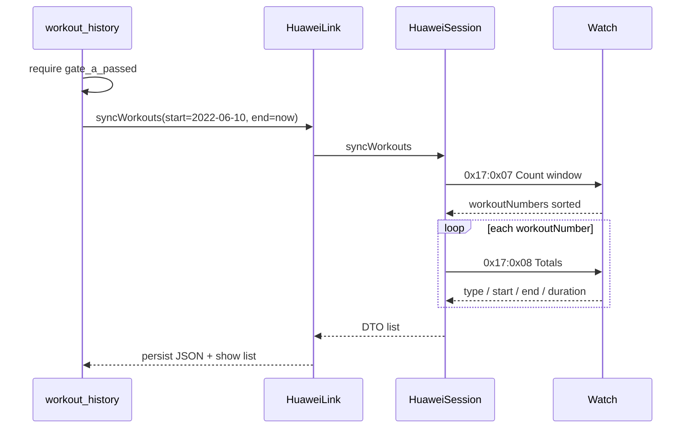

# Learning: Huawei Watch GT5-A07 companion POC

**Date:** 2026-07-18  
**Devices:** Huawei Watch GT 5-A07 (HarmonyOS / VLI-B19) · Pixel 8a  
**App:** Fitness OS (`feat/huawei-gt5-companion-gate-a`)  
**Verdict:** **GO** — Gate A pair/reconnect + Gate B workout list proven on-device without Huawei Health at runtime.

**Related docs**

| Doc | Role |
|-----|------|
| `docs/wire-specs/huawei-br-gt5-gate-a.md` | Normative wire facts |
| `docs/handoffs/2026-07-18-huawei-gt5-gate-a-stack-handoff.md` | Stack handoff for implementers |
| `docs/experiments/gt5-a07-companion-feasibility.md` | On-device evidence table |
| `docs/plans/2026-07-17-001-feat-huawei-gt5-companion-mvp-plan.md` | Original Gate A/B plan |

Gadgetbridge = **behavioral oracle only** (study tree outside repo). No AGPL paste.

---

## 1. What this POC proved

| Gate | Goal | Result |
|------|------|--------|
| **A** | Discover → Classic RFCOMM → HiChain3 auth/bind → post-bind configure → watch pairing UI clear → remember + reconnect after kill | **Proven** |
| **A unlock** | Durable `gate_a_passed` after interrupt checklist | **Proven** (owner credited) |
| **B** | Explicit Sync: workout Count → Totals → local offline list | **Proven** (strength ~112s, `type=140`, workout `#2`) |

**Not in POC:** live HR, workout samples/GPS/pace, Huawei account login, iOS, Companion Device Manager privileges.

---

## 2. Mental model — success is three different things



| Signal | Means |
|--------|--------|
| Android “connected” | Classic socket only |
| App `session_ready` | HiChain3 + encrypted configure finished on phone |
| Watch pairing UI clears | Real first-pair success |
| `gate_a_passed` | Reconnect checklist passed → Sync unlocked |

---

## 3. Communication stack (how layers are built)

```text
Flutter UI
  device_pairing (scan/pair/checklist)     workout_history (Sync + list)
                 \                       /
                  \                     /
                   HuaweiLink (sole channel owner)
                              |
              MethodChannel / EventChannel
                              |
                   HuaweiBtPlugin (Kotlin)
                              |
  ┌───────────────────────────┴───────────────────────────┐
  │ RfcommTransport   BLE FE86 discover → SDP RFCOMM      │
  │ HuaweiFraming     0x5A / TLV / CRC / slices             │
  │ HuaweiSession     auth + configure + async multiplex    │
  │   ├ HuaweiHiChain          ISO 0x28 (HiChain3)          │
  │   ├ HuaweiPacketCrypto     AES-GCM tags 7C/7D/7E        │
  │   ├ HuaweiFeatureUpload    FileUpload 0x28 features     │
  │   └ HuaweiWorkoutSync      Count 0x07 → Totals 0x08     │
  │ HuaweiSecretStore EncryptedSharedPreferences            │
  └─────────────────────────────────────────────────────────┘
```

**Persistence split**

- Dart prefs: MAC/name, Gate A bits, `gate_a_passed`, workout JSON, sync cursor  
- Native secrets only: auth key / phone MAC override (never Flutter prefs)

---

## 4. End-to-end communication flowchart

### 4.1 Full POC path (first pair → sync)



### 4.2 Auth branch decision



**Critical learning:** ServerNonce V1 is crypto version, **not** “use Normal auth”. Mode = `t=7`.

### 4.3 Post-bind configure order (working on GT5-A07)



Async handlers run **during** configure waits. `awaitFrame` must skip unrelated SS/CC or the queue deadlocks.

### 4.4 FeatureManager / FileUpload finalize



Skipping FileUpload → watch retries → session tear-down → late GCM MAC failures (look like crypto bugs; usually poison from earlier).

### 4.5 Gate B workout sync



**On-device proof:** strength session → `count=1`, totals `number=2`, `type=140`, `duration=112s`.

Defer for later: Data `0x0a`, Pace `0x0c`, Swim `0x0e`, GPS files.

---

## 5. Packet framing (LPv2)

```text
Non-sliced:  0x5A | LLLL | 0x00 | SS CC TLV… | CRC16
Sliced:      0x5A | LLLL | XX | YY | fragment | CRC16
```

| Fact | Value |
|------|--------|
| Magic | `0x5A` |
| SDP UUID | `82FF3820-8411-400C-B85A-55BDB32CF060` |
| BLE filter UUID | `0000FE86-0000-1000-8000-00805F9B34FB` |
| CRC | CRC-16/CCITT-FALSE (XMODEM) |
| Encrypted body | tags `0x7C` / `0x7D` IV / `0x7E` ciphertext |

---

## 6. Easy-to-confuse wire IDs

| Looks like | Actually |
|------------|----------|
| `0x01:0x37` | ExpandCapability (DeviceConfig) |
| `svc=0x37` | DataSync / UniteDevice |
| `0x01:0x28` | HiChain ISO |
| `svc=0x28` | FileUpload |
| `svc=0x17` | Workout |
| `svc=0x1A` | AccountRelated |
| `svc=0x25` | Music |

---

## 7. Hard-won learnings (anti-patterns)

| # | Failure | Root cause | Fix |
|---|---------|------------|-----|
| 1 | Watch “pairing failed”, BT connected | Normal auth on HiChain3 watch | Branch on `t=7:04` |
| 2 | Auth/bind hangs | Unrelated frames block `awaitFrame` | Skip non-matching SS/CC |
| 3 | `session_ready` but watch UI fails | Incomplete configure / async | PhoneInfo + FeatureUpload + account/setting/reverse |
| 4 | GCM MAC fail after music OK | Blanket DataSync OK | **Never** `t=7f:100000` on DataSync |
| 5 | FeatureManager alone | Missing FileUpload | Upload `feature_<CC>_device.txt` + action=1 |
| 6 | HiChain weird on Pixel | Privacy MAC `02:00:00:00:00:00` | Phone MAC override in secret store |
| 7 | Late music decrypt fail | Session already poisoned | Fix earlier DataSync/account path |
| 8 | Sync rejected at launch | Sync during `authenticating` | Wait for `connected` / `session_ready` |
| 9 | First Count = 0 after workout | Watch not finished storing | Retry Sync after a few seconds |
| 10 | Short workouts “missing” | Watch may not persist stubs | Seed real sessions (~2+ min worked for strength) |

### Known non-blocking quirks

- SupportedCommands response parse incomplete (`services=0` in log) — fallback still runs Extended Account when mask has `0x1A`.
- Country Code may soft-timeout on reconnect amid DataSync flood — OK to continue.

---

## 8. Achievements checklist

### Gate A

- [x] BLE discover GT5 by name / FE86  
- [x] Classic SDP RFCOMM connect  
- [x] Clean-room framing + TLV + CRC  
- [x] HiChain3 auth + bind + AES-GCM session  
- [x] Post-bind configure (GB-shaped dynamic init)  
- [x] Async PhoneInfo / FeatureUpload / P2P / selective DataSync  
- [x] Watch pairing UI clear  
- [x] Remember device + secrets  
- [x] Reconnect after app kill  
- [x] `gate_a_passed` unlock path  

### Gate B

- [x] Count → Totals over encrypted session  
- [x] Full-history window for testing (mid-2022 → now)  
- [x] Persist + offline list in `workout_history`  
- [x] Sync gated on `gate_a_passed`  
- [x] On-device strength workout listed (`type=140`)  

### Process / hygiene

- [x] Owned wire-spec (no AGPL paste)  
- [x] Feasibility GO note  
- [x] Stack handoff  
- [x] This learning doc  

---

## 9. Source map (where to look)

### Native — `android/.../huawei/`

| File | Role |
|------|------|
| `RfcommTransport.kt` | BLE + RFCOMM |
| `HuaweiFraming.kt` | Packets |
| `HuaweiSession.kt` | Auth + configure + sync entry |
| `HuaweiHiChain.kt` | HiChain3 ISO |
| `HuaweiPacketCrypto.kt` | Session crypto |
| `HuaweiFeatureUpload.kt` | Features file SM |
| `HuaweiWorkoutSync.kt` | Gate B Count/Totals |
| `HuaweiSecretStore.kt` | Secrets |
| `HuaweiBtPlugin.kt` | Flutter bridge |

### Dart

| Path | Role |
|------|------|
| `lib/core/huawei/` | Link + channel |
| `lib/features/device_pairing/` | Pairing + Gate A |
| `lib/features/workout_history/` | Sync + list |

---

## 10. Log cheat-sheet (happy path)

```text
# Pair / reconnect
RFCOMM connected
link-params ok … supportType=4(HiChain3)
security-nego ok → PIN ok → HiChain authenticate complete → bind complete
session crypto on keyLen=32 gcm=true
post-bind: … extended-account / reverse-capabilities / music-*-ok
feature-upload … action=1 notify
authenticate → Ready
session_state=session_ready

# Gate B
syncWorkouts window=[1654819200, …]
workout-sync count=1
workout-sync totals number=2 type=140 … duration=112s
```

---

## 11. Clean-room rules (carry forward)

1. GB / `_study_gadgetbridge` = behavioral oracle only — class names, SS/CC, order. No method-body paste.  
2. Normative implement source = wire-spec + this learning doc + handoff + owner HCI notes.  
3. Never commit auth keys, phone MAC secrets, or raw HCI pcaps.  
4. Prefer log redaction (`FOS_HUAWEI`, MAC `••:••:••`).

---

## 12. Optional next (post-POC)

| Item | Why |
|------|-----|
| WorkoutData / Pace / Swim / GPS | Richer detail than list totals |
| SupportedCommands parser fix | Real cmd gates vs mask fallback |
| Incremental sync cursor | Faster Sync after full-history testing |
| Compound into `docs/solutions/` | Searchable fix cards per failure mode |
| Product UX polish | Less pairing debug UI, clearer Sync states |

---

## 13. One-paragraph summary

Fitness OS can own the Huawei GT5-A07 Classic BR link without Huawei Health: BLE discover, SDP RFCOMM, HiChain3 bind, encrypted post-bind configure (including FeatureUpload finalize), durable reconnect unlock, and Count→Totals workout history into an offline list. The main traps were wrong auth branch (Normal vs HiChain3), blanket DataSync ACKs poisoning GCM, incomplete finalize vs watch pairing UI, and Pixel privacy MAC — all documented above so the next cut starts from a known-good stack.
