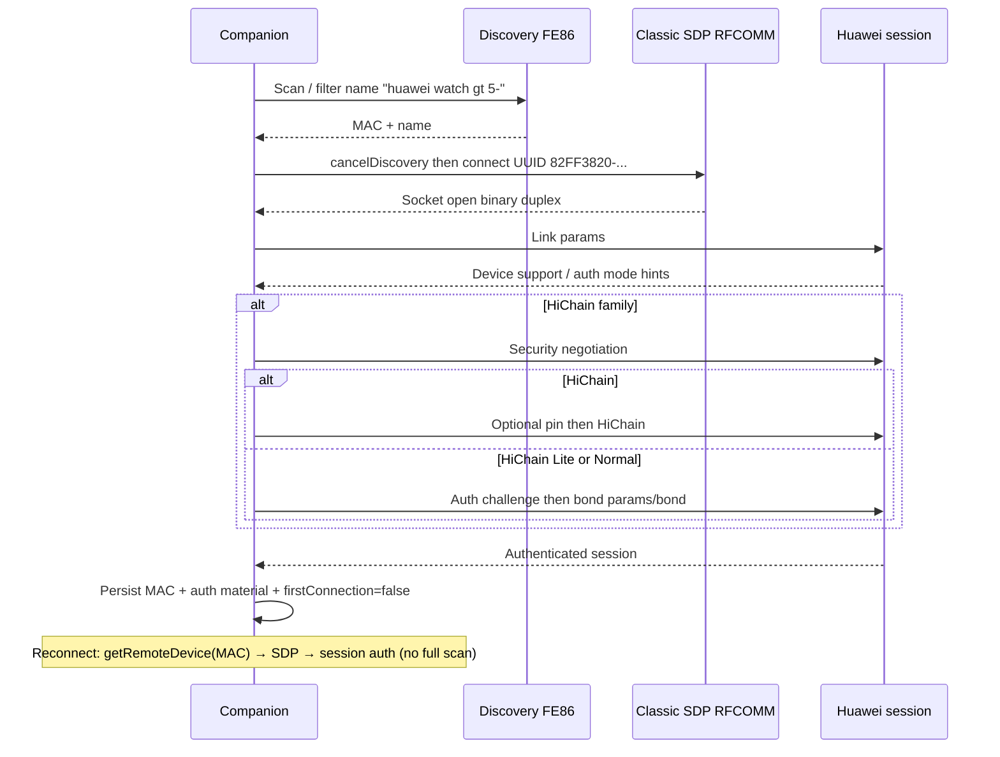
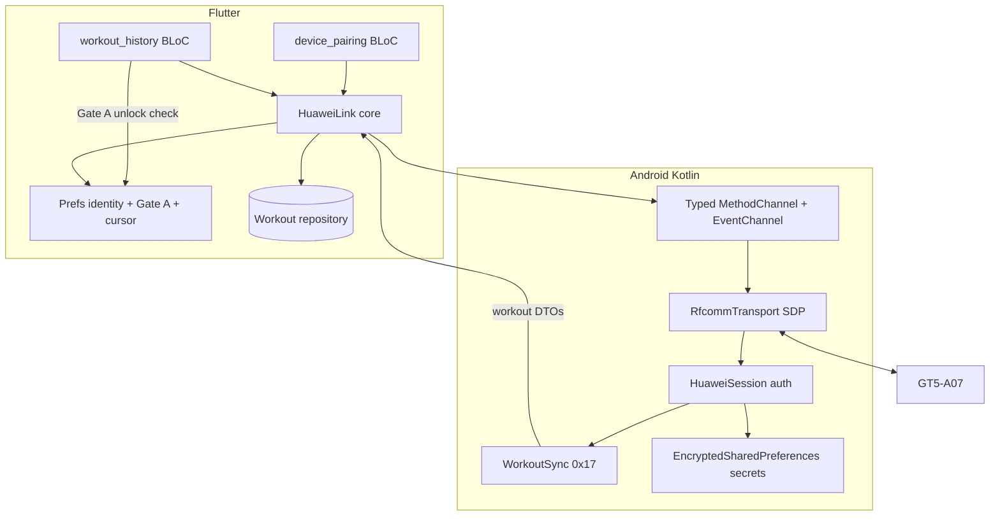
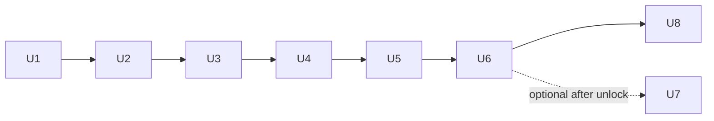
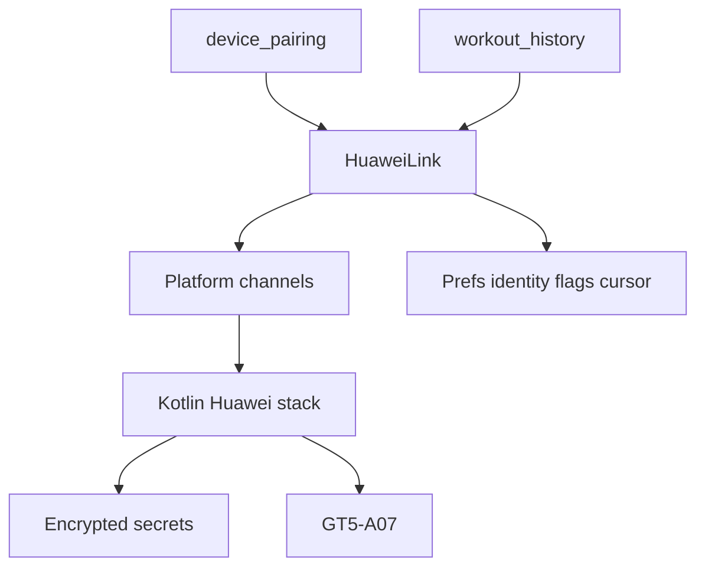

# feat: Huawei GT5 companion Gate A pair + Gate B sync

## Summary

Build an Android-only Fitness OS companion that owns the Huawei Watch GT5-A07 radio link without Huawei Health at runtime. **First-cut definition of done is Gate A (U1–U6 + U8):** discover, Classic SDP connect, Huawei auth/bond, remember device, reliable reconnect after app kill / reboot / Bluetooth toggle, and an evidence-backed GO/PIVOT/STOP note. **Phase 2 (U7) is optional** — workout history sync only after Gate A is unlocked on-device; do not start U7 until that unlock is true. Gadgetbridge remains the on-device oracle (smoke already confirmed); Fitness OS reimplements the protocol clean-room — Gadgetbridge AGPL-3.0 source is not copied.

---

## Problem Frame

Workout and device access for the GT5-A07 currently go through Huawei Health. The owner confirmed Gadgetbridge can pair this exact watch (origin R13), so protocol feasibility is proven — but **Gate A is not done in Fitness OS**. This plan is how Fitness OS reproduces that stack (Classic BR transport, auth, reconnect, then workout decode) inside the greenfield Flutter scaffold. (see origin: `docs/brainstorms/2026-07-17-huawei-gt5-companion-mvp-requirements.md`)

---

## Requirements

- R1. Android only; iOS out of definition of done
- R2. Only supported watch: Huawei Watch GT5-A07 (Watch GT 5 family name pattern)
- R3. Discover and connect over Huawei companion radio (Classic SDP session — not GATT-only) without Health as a runtime dependency
- R4. After first pair, remember device so reconnect skips full scan-and-select
- R5. Reconnect after each of app process kill, phone reboot, and Bluetooth toggle off/on either reaches authenticated connected **or** shows `reconnect_failed` with a clear next action while still remembering the device (matches origin AE2–AE4). Gate A unlock (U6) may credit an interrupt bit **only** when that interrupt reached authenticated `connected` — failure-accept does not unlock.
- R6. The UI must show clear connection state (expanded link-state table under High-Level Technical Design)
- R7. Gate B blocked until Gate A (R5) has passed via durable in-app unlock
- R8. Once Gate A passed, sync completed workouts from the watch
- R9. Synced workouts persist locally and remain viewable offline
- R10. History UI is a basic list of decodeable fields (type/date/duration preferred; sparse OK)
- R11. Pairing tests follow Health recovery order and record the winning path in experiment notes
- R12. End with evidence-backed GO / PIVOT / STOP recommendation
- R13. Satisfied externally (2026-07-17): Gadgetbridge works on this GT5-A07 — keep as oracle; re-run only if firmware/phone/Health setup breaks

**Origin actors:** A1 Owner, A2 Watch GT5-A07, A3 Huawei Health (setup obstacle)
**Origin flows:** F1 first-time pair, F2 reliable reconnect, F3 workout sync, F4 Health/auth recovery, F5 GB smoke (done)
**Origin acceptance examples:** AE1–AE7 (implement), AE8 (already passed)

---

## Scope Boundaries

- iOS support
- Multi-vendor / multi-watch architecture as an MVP goal
- Sport-specific detail screens (maps, splits, pace charts, SWOLF, strength breakdowns)
- Requiring complete field coverage for every sport type
- Coexistence with an *active* Huawei Health session
- Polished Settings beyond pairing, permissions, auth-key entry, and sync
- Production Fitness OS ecosystem features beyond this feasibility companion
- Sticky `connectedDevice` foreground service / reconnect while the app is killed (Gate A reconnect is on **next app open** — matches AE2/AE4)
- Shipping any Gadgetbridge AGPL-derived source (parsers, crypto, TLV) inside Fitness OS

### Deferred to Follow-Up Work

- Companion Device Manager pairing (useful later for OS-level companion privileges; not required for Gate A)
- Pace / GPS / swim-segment decode beyond totals fields needed for the basic list
- Formal legal review if the app is publicly distributed
- Compounding Gate A/B learnings into `docs/solutions/` after the cut

---

## Context & Research

### Relevant Code and Patterns

- Greenfield Flutter 3.35.5 / Dart 3.9.2 Mason scaffold: `lib/app/bootstrap.dart`, GetIt `lib/core/di/injector.dart`, routes `lib/app/routing/route_registry.dart`
- Feature shape (mason `feature` brick): `lib/features/<name>/{domain,data,presentation}` + BLoC + `Either<Failure, T>`
- Android host is empty `FlutterActivity`: `android/app/src/main/kotlin/com/example/fitness_os/MainActivity.kt`
- No Bluetooth permissions, plugins, or persistence exist yet — Classic SDP must be added natively
- Design system: `packages/blueprint_ui` (use existing primitives; barrel exports are incomplete — deep-import theme as `lib/app/app.dart` already does)

### Institutional Learnings

- None — `docs/solutions/` does not exist yet

### External References

- [Gadgetbridge Watch GT 5 support (PR #4155)](https://codeberg.org/Freeyourgadget/Gadgetbridge/pulls/4155) — device class; mostly supported; no-vendor pair
- [Huawei/Honor pairing](https://gadgetbridge.org/basics/pairing/huawei-honor-pairing/) — disable Health; 17-digit account `userId` auth key; factory reset alternative
- [Huawei/Honor specifics](https://gadgetbridge.org/internals/topics/huawei-honor-specifics/) — bulk workout sync; stuck sync → disconnect/reconnect; short workouts may not store
- [Bluetooth HCI snoop guide](https://gadgetbridge.org/internals/development/bluetooth/) — oracle captures vs Fitness OS
- Behavioral map (study order, not to copy): `HuaweiWatchGT5Coordinator` → `HuaweiBRSupport` → `HuaweiSupportProvider` auth/workout requests
- **Not Gate B:** [huawei-hr-overlay](https://github.com/fishuvn/huawei-hr-overlay) is live HR broadcast only
- Android Classic RFCOMM: [`createRfcommSocketToServiceRecord`](https://developer.android.com/develop/connectivity/bluetooth/connect-bluetooth-devices); permissions: [BT permissions](https://developer.android.com/develop/connectivity/bluetooth/bt-permissions)
- Flutter platform channels: [platform channels](https://docs.flutter.dev/platform-integration/platform-channels)

### Gadgetbridge pair flow (behavioral oracle for Gate A)

> Observed community/reference behavior for clean-room wire-spec writing. Do **not** port AGPL source into Fitness OS.



**Transport facts to match:**

| Fact | Value |
|------|--------|
| Discovery filter UUID | Huawei service `…FE86` (advertising / filter aid) |
| Session UUID | SDP `82FF3820-8411-400C-B85A-55BDB32CF060` (not SPP `00001101-…`) |
| Name pattern | `huawei watch gt 5-` / `huawei watch gt 5 pro-` (case-insensitive) |
| Read buffer scale | ~1 KB frame buffering on native read loop |
| Auto-reconnect intent | Remembered device + reconnect without rediscovery |
| First vs later connect | First pair may take a longer auth/configure path; reconnect uses remembered secrets |

**Auth branching (capture which path GT5-A07 takes during U3):** link params → device status (BR) → HiChain vs HiChain Lite vs Normal → auth/bond → configure. Optional 17-digit Huawei account `userId` when the watch was previously Health-bound.

**Test preconditions (every Fitness OS Gate A/B run):** Huawei Health force-stopped / permissions stripped; Gadgetbridge force-stopped (oracle only when intentionally capturing); watch advertising or previously bonded.

---

## Key Technical Decisions

| Decision | Choice | Rationale |
|----------|--------|-----------|
| Transport | Custom Kotlin Classic RFCOMM/SDP via MethodChannel + EventChannel (or Pigeon) | GT5 uses HuaweiBR path; BLE-only Flutter plugins cannot complete the companion link |
| Protocol / crypto location | Native Android first (same process as the socket) | Faster HCI debugging; Dart models only after framing is stable |
| AGPL strategy | Clean-room: docs + HCI/behavior oracle → original wire-spec → original code | Origin forbids shipping GB source; copying parsers would infect Fitness OS |
| Gate A “passed” | Durable in-app unlock flag set only after all three interrupt cases succeed | Makes AE5 enforceable; prevents “connected once → sync” false wins |
| Reconnect after kill | On next app open only (no sticky FGS in this cut) | Matches AE2/AE4; keeps Phase 1 focused on pair reliability |
| Persistence source of truth | Dart owns identity (MAC/name), Gate A interrupt bits + unlock, and last-sync cursor in prefs; secrets only in Android Keystore-backed `EncryptedSharedPreferences` (never Flutter prefs) | Avoid Flutter/native split-brain on cold start and Forget Device |
| Secret storage | Auth keys, session secrets, optional 17-digit Huawei `userId` only in EncryptedSharedPreferences; UI masks `userId` after entry | Backup dumps and debug logs must not expose Health account material |
| Radio session owner | Single GetIt-registered `HuaweiLink` / connection repository in `lib/core/huawei` — sole caller of the platform channel | Prevents `device_pairing` and `workout_history` racing scan/connect/sync |
| Dart channel API | After U1 transport proof, freeze Flutter API as typed session commands + events (connect/auth/disconnect/sync) — not a long-lived raw `write(bytes)` product surface | Framing stays native between transport and session |
| Discovery vs reconnect | Scan only for first pair / forget; reconnect uses `getRemoteDevice(savedMac)` | Origin R4 |
| OS bond vs Huawei auth | Treat as two layers; bond-lost keeps remembered device and prompts re-bond | Avoid wiping memory on Settings unpair |
| Sync trigger | Explicit Sync button for the whole cut; **blocked until `gate_a_passed`** — no auto-sync on connect | Resolves origin F3 ambiguity; keeps Gate B intentional |
| Gate A unlock writer | U6 is the sole writer that **sets** interrupt bits / `gate_a_passed` true; Forget Device (U4) and R11 reset are the only allowed clear/reset writers | Prevents false unlock; Forget may clear |
| Feature modules | Phase 1: mason `device_pairing` owns the channel via a pairing-scoped repository (or `HuaweiLink` used only by pairing). Introduce shared `HuaweiLink` for a second caller only when optional U7 lands | Avoids dual-feature abstraction before Gate A wins |

---

## Open Questions

### Resolved During Planning

- **Flutter Classic BT approach:** Custom native module + channels — not a GATT plugin, not “hope a Classic plugin supports Huawei UUID framing.”
- **Gate A unlock mechanism:** Explicit durable in-app flag; interrupt bits set only by owner checklist after each interrupt that reached authenticated `connected` (no auto-detect; failure-accept does not credit bits); U6 sole setter; U4 Forget / R11 reset clear.
- **Protocol layer placement:** Native-first alongside RFCOMM; freeze a wire-spec from observation before any Dart port of parsers.
- **Radio ownership (Phase 1):** Pairing-scoped channel owner; promote to shared `HuaweiLink` only if U7 needs a second caller. Connection/session state lives on the link owner; pairing BLoC projects link UI; (future) workout observes the link owner, not pairing BLoC.
- **Persistence split:** Dart prefs for identity/Gate A; EncryptedSharedPreferences for secrets only; Forget clears both atomically via one usecase.
- **Sync trigger:** Explicit Sync button; blocked until `gate_a_passed`.
- **Canonical Forget / R11 clear:** Always clear (1) identity MAC/name, (2) EncryptedSharedPreferences secrets, (3) Gate A interrupt bits, (4) `gate_a_passed`, (5) `last_sync_cursor` if present — same five categories everywhere.
- **Remembered device when OS bond missing:** Keep MAC/auth memory; surface bond-required / reconnect-failed with next action; do not auto-forget until user Forget Device.
- **After R11 factory reset / unlink:** Apply canonical five-category clear — treat as new first-time pair.
- **GB during Fitness OS tests:** Force-stop Gadgetbridge (and Health) so only one companion owns the link.
- **Empty workout list:** Protocol sync success with zero stored workouts is not Gate B failure; AE6 still requires a pre-seeded completed workout (prefer GB-verified, not a 30s stub).
- **U2 abort gate:** If clean-room crypto/auth cannot be independently specified from captures + public docs (without AGPL paste), stop before U3 and write PIVOT/STOP — do not invent crypto.

### Deferred to Implementation

- Exact auth mode the owner’s GT5-A07 negotiates on first pair vs after Health (HiChain / Lite / Normal) — capture from GB HCI snoop + Fitness OS logs during U3
- Minimal Workout totals TLV subset that yields type/date/duration on this firmware — spike during U7 after Gate A unlock
- Whether cold-start reconnect needs full crypto every time or can reuse session material — assume full session auth until proven otherwise
- Secure vs insecure RFCOMM socket preference on this phone/watch pair — try secure first (GB path), document fallback if needed
- Exact MethodChannel vs Pigeon choice once the control API surface stabilizes (either is acceptable)

---

## Output Structure

```text
lib/
  features/
    device_pairing/          # Gate A UI + BLoC + domain
    workout_history/         # Gate B UI + BLoC + domain (Phase 2)
  core/
    huawei/                  # Dart facades / DTOs talking to platform channel
android/app/src/main/
  AndroidManifest.xml        # BT permissions + Classic feature
  kotlin/.../huawei/
    RfcommTransport.kt       # SDP connect, read loop, events
    HuaweiSession.kt         # Clean-room auth/session orchestration
    HuaweiFraming.kt         # Packet/TLV framing from wire-spec
    WorkoutSync.kt           # Service 0x17 count → totals (Phase 2)
docs/
  plans/...                  # this plan
  experiments/               # Gate A/B notes + GO/PIVOT/STOP
  wire-specs/                # observed Huawei BR wire-spec (no GB source)
```

*(Layout is a scope declaration — implementer may adjust names if mason feature generation prefers different paths.)*

---

## High-Level Technical Design

> *This illustrates the intended approach and is directional guidance for review, not implementation specification. The implementing agent should treat it as context, not code to reproduce.*



**Link states** (pairing BLoC projects UI from the link/session owner):

| State | Meaning | Typical next action |
|-------|---------|---------------------|
| `disconnected` | No socket | Scan or reconnect |
| `permission_required` | Missing BT/nearby perms | System settings |
| `scanning` | Discovery in progress | Select GT5 |
| `connecting` | SDP connect in flight | Wait / cancel |
| `authenticating` | Link params / auth / bond | Wait |
| `auth_failed` | Negotiation failed | R11 recovery + account ID field |
| `bond_required` | OS Bluetooth bond missing | Complete system bond |
| `reconnect_failed` | Remembered device, connect failed | Retry; do not wipe memory |
| `gate_a_incomplete` | Session ready but unlock not earned | Finish interrupt checklist |
| `connected` | Session ready **and** Gate A unlocked (mutually exclusive with `gate_a_incomplete`) | Idle / optional Sync |

**Sync states** (owned by `workout_history` BLoC; only meaningful when link is `connected` and Gate A unlocked):

| State | Meaning | Typical next action |
|-------|---------|---------------------|
| `idle` | Not syncing | Owner taps Sync |
| `syncing` | Gate B in progress | Wait |
| `sync_stuck` | Hang detected | Disconnect → reconnect → retry sync |
| `sync_failed` | Hard failure | Retry / check notes |

---

## Phased Delivery

### Phase 1 — Gate A first win (definition of done)

Units U1–U6 + U8: permissions/transport, wire-spec (+ crypto inventory), auth/session, pairing UI, interrupt reconnect, Gate A unlock, feasibility recommendation. Success = AE1–AE4 + AE5 (no sync entry or blocked) + AE7 notes + R12. **Do not start U7 until unlock is true on-device.**

### Phase 2 — Gate B optional after unlock

Unit U7 only: workout count→totals→local list. Success = AE6. Skip entirely if Gate A fails or owner chooses PIVOT/STOP after U8.



---

## Implementation Units

### U1. Android permissions and Classic RFCOMM transport channel

**Goal:** From Flutter, scan for Classic/nearby Huawei advertisements, connect an RFCOMM socket to the Huawei SDP UUID, and exchange raw bytes with connection lifecycle events — transport proof only.

**Requirements:** R1, R2, R3 · **Origin:** F1

**Dependencies:** None

**Files:**
- Create: `android/app/src/main/kotlin/com/example/fitness_os/huawei/RfcommTransport.kt`
- Create: `android/app/src/main/kotlin/com/example/fitness_os/huawei/HuaweiBtPlugin.kt` (channel registration)
- Modify: `android/app/src/main/kotlin/com/example/fitness_os/MainActivity.kt`
- Modify: `android/app/src/main/AndroidManifest.xml`
- Modify: `android/app/build.gradle.kts` (only if minSdk/feature flags need adjustment)
- Create: `lib/core/huawei/huawei_bt_channel.dart`
- Test: `test/core/huawei/huawei_bt_channel_test.dart` (Dart API contract with mocked channel)
- Test: instrumented smoke documented in experiment notes (device required)

**Approach:**
- Declare Classic Bluetooth feature + BLE (for discovery) + API 31+ `BLUETOOTH_SCAN` / `BLUETOOTH_CONNECT` (with `neverForLocation` when possible) and legacy maxSdk 30 BT/location permissions
- Set `android:allowBackup="false"` on the application for this feasibility build (or backup rules excluding secrets + identity)
- **Dual-radio handoff (required):** BLE discovery / filter using Huawei service `…FE86` and name prefix `huawei watch gt 5-` → obtain MAC → `cancelDiscovery()` → Classic RFCOMM `createRfcommSocketToServiceRecord(82FF3820-…)` for the session. Classic-only discovery is insufficient; BLE-only never opens the companion socket.
- Temporary MethodChannel surface for U1 proof: permissions, startBleDiscovery/stop, connect(mac, sdpUuid), write(bytes) **debug-only**, disconnect
- EventChannel: adapter state, discovery results, connection state, inbound byte chunks
- Run blocking I/O off the main thread; buffer reads (~1 KB scale)
- Do **not** implement Huawei framing/auth in this unit — bytes only
- **API sunset:** Before U3 merges, replace product-facing Dart API with typed session commands; bind any raw `write(bytes)` to `BuildConfig.DEBUG` only (never release)

**Execution note:** Prove dual-radio handoff against the watch (same phone as GB smoke) before starting auth.

**Patterns to follow:** Flutter platform-channel binary `Uint8List` ↔ `byte[]`; empty `MainActivity` extension pattern

**Test scenarios:**
- Happy path: With mocked channel, `connect` then `write`/`onData` round-trip delivers the same bytes the native side emits
- Happy path: Discovery event with name matching `huawei watch gt 5-` is surfaced; non-matching names can be filtered by Dart or native policy
- Error path: Permission denied → Dart receives a typed failure suitable for `permission_required` UI
- Error path: Connect with discovery still running is prevented (cancelDiscovery called) or fails clearly
- Edge case: BT adapter off → connect fails with actionable error, not a hang
- Integration: On-device smoke — BLE find GT5-A07 by FE86/name, then SDP socket opens (auth may still fail; socket open is enough for U1)

**Verification:** Flutter can discover the watch (or bonded MAC), open the Huawei SDP socket, send/receive arbitrary bytes, and tear down cleanly. Experiment note records secure vs insecure socket outcome if both were tried.

---

### U2. Observed wire-spec and clean-room framing foundation

**Goal:** Produce a Fitness OS–owned wire-spec (from Gadgetbridge-as-oracle behavior + HCI snoops) and a minimal clean-room framer/parser for Huawei BR packets — enough to drive link-params and auth message I/O without AGPL code.

**Requirements:** R3, R13 (oracle use) · **Origin:** F1

**Dependencies:** U1

**Files:**
- Create: `docs/wire-specs/huawei-br-gt5-gate-a.md` (sequences, UUIDs, magic/version, message IDs as observed)
- Create: `android/.../huawei/HuaweiFraming.kt` (or equivalent)
- Create: `docs/experiments/2026-07-17-hci-capture-notes.md` (capture inventory; redacted)
- Test: `android` unit tests for framing round-trip against **owner-captured** fixtures (not extracted from GB jars)
- Test: fixtures under `test/fixtures/huawei/` for golden frames the team captured (redacted)

**Approach:**
- Capture short labeled HCI sessions: `gb_pair`, `gb_reconnect`, later `fos_*` — keep raw snoops off-repo; commit redacted notes/fixtures only; enable snoop only for short labeled sessions then disable (captures may include non-Huawei BT traffic)
- Document: discovery → SDP → link params → security/auth/bond → connected; note which HiChain branch the GT5-A07 takes
- **U2 exit criteria (blocking for U3):** (1) observed auth branch for this watch, (2) clean-room crypto/key-material inventory from public docs + captures — KDF/cipher/MAC/`userId` injection as independently specified steps, (3) fixture vectors for at least one challenge→response. If (2) cannot be written without AGPL paste → **abort to U8 PIVOT/STOP before coding U3**
- Implement original framing using independently known constants (magic `0x5A`, protocol version `0x02`, SDP UUID) and field layouts from captures/docs — **no GB source paste**
- Study GB docs/HCI outside the Fitness OS coding workspace; production code from wire-spec + redacted fixtures only
- PR checklist for U2+: reject GB class/method name paste, jar-extracted fixtures, or structural clones of AGPL crypto/parsers

**Patterns to follow:** Origin community evidence table; GB docs pairing + internals as behavioral references only

**Test scenarios:**
- Happy path: Known captured frame bytes parse into service/command/TLV map and re-serialize to equivalent bytes
- Edge case: Truncated buffer does not crash; waits for more data or signals incomplete frame
- Error path: Invalid magic / version rejected with clear error
- Integration: Framing used on live U1 socket can exchange at least the link-params request/response observed in `gb_pair`
- Edge case: If crypto inventory cannot be completed clean-room, unit stops with abort artifact (no U3 code)

**Verification:** Wire-spec exists with crypto inventory **or** explicit abort recorded; framing unit tests pass on owner fixtures when proceeding; live link-params exchange works against the watch.

---

### U3. Huawei session auth, bond, and secret persistence

**Goal:** Complete first-pair authenticated session after SDP connect, including optional 17-digit account auth key path, and persist secrets for later reconnect. Reconnect *policy* is U5 — this unit only makes session auth callable with persisted material.

**Requirements:** R3, R4, R6, R11 · **Origin:** F1, F4, AE1, AE7

**Dependencies:** U1, U2

**Files:**
- Create: `android/.../huawei/HuaweiSession.kt`
- Create: `lib/core/huawei/huawei_link.dart` (typed facade + sole channel owner skeleton)
- Create: Android EncryptedSharedPreferences helper (`androidx.security:security-crypto`) + channel ops `hasSecrets()` / `clearSecrets()`
- Modify: `AndroidManifest.xml` application `allowBackup="false"` if not done in U1
- Test: android unit tests for auth state transitions with fixtures
- Experiment: append auth-mode outcome + winning R11 path to `docs/experiments/` (redact secrets)

**Approach:**
- Orchestrate observed sequence: link params → (status) → HiChain branch as negotiated → auth → bond params/bond → session ready
- **OS bond vs Huawei auth:** Document sequence for Android `createBond` / user confirm when secure RFCOMM requires it; try secure socket first, insecure only as recorded exception (see Risks)
- Support optional auth key (17-digit Huawei `userId`) supplied from Flutter before connect; store only in EncryptedSharedPreferences; mask in UI
- On auth failure: emit `auth_failed`, disconnect socket, surface R11 hints; when recovery succeeds, record which R11 step won (AE7)
- Persist secrets in EncryptedSharedPreferences; persist MAC/name via Dart prefs (Dart is source of truth for identity); expose `hasSecrets` / `clearSecrets` for Forget + cold start
- Freeze typed Dart API: connect/authenticate/disconnect + session events (no product raw-byte API)
- Do not mark Gate A passed; do not implement interrupt reconnect matrix (U5)

**Execution note:** Compare Fitness OS HCI to `gb_pair` when auth fails; prefer observation over guessing crypto.

**Patterns to follow:** Origin R11 recovery order; pairing guide account-ID path

**Test scenarios:**
- Happy path: Fixture-driven auth sequence reaches session-ready
- Happy path: Covers AE1 precursor — first pair with Health disabled reaches authenticated connected and persists identity+secrets
- Error path: Missing/invalid account key when required → `auth_failed` with recovery hint
- Error path: Auth timeout → disconnect + `auth_failed`
- Error path: Covers AE7 — after staged auth failure, recovery via account-ID (or reset) records winning R11 step in experiment notes
- Edge case: Auth key present but Health still holding link → Health-contention guidance
- Integration: On-device first pair with Health disabled reaches authenticated connected

**Verification:** Owner can authenticate the GT5-A07 from Fitness OS with Health disabled; secrets persist across process death in EncryptedSharedPreferences; auth failure is first-class with R11 next steps.

---

### U4. Device pairing feature UI and connection state machine

**Goal:** Ship the Gate A Flutter feature: permissions UX, scan/select, connect, auth-key entry, Forget Device, and live link-state UI. Reserve prefs for identity + Gate A bits/unlock only (no sync cursor or Sync CTA in Phase 1).

**Requirements:** R1, R2, R3, R4, R6, R11 · **Origin:** F1, F4, AE1, AE7

**Dependencies:** U3

**Files:**
- Create: `lib/features/device_pairing/**` (mason `feature`)
- Modify: `lib/core/di/injector.dart`, `lib/app/routing/route_registry.dart` (replace `/` with pairing home)
- Add dep: `shared_preferences` (or equivalent) in `pubspec.yaml`
- Define prefs keys: `remembered_mac`, `remembered_name`, `gate_a_kill_ok`, `gate_a_reboot_ok`, `gate_a_bt_toggle_ok`, `gate_a_passed`
- Test: `test/features/device_pairing/presentation/device_pairing_bloc_test.dart`
- Test: `test/features/device_pairing/domain/..._test.dart`

**Approach:**
- BLoC projects **link states** from the pairing-scoped session/link owner
- First launch: permission gate → BLE scan → select GT5-A07 → connecting → authenticating → `gate_a_incomplete`
- Auth-key field when negotiation fails; mask after entry
- **Forget Device** applies the canonical five-category clear (cursor clear is a no-op until U7 creates the key)
- No Sync button in Phase 1 — AE5 is satisfied by absence of a sync entry point (U6 documents the unlock gate for future U7)
- U4 does **not** own remembered-MAC reconnect policy (that is U5); U4 may show “remembered device” UI shell but cold-start reconnect lands in U5
- Show R11 recovery hints; on recovery success ensure AE7 winning path is recorded

**Patterns to follow:** Mason feature DI; Blueprint UI primitives; `Either`/`Failure` mapping

**Test scenarios:**
- Happy path: Covers AE1 — scan → select → session ready → device remembered across bloc recreation
- Edge case: Scan empty → actionable empty state
- Error path: `auth_failed` shows account-ID / reset guidance
- Error path: Covers AE7 — recovery after auth_failed records winning R11 step
- Edge case: Permission denied maps to `permission_required`
- Edge case: Forget Device clears identity, secrets, interrupt bits, and unlock

**Verification:** App home is pairing; AE1 demonstrable on-device; link states distinguishable; Forget Device contract tested.

---

### U5. Remembered-device reconnect across Gate A interrupts

**Goal:** Make reconnect reliable for the three Gate A interrupt cases without repeating first-time pairing. Produce experiment evidence only — do **not** write Gate A unlock prefs (U6 owns those).

**Requirements:** R4, R5, R6 · **Origin:** F2, AE2, AE3, AE4

**Dependencies:** U4

**Files:**
- Modify: `lib/core/huawei/huawei_link.dart` + pairing BLoC reconnect policy
- Modify: `android/.../huawei/RfcommTransport.kt` / `HuaweiSession.kt` as needed for cold-start reconnect
- Create: `docs/experiments/gate-a-interrupt-matrix.md` (evidence only)
- Test: `test/features/device_pairing/..._reconnect_test.dart`

**Approach:**
- On app start with remembered MAC: load Dart identity → query native `hasSecrets()` → if MAC∧¬secrets → `auth_failed` / re-pair guidance (do not spin forever); else adapter-on → `getRemoteDevice` → SDP connect → session auth → `gate_a_incomplete`
- Interrupt matrix (document pass/fail in experiment doc — U6 checklist credits only **successful authenticated** reconnects):
  1. Force-stop app → reopen (AE2)
  2. Bluetooth off → on (AE3)
  3. Phone reboot → open app (AE4)
- While BT off, retain memory; show disconnected / waiting, not forget
- If OS bond missing: `bond_required` / `reconnect_failed` with re-bond action — still remembered
- U5 must **not** set `gate_a_*` prefs or `gate_a_passed`
- U5 **owns** the remembered-MAC reconnect path (UI + link policy); U4 does not duplicate it

**Test scenarios:**
- Happy path: Covers AE2 — after simulated process death (prefs reload), reconnect reaches authenticated session
- Happy path: Covers AE3 — adapter off then on triggers reconnect without clearing prefs
- Happy path: Covers AE4 — cold start path uses persisted MAC (on-device checklist)
- Error path: Covers AE2 failure-accept — `reconnect_failed` with device still remembered and clear next action (does **not** credit U6 unlock bit)
- Edge case: Remembered MAC with missing secrets → fail closed, no reconnect spin
- Edge case: Bond missing mid-reconnect → bond-required guidance, memory retained
- Integration: On-device matrix filled in experiment doc with pass/fail per interrupt

**Verification:** Interrupt matrix documented. Device identity never silently wiped. Gate A unlock prefs remain untouched by U5.

---

### U6. Gate A unlock flag and sync gate

**Goal:** Persist an explicit Gate A “passed” unlock only after the owner confirms all three interrupt checklist items (backed by U5 matrix evidence), and block workout sync until then.

**Requirements:** R5, R7, AE5 · **Origin:** F2, AE5

**Dependencies:** U5

**Files:**
- Modify: `lib/features/device_pairing/**` (checklist UI + unlock writer)
- Create: Gate A status usecase writing `gate_a_kill_ok`, `gate_a_reboot_ok`, `gate_a_bt_toggle_ok`, `gate_a_passed`
- Test: `test/features/device_pairing/gate_a_unlock_test.dart`

**Approach:**
- Interrupt bits are set **only** by explicit in-app checklist confirmation after each interrupt that reached authenticated session ready — no auto-detect; `reconnect_failed` does not credit a bit
- Unlock (`gate_a_passed`) only when all three bits are true; session UI moves from `gate_a_incomplete` → `connected`
- Invalidate using the canonical five-category clear on Forget Device and R11 factory-reset / unlink
- Phase 1 AE5: no sync entry point exists until optional U7; document that U7 domain must re-read `gate_a_passed` before any sync write

**Test scenarios:**
- Happy path: After all three checklist bits set, `gate_a_passed` is true and link state becomes `connected`
- Happy path: Covers AE5 — with unlock false, no sync API/entry exists (or future U7 would no-op); no workout writes
- Edge case: Only two of three bits recorded → unlock remains false
- Error path: Forget Device clears unlock + interrupt bits (+ identity/secrets via U4 contract)
- Edge case: Attempt to credit a bit after `reconnect_failed` only is rejected

**Verification:** AE5 holds by absence of sync in Phase 1; on-device Gate A unlock requires three successful interrupt credits. **Phase 1 first win is complete when U6 unlock is true on the owner device (then U8).**

---

### U7. Workout history sync (Gate B)

**Goal:** After Gate A unlock, download completed workouts (count → totals), persist locally via workout repository, and show a basic offline list. Sync remains explicit owner action only.

**Requirements:** R7, R8, R9, R10, AE6 · **Origin:** F3, AE5, AE6

**Dependencies:** U6

**Files:**
- Create: `lib/features/workout_history/**` (mason feature)
- Create: `android/.../huawei/WorkoutSync.kt`
- Extend: wire-spec with service `0x17` count/totals observations
- Persist: workout rows + `last_sync_cursor` (same prefs key reserved in U4)
- Test: `test/features/workout_history/**`
- Experiment: compare Fitness OS list vs Gadgetbridge workout count

**Approach:**
- Domain requires `gate_a_passed` + authenticated session before calling native sync
- Native emits workout DTOs over the channel; Flutter `workout_history` repository persists (native does not own the history DB)
- Implement count → totals first; defer pace/GPS/swim
- Expect bulk sync from last cursor; on hang → `sync_stuck` → disconnect/reconnect → retry
- Pre-seed a real completed workout (GB-verified) before claiming AE6
- Forget Device uses U4 contract only — do not invent a second clear path; after Forget → re-pair, sync must not reuse a stale cursor

**Execution note:** Do not start U7 until U6 unlock is true on-device (origin R7).

**Patterns to follow:** Origin F3; Huawei specifics bulk sync / stuck sync; avoid huawei-hr-overlay

**Test scenarios:**
- Happy path: Covers AE6 — sync with fixture totals produces ≥1 list row; still visible offline
- Happy path: Covers AE5 regression — unlock false still blocks sync API
- Edge case: Zero workouts on watch → empty list + guidance; AE6 still needs seeded workout for pass
- Error path: Sync hang → `sync_stuck` with disconnect/retry action
- Error path: Partial failure does not corrupt prior persisted rows
- Edge case: Forget → re-pair → sync does not reuse stale `last_sync_cursor`
- Integration: On-device count matches GB oracle within sparse-field tolerance

**Verification:** At least one decodeable workout appears in the local list after sync; survives offline; Gate A lock still enforced.

---

### U8. Experiment notes and GO / PIVOT / STOP recommendation

**Goal:** Close the feasibility cut with evidence: what worked, which R11 path won, Gate A/B outcomes, and a recommendation.

**Requirements:** R11, R12, AE7 · **Origin:** F4, AE7

**Dependencies:** U6 (minimum); U7 if Gate B attempted

**Files:**
- Create: `docs/experiments/gt5-a07-companion-feasibility.md` (redact secrets / full account IDs)

**Approach:**
- Record: Health setup path that worked (AE7); auth mode observed; interrupt matrix; sync results; HCI capture inventory (paths only, no raw snoops in repo)
- Recommendation rubric: Gate A fail → interim PIVOT/STOP even if sync untried; Gate A pass + Gate B fail → conditional GO on pairing with sync risk called out; both pass → GO on direct protocol bet

**Test scenarios:**
- Happy path: Covers AE7 — feasibility doc contains the winning R11 recovery step when auth recovery was required (or “no-vendor pair succeeded without account ID”)
- Edge case: If Gate B not reached, recommendation still ships based on Gate A evidence alone

**Verification:** A single experiment doc exists that supports GO / PIVOT / STOP without re-deriving history; no plaintext secrets committed.

---

## System-Wide Impact



- **Interaction graph:** MainActivity registers the Huawei plugin; `HuaweiLink` is the only Flutter caller of the channel; RouteRegistry home becomes pairing; workout feature depends on `gate_a_passed`
- **Error propagation:** Native failures → typed channel errors → domain `Failure` → link or sync BLoC states — never silent disconnect without UI
- **State lifecycle risks:** Partial auth must not leave “connected” without secrets; Forget Device clears identity, secrets, Gate A bits, unlock, and sync cursor; cursor corruption after partial sync
- **PII / secret boundary:** MAC, optional Huawei `userId`, auth keys, and session secrets are sensitive — EncryptedSharedPreferences for secrets; prefs for identity/flags only; never log full MAC/`userId`/keys (last-3 octets max in debug)
- **Logging & HCI hygiene:** Captures stay owner-private; commit redacted fixtures/notes only; never attach raw `btsnoop_hci.log` to the repo
- **Account-ID handling:** 17-digit `userId` is owner-supplied; UI masks after entry; never persist in Flutter prefs or experiment prose in cleartext
- **AGPL gate before merge:** Diff review for U2–U7 — reject GB source paste, AGPL parser/crypto clones, or jar-extracted fixtures
- **API surface parity:** Android-only; iOS stubs not required
- **Integration coverage:** On-device interrupt matrix and GB oracle comparison cannot be replaced by unit tests alone
- **Unchanged invariants:** `blueprint_ui` usage pattern; mason feature wiring markers; no multi-vendor device abstraction in this cut

---

## Risks & Dependencies

| Risk | Likelihood | Impact | Mitigation |
|------|------------|--------|------------|
| Auth mode on GT5-A07 differs from assumptions | Med | High | HCI capture from GB first; branch in session code; defer exact mode to U3 discovery |
| Health / GB still owning the link | High | High | Force-stop both; R11 order; exclusive-owner precondition in experiment notes |
| AGPL contamination (copy, AI rewrite, GB identifiers) | Med | High | Clean-room: study outside repo → wire-spec from HCI/docs → implement from wire-spec; PR checklist blocks GB paste |
| Secrets in plaintext prefs / logs / crash reports | Med | High | EncryptedSharedPreferences only; redaction allowlist; strip channel payloads from release logs |
| HCI / experiment artifacts leak account ID or keys | Med | High | On-device snoops; redacted fixtures only; no raw HCI in git |
| Classic RFCOMM flaky on OEM phones | Med | High | cancelDiscovery; secure then insecure; bond refresh; experiment notes |
| “Connected once” mistaken for Gate A | Med | High | U6 checklist unlock only; AE5 domain gate |
| Stuck workout sync | Med | Med | `sync_stuck` + disconnect/reconnect; don’t delete device |
| Short test workouts not stored | Med | Med | Seed real workouts; verify in GB before AE6 |
| Insecure RFCOMM required for connect | Med | High | Prefer secure-only for GO; if only insecure works, record as PIVOT condition — local MITM exposure |
| Workout rows (health PII) at rest | Low | Med | Phase 2: encrypted store or explicit accept-risk; include in Forget clear; never log payloads |
| Phone-wide HCI snoop captures other apps | Med | Med | Short labeled sessions only; disable after; keep captures on-device; redact before any share |
| Auth crypto cannot be clean-room specified | Med | High | U2 abort → U8 PIVOT/STOP before U3; do not invent/paste AGPL crypto |

---

## Alternative Approaches Considered

- **GATT-only Flutter BLE plugin:** Rejected — GT5 companion session is Classic SDP (`HuaweiBRSupport`), not FE86 GATT characteristics alone
- **Embed / fork Gadgetbridge code in-process:** Rejected — AGPL-3.0 copyleft; origin requires study-not-ship
- **Gate B in parallel with Gate A:** Rejected — origin two-gate rule; pairing failures must not be confused with sync failures
- **Sticky foreground service for always-on link:** Deferred — AE2/AE4 are app-open reconnect; FGS adds OEM/battery complexity without unlocking the first win
- **Dart-first protocol with thin native socket only:** Deferred as Phase 1 approach — slower HCI debug; revisit after wire-spec freezes

---

## Success Metrics

- AE1–AE4 pass on owner hardware in Fitness OS (not only in Gadgetbridge), with unlock bits only for successful reconnects
- AE5 satisfied in Phase 1 by no sync entry (or blocked when U7 exists)
- AE6 only if optional Phase 2 reached
- AE7 recovery path recorded
- R12 recommendation written with evidence (Gate A alone is enough for interim PIVOT/STOP)
- Zero Gadgetbridge source files in the Fitness OS tree
- U2 crypto inventory complete **or** explicit abort before U3

---

## Dependencies / Prerequisites

- Owner Android test phone + GT5-A07 with Gadgetbridge still available as oracle
- Ability to disable/force-stop Huawei Health; optional path to obtain 17-digit `userId`
- HCI snoop / Wireshark available for divergence debugging
- Flutter 3.35 toolchain matching the repo

---

## Documentation Plan

- `docs/wire-specs/huawei-br-gt5-gate-a.md` — observed protocol (U2)
- `docs/experiments/gate-a-interrupt-matrix.md` — AE2–AE4 evidence (U5)
- `docs/experiments/gt5-a07-companion-feasibility.md` — R11/R12 closeout (U8)
- Keep origin brainstorm as product truth; do not fork requirements into the plan

---

## Operational / Rollout Notes

- Single-owner feasibility build — not a store release
- Debug builds only; enable BT HCI snoop during divergence investigations
- When comparing to Gadgetbridge, run one app at a time

---

## Sources & References

- **Origin document:** [docs/brainstorms/2026-07-17-huawei-gt5-companion-mvp-requirements.md](docs/brainstorms/2026-07-17-huawei-gt5-companion-mvp-requirements.md)
- Related scaffold: `lib/app/`, `lib/core/`, `android/app/src/main/kotlin/com/example/fitness_os/MainActivity.kt`
- Gadgetbridge: [PR #4155](https://codeberg.org/Freeyourgadget/Gadgetbridge/pulls/4155), [pairing](https://gadgetbridge.org/basics/pairing/huawei-honor-pairing/), [specifics](https://gadgetbridge.org/internals/topics/huawei-honor-specifics/), [HCI](https://gadgetbridge.org/internals/development/bluetooth/)
- Behavioral reference classes (external, AGPL — study only): `HuaweiWatchGT5Coordinator`, `HuaweiBRSupport`, `HuaweiSupportProvider`, `HuaweiConstants`
