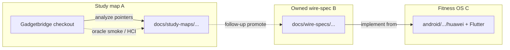
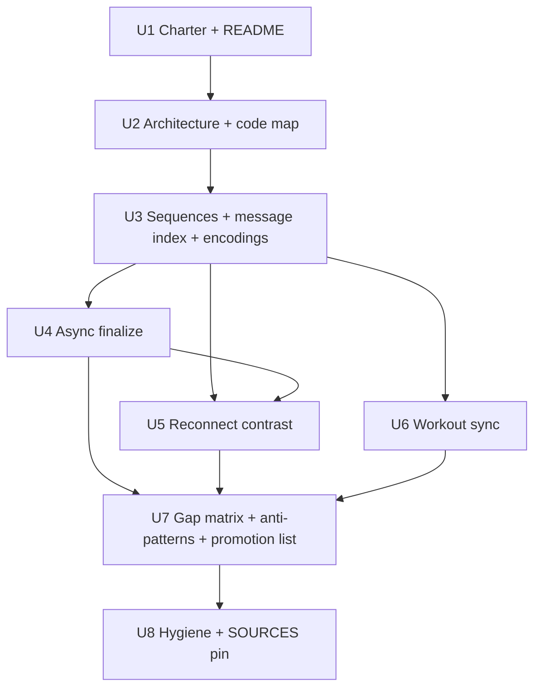

# feat: Gadgetbridge GT5 architecture + pair-sync code map

## Summary

Produce a Fitness OS–owned **study/oracle documentation package** that maps Gadgetbridge’s successful Huawei Watch GT 5 (GT5-A07) path from discovery through Classic BR connect, HiChain3 auth, post-pair configure, async pair-finalize, reconnect, and workout sync — with class/path ownership, ordered steps, encodings at the wire/behavioral level, libraries, and a Fitness OS gap matrix. The package is analysis/oracle context (A) for drafting and later promoting owned wire-spec facts; **implementing agents consume owned wire-spec (B) only**, never the study-map or GB checkout by default. This cut is **docs-only**: no Fitness OS Kotlin/Flutter changes, and **no promotion** into `docs/wire-specs/huawei-br-gt5-gate-a.md` (that stays a follow-up).

---

## Problem Frame

Fitness OS already has a partial Gate A stack and a Fitness OS–owned wire-spec, but agents still lack a single navigable map of how Gadgetbridge actually succeeds end-to-end on this watch. The brainstorm confirmed GB smoke (R13) and forbade shipping AGPL source. This plan closes the **analysis gap**: a study artifact that records GB ownership, ordering, and wire IDs for pair→finalize→sync so a *follow-up* promotion into the owned wire-spec can proceed without rediscovering HiChain3, FileUpload, async multiplex, or workout `0x17` under time pressure. This cut does **not** itself unblock Fitness OS coding — promotion (deferred) is the bridge to implementers. (see origin: `docs/brainstorms/2026-07-17-huawei-gt5-companion-mvp-requirements.md`)

---

## Requirements

- R1. Document GB’s GT5 BR path **end-to-end**: discover → SDP RFCOMM → link-params → auth branch → bind → configure → async finalize → reconnect → workout sync (origin F1–F3, F5)
- R2. Architecture + code map must name **GB packages/classes/methods as navigation pointers** (study order, ownership, next hop) — never paste AGPL method bodies, parsers, or crypto algorithms
- R3. Every flow step must record: trigger → SS/CC (and critical TLVs when known) → expected peer response → timeout/retry posture → terminal failure → Fitness OS status today
- R4. Pin GT5-A07 auth as **HiChain3** (`deviceSupportType=4`); document Normal / HiChain Lite as anti-patterns with observed failure modes (origin R3; wire-spec inventory)
- R5. Async pair-finalize must be first-class: PhoneInfo, DataSync/FeatureManager, FileUpload features path, Music/P2P keep-alives — including the pair-success predicate vs phone-only `session_ready` (origin AE1; experiment learnings)
- R6. Gate B map: workout service `0x17` count → totals → data (pace/GPS deferred), cursor semantics, stuck-sync recovery (origin R8–R10)
- R7. Include libraries / Android APIs GB relies on for this path (BT Classic SDP, crypto primitives at *family* level, framing CRC family) without copying GB implementations
- R8. Include a **Fitness OS ↔ GB gap matrix** and an **anti-patterns** appendix (Normal auth, blanket DataSync OK, GATT-only, etc.)
- R9. Package lives under `docs/study-maps/`; banner on every file: AGPL study/oracle — **not normative for implementation**; implementers cite owned wire-spec only
- R10. **Map-only cut:** do not edit `docs/wire-specs/huawei-br-gt5-gate-a.md` in this plan; list promotion candidates for a follow-up
- R11. Study source is a **local GB checkout outside the Fitness OS tree** (already seeded at sibling `_study_gadgetbridge`); never vendor GB into this repo

**Origin actors:** A1 Owner, A2 Watch GT5-A07, A3 Huawei Health (setup obstacle)  
**Origin flows:** F1 first-time pair, F2 reconnect, F3 workout sync, F4 Health recovery (precondition notes only), F5 GB smoke (done)  
**Origin acceptance examples:** AE1–AE7 inform gap matrix columns; AE8 already passed externally

---

## Scope Boundaries

- No Fitness OS application code changes (Kotlin, Dart, tests, fixtures)
- No edits to `docs/wire-specs/huawei-br-gt5-gate-a.md` in this cut
- No pasting AGPL source, test bodies, or line-by-line algorithm translations into study-map docs
- No committing raw HCI `.pcap` / secrets / `userId` / auth keys
- No implementing Gate A finalize or Gate B sync as part of this plan
- No embedding or forking Gadgetbridge inside Fitness OS
- Not a legal opinion — AGPL hygiene rules are engineering process only (formal counsel remains deferred per companion MVP plan)

### Deferred to Follow-Up Work

- Promote study-map facts into owned wire-spec (`docs/wire-specs/huawei-br-gt5-gate-a.md` and future Gate B wire-spec) after hygiene review
- Fill `docs/experiments/2026-07-17-hci-capture-notes.md` with annotated `gb_pair` / `gb_sync` timelines
- Compound learnings into `docs/solutions/` after Gate A/B stabilize
- Fitness OS implementation work driven by a later `/ce-work` on the companion MVP plan or a new implement plan

---

## Context & Research

### Relevant Code and Patterns

- Origin GB study order (skeleton): `docs/brainstorms/2026-07-17-huawei-gt5-companion-mvp-requirements.md` § Community Evidence
- Owned protocol facts: `docs/wire-specs/huawei-br-gt5-gate-a.md`
- On-device failures to encode as anti-patterns: `docs/experiments/gt5-a07-companion-feasibility.md`
- Companion MVP architecture decisions (AGPL clean-room, native-first): `docs/plans/2026-07-17-001-feat-huawei-gt5-companion-mvp-plan.md`
- Fitness OS native stack (gap-matrix right column): `android/app/src/main/kotlin/com/example/fitness_os/huawei/` (`RfcommTransport`, `HuaweiFraming`, `HuaweiSession`, `HuaweiHiChain`, …)
- Local GB study tree (outside repo): sibling `_study_gadgetbridge` sparse checkout of Huawei packages — planning pin **`a0948ee`** (re-pin in U8 if the checkout moves)

### Institutional Learnings

- No `docs/solutions/` yet — learnings live in wire-spec + experiments
- HiChain3 observed; Normal returns `100004`
- Phone `session_ready` ≠ watch pairing UI success
- Blanket DataSync `t=7f:100000` poisons GCM / closes RFCOMM
- FeatureManager action=2 needs ConfigCommand (`configId=900100007`, data `"01"`); features FileUpload follows
- Dual-radio: BLE `FE86` discover → Classic SDP `82FF3820-8411-400C-B85A-55BDB32CF060`

### External References

- [Gadgetbridge Huawei pairing](https://gadgetbridge.org/basics/pairing/huawei-honor-pairing/)
- [Huawei/Honor specifics](https://gadgetbridge.org/internals/topics/huawei-honor-specifics/)
- [Bluetooth HCI snoop](https://gadgetbridge.org/internals/development/bluetooth/)
- [PR #4155 Watch GT5](https://codeberg.org/Freeyourgadget/Gadgetbridge/pulls/4155) — device support provenance only
- [zyv/huawei-lpv2 wiki — Wire protocol](https://github.com/zyv/huawei-lpv2/wiki/Wire-protocol) — MIT public framing (prefer for owned wire facts later)
- Upstream: [Freeyourgadget/Gadgetbridge](https://codeberg.org/Freeyourgadget/Gadgetbridge) (GitHub mirror OK for clone)

### GB entry points already confirmed in study tree

| Layer | Class | Role |
|-------|-------|------|
| Device entry | `HuaweiWatchGT5Coordinator` | Name pattern; extends `HuaweiBRCoordinator` |
| Transport | `HuaweiBRSupport` | SDP UUID service; socket read → provider |
| Orchestrator | `HuaweiSupportProvider` | `initializeDevice*` chain, configure, dynamic services, `fetchWorkoutData` |
| Framing / TLV | `HuaweiPacket`, `HuaweiTLV`, `HuaweiConstants` | Magic/CRC/constants |
| Crypto family | `HuaweiCrypto` + HiChain request path | Study pointers only |
| Auth requests | `GetLinkParamsRequest`, `GetDeviceStatusRequest`, `GetSecurityNegotiationRequest`, `GetPincodeRequest`, `GetHiChainRequest`, `GetAuthRequest`, `GetBondParamsRequest`, `GetBondRequest` | Branching |
| Async | `AsynchronousResponse` | PhoneInfo, Music, FileUpload, P2P, … |
| Upload | `HuaweiUploadManager` + `SendFileUpload*` | Features / watchface / etc. |
| Workouts | `GetWorkoutCountRequest` → Totals → Data (+ Pace/Swim) | Gate B |
| Parser oracle | `HuaweiWorkoutGbParser` | Study for field inventory later; do not paste |

**HiChain3 path (provider):** `initializeDevice` → `initializeDeviceCheckStatus` → `initializeDeviceDealHiChain` (`deviceSupportType==4` → authMode 4) → `GetSecurityNegotiationRequest` → `initializeDeviceHiChainMode` (`GetPincodeRequest` if `firstConnection` then `GetHiChainRequest`) → `initializeDeviceConfigure` → `GetSupportedServicesRequest` → `initializeDynamicServices` → `GBDevice.State.INITIALIZED`.

---

## Key Technical Decisions

| Decision | Choice | Rationale |
|----------|--------|-----------|
| Deliverable type | Docs-only study-map package | User wants architecture + code map for a later custom implement agent; not another coding cut |
| Doc home | `docs/study-maps/gadgetbridge-huawei-gt5/` | Keeps AGPL oracle (A) separate from owned wire-spec (B) under `docs/wire-specs/` |
| Wire-spec promotion | Out of this cut | User chose map-only; promotion is a deliberate hygiene gate later |
| Citation depth | Paths/classes/methods + wire IDs + behavioral sequences | Enough for an agent to navigate GB and write owned specs; not enough to be a port recipe |
| Study tree location | Sibling checkout outside Fitness OS (`_study_gadgetbridge`) | Origin forbids vendoring AGPL; sparse Huawei paths already cloned for planning |
| A/B/C contract | A = study-map; B = wire-spec; C = Fitness OS code | Implementing agents default to B only; A is analysis/oracle context |
| Gate B in map | Included now | User asked pair→sync; map completeness ≠ permission to start companion-MVP U7 (Gate B product code) |
| Evidence tags | Each message/step tagged `public-doc` \| `owner-observed` \| `gb-pointer` \| `hci-pending` | Prevents “only evidence is AGPL source” facts from landing as if normative |

---

## Open Questions

### Resolved During Planning

- Doc home: `docs/study-maps/` (user)
- Wire-spec promotion this cut: no (user)
- Scope: full architecture + code map for custom clean-room implement (user)
- GB study tree: local sibling sparse checkout (planning bootstrap)

### Deferred to Implementation

- Exact GB pair-success predicate (INITIALIZED vs FileUpload of `feature_*` complete vs watch UI) — must be answered in U4 from GB + oracle logs; do not invent in the plan
- Full DataSync module inventory beyond `featureManager` on GT5-A07 — enumerate in U4 from `AsynchronousResponse` + on-device logs
- Minimal `feature_*.txt` content that clears watch pairing UI — document what GB builds; content bytes stay study-only until HCI confirms
- Whether reconnect re-runs full dynamic init + FeatureManager / FileUpload — contrast `firstConnection` in U5
- Totals-only vs need `GetWorkoutData` for AE6 list fields on this firmware — U6 notes both; on-device decides later

---

## Output Structure

```text
docs/study-maps/gadgetbridge-huawei-gt5/
  README.md                      # purpose, AGPL banner, A/B/C rules, who may read
  00-charter.md                  # scope, no-go list, citation hygiene, evidence tags
  01-architecture.md             # C4-ish: context + containers + component ownership table
  02-code-map.md                 # study-order table: path → class → method → next hop → FOS gap
  03-sequences.md                # behavioral mermaid: pair / reconnect / configure / finalize / sync
  04-message-index.md            # SS/CC/tag catalog by phase + evidence tags
  05-encodings-libraries.md      # framing/TLV/CRC/crypto *families*, Android BT APIs, GB libs used
  06-async-finalize.md           # PhoneInfo, DataSync, FeatureManager, FileUpload SM, pair-success
  07-workout-sync.md             # 0x17 count→totals→data, cursor, stuck-sync, parser field inventory
  08-gap-matrix.md               # GB oracle vs FOS today vs wire-spec status
  09-anti-patterns.md            # failed approaches (Normal, blanket DataSync OK, …)
  10-promotion-candidates.md     # facts ready to promote to wire-spec later (not applied here)
  SOURCES.md                     # dated links, AGPL vs MIT vs owner HCI, study-tree pin (commit SHA)
```

---

## High-Level Technical Design

> *This illustrates the intended approach and is directional guidance for review, not implementation specification. The implementing agent should treat it as context, not code to reproduce.*

### A / B / C separation



### End-to-end phases the map must cover

```mermaid
sequenceDiagram
  participant Disco as Discovery FE86
  participant Sock as Classic SDP
  participant Auth as HiChain3 session
  participant Cfg as Configure + dynamic init
  participant Async as Async finalize
  participant Sync as Workout 0x17

  Disco->>Sock: MAC + cancelDiscovery + RFCOMM
  Sock->>Auth: link-params → security-nego → pin? → HiChain
  Auth->>Cfg: encrypted product-info…services…dynamic queue
  Cfg->>Async: PhoneInfo + FeatureManager + FileUpload
  Note over Async: Pair-success predicate TBD in U4
  Async->>Sync: Gate B only after Gate A unlock product-side
  Sync->>Sync: count → totals → data; stuck → reconnect
```

### Dependency graph for documentation units



---

## Implementation Units

### U1. Charter, README, and A/B/C agent contract

**Goal:** Establish the study-map package, license banners, citation hygiene, evidence-tag vocabulary, and who may open which artifact.

**Requirements:** R2, R9, R11

**Dependencies:** None

**Files:**
- Create: `docs/study-maps/gadgetbridge-huawei-gt5/README.md`
- Create: `docs/study-maps/gadgetbridge-huawei-gt5/00-charter.md`
- Create: `docs/study-maps/gadgetbridge-huawei-gt5/SOURCES.md` (stub with upstream URL + “commit SHA TBD in U8”)

**Approach:**
- Banner language mirrors wire-spec: GB is behavioral oracle; no AGPL paste; implement from owned wire-spec only
- Secrets rule mirrors wire-spec: no `userId` / auth keys / pin digits / session secrets / raw HCI `.pcap` excerpts in study-map docs (pref key *names* and behaviors only)
- Define evidence tags: `public-doc`, `owner-observed`, `gb-pointer`, `hci-pending`
- State study-tree location as outside-repo path convention (document the sibling checkout name; do not add GB to Fitness OS git)
- Explicit “implementing agent default context = B only”

**Patterns to follow:**
- Banner style in `docs/wire-specs/huawei-br-gt5-gate-a.md`
- Origin AGPL decision in brainstorm Key Decisions

**Test scenarios:**
- Happy path: A new reader can state in one sentence whether they may paste GB code into Fitness OS (answer: no)
- Edge case: Charter lists what *may* be named (paths, classes, SS/CC) vs must not (algorithm bodies)
- Error path: Charter forbids vendoring `_study_gadgetbridge` into this repo

**Verification:**
- Package directory exists; every new file in later units can link to the charter banner rules

---

### U2. Architecture overview + code-map study order

**Goal:** C4-style architecture and a complete study-order table from GT5 coordinator through transport, provider lifecycle, managers, requests, packets, and tests.

**Requirements:** R1, R2

**Dependencies:** U1

**Files:**
- Create: `docs/study-maps/gadgetbridge-huawei-gt5/01-architecture.md`
- Create: `docs/study-maps/gadgetbridge-huawei-gt5/02-code-map.md`

**Approach:**
- Context: Owner phone, GT5-A07, Health obstacle, GB oracle, Fitness OS custom stack
- Containers: BLE discovery vs Classic BR session; GB app layers vs Fitness OS layers (comparison only)
- Component table columns: `path` | `class` | `responsibility` | `phase` | `next hop` | `FOS analogue` | `notes`
- Seed from confirmed provider methods (`initializeDevice*`, `initializeDynamicServices`, `fetchWorkoutData`, `onSocketRead`) and `AsynchronousResponse.handleResponse` dispatch list
- Include test package pointers as oracle names only (`TestHuaweiPacket`, `TestHuaweiTLV`, `TestHuaweiCrypto`, workout tests)

**Patterns to follow:**
- Origin § Gadgetbridge map study order
- Companion plan “Gadgetbridge pair flow” mermaid (behavioral)

**Test scenarios:**
- Happy path: From `HuaweiWatchGT5Coordinator`, a reader can walk next-hop links to workout fetch without guessing folders
- Edge case: BR vs LE support classes both listed; GT5 marked BR-only
- Integration: Every manager touched on pair (`Upload`, `Music`, `P2P`, `Async`) appears in the table even if Gate A product ignores some later

**Verification:**
- No Java/Kotlin code blocks from GB; tables are pointer-complete for pair→sync phases

---

### U3. Behavioral sequences, message index, encodings & libraries

**Goal:** Phase sequences (mermaid), SS/CC/tag index by phase, and encoding/library inventory at family level.

**Requirements:** R1, R3, R4, R7

**Dependencies:** U2

**Files:**
- Create: `docs/study-maps/gadgetbridge-huawei-gt5/03-sequences.md`
- Create: `docs/study-maps/gadgetbridge-huawei-gt5/04-message-index.md`
- Create: `docs/study-maps/gadgetbridge-huawei-gt5/05-encodings-libraries.md`

**Approach:**
- Sequences: first-pair, auth-branch decision, post-bind configure + dynamic init (mask-gated), stuck-sync recovery — participants are roles not GB methods
- Message index: rows for link-params, device-status, security-nego, HiChain/pin, product-info, set-time, battery, supported-services, timezone, accept-agreement, connect-status, music params, PhoneInfo, DataSync, FileUpload cmds, workout count/totals/data — each with evidence tag
- Encodings: magic `0x5A`, length, flags/slice, CRC-16/XMODEM family, TLV/VarInt rules (cite public LPv2 wiki + owner wire-spec; GB classes as pointers only)
- Libraries: Android `BluetoothDevice.createRfcommSocketToServiceRecord`, BLE scanner for FE86, Java crypto APIs GB uses *by name* (e.g. AES-GCM / HMAC / HKDF families) without pasting KDF code; note GB is a monolithic Android app (no separate Huawei Maven artifact)
- Crypto hygiene: name *families* and public/MIT/owner-observed wire steps only; forbid GB-derived ordered KDF/handshake recipes — normative crypto stays in owned wire-spec / MIT citations

**Execution note:** Prefer promoting constants already in `docs/wire-specs/huawei-br-gt5-gate-a.md` by reference rather than re-deriving from AGPL.

**Patterns to follow:**
- Wire-spec packet layout tables
- Public LPv2 wiki for framing narrative

**Test scenarios:**
- Happy path: Auth-branch sequence shows HiChain3 for `deviceSupportType=4` and marks Normal as wrong for GT5-A07
- Edge case: Slice/reassembly called out as session-layer concern for large FileUpload/workout payloads
- Error path: Message index marks `hci-pending` where owner capture is still empty
- Integration: Configure sequence distinguishes must-ACK vs fire-and-forget (`SendSetUpDeviceStatusRequest` 50ms timeout pattern documented as GB behavior)

**Verification:**
- A reader can list ordered wire phases without opening GB; every SS/CC row has an evidence tag

---

### U4. Async pair-finalize deep map (PhoneInfo, DataSync, FeatureManager, FileUpload)

**Goal:** Document the watch-driven finalize path that currently blocks Fitness OS watch pairing UI — with GB class/method pointers where they exist, explicit **negative results** where the pinned study tree has no symbol, and a pair-success predicate hypothesis + confirmation method.

**Requirements:** R3, R5

**Dependencies:** U3

**Files:**
- Create: `docs/study-maps/gadgetbridge-huawei-gt5/06-async-finalize.md`

**Approach:**
- Map `AsynchronousResponse.handleResponse` dispatch order (FindPhone, Music, Call, PhoneInfo, Menstrual, Weather, GPS, FileUpload, Watchface, Camera, App, P2P, Ephemeris, Battery)
- **Negative-result section (required):** At pin `a0948ee`, string/class search for `FeatureManager` / `DataSync` may find nothing under Huawei service packages. Document the search + empty result. Treat ConfigCommand / `svc=0x37` / `configId=900100007` as **`owner-observed`** (FOS experiments + wire-spec) until a GB producer/consumer is found (widen search / HCI — do not invent a GB class name)
- FileUpload state machine via `HuaweiUploadManager` + `SendFileUploadInfo/Hash/Ack/Chunk/Complete` — triggers, filename patterns (`feature_*`), encrypt flag, success/failure terminals; full `feature_*.txt` bytes stay off-repo
- Explicit section: **Pair-success predicate** — contrast (a) `INITIALIZED` after `initializeDynamicServices`, (b) FileUpload / notify completion, (c) watch pairing UI clear; evidence-tag each claim; default hypothesis: INITIALIZED alone is insufficient for watch UI
- Multiplex rules during configure waits; anti-pattern cross-link to blanket `t=7f` (appendix stays U7)

**Patterns to follow:**
- `docs/experiments/gt5-a07-companion-feasibility.md` failed approaches
- Wire-spec async notes (PhoneInfo, DataSync)

**Test scenarios:**
- Happy path: FileUpload SM steps listed with SS/CC from GB request classes
- Edge case: Negative-result section present if FeatureManager/DataSync symbols absent at pin
- Error path: Map symptoms of unanswered PhoneInfo and poisoned DataSync ACK to expected teardown (owner-observed OK)
- Integration: States when async frames interleave with `initializeDeviceConfigure` / dynamic queue

**Verification:**
- U4 either names GB owners for FeatureManager/DataSync **or** records negative search + owner-observed wire facts; FileUpload SM and pair-success hypothesis are always present

---

### U5. Reconnect vs first-pair contrast

**Goal:** Map how GB treats `firstConnection`, remembered secrets, and whether configure/FeatureManager/FileUpload re-run on reconnect — needed for origin F2 / AE2–AE4.

**Requirements:** R1, R3

**Dependencies:** U3, U4

**Files:**
- Modify: `docs/study-maps/gadgetbridge-huawei-gt5/03-sequences.md` (add reconnect sequence)
- Modify: `docs/study-maps/gadgetbridge-huawei-gt5/02-code-map.md` (firstConnection / secret persistence pointers)

**Approach:**
- Trace `setFirstConnection`, secret key prefs (`authkey`), HiChain path with/without `GetPincodeRequest`
- Document disconnect/reconnect entry (`connect` / `connectFirstTime` on `HuaweiBRSupport`)
- Contrast with Fitness OS reconnect-on-next-open policy (companion plan) — documentation only

**Patterns to follow:**
- Origin F2; companion plan reconnect decisions

**Test scenarios:**
- Happy path: Table shows which init steps skip when `firstConnection=false`
- Edge case: Missing OS bond / forgotten secrets → GB failure mode named
- Error path: Auth negotiation timeout → disconnect behavior documented

**Verification:**
- Reconnect sequence exists and does not assume full first-pair FileUpload of `feature_*` without GB evidence

---

### U6. Workout sync code map (Gate B)

**Goal:** Complete `0x17` sync map from `onFetchRecordedData` / `fetchWorkoutData` through count → totals → data (+ optional pace/swim), cursor, parser field inventory, stuck-sync recovery.

**Requirements:** R6, R3, R7

**Dependencies:** U3

**Files:**
- Create: `docs/study-maps/gadgetbridge-huawei-gt5/07-workout-sync.md`

**Approach:**
- Document start/end time window + `lastSportsActivityTimeMillis` / DB cursor behavior as GB semantics (pointer + behavioral description)
- Request chain classes and packet types under `packets/Workout`
- Note community rules: bulk since last sync; activity+workouts not together; short workouts may not store; stuck → disconnect/reconnect
- Field inventory for basic list (type/date/duration/distance/calories) from parser *structure names* / public docs — not pasted decode code
- Explicit: Gate B product code remains blocked until Gate A unlock; this unit is map-only

**Patterns to follow:**
- Origin F3, R8–R10; gadgetbridge.org Huawei specifics

**Test scenarios:**
- Happy path: Agent can list ordered sync requests and cursor update moment
- Edge case: Empty inventory vs protocol failure distinguished
- Error path: Stuck sync recovery steps documented
- Integration: Async handlers still live during sync (or GB exclusivity if proven otherwise)

**Verification:**
- `07-workout-sync.md` is sufficient for a later Gate B wire-spec draft without re-walking all of GB

---

### U7. Gap matrix, anti-patterns, promotion candidates

**Goal:** Make the map actionable for Fitness OS: what matches, what’s missing, what failed before, what should promote to wire-spec later.

**Requirements:** R8, R10

**Dependencies:** U4, U5 (U6 optional — Gate B rows may stay stubbed if U6 not finished; Gate A gap/anti-pattern/promotion must not wait on workout map)

**Files:**
- Create: `docs/study-maps/gadgetbridge-huawei-gt5/08-gap-matrix.md`
- Create: `docs/study-maps/gadgetbridge-huawei-gt5/09-anti-patterns.md`
- Create: `docs/study-maps/gadgetbridge-huawei-gt5/10-promotion-candidates.md`

**Approach:**
- Gap matrix columns: Phase | GB behavior | FOS today | Wire-spec today | Priority
- Anti-patterns: Normal auth, GATT-only, blanket DataSync OK, music-flood-as-root-cause, phone session_ready=paired, embed GB, huawei-hr-overlay as Gate B, Gate B before Gate A
- Promotion candidates: ordered list of facts with evidence tags ready for a future wire-spec PR — **do not apply** in this cut
- Promotion-ready gate: a fact may be listed as wire-spec-candidate only if tagged `public-doc` and/or `owner-observed` (HCI/experiment). `gb-pointer`-only or `hci-pending`-only rows go in a research-backlog subsection, not as promote-now candidates. Strip GB class/method names from any future normative wire-spec text.

**Patterns to follow:**
- Feasibility experiment + wire-spec inventories

**Test scenarios:**
- Happy path: Top Gate A blockers (FileUpload, pair-success) appear as highest priority gaps
- Edge case: Items that are FOS-complete still listed as “parity OK” so agents don’t rework them
- Integration: Every Critical gap from `docs/experiments/gt5-a07-companion-feasibility.md`, wire-spec Open risks, and U4/U5/U6 deferred questions appears in matrix or anti-patterns

**Verification:**
- Promotion file is non-empty for finalize gaps but wire-spec file git status unchanged by this plan’s work

---

### U8. Hygiene review, SOURCES pin, package acceptance checklist

**Goal:** Ensure the package meets clean-room citation rules and is agent-ready.

**Requirements:** R2, R9, R11

**Dependencies:** U7

**Files:**
- Modify: all files under `docs/study-maps/gadgetbridge-huawei-gt5/`
- Modify: `docs/study-maps/gadgetbridge-huawei-gt5/SOURCES.md` (pin GB commit SHA + clone instructions)

**Approach:**
- Sweep for pasted code blocks from GB; remove or rewrite as behavioral prose
- Sweep prose/tables (not only fenced code) for line-by-line algorithm/KDF/handshake translations, structural clones of GB parsers/crypto, and embedded GB test/fixture vectors
- Sweep for secrets: no `userId` / auth keys / pin digits / session secrets / raw HCI excerpts
- Confirm banners present on every file
- Pin study-tree commit SHA and sparse-checkout paths in SOURCES
- Acceptance checklist (documentation “tests”):

| ID | Checklist item |
|----|----------------|
| A1 | Flows discover→sync have ordered steps + handoffs |
| A2 | HiChain3 pinned; Normal anti-pattern present |
| A3 | Configure + dynamic init mask gating documented |
| A4 | Async finalize + FileUpload SM documented |
| A5 | Pair-success predicate stated with evidence tag (`gb-pointer` / `owner-observed` / `hci-pending`) |
| A5b | README **Gate A analysis readiness**: `draft` if pair-success or FeatureManager ownership is only `hci-pending`/negative-result; `analysis-complete` only when FileUpload SM is documented and pair-success has non-pending evidence or an explicit owner decision to proceed on hypothesis |
| A6 | Anti-patterns appendix complete |
| A7 | Reconnect contrast present |
| A8 | Workout `0x17` map present |
| A9 | Zero AGPL code fences; no line-by-line algorithm/KDF/handshake translations or structural clones of GB parsers/crypto; no embedded GB test/fixture vectors; implementers pointed at wire-spec |
| A10 | Promotion candidates listed with promotion-ready evidence gate; wire-spec not edited |
| A11 | Secrets/pcap/`userId` redaction sweep clean; no example auth values |

**Test scenarios:**
- Happy path: Checklist A1–A11 all pass or explicitly waive with reason
- Error path: Any AGPL code fence or step-by-step crypto recipe from GB pointers found → must be removed before done
- Integration: README links every numbered doc; no orphan files

**Verification:**
- Package README states “ready for analysis / wire-spec follow-up (implementers use B only)”; SOURCES has commit SHA

---

## System-Wide Impact

- **Interaction graph:** Documentation only — no runtime callbacks. Downstream consumers: (1) analysis agents writing/updating the study-map, (2) follow-up promotion PRs into wire-spec, (3) implementing agents on companion Gate A finalize / Gate B. Analysis sessions may open A + GB checkout; implementation sessions must not load A or AGPL trees by default.
- **Error propagation:** N/A at runtime. Doc failure mode is **contamination**: an implementer copies study-map structure into Kotlin packages or pastes GB algorithms. Mitigate with banners, U8 sweep, and PR checklist language in README (“reject AGPL paste / structural clone”).
- **State lifecycle risks:** Stale map if GB upstream moves — mitigate with SOURCES commit pin (`a0948ee` at plan time) + “re-verify on GB upgrade” note. Partial package (Phase 1 without U4) must not be advertised as Gate A–unblocking.
- **API surface parity:** None in app; parity is the gap matrix vs `HuaweiSession` / future `WorkoutSync`.
- **Integration coverage:** Completeness judged by U8 checklist A1–A11 and a dry-run: “can a blinded agent draft wire-spec finalize + `0x17` sections from map + LPv2 wiki + existing wire-spec without opening GB?”
- **Unchanged invariants:** Existing wire-spec, companion MVP plan status, Fitness OS code, and experiment files remain authoritative for product/runtime until a follow-up explicitly updates them. Gate A unlock and Gate B product work stay owned by the companion MVP plan, not this docs plan.

---

## Risks & Dependencies

| Risk | Likelihood | Impact | Mitigation |
|------|-----------|--------|------------|
| AGPL contamination via over-detailed map | Med | High | Citation hygiene in U1/U8; no code pastes; A/B/C contract |
| Map incomplete on FileUpload/pair-success without HCI | High | High | Allow `hci-pending`; U4 must still map GB SM; follow-up capture |
| GB upstream drift vs pinned SHA | Med | Med | Pin SHA; note re-smoke when upgrading study tree |
| Agents implement from A instead of B | Med | High | Banners + README; promotion deferred deliberately |
| Scope creep into Fitness OS coding | Med | Med | Scope boundaries + R10; ce-work on this plan stays docs-only |
| Codeberg scrape blocks | Low | Low | Use local clone / GitHub mirror (already working) |

---

## Alternative Approaches Considered

- **Single wire-spec file under `docs/wire-specs/`:** Rejected — user chose `docs/study-maps/` for clear A/B split
- **Map + promote wire-spec in same cut:** Rejected — user chose map-only; promotion is a hygiene-gated follow-up
- **Embed GB as library / submodule in Fitness OS:** Rejected — origin AGPL decision
- **HCI-only black-box map without GB class pointers:** Rejected — user asked for architecture + code map; HCI inventory still largely pending
- **Deepen companion MVP plan instead of new plan:** Rejected — companion plan is completed coding plan; this is a distinct docs deliverable

---

## Success Metrics

- Study-map package passes U8 checklist A1–A11 (and A5b readiness label is set — `draft` is an acceptable ship state for this map-only cut)
- U8 dry-run rubric (analysis agent, not implementer): given only study-map + LPv2 wiki + existing wire-spec (GB tree closed), produce a bullet list of wire-spec promotion candidates for Gate A finalize — pass if list covers FileUpload SM + pair-success hypothesis + PhoneInfo without inventing GB class names absent from the map
- Zero AGPL source files and zero GB code blocks land in Fitness OS git
- Promotion candidates file lists FileUpload/pair-success as top follow-ups (only `public-doc` / `owner-observed` as promote-now); this cut does **not** require Fitness OS Gate A to unlock

---

## Dependencies / Prerequisites

- Local GB study checkout readable (sibling `_study_gadgetbridge` or equivalent sparse clone; planning pin `a0948ee`)
- Existing FOS docs: brainstorm, wire-spec, feasibility experiment
- Optional but valuable: owner can re-run GB pair+sync with HCI snoop labeled `gb_pair` / `gb_sync` (fills `hci-pending` rows; not a hard blocker for first map draft)

---

## Phased Delivery

### Phase 1 — Navigation skeleton (U1–U3)

Charter, architecture, code map, sequences, message index, encodings — enough to navigate GB safely.

### Phase 2 — Gate A finalize + reconnect (U4–U5)

Deep map of the current Fitness OS blocker and reconnect contrast.

### Phase 3 — Gate B + closure (U6–U8)

Workout sync map, gap/anti-pattern/promotion docs, hygiene + SHA pin.

---

## Documentation Plan

- Primary output: `docs/study-maps/gadgetbridge-huawei-gt5/**`
- Discoverability stays in study-map README / SOURCES (no origin brainstorm edits in this cut)
- Explicit non-touch: `docs/wire-specs/huawei-br-gt5-gate-a.md` (this cut)
- After this plan: separate follow-up to promote candidates from `10-promotion-candidates.md` (U7) into wire-spec, then implement

---

## Sources & References

- **Origin document:** [docs/brainstorms/2026-07-17-huawei-gt5-companion-mvp-requirements.md](../brainstorms/2026-07-17-huawei-gt5-companion-mvp-requirements.md)
- Related plan: [docs/plans/2026-07-17-001-feat-huawei-gt5-companion-mvp-plan.md](./2026-07-17-001-feat-huawei-gt5-companion-mvp-plan.md)
- Related wire-spec: [docs/wire-specs/huawei-br-gt5-gate-a.md](../wire-specs/huawei-br-gt5-gate-a.md)
- Related experiment: [docs/experiments/gt5-a07-companion-feasibility.md](../experiments/gt5-a07-companion-feasibility.md)
- External: Gadgetbridge Huawei pairing/specifics/HCI docs; PR #4155; huawei-lpv2 wiki
- Study tree: sibling `_study_gadgetbridge` (not part of this repository)
