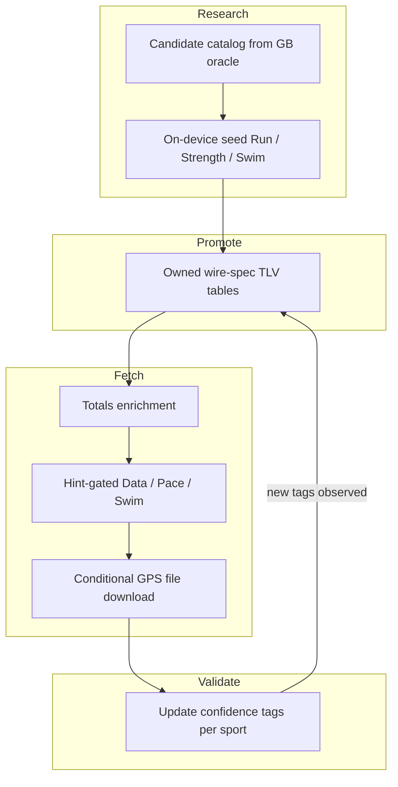

# feat: GT5-A07 workout data catalog + fetch (Run/Strength/Swim)

> **Superseded** by [`docs/plans/2026-07-18-003-feat-gt5-full-metrics-catalog-plan.md`](./2026-07-18-003-feat-gt5-full-metrics-catalog-plan.md) — full metrics catalog for derivation (workouts + vitals + sleep + IMU limits). Workout enrichment survives as Phase C / U4 of that plan. Kept for history.

## Summary

Produce a Fitness OS–owned catalog of every workout data point the Huawei Watch GT5-A07 can expose for **Running, Strength training, and Swimming**, tagged by evidence level, then promote proven surfaces into the owned wire-spec and extend Gate B beyond Count→Totals so those fields are fetched, stored, and validated on-device per sport. Gadgetbridge remains a behavioral oracle only; parsers ship only after wire-spec promotion.

---

## Problem Frame

Gate B already lists completed workouts from Totals (`0x17:0x08`) and has on-device proof for one Strength session (`type=140`). Fitness OS still does not know — per sport — which Totals TLVs, sample streams, pace blocks, swim segments, or GPS tracks actually appear on this watch. Without that inventory and validation loop, enrichment work either under-fetches or invents fields from community claims. Related MVP requirements (`docs/brainstorms/2026-07-17-huawei-gt5-companion-mvp-requirements.md`) intentionally deferred sport-detail completeness; this plan is the next cut that builds an evidence-tagged inventory and fetches only surfaces proven on this watch for the three target sports.

---

## Requirements

**Catalog & evidence**
- R1. Publish a durable catalog of workout data-point **candidates** for Running, Strength, and Swimming across Count, Totals, Data, Pace, Swim, and GPS — every row dated with an evidence tag (not every field proven)
- R2. Tag every catalog row with evidence using **per-sport labels** (not a single exclusive enum): `community-oracle` | `wire-spec` | `on-device-proven` | `absent-in-observed-sessions` | `unknown`. Promotion path: `community-oracle` → `wire-spec` (after owned contract) → `on-device-proven` (after GT5 value observed). Prefer `absent-in-observed-sessions` over over-claiming `absent-on-device`

**On-device characterization**
- R3. Seed and Sync real sessions for each target sport (duration floor ~2+ min) and record Count hints + Totals `type` + present TLV tags before calling fields fetchable
- R4. Resolve GT5-A07 activity `type` values for Running and Swimming (pool vs open water if distinct) from on-device Totals, not from conflicting label maps alone

**Wire-spec / clean-room**
- R5. Promote observed SS/CC/tag contracts into owned wire-spec **before** adding Kotlin parsers (AGPL clean-room)

**Fetch & GPS**
- R6. Extend Gate B fetch so Count hints gate enrichment: `dataCount>0` → Data `0x0a`; `paceCount>0` → Pace `0x0c`; `segmentsCount>0` → Swim `0x0e`

**Persist & merge**
- R7. Persist promoted fields through existing channel ownership: native DTO maps → `HuaweiLink` → Flutter `workout_history` merge-by-`number`
- R8. Treat GPS as a **file-download** surface (not a Totals TLV); catalog it; on outdoor Run observe whether a track file exists; implement download/parse/storage only if observed on GT5-A07
- R9. Update catalog confidence after each on-device sport validation; do not collapse community-oracle into proven

**Auth gate**
- R10. Preserve Gate A gate: Sync remains behind durable `gate_a_passed` + encrypted `session_ready`

**Actors (carried for context):** Owner, Watch GT5-A07, Huawei Health as setup obstacle only  
**Related flows:** Gate B sync enrichment; sport seed/validation matrix

---

## Scope Boundaries

- No Huawei Health / HMS SDK dependency
- No AGPL paste from `_study_gadgetbridge` into Fitness OS source or fixtures
- No live HR overlay as a workout-history path
- No sport-detail UX (maps, pace charts, SWOLF screens) — fetch/store + catalog only; list UI may show newly persisted scalars if already present
- No requiring complete field coverage for all three sports before shipping any enrichment — ship proven subsets
- No iOS
- No starting workouts from the phone
- No daily activity / sleep / SpO2 / stress sync (non-workout surfaces stay out)

### Deferred to Follow-Up Work

- Rich sport-detail screens and route map UI
- Incremental sync cursor semantics once enrichment is reliable (today’s full-history testing window may remain)
- Promoting the separate Gadgetbridge study-map plan’s `07-workout-sync.md` package if that plan lands later (this plan’s catalog is the Fitness OS–owned inventory)
- Strength set/rep breakdown if the watch never exposes it on Totals/Data (catalog as `absent-in-observed-sessions` when confirmed)
- Encrypt-at-rest for workout prefs + GPS/sample side-files (or revisit accept-risk)
- Per-workout delete / GPS retention caps beyond Forget-only

---

## Context & Research

### Relevant Code and Patterns

- Gate B Count→Totals: `android/app/src/main/kotlin/com/example/fitness_os/huawei/HuaweiWorkoutSync.kt`
- Session / channel: `HuaweiSession.kt`, `HuaweiBtPlugin.kt`, `lib/core/huawei/huawei_link.dart`
- History persist/UI: `lib/features/workout_history/`
- Normative Gate B fragment: `docs/wire-specs/huawei-br-gt5-gate-a.md` § Gate B
- POC learnings: `docs/learnings/2026-07-18-huawei-gt5-companion-poc.md`
- Handoff next work: `docs/handoffs/2026-07-18-huawei-gt5-gate-a-stack-handoff.md`
- Unit-test style: `android/app/src/test/java/.../huawei/HuaweiWorkoutSyncTest.kt` (synthetic TLVs; null transport)
- Fixture hygiene: `test/fixtures/huawei/README.md`

### Institutional Learnings

- Strength Totals proven: `number`, `type=140`, start/end, `duration≈112s`
- Count `dataCount` / `paceCount` / `segmentsCount` parsed natively but ignored for list
- First Count may be 0 (watch still storing); short workouts may not persist
- Stuck sync → disconnect/reconnect; do not corrupt prior Flutter rows
- Phone `session_ready` ≠ Gate A unlock; Sync needs `gate_a_passed`

### External References

- Gadgetbridge Huawei feature matrix: workout sync fields vary by device/workout ([Huawei/Honor gadgets](https://gadgetbridge.org/basics/topics/huawei-honor/))
- Local GB study tree (outside repo): `_study_gadgetbridge` — oracle for field **names**, SS/CC, and TLV tags only (`packets/Workout.java`, workout GPS via `HuaweiFileDownloadManager.workoutGpsFileRequest`, point fields via `HuaweiGpsParser.GpsPoint`)
- Community type enum in GB `HuaweiWorkoutGbParser` **disagrees** with Fitness OS UI provisional map for Walk/Run/Swim IDs — on-device `type` wins

---

## Key Technical Decisions

- **Phased evidence:** Catalog first from community-oracle (GB field/tag inventory), then promote and fetch only after per-sport on-device observation
- **Hint-gated enrichment:** Never blindly request Data/Pace/Swim when Count hint is 0 — reduces stuck-sync risk on Strength
- **Promote-before-parse:** New TLV meanings land in `docs/wire-specs/` (Gate B extension or sibling Gate B enrichment section) before Kotlin grows
- **Three distinct surfaces stay separate:** (1) FeatureUpload `0x28` = pair finalize only; (2) Workout `0x17` TLV enrichment = Sync orchestration; (3) Workout GPS = separate FileDownload collaborator after outdoor-Run observe proves a track. Rejected: one shared “file SM” for FeatureUpload + GPS, or GPS-as-Totals-TLV
- **Type authority:** Freeze Running/Swimming `type` values from on-device Totals `0x14`; treat both FOS UI map and GB enum as provisional until then
- **Enrichment-monotonic merge:** Today’s Flutter replace-by-`number` must become field-preserving: never clobber a richer local row with Totals-only incoming; nested `samples` / `paceBlocks` / `swimSegments` / GPS refs only replace when the new fetch for that surface is complete. Persist per-workout TLV completeness (`totals_only` | `enrichment_partial` | `enrichment_complete`). GPS outcome is a separate `gpsState` (`none` | `pending` | `stored` | `absent_in_observed_sessions`) added only if U6 observes a track path
- **Stuck / partial status:** Native may return `ok` | `empty` | `partial_batch` | `stuck` | `error` | `not_ready`. Flutter merges on `ok` and on `stuck`/`partial_batch` when `workouts` is non-empty (behavior change vs today’s drop-on-stuck). UI still prompts reconnect on stuck. Single-flight Sync lock on `HuaweiLink` / repository while enrichment runs
- **Cursor bookkeeping (this cut):** Keep the **full-history** Count window. Cursor write remains best-effort bookkeeping only; **hard invariant:** do not narrow the Count window to cursor while any local workout has incomplete enrichment flags. Prefs write failure → no cursor bump. True incremental cursor semantics stay deferred
- **Prefs vs side-files:** Totals scalars stay in `workoutsJson`. Nested series default to prefs/JSON for this cut until U2/U5 measures a real size failure; then spill to side-files. GPS (if present) always side-file. MethodChannel returns scalars + small nests or path refs only — native must not push Binder-busting sample arrays
- **Sync multiplex:** During `syncWorkouts`, do not start FeatureUpload; FileDownload (if any) is an exclusive Sync sub-phase after that workout’s TLV enrichment; keep single-flight Sync on `HuaweiLink`
- **Forget Device:** Extend clear to workouts JSON + workout side-files (samples/pace/swim/GPS); single Forget path only
- **Privacy logging:** Catalog/experiments may record tag presence; never commit lat/lon, raw GPS, or full HR sample streams; runtime logs redact coordinates

---

## Open Questions

### Resolved During Planning

- **Inventory vs fetch:** Both — catalog artifact plus fetch/store units for proven fields
- **Evidence bar:** Community-oracle catalog is required, and on-device validation per sport is required before `on-device-proven` / fetchable claims
- **GPS in this plan:** Catalog + observe; implement only if outdoor Run produces a track file on GT5-A07
- **Sample DTO shape:** Nested channel keys `samples`, `paceBlocks`, `swimSegments` only when a surface is fetched; camelCase + unit suffixes; Flutter `toJson` omits nulls; **omit** absent/empty nests (no placeholder empty lists). Schema names are reserved in docs, not emitted until U5/U6 persist them
- **At-rest risk (this cut):** Owner-only local plaintext for Totals scalars in prefs is explicitly accepted; encrypt-at-rest for workouts/GPS remains a follow-up. Backup: keep `allowBackup=false` / exclude workout prefs and any side-file dirs
- **U2 kill/continue:** After sport seed + hint force-probe, if no sport shows non-zero `dataCount`/`paceCount`/`segmentsCount` and no GPS file, stop after Totals expansion + catalog; do not start U5/U6 FileDownload

### Deferred to Implementation

- Exact prefs size threshold / sample side-file cutoff (tune after U2 payload sizes; planning default ~50–100 KB or ~500–1000 samples per workout)
- Whether pool and open-water swimming both need seed sessions for the user’s definition of “Swimming” (default: seed pool first; add open water if pool type ≠ user’s swim mode)
- Whether GPS new-sync flag differs on this firmware (observe from device capability / file list)
- Retention demotion of old samples/GPS under space pressure (Totals always kept)

---

## Output Structure

```text
docs/catalogs/
  gt5-a07-workout-data-points.md   # durable catalog + confidence matrix
docs/experiments/
  gt5-a07-sport-seed-matrix.md     # per-sport seed / Sync observations
docs/wire-specs/
  huawei-br-gt5-gate-b-enrichment.md  # preferred: sibling enrichment wire-spec
  huawei-br-gt5-gate-a.md             # link to enrichment doc from Gate B section
```

---

## High-Level Technical Design

> *This illustrates the intended approach and is directional guidance for review, not implementation specification. The implementing agent should treat it as context, not code to reproduce.*



**Sync shape (directional):**

```text
gate_a_passed + session_ready
  → Count 0x17:0x07  (collect workoutNumber + dataCount/paceCount/segmentsCount)
  → for each workoutNumber:
       Totals 0x17:0x08  (all promoted TLVs present)
       if dataCount > 0:     Data 0x17:0x0a for dataNumber 0..dataCount-1
       if paceCount > 0:     Pace 0x17:0x0c for paceNumber 0..paceCount-1
       if segmentsCount > 0: Swim 0x17:0x0e for segmentNumber 0..segmentsCount-1
       if GPS observed path: file-download for workoutId (separate SM)
  → emit enriched DTO → Flutter merge-by-number → update catalog confidence
```

---

## Candidate data-point inventory (planning seed)

> Source: GB Huawei workout oracle field/tag inventory + Fitness OS wire-spec/learnings.  
> **Not** on-device-proven for Running/Swimming unless noted. Strength list minimum is proven.

### Surfaces and commands

| Surface | SS:CC | Role | Fitness OS today |
|---------|-------|------|------------------|
| Count | `0x17:0x07` | Windowed workout list + per-id hints | Implemented |
| Totals | `0x17:0x08` | Per-workout summary TLVs | List minimum + optional cal/dist/steps |
| Data | `0x17:0x0a` | Timed sample series (bitmap fields) | Deferred |
| Pace | `0x17:0x0c` | Pace / split blocks | Deferred |
| Swim segments | `0x17:0x0e` | Per-segment swim metrics | Deferred |
| GPS track | File download (workout GPS file) | Lat/lon/(alt) points | Deferred |
| NotifyHeartRate | `0x17:0x17` | Live notify (not history sync) | Out of scope |

### Count metadata (per workoutNumber)

| Field | Tag | Confidence |
|-------|-----|------------|
| workoutNumber | `0x06` | `wire-spec` + Strength `on-device-proven` |
| dataCount | `0x07` | `wire-spec` (parsed, unused) |
| paceCount | `0x08` | `wire-spec` (parsed, unused) |
| segmentsCount | `0x09` | `wire-spec` (parsed, unused) |

### Totals fields (community-oracle tags)

| Field | Tag | Likely sports | Confidence |
|-------|-----|---------------|------------|
| number | `0x02` | all | Strength `on-device-proven` |
| status | `0x03` | all | `community-oracle` |
| startTime | `0x04` | all | Strength `on-device-proven` |
| endTime | `0x05` | all | Strength `on-device-proven` |
| calories | `0x06` | all | `wire-spec` optional; unproven values |
| distance | `0x07` | Run / Swim | `wire-spec` optional |
| stepCount | `0x08` | Run / Strength? | `wire-spec` optional |
| totalTime | `0x09` | all | `community-oracle` |
| elevationGain | `0x0b` | outdoor Run | `community-oracle` |
| min/max HR peak | `0x0c` (2 bytes) | all | `community-oracle` |
| workoutLoad | `0x0d` | all | `community-oracle` |
| aerobicEffect | `0x0e` | all | `community-oracle` |
| maxMET | `0x10` | all | `community-oracle` |
| recoveryTime | `0x11` | all | `community-oracle` |
| duration | `0x12` | all | Strength `on-device-proven` |
| type | `0x14` | all | Strength `140` proven; Run/Swim TBD |
| swimType | `0x15` | Swim | `community-oracle` |
| strokes | `0x16` | Swim | `community-oracle` |
| avgStrokeRate | `0x17` | Swim | `community-oracle` |
| poolLength (cm) | `0x18` | Pool swim | `community-oracle` |
| laps | `0x19` | Pool swim | `community-oracle` |
| avgSwolf | `0x1a` | Swim | `community-oracle` |
| elevationLoss | `0x1b` | outdoor Run | `community-oracle` |
| maxAltitude | `0x1c` | outdoor Run | `community-oracle` |
| minAltitude | `0x1d` | outdoor Run | `community-oracle` |
| anaerobicEffect | `0x20` | all | `community-oracle` |
| hrZoneType | `0x24` | Run / Strength | `community-oracle` |
| runPaceZone1–5 min/max | `0x50`–`0x55` | Run | `community-oracle` |
| runPaceZone1–5 time | `0x56`–`0x5a` | Run | `community-oracle` |
| algType | `0x5d` | all | `community-oracle` |
| trainingPoints | `0x63` | all | `community-oracle` |
| recoveryHeartRates | `0x66` | all | `community-oracle` |

### WorkoutData sample fields (bitmap-selected; `community-oracle`)

Header: workoutNumber, dataNumber, timestamp, interval, dataCount, dataLength, bitmap (+ innerBitmap).

Per sample (presence depends on bitmap): heartRate, speed, stepRate, cadence, stepLength, groundContactTime, impact, swingAngle, fore/mid/back foot landing, eversionAngle, swolf, strokeRate, calories, cyclingPower, frequency, altitude, calculated timestamp.

**Sport expectation (hypothesis, not proven):** Running → HR/speed/cadence/run form; Swimming → HR/swolf/strokeRate; Strength → HR (and sparse others) if `dataCount>0`.

### Pace block fields (`0x0c`)

distance, type, pace, pointIndex, optional correction — expected mainly for Running when `paceCount>0`.

### Swim segment fields (`0x0e`)

distance, type, pace, pointIndex, segment, swimType, strokes, avgSwolf, time — expected for Swimming when `segmentsCount>0`.

### GPS track point fields (file path)

timestamp, latitude, longitude, altitudeSupported, altitude — expected for outdoor Running; unlikely Strength; Swim TBD.

### Activity type IDs (conflict — resolve on-device)

| Source | Run | Indoor run | Pool swim | Open water | Strength |
|--------|-----|------------|-----------|------------|----------|
| Fitness OS UI provisional | 2 | 7 | 5 | 6 | **140** proven |
| GB community enum | 1 | 5 | 6 | 8 | **140** |

Plan treats neither map as authoritative for Run/Swim until Totals `0x14` is logged from seeded sessions.

### Non-workout sensor sync (explicitly out of this catalog’s fetch scope)

GB also syncs daily HR, SpO2, stress, temperature, HRV, steps, calories, sleep — **not** workout `0x17` history. Mention only so they are not mistaken for workout data points.

---

## Implementation Units

### U1. Durable candidate catalog document

**Goal:** Land the full candidate field matrix (surfaces × fields × tags × sport hypothesis × confidence) as a Fitness OS–owned catalog that implementers update as evidence arrives.

**Requirements:** R1, R2, R9

**Dependencies:** None

**Files:**
- Create: `docs/catalogs/gt5-a07-workout-data-points.md`
- Modify: none required (may link from handoff later)
- Test: none — documentation unit

**Approach:**
- Seed from this plan’s Candidate inventory section
- Document confidence vocabulary and the promote-before-parse rule
- Note type-ID conflict and Count-hint gating policy
- Mark GPS as file-download surface distinct from `0x17` TLVs

**Test expectation:** none -- documentation catalog only

**Verification:**
- Catalog lists Count, Totals, Data, Pace, Swim, GPS with field rows and confidence tags
- Three sports appear as columns or sections with hypothesized relevance
- AGPL hygiene banner: oracle names/tags only; normative facts live in wire-spec after promotion

---

### U2. On-device sport seed + evidence matrix

**Goal:** Produce Running, Strength, and Swimming sessions on GT5-A07, Sync them, and record Count hints, Totals `type`, and present Totals TLV tags so the catalog can graduate rows from `community-oracle` toward `on-device-proven` / `absent-in-observed-sessions`.

**Requirements:** R3, R4, R9, R10

**Dependencies:** U1 (catalog skeleton); Gate A already passed on device

**Files:**
- Create: `docs/experiments/gt5-a07-sport-seed-matrix.md`
- Modify: `docs/catalogs/gt5-a07-workout-data-points.md` (confidence updates)
- Test: none for the experiment doc; optional native debug logging in existing sync path if needed to dump raw Totals tags

**Approach:**
- Seed checklist: ≥2 min Strength (baseline), outdoor Run, Pool swim (add open water if user’s swim mode differs)
- After each workout: wait for settle → Sync → record Count hints + Totals **tag presence** (tag+length only; no HR/GPS/sample values in logs or git)
- Required debug-gated nested tag dump for Totals (current parsers drop unknown tags — characterization is not optional)
- **Hint force-probe:** for the first workout with each non-zero hint, send one Data/Pace/Swim request; record success / empty / timeout; update catalog `hint-trustworthy` vs hang before U5
- **GPS observe recipe:** after outdoor Run Totals, attempt wire-spec’d file-list / one-shot download probe; presence/absence only — no parser yet
- Freeze observed `type` values as “observed values,” not a complete type map
- Apply U2 kill/continue criterion before starting U5/U6 FileDownload

**Execution note:** Characterization-first — observe raw TLV presence before expanding parsers.

**Test scenarios:**
- Happy path: After a ≥2 min Strength session, Sync yields Count≥1 and Totals `type=140`
- Happy path: After outdoor Run seed, Sync yields a Totals row whose `type` is recorded and calories/distance/steps presence noted
- Happy path: After Pool swim seed, Sync yields Totals swim-related tags and/or `segmentsCount>0` noted
- Edge case: Immediate Sync after workout end returns Count=0 → retry after settle succeeds or is documented
- Edge case: Sub-minute stub does not appear → documented as watch persistence behavior
- Error path: Stuck sync leaves prior Flutter history intact after reconnect

**Verification:**
- Seed matrix has one completed row per target sport with `type`, hints, and TLV presence list
- Catalog confidence updated for observed Totals tags
- Run/Swim `type` IDs no longer `unknown`

---

### U3. Promote Totals enrichment + enrichment command contracts to wire-spec

**Goal:** Turn observed Totals tags and the Data/Pace/Swim request/response shapes into owned wire-spec so coding cannot race AGPL study.

**Requirements:** R5, R8 (documents contracts; R6 implemented in U5)

**Dependencies:** U2

**Files:**
- Modify: `docs/wire-specs/huawei-br-gt5-gate-a.md` (extend Gate B) **or** Create: `docs/wire-specs/huawei-br-gt5-gate-b-enrichment.md` linked from Gate A doc
- Modify: `docs/catalogs/gt5-a07-workout-data-points.md` (rows → `wire-spec` where promoted)

**Approach:**
- Promote Totals tags only when observed on GT5-A07. Promote Data/Pace/Swim **request and response** shapes only after at least one owner-captured raw frame **or** documented timeout/absence from the U2 force-probe — no request-only promotion from GB oracle
- Document hint-gating rules and stuck/partial semantics
- GPS: document observe outcome; if file present, promote filename/sync-family facts without pasting GB parser math

**Test expectation:** none -- wire-spec documentation

**Verification:**
- Wire-spec lists promoted Totals tags with widths
- Data/Pace/Swim SS:CC and request keys documented
- Catalog rows for promoted fields show `wire-spec`
- Unobserved Totals luxury tags remain `community-oracle` / `unknown`, not silently promoted

---

### U4. Expand Totals parse + Flutter persist for promoted fields

**Goal:** Parse and store all wire-spec–promoted Totals fields (beyond list minimum) for the three sports.

**Requirements:** R7, R9, R10

**Dependencies:** U3

**Files:**
- Modify: `android/app/src/main/kotlin/com/example/fitness_os/huawei/HuaweiWorkoutSync.kt`
- Modify: `lib/core/huawei/huawei_link.dart` (DTO / map keys)
- Modify: `lib/features/workout_history/` (persist + optional list scalars + stuck merge)
- Test: `android/app/src/test/java/com/example/fitness_os/huawei/HuaweiWorkoutSyncTest.kt`
- Test: `test/features/workout_history/workout_history_repository_test.dart`

**Approach:**
- Extend `WorkoutTotals` + `toMap()` only for wire-spec–promoted **new** tags (keep already-shipped calories/distance/steps); camelCase + unit suffixes; missing tag → `null`, never `0`
- Extend `WorkoutSummary` / `fromMap` / `toJson` in `huawei_link.dart` for new Totals scalars only (nested keys land in U5 when first persisted)
- Change Flutter stuck/`partial_batch` handling: non-empty `workouts` merge before surfacing failure; add single-flight Sync lock
- Enrichment-monotonic merge required before any nested surface ships (can land in U4 if U5 is next, or at U5 start)
- Full-history window unchanged; cursor bookkeeping only; prefs write failure → no cursor bump
- Keep list-minimum parse rejection; truncated TLV skips that workout without wiping history
- Prefer duration `0x12` over `0x09` (existing behavior)
- While Sync active: hard-ignore FeatureManager action=2 / FeatureUpload start

**Execution note:** Parser unit tests with synthetic TLVs first (test-first for new tags); add `sync()` sequenced mock for stuck+partial.

**Test scenarios:**
- Happy path: Synthetic Totals with calories/distance/steps → maps contain those keys
- Happy path: Synthetic Totals with swim tags (if promoted) → maps contain strokes/laps/swolf as promoted
- Edge case: Totals without optional tags → nulls/absent keys; list minimum still parses
- Edge case: `0x12` and `0x09` both present → duration from `0x12`
- Error path: Truncated TLV → workout skipped; prior Flutter history intact
- Error path: Count OK → Totals timeout mid-list → `stuck`/`partial_batch` + completed workouts merge in Flutter
- Integration: Re-sync Totals-only after a row already has samples (post-U5) → samples still present
- Integration: Persist write failure → no cursor bump; previous JSON unchanged

**Verification:**
- On-device Sync for seeded sports persists newly promoted Totals fields
- Stuck mid-Totals with N completed → those N merge; prior local rows intact
- Catalog rows for those fields move to `on-device-proven` where values observed

---

### U5. Hint-gated Data / Pace / Swim fetch + store

**Goal:** When Count hints are non-zero, fetch WorkoutData / Pace / Swim segments, parse promoted fields, and persist under the workout record.

**Requirements:** R6, R7, R9

**Dependencies:** U3, U4

**Files:**
- Modify: `android/app/src/main/kotlin/com/example/fitness_os/huawei/HuaweiWorkoutSync.kt` (orchestration + testable `parseData` / `parsePace` / `parseSwim` helpers in same package)
- Modify: `lib/core/huawei/huawei_link.dart`
- Modify: `lib/features/workout_history/`
- Test: `android/app/src/test/java/com/example/fitness_os/huawei/HuaweiWorkoutSyncTest.kt` (or new focused test class)
- Test: `test/features/workout_history/workout_history_repository_test.dart`
- Optional fixtures: `test/fixtures/huawei/` (owner-captured / synthetic only)

**Approach:**
- **Gate on U2:** implement parse/persist only for surfaces with hint > 0 **and** successful force-probe; others stay catalog-only
- Keep one `HuaweiWorkoutSync.sync()` orchestration and one Flutter `syncWorkouts` entry; preserve Count hints in the loop
- Gate strictly on hints; page `dataNumber` / `paceNumber` / `segmentNumber` from 0..count-1; add Sync budgets (max incomplete workouts / max Data pages per run)
- Channel payload: small nests or side-file refs only — native enforces Binder-safe ceiling
- Mark surface `enrichment_partial` if fetched length < Count hint; never claim full series
- Prefs-first for nests until size failure; then side-file
- On stuck mid-enrichment: keep Totals + complete surfaces; retry via completeness flags under full-history window
- Workout-frame logging: tag+length only for `0x17` / download paths (no hex value dumps of HR/GPS)

**Technical design:** *(directional)* Prefer small parser helpers per surface next to `HuaweiWorkoutSync`, shared framing/TLV utilities, single sync orchestration method so Flutter still calls one `syncWorkouts`.

**Test scenarios:**
- Happy path: `dataCount=2` → exactly two Data exchanges with ascending `dataNumber`
- Happy path: `paceCount=0` and `segmentsCount=0` → zero Pace/Swim frames
- Happy path: `segmentsCount>0` → Swim blocks parsed (distance/strokes/swolf/time as promoted)
- Edge case: Data bitmap omits HR → sample row still accepted with sparse fields
- Edge case: `dataCount=k` but fewer pages → incomplete flag; not catalogued as full series proven
- Error path: Mid-Data timeout → stuck/partial; Totals retained; samples incomplete
- Integration: Strength with all hints 0 completes without enrichment calls
- Integration: Totals-only re-sync does not wipe prior `samples`

**Verification:**
- Seeded Run with `paceCount>0` stores pace blocks (if watch provides them)
- Seeded Swim with `segmentsCount>0` stores segments
- Catalog sample/pace/swim rows updated to `on-device-proven` or `absent-in-observed-sessions` per sport

---

### U6. Conditional GPS track path + catalog closeout

**Goal:** From outdoor Run observation, either implement workout GPS file download/parse/storage or close GPS as `absent-in-observed-sessions` for this watch/firmware cut; publish final confidence matrix for the three sports.

**Requirements:** R1, R2, R8, R9

**Dependencies:** U2, U4 (Totals path + merge stable). U5 helpful but not required for observe/closeout.

**Files:**
- Modify: `docs/catalogs/gt5-a07-workout-data-points.md`
- Modify: `docs/experiments/gt5-a07-sport-seed-matrix.md`
- Modify (only if GPS present): native FileDownload collaborator under `android/.../huawei/` (FeatureUpload-shaped SM, not Totals TLV), wire-spec GPS subsection, Flutter path-ref storage
- Test (only if GPS present): native parse unit tests with synthetic/owner file bytes (never GB jar bytes)

**Approach:**
- Observation/closeout can complete after U2+U4 even if Data/Pace/Swim stall
- If no GPS file after observe recipe (prefer ≥1 outdoor Run with documented GPS attempt): document `absent-in-observed-sessions` and stop — no FileDownload SM
- If present: promote filename/sync-family facts; run FileDownload as exclusive Sync sub-phase after that workout’s TLV enrichment; persist points as side-file; workout row holds path/ref only
- Forget Device must delete GPS/sample side-files; missing file ⇒ treat as no GPS, allow re-download
- Catalog closeout: all **fetch-path surfaces** + observed type IDs + tags actually seen/requested; unfetched luxury oracle rows may remain `community-oracle` / `unknown` without force-absent campaigns

**Test scenarios:**
- Happy path (GPS present): Outdoor Run Sync yields ≥1 track point with lat/lon in side-file; prefs hold ref only
- Happy path (GPS absent): Catalog marks GPS `absent-in-observed-sessions`; Sync still succeeds for Totals/Data; no FileDownload collaborator invoked
- Edge case: Empty/corrupt GPS file → no crash; workout row without track
- Error path: File download timeout → Totals/Data already stored remain intact; `gps_absent`/`gps_pending` as appropriate
- Integration: Forget Device → workouts JSON empty, cursor cleared, GPS/sample dirs empty

**Verification:**
- Catalog closeout table exists for Run / Strength / Swim with final confidence per surface
- GPS either proven with storage path or explicitly closed as absent for this cut

---

## System-Wide Impact

- **Interaction graph:** `HuaweiWorkoutSync` owns `0x17` orchestration; FeatureUpload stays on pair path only; optional FileDownload is a Sync-owned sub-phase (not interleaved with Count/Data loops); `HuaweiLink.syncWorkouts` remains the sole Flutter entry; payload widens with keys/refs, not a second MethodChannel
- **Error propagation:** Distinguish `empty` (settle-retry) vs `partial_batch`/`stuck` (merged incomplete + reconnect) vs `error`; prior rows never cleared; Binder/payload risk mitigated by side-file refs for large nests/GPS
- **State lifecycle risks:** Enrichment-monotonic merge; TLV completeness flags per workout; full-history window + bookkeeping cursor; prefs write failure blocks cursor bump; Forget clears prefs workouts/cursor **and** side-files
- **API surface parity:** Single `syncWorkouts` status envelope; nested keys optional when absent
- **Integration coverage:** Per-sport on-device matrix is mandatory; sequenced native `sync()` mocks cover hint gating and stuck/partial; Flutter repository tests cover stuck-merge and no-clobber
- **Privacy:** GPS/HR detail is local PII; no coordinate logging; Forget is the deletion path
- **Unchanged invariants:** Gate A checklist, HiChain3 bind, clean-room rules, list UI minimum fields still work when enrichment absent

---

## Risks & Dependencies

| Risk | Mitigation |
|------|------------|
| AGPL contamination | Promote-before-parse; oracle = names/tags/order only; synthetic fixtures |
| Type ID map conflict | U2 freezes on-device `type` before UI/label changes |
| Stuck sync drops partial list (today’s Flutter) | U4 changes merge-on-stuck/partial; native already returns completed Totals |
| Totals-only re-sync wipes samples | Enrichment-monotonic merge + completeness flags |
| Incomplete sample pages look final | Persist pages + incomplete flag when length < Count hint |
| Prefs JSON too large / write fails | Side-file nests above threshold; failed write → no cursor bump |
| GPS/FileDownload vs FeatureUpload collision | Distinct SMs; no FeatureUpload during Sync; exclusive download sub-phase |
| GPS/sample orphans after Forget | Forget deletes side-files; verify empty dirs |
| Health/location PII leakage | Redacted logs; no GPS in prefs/channel; no committed tracks |
| Watch omits most Totals luxury tags | Catalog `absent-in-observed-sessions`; still ship sparse proven set |
| Depends on Gate A unlock | Sync remains gated on `gate_a_passed` |

---

## Phased Delivery

1. **Phase A — Know:** U1 catalog + U2 seed matrix + hint force-probe  
2. **Phase B — Own:** U3 wire-spec promotion (Totals from observed tags; Data/Pace/Swim only after captured frames or documented absence)  
3. **Phase C1 — Totals fetch:** U4 Totals enrichment + stuck/`partial_batch` merge  
4. **Phase C2 — Nested fetch (conditional):** U5 only for surfaces U2 recorded with hint > 0 and successful probe  
5. **Phase D — Close:** U6 observe/catalog closeout after U4; FileDownload implement only if track observed (may run parallel to C2)  

---

## Documentation Plan

- Primary durable artifact: `docs/catalogs/gt5-a07-workout-data-points.md`
- Evidence log: `docs/experiments/gt5-a07-sport-seed-matrix.md`
- Normative protocol: wire-spec Gate B enrichment section
- Optional: short update pointer in `docs/handoffs/2026-07-18-huawei-gt5-gate-a-stack-handoff.md` after closeout

---

## Sources & References

- `docs/brainstorms/2026-07-17-huawei-gt5-companion-mvp-requirements.md` (adjacent; sport-detail deferred there)
- `docs/learnings/2026-07-18-huawei-gt5-companion-poc.md`
- `docs/wire-specs/huawei-br-gt5-gate-a.md`
- `docs/handoffs/2026-07-18-huawei-gt5-gate-a-stack-handoff.md`
- `docs/plans/2026-07-17-001-feat-huawei-gt5-companion-mvp-plan.md`
- `docs/plans/2026-07-18-001-feat-gadgetbridge-gt5-code-map-plan.md` (related study-map; not a substitute for this catalog)
- https://gadgetbridge.org/basics/topics/huawei-honor/
- Local GB study tree `_study_gadgetbridge` (behavioral oracle only)
