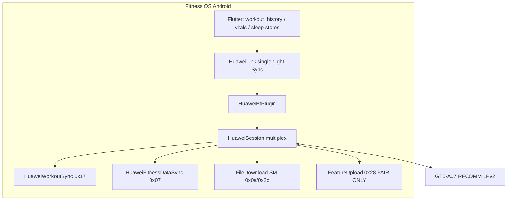
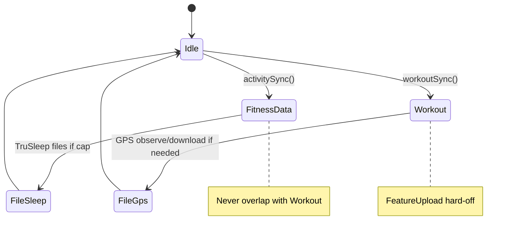
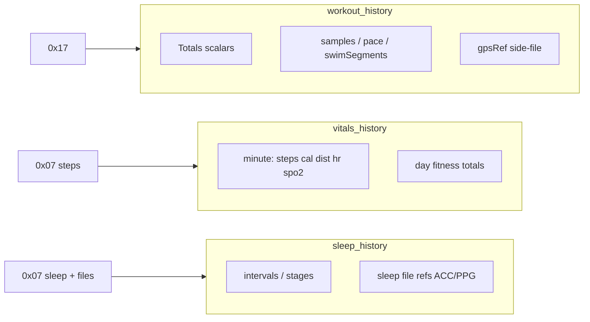

# feat: GT5-A07 full metrics catalog (companion emission honesty)

## Summary

Produce a Fitness OS–owned **full metrics catalog** for Huawei Watch GT5-A07 that honestly maps what the companion link can emit — scored evidence + separate observation outcome — so the **GO / PIVOT / STOP** companion bet stays grounded (no marketing overclaim, IMU limits explicit).

**Identity (explicit):** This cut is still the **feasibility companion** track (pair + Sync honesty + GO/PIVOT/STOP). It is **not** a pivot to a derivation/data platform. Future derivation may consume the catalog; it is not a success criterion here.

**This plan ships:** U1–U3 (catalog + probes + owned wire-specs). That is the acceptance bar.

**Follow-on plans (not acceptance for this plan):** U4 workout fetch → then U5/U6 vitals/sleep fetch — only after U2 kill/continue and only for probe-success families. Unit sketches below keep Sync/merge contracts ready; do not treat C–D as this plan’s done definition.

**Catalog streams (inventory):**
- **Running** — seed Outdoor Run (must); Indoor Run opportunistic if type/GPS diverge
- **Strength** (`type=140` proven)
- **Swimming** — seed Pool (must); Open water opportunistic if type/GPS diverge; laps via Swim `0x0e`
- **Sleep / TruSleep**, **Heart rate**, **Other must/should/defer** (see S6 outcome table)

Gadgetbridge = behavioral oracle only. No Huawei Health SDK. High-rate raw accel/gyro = score **0**.

Supersedes workout-only plan `docs/plans/2026-07-18-002-feat-gt5-workout-data-catalog-plan.md`.

---

## Problem Frame

Gate A + Gate B list Totals are proven (Strength). The companion needs a complete, scored map of what the link can emit — workouts, daily vitals, sleep files, and honest IMU limits — without inventing fields from marketing or over-claiming the GB feature matrix (stress/HRV/PAI are matrix-advertised but **not** implemented as Huawei parsers in the study oracle).

**Success split:**
1. **This plan — companion-emission honesty:** dated catalog + observation outcomes + wire-specs for probed families. Sparse kill/continue (Totals-only workouts, daily HR ≤2, deferred sleep files) still counts as success if honesty is recorded.
2. **Later — derivation readiness (out of scope):** a named consumer + minimum field set at score **5** (or accepted sparsity). Do **not** label this plan’s catalog “derivation SoT.”

---

## Confidence score + observation (dual axes)

Every catalog row has **both** a primary evidence score and an observation outcome. Do not overload score **2** with absence.

| Score | Label | Meaning |
|------:|-------|---------|
| **5** | Proven | GT5-A07 Fitness OS Sync observed a real value **for that mode/surface** |
| **4** | Wire-spec | Owned FOS wire-spec documents SS/CC/tag (after U3 promotion citing capture or documented absence id) |
| **3** | Oracle | GB Huawei implements the surface (family-level) |
| **2** | Claimed | Public matrix / docs claim present; device-dependent — **not** “we looked and missed it” |
| **1** | Unknown | No clear path or conflicting docs |
| **0** | Unavailable | No companion path (e.g. high-rate gyro) |

| Observation | Meaning |
|-------------|---------|
| `unobserved` | No qualifying probe attempt yet |
| `present` | Value/file/tag seen in a qualifying attempt |
| `absent-in-observed-sessions` | Qualifying attempts completed; surface not seen (score stays on claim/oracle axis; do **not** jump to **0** from one miss) |

Promotion: research → **3/2** → wire-spec **4** → on-device **5**. Observation moves independently (`unobserved` → `present` | `absent-in-observed-sessions`).

---

## Scope Boundaries (implementation gate)

### In scope (this plan — acceptance = U1–U3)

| ID | Stream | Modes / notes | Companion outcome |
|----|--------|---------------|-------------------|
| S1 | Running | Must-seed Outdoor; Indoor if type≠outdoor or GPS/elev diverge | Workout list labels + GPS honesty |
| S2 | Strength | `type=140`; Totals + optional Data HR | Already proven Gate B path |
| S3 | Swimming | Must-seed Pool; OW if type≠pool or GPS diverge; laps `0x0e` | Swim list + lap surface honesty |
| S4 | Sleep | Messages + TruSleep files (ACC/PPG limited-rate) | GO evidence: sleep path exists or honest absent |
| S5 | Heart rate | Daily interval + workout peaks/samples (not live) | GO evidence: daily vs workout clocks separate |
| S6 | Other must | Steps, cal, dist, SpO2, fitness totals, battery | Companion vitals honesty / reconnect battery |

**Should (catalog + score only):** skin temp, VO₂/maxMET — nice-to-have GO color; no fetch until Must hit **5** or honest ≤2 + `absent-in-observed-sessions`.

### Out of scope / defer

- High-rate raw accelerometer / gyroscope (**0**)
- Live HR as history; stress/HRV/emotions/PAI/sleep RR until a captured frame
- Sport-detail UX, derivation feature engineering, iOS, Health SDK
- Concurrent activity Sync + workout Sync
- Skin temp / VO₂ fetch; Flutter vitals/sleep **product** stores as this plan’s deliverable
- Calling the catalog “derivation SoT”

### Implementation readiness

| Phase | Ready when | This plan? |
|-------|------------|------------|
| U1 catalog | Now | **Yes — acceptance** |
| U2 probes | Now (checklist below) | **Yes — acceptance** |
| U3 wire-specs | After U2 captures / documented absences | **Yes — acceptance** |
| U4–U6 fetch | After U3 + kill/continue; separate follow-on plans | Sketch only |

**Plan exit:** U1+U2+U3 complete (catalog honesty SoT). Phases C–D are optional follow-ons.  
**Do not start U4–U6 coding from GB source.** Normative source = owned wire-spec.

---

## Requirements

**Catalog (this plan)**
- R1. Publish `docs/catalogs/gt5-a07-full-metrics.md` with S1–S6; every row has primary score 0–5, observation outcome, and optional notes
- R2. Re-score after each probe; never collapse **3→5** without mode-specific on-device value; never mint **4** without owned wire-spec citing capture or documented-absence id; never encode absence in score **2**
- R2a. Privacy: catalog/experiments record tag presence/lengths and scores only; never commit lat/lon, raw GPS tracks, full HR/SpO2 series, or sleep PPG/ACC blobs; runtime logs redact coordinates and omit sample payloads
- R2b. At-rest (this cut): accept owner-device plaintext for workout/vitals/sleep prefs + side-files; keep `allowBackup=false` and exclude those prefs/dirs from backup; encrypt-at-rest is a follow-up

**Probes (this plan)**
- R3. **Must-seed now:** Strength, Outdoor Run, Pool swim (≥2 min each); multi-hour activity with auto-HR/SpO2; overnight TruSleep (prefer night 2). **Opportunistic:** Indoor Run, Open water — required only if must-seed shows type collision with another sport, or GPS/elev expectations need a second mode
- R4. Provisional type freeze from on-device Totals `0x14` after **N≥2** consistent observations per seeded mode (or 1 observation + watch activity-list UI cross-check); record firmware beside IDs; re-freeze on firmware change. FOS UI map and GB enum are non-authoritative

**Wire-spec (this plan)**
- R5. Promote observed / documented-absent contracts before parsers; no AGPL; no request-only promotion for nested surfaces

**Fetch (follow-on plans — contracts only here)**
- R6. Workouts `0x17` hint-gated; GPS file conditional (outdoor / OW observe)
- R7. FitnessData `0x07` activity chain for daily vitals (+ sleep count/data handoff)
- R8. TruSleep / sleep FileDownload when present
- R9. `HuaweiLink` sole channel; `syncWorkouts` + `syncActivity` share single-flight lock; native refuses overlap; Flutter owns stores when fetch ships
- R9a. Forget Device clears workout/vitals/sleep stores + side-files (empty dirs)
- R9b. FileDownload: shared collaborator skeleton lands in the **first** follow-on unit that needs a file (U4 if U2 observed GPS; else U6 for TruSleep). U4 may ship Totals/Data/Pace/Swim without GPS fetch

**Gates**
- R10. Sync/FileDownload behind durable `gate_a_passed` + encrypted `session_ready` (phone ready alone insufficient)
- R11. IMU honesty: high-rate **0**; TruSleep ACC ~1/min activity bytes

---

## Architecture

> *Directional — not implementation specification.*

### System context (follow-on fetch target — not this plan’s deliverable)



### Sync phase machine (hard rules)



**GB / community heuristics (operational — not single-shot epistemic law):**
1. Serialize **activity Sync** and **workout Sync** (never concurrent)
2. Stuck → disconnect/reconnect; do not delete device
3. SpO2/HR empty: require caps show enable support + wear ≥4h; then reboot once and re-sync; max **2** enable→wear→sync cycles before `absent-in-observed-sessions` and score ≤2
4. Sleep: prefer night 2 after pair; max **2** full nights (TruSleep ON) before scoring messages/files absent; optional TruSleep OFF compare night if stages missing
5. Short workouts may not persist — seed ≥2 min
6. Incomplete must-seed set is OK: freeze what was observed; opportunistic modes stay `unobserved` / unknown — do not block U3 for seeded families

### Protocol families (codes)

| Family | Service | Primary commands | Owner class (planned) |
|--------|---------|------------------|------------------------|
| Workout | `0x17` | Count `0x07`, Totals `0x08`, Data `0x0a`, Pace cmd `0x0c`, Swim `0x0e` | `HuaweiWorkoutSync` |
| FitnessData | `0x07` | Step count/data `0x0A`/`0x0B`, Sleep count/data `0x0C`/`0x0D`, Totals `0x03`, enables `0x16`/`0x17`/`0x24`/`0x2a` | `HuaweiFitnessDataSync` |
| FileDownload | `0x0a` or `0x2c` (new-sync) | sleep_state / sleep_data / `{id}_gps.bin` | FileDownload collaborator |
| FeatureUpload | `0x28` | Pair finalize only | `HuaweiFeatureUpload` — **off during Sync** |
| Battery | `0x01` | `0x08` (+ async) | Session side-fetch |

### Data store split



**Never merge** workout sample HR into daily minute HR (different clocks/density).

---

## Key Technical Decisions

- **North star:** companion GO/PIVOT/STOP honesty inventory (U1–U3). Not a derivation platform cut.
- **Plan vs follow-on:** this plan accepts at catalog + wire-spec; U4 then U5/U6 are separate plans. Sync/merge contracts below are normative for those follow-ons.
- **Dual-axis evidence:** score 0–5 ≠ observation (`present` / `absent-in-observed-sessions` / `unobserved`)
- **Conditional second modes:** Outdoor Run + Pool are must; Indoor Run / Open water only on type or GPS/elev conflict
- **Swim lap surface = `0x0e`:** not Pace command `0x17:0x0c`
- **Hex disambiguation:** Pace **command** `0x17:0x0c` vs Totals **TLV tag** `0x0c` under `0x17:0x08`
- **HR = two stores (when fetch ships):** daily `0x07:0x0B` vs workout Totals/Data
- **Type freeze:** provisional until N≥2 consistent `0x14` (or 1 + UI cross-check); firmware recorded
- **Score-first + kill/continue** after U2; incomplete opportunistic seeds do not block
- **AGPL clean-room + promote-before-parse**
- **At-rest:** plaintext accepted this cut; `allowBackup=false` + exclude side-file dirs (R2b)
- **FileDownload ownership (R9b):** first consumer wins skeleton (U4 GPS if observed, else U6 sleep)
- **Dual Sync APIs (follow-on):** `syncWorkouts` + `syncActivity`; shared single-flight; native hard-refuse overlap
- **Stuck / partial_batch (follow-on):** merge non-empty workouts on `ok`/`stuck`/`partial_batch`; UI reconnect on stuck
- **Enrichment-monotonic merge (follow-on):** never clobber richer local row with Totals-only
- **FeatureUpload hard-off (follow-on):** ignore `configAction=2` while Sync active

---

## Metric inventory by workstream

### S1 — Running (Outdoor + Indoor)

| Field | Surface | Outdoor | Indoor | Score |
|-------|---------|---------|--------|------:|
| type (`0x14`) | Totals | freeze | freeze | **1** until seed |
| number, start, end, duration | Totals | Y | Y | **3** until Outdoor/Indoor Sync observes values (Strength path ≠ mode proof) |
| calories, distance, steps | Totals | likely | likely | **3** until owned wire-spec promotes after observation |
| elev / altitude tags | Totals | likely | unlikely | **3** |
| run pace zones `0x50`–`0x5a` | Totals | likely | possible | **3** |
| HR peaks / load / recovery | Totals | likely | likely | **3** |
| Data samples HR/speed/cadence/form | `0x0a` | if dataCount>0 | if dataCount>0 | **3** |
| Pace blocks | Pace cmd `0x17:0x0c` | if paceCount>0 | if paceCount>0 | **3** |
| GPS track | File | observe | expect absent | **2** + observation axis |
| High-rate IMU | — | — | — | **0** / `unobserved` N/A |

**Type ID conflict (do not trust until freeze):**

| Mode | Seed | GB enum | FOS UI provisional |
|------|------|--------:|-------------------:|
| Outdoor Run | Must | 1 | 2 |
| Indoor Run | Opportunistic | 5 | 7 |

### S2 — Strength

| Field | Score | Notes |
|-------|------:|-------|
| type=140, list Totals | **5** | POC ~112s |
| calories, HR peaks, load, recovery HR | **3** | probe tag dump |
| Data HR series | **3** | if dataCount>0 |
| Pace / Swim / GPS / set-rep | primary **0**–**2** + observation | expect absent; set-rep **0** |

### S3 — Swimming (Pool + Open water)

| Field | Surface | Pool | Open water | Score |
|-------|---------|------|------------|------:|
| type (`0x14`) | Totals | freeze | freeze | **1** until seed |
| swimType, strokes, strokeRate, avgSwolf | Totals | likely | likely | **3** |
| poolLength (cm), laps | Totals | likely | unlikely | **3** |
| Swim segments (style, dist, time, strokes, swolf, pace) | `0x0e` | if segmentsCount>0 | possible | **3** |
| Pace cmd `0x17:0x0c` | — | not lap-style source | — | **1** for swim laps |
| Data HR/swolf/strokeRate | `0x0a` | if dataCount>0 | if dataCount>0 | primary **2** (notes: up to 3 if oracle) |
| GPS | File | unlikely | observe | **2** |

**Type conflict:** FOS UI pool=5 / OW=6 vs GB pool=6 / OW=8 — provisional freeze on-device (Pool must; OW opportunistic).

### S4 — Sleep / TruSleep

| Field | Surface | Score |
|-------|---------|------:|
| begin/end (messages `0x0C`/`0x0D`) | FitnessData | **3** |
| begin/end (`sleep_state.bin`) | FileDownload | **3** |
| stages light/deep (messages, TruSleep off) | `0x0D` type | **2** |
| stages REM+ (HarmonyOS 5 claim) | contested docs | **2** |
| ACC ~1/min activity bytes | `sleep_data.bin` TAG_ACC | **3** |
| PPG compressed | `sleep_data.bin` TAG_PPG | **3** |
| High-rate IMU/PPG dump | — | **0** |

Enable: `0x07:0x16`. File svc: `0x2c` if `truSleepNewSync` else `0x0a`.

### S5 — Heart rate

| Stream | Codes | Score | Store |
|--------|-------|------:|-------|
| Daily interval HR | `0x07:0x0B` bitmap `0x40`; enable `0x07:0x17` | primary **2** (notes: oracle 3) | vitals_history |
| Workout peaks | Totals TLV tag `0x0c` under cmd `0x17:0x08` (not Pace cmd) | **3** | workout |
| Recovery HR blob | Totals TLV `0x66` | primary **2** (notes: up to 3) | workout |
| Workout samples | Data bit0 | **3** | workout samples |
| Resting HR history | cap `0x07:0x23` only in GB | primary **1** (notes: up to 2) | none until frames |
| Live overlay / realtime | GATT / `0x17:0x17` | primary **0** (notes: ≤1 as history) | out of scope |

SpO2 shares step containers (bitmap2 `0x01`); enable `0x07:0x24`.

### S6 — Other metrics (must / should / defer rows)

| Metric | Surface | Score | Scope | Outcome served |
|--------|---------|------:|-------|----------------|
| Steps / cal / dist interval | `0x07:0x0B` | **3** | **Must** | Companion daily activity honesty |
| SpO2 interval | same + enable `0x24` | **3** | **Must** | GO evidence vs matrix overclaim |
| Fitness totals day | `0x07:0x03` | primary **2** | **Must** | Day rollup path exists or absent |
| Battery | `0x01:0x08` | **4** | **Must** | Reconnect/session UX already Gate A |
| Skin temperature | enable `0x2a` + P2P | **3** | **Should** | Optional GO color; catalog only |
| VO₂-like (maxMET `0x10`) | Workout Totals | primary **2** | **Should** | Optional workout richness; catalog only |
| Stress / HRV / emotions / PAI / sleep RR | matrix only | primary **0** | **Defer** | Avoid false companion claims |
| Raw IMU | — | **0** | Catalog only | Explicit non-goal |
| Step unknownTVs | unmapped bits | primary **1** | Probe | Future contract discovery |

---

## Probe matrix (U2) — concrete checklist

### Workouts (serialize after activity Sync)

| Seed | Priority | Min | Record |
|------|----------|-----|--------|
| Strength | **Must** | ≥2 min | type=140, hints, Totals tags, Data force-probe if dataCount>0 |
| Outdoor Run | **Must** | ≥2 min + GPS lock note | type freeze, elev/pace-zone tags, Data/Pace probes, GPS file observe |
| Pool swim | **Must** | ≥2–3 min, ≥2–4 laps | type freeze, tags `0x15`–`0x1a`, segmentsCount→`0x0e` |
| Indoor Run | Opportunistic | ≥2 min | only if outdoor type collides or GPS/elev needs contrast |
| Open water | Opportunistic | ≥2–3 min | only if pool type collides or GPS needs OW observe |

Per row: `mode | priority | duration | type | dataCount | paceCount | segmentsCount | tags[] | probes | gpsFile | observation`

### Activity / vitals

1. Dump caps: `0x07` cmds `0x0A/0B/0C/0D/0x16/0x17/0x23/0x24/0x2a`, expand temp `0x1d`, `truSleepNewSync`
2. Enable auto-HR + auto-SpO2; wear ≥4h; activity Sync only
3. If SpO2/HR empty → reboot → re-sync; repeat up to attempt budget (heuristics §3) then `absent-in-observed-sessions`
4. Log presence rates + unknownTV histogram (tag+len only)
5. FitnessTotals day rollup

### Sleep

1. TruSleep ON → full night (night 1 may miss) → sync messages + files
2. Night 2 preferred before absent; max 2 nights then observation=`absent-in-observed-sessions`
3. If no stages → optional TruSleep OFF night for message light/deep compare

### Kill/continue

- No non-zero workout hints + no GPS → Totals-only for workout **follow-on**  
- No sleep file after budget → TruSleep FileDownload deferred (U6 follow-on)  
- No step HR after attempt budget → daily HR score ≤2 + `absent-in-observed-sessions`  
- Must-seeds done, opportunistic skipped → U3 proceeds for observed families; catalog marks skipped modes `unobserved`  
- Indoor/OW deferred indefinitely for calendar reasons → not a plan failure  

**Probe matrix complete** = all attempted seeds recorded + explicit deferrals for unattempted opportunistic modes (not “all five workouts executed”).

---

## Implementation Units

### U1. Master scored catalog — **this plan**

**Goal:** `docs/catalogs/gt5-a07-full-metrics.md` with S1–S6, dual-axis score + observation, type-conflict notes, IMU **0**.

**Requirements:** R1, R2, R2a, R2b, R11  
**Dependencies:** None  
**Files:** Create catalog; keep 002 superseded pointer  
**Test expectation:** none -- docs  
**Verification:** Must-seed rows present; opportunistic modes allowed as `unobserved`; should/defer explicit; no unseeded mode scored **5**; no “derivation SoT” claim

---

### U2. On-device probe matrix — **this plan**

**Goal:** Execute must-seed checklist (+ opportunistic as needed); update scores + observation; provisional type freezes.

**Requirements:** R3, R4, R10  
**Dependencies:** U1, Gate A  
**Files:** `docs/experiments/gt5-a07-full-metrics-probe-matrix.md`; debug tag dumps  
**Execution note:** Characterization-first  
**Test scenarios:** Strength still 5; SpO2/HR attempt budget; sleep night budget; incomplete opportunistic seeds recorded as deferrals  
**Verification:** Probe matrix complete (attempted + explicit deferrals); kill/continue recorded

---

### U3. Wire-specs — **this plan**

**Goal:** Owned specs with SS/CC/tag tables and sync-phase diagrams for **observed / documented-absent** families.

**Requirements:** R5  
**Dependencies:** U2  
**Files:**
- `docs/wire-specs/huawei-br-gt5-gate-b-enrichment.md` (workouts seeded in U2; Swim `0x0e` if probed)
- `docs/wire-specs/huawei-br-gt5-fitness-data.md` (steps/HR/SpO2/sleep messages/enables)
- `docs/wire-specs/huawei-br-gt5-sleep-files.md` (only if U2 saw files; else stub “deferred”)
- Link from `huawei-br-gt5-gate-a.md`

**Approach:** Promote only observed / documented-absent envelopes; FeatureUpload vs FileDownload boundaries; serialize activity/workout  

**Test expectation:** none -- docs  
**Verification:** Catalog rows → **4** only where a wire-spec section cites capture or absence id; Phase B closeout = companion-emission honesty SoT

---

### U4. Workout fetch/store — **follow-on plan sketch**

**Goal:** Hint-gated Totals enrichment + Data/Pace/Swim; GPS conditional; merge on `ok`/`stuck`/`partial_batch`.

**Requirements:** R6, R9, R9a, R9b, R10, R2a, R2b  
**Dependencies:** U3 workout sections; U2 kill/continue  
**Files:** `HuaweiWorkoutSync.kt` (+ helpers), `huawei_link.dart`, `workout_history/`, tests  

**Approach:**
- Implement only probe-success surfaces
- Swim laps from `0x0e` when segmentsCount>0
- If U2 observed GPS: introduce shared FileDownload collaborator (GPS-only); else ship without GPS fetch
- FeatureUpload hard-off; enrichment-monotonic merge; single-flight with future `syncActivity`
- Statuses: `ok` | `empty` | `partial_batch` | `stuck` | `error` | `not_ready`

**Test scenarios:** type labels for seeded modes; Strength hints 0 → no Pace/Swim; stuck merge; Forget clears workout JSON + side-files  

**Verification:** Catalog S1–S3 rows → **5** where values seen

---

### U5. Daily vitals + HR + other must — **follow-on plan sketch**

**Goal:** FitnessData activity chain → vitals store; sleep message handoff; battery. No skin-temp fetch.

**Requirements:** R7, R9, R9a, R10, R2a, R2b  
**Dependencies:** U3 fitness-data; U2 kill/continue; prefer after U4 for companion value sequencing  
**Files:** `HuaweiFitnessDataSync.kt`, vitals feature, tests  

**Approach:**
```
activitySync:
  sleepCount→sleepData
  stepCount→stepData
  fitnessTotals
  battery
# idle before workoutSync
```

**Shadow paths:** `not_ready` if sessionKey missing; empty day → keep prior vitals; mid-chain timeout → merge completed containers; never start `workoutSync` until idle.

**Verification:** Must metrics → **5** or honest ≤2 + observation

---

### U6. Sleep files — **follow-on plan sketch (conditional)**

**Goal:** TruSleep FileDownload; ACC/PPG as limited-rate.

**Requirements:** R8, R9, R9a, R9b, R11, R2a, R2b  
**Dependencies:** U2 sleep file `present`; U3 sleep-files  
**Files:** FileDownload collaborator (extend U4 skeleton if GPS landed first); sleep store  

**Approach:** state then data files; never label ACC as raw IMU; skip entire unit if U2 deferred files  

**Verification:** Sleep file rows rescored; ACC not labeled raw IMU

---

## Phased Delivery

1. **Phase A — Know (this plan):** U1 + U2 (must-seeds; opportunistic as needed)  
2. **Phase B — Own (this plan):** U3 wire-specs → **plan exit** = companion-emission honesty SoT  
3. **Phase C — Follow-on:** U4 workout fetch (next companion-visible value)  
4. **Phase D — Follow-on:** U5 then U6; runtime Sync never overlaps  
5. **Phase E — Optional rescored catalog** after follow-ons (still not “derivation SoT” unless a named consumer + minimum field set is defined)

---

## Risks & Dependencies

| Risk | Mitigation |
|------|------------|
| Type-map Walk/Run swap | Provisional freeze N≥2 / UI cross-check; firmware note |
| Matrix overclaim (stress/HRV) | Defer; unknownTV probe only |
| Activity+workout concurrent stall | Hard serialize (follow-on) |
| SpO2/HR false absent | Attempt budget + caps precondition |
| First-night sleep miss | Night budget (max 2) |
| Open water / Indoor unavailable | Opportunistic; not plan failure |
| FileDownload vs FeatureUpload | Distinct SM; Sync gate |
| AGPL | Promote-before-parse |
| Scope explosion | Plan exit at U1–U3; kill/continue |

---

## Open Questions

### Resolved During Planning

- North star = **companion GO/PIVOT/STOP honesty**, not derivation platform
- Plan acceptance = **U1–U3**; U4–U6 are follow-on plans
- Dual-axis evidence: score ≠ `absent-in-observed-sessions`
- Must-seed Outdoor Run + Pool (+ Strength); Indoor/OW opportunistic
- Swim lap wire surface = **`0x0e`**, not Pace cmd `0x0c`
- At-rest: plaintext accepted + `allowBackup=false` (encrypt later)
- FileDownload: first consumer (U4 GPS if observed, else U6) owns skeleton
- Stress/HRV/PAI/emotions deferred; high-rate IMU = **0**
- Six parallel research briefs absorbed (Run, Strength, Swim, Sleep, HR, Other)

### Deferred to Implementation

- Exact Flutter module names for vitals/sleep (follow-on)
- Whether open-water GPS appears on this firmware
- TruSleep stage semantics after overnight FileDownload
- Prefs vs side-file thresholds after first full activity day
- Named derivation consumer + minimum field set (separate future plan)

---

## Sources & References

- Parallel research (2026-07-18): Run / Strength / Swim / Sleep / HR / Other agents against `_study_gadgetbridge` + FOS docs
- `docs/plans/2026-07-18-002-feat-gt5-workout-data-catalog-plan.md` (superseded)
- `docs/learnings/2026-07-18-huawei-gt5-companion-poc.md`
- `docs/wire-specs/huawei-br-gt5-gate-a.md`
- https://gadgetbridge.org/basics/topics/huawei-honor/
- https://gadgetbridge.org/internals/topics/huawei-honor-specifics/
