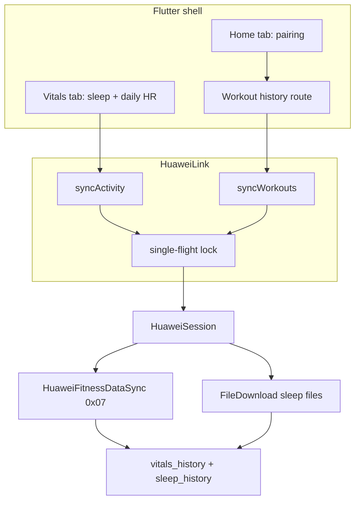
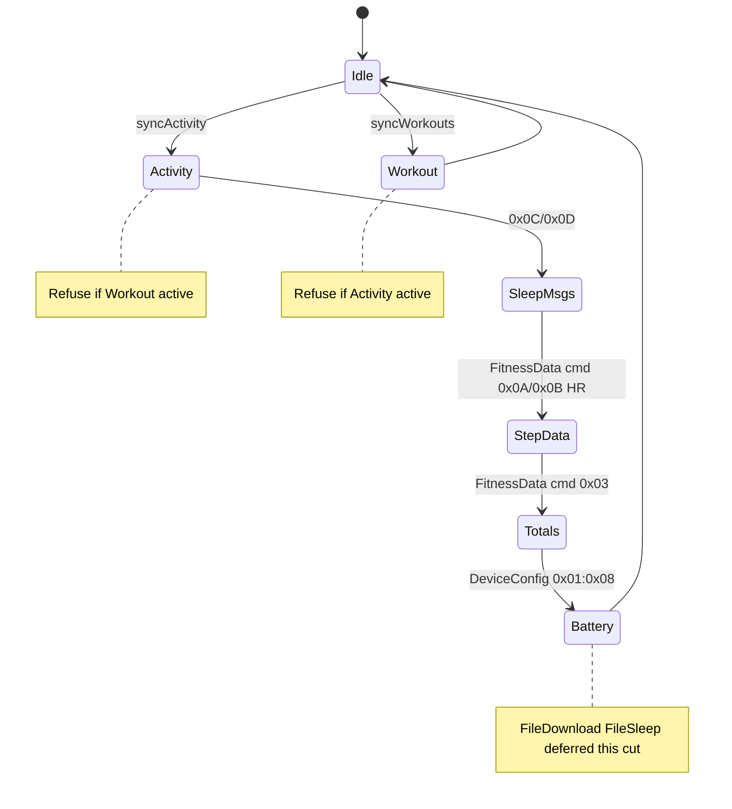

# feat: Vitals tab — TruSleep + whole-day HR

## Summary

Add a bottom-nav shell so today’s pairing UI becomes **Home**, introduce a **Vitals** tab that shows sleep sessions and whole-day heart rate, and implement companion `syncActivity` (FitnessData `0x07` message path) behind Gate A + shared single-flight with workout sync. TruSleep FileDownload enrichment is deferred. Workout-session HR stays out of this plan.

---

## Problem Frame

The companion already pairs and syncs workout Totals into a local list, but daily HR and sleep never leave the watch. The full-metrics catalog (S4/S5) and FitnessData wire-spec define the honesty contracts; this plan turns those follow-on sketches into product sync + a discoverable Vitals surface without overclaiming unobserved payloads.

---

## Requirements

- R1. Bottom navigation with two destinations: **Home** (current pairing / device UI) and **Vitals**
- R2. Vitals shows **whole-day (interval) HR** from FitnessData activity sync — not workout-session HR
- R3. Vitals shows **TruSleep sleep sessions** including **overnight** and **naps** as distinct rows when the watch emits them
- R4. Owner can explicitly **Sync** vitals/sleep when `gate_a_passed` and encrypted session are ready (manual Sync, matching workouts)
- R5. `syncActivity` and `syncWorkouts` share a **single-flight** lock; native hard-refuses overlap; second call surfaces busy without mutating stores
- R6. Empty / absent activity results **keep prior** local vitals/sleep; UI uses honest absent copy (not wipe-as-error)
- R7. Status distinguishes `ok` | `empty` | `partial_batch` | `stuck` | `not_ready` | `error` | `busy`. **`partial_batch` and `stuck` merge completed containers**; `empty` / `busy` / `not_ready` / hard `error` do not wipe prior local data
- R8. Forget Device clears vitals + sleep stores (and any sleep side-file dirs left empty) in the same forget path as workouts
- R9. Never merge daily interval HR into workout history (or vice versa)
- R10. Privacy: runtime may store series locally on owner device; logs/experiments record presence/tag+len only — never commit full HR series or sleep ACC/PPG blobs; keep `allowBackup=false` and exclude side-file dirs
- R11. Catalog honesty **constraint** (non-blocking for product UI): do not mint S4/S5 score **4/5** without `capture:…` or `ABSENT-…`. Score/observation edits after probes are follow-up checklist work — not a U3/U6 acceptance gate
- R12. ACC from TruSleep files (if present) labeled limited-rate activity bytes — never high-rate IMU
- R13. Do **not** persist SpO2 / steps / calories / fitness-totals this cut — extract daily HR in memory from shared step containers, then drop the rest

**Origin trace:** Catalog streams S4 (Sleep/TruSleep), S5 (daily HR); follow-on sketches U5/U6 and contracts from `docs/plans/2026-07-18-003-feat-gt5-full-metrics-catalog-plan.md`. **R# below are this plan’s IDs.** Origin catalog requirement IDs are written as `catalog-003 R…` (e.g. `catalog-003 R9b` FileDownload ownership, `catalog-003 R2b` at-rest plaintext).

---

## Scope Boundaries

- Live / realtime HR overlay
- Workout Totals/Data HR peaks and samples (workout detail — separate plan)
- SpO2 / steps / calories / fitness-totals **product UI** (protocol may fetch shared step containers for HR; Vitals UI stays sleep + whole-day HR)
- Skin temp, stress, HRV, emotions, PAI, sleep RR
- Auto-sync on connect
- Encrypt-at-rest upgrade for vitals/sleep prefs (plaintext + backup exclusion acceptable this cut)
- iOS / Huawei Health SDK
- Derivation / analytics platform

### Deferred to Follow-Up Work

- Workout detail enrichment UI (session HR, samples, GPS) — separate plan
- Catalog score/observation updates after owner overnight / multi-hour HR probes (`docs/experiments/gt5-a07-full-metrics-probe-matrix.md`) — includes affirmative `absent-in-observed-sessions` bookkeeping
- **U4 TruSleep FileDownload** (side-files, enrichment-monotonic file refs, `catalog-003 R9b` skeleton) — non-blocking; ship Vitals on message SoT first; promote `docs/wire-specs/huawei-br-gt5-sleep-files.md` only with `capture:…` / `ABSENT-…`
- Optional third bottom-nav destination for workouts (today: keep Workouts as push from Home)
- Encrypt-at-rest for vitals/sleep (residual risk accepted this cut: plaintext on owner device)

---

## Context & Research

### Relevant Code and Patterns

- Channel sole owner: `lib/core/huawei/huawei_link.dart` + `android/.../huawei/HuaweiBtPlugin.kt` / `HuaweiSession.kt`
- Workout sync collaborator to mirror: `android/.../huawei/HuaweiWorkoutSync.kt`
- Flutter store / Gate A / Forget: `lib/features/workout_history/`, `lib/features/device_pairing/domain/gate_a_prefs.dart`, `DevicePairingRepositoryImpl.forgetDevice()`
- Feature scaffold: `./create_feature.sh` → mason feature under `lib/features/<name>/`
- App entry / routes: `lib/app/app.dart`, `lib/app/routing/route_registry.dart`
- Contracts: `docs/wire-specs/huawei-br-gt5-fitness-data.md`, `docs/wire-specs/huawei-br-gt5-sleep-files.md` (deferred stub), `docs/catalogs/gt5-a07-full-metrics.md`
- Layer ownership: `docs/handoffs/2026-07-18-huawei-gt5-gate-a-stack-handoff.md`

### Institutional Learnings

- `docs/solutions/` is empty — use POC learning + handoff instead
- Success ≠ BT connected: need `session_ready` + `gate_a_passed` before Sync (`docs/learnings/2026-07-18-huawei-gt5-companion-poc.md`)
- FeatureUpload (`0x28`) ≠ FileDownload (`0x0a`/`0x2c`); FeatureUpload hard-off during Sync
- Daily HR clock ≠ workout sample clock — never merge stores

### External References

- [Gadgetbridge Huawei/Honor specifics](https://gadgetbridge.org/internals/topics/huawei-honor-specifics/) — serialize activity vs workout; stuck → reconnect; first-night sleep miss; SpO2 reboot heuristic
- [Huawei sleep / nap product rules](https://consumer.huawei.com/au/support/content/en-gb00733908/) — duration **&lt; 3h → nap**, **≥ 3h → nighttime**; day window **20:00→20:00**
- Flutter Material 3 `NavigationBar` + `IndexedStack` for tab state

---

## Key Technical Decisions

- **Shell IA:** Material 3 bottom `NavigationBar` with Home + Vitals; shell owns `/`; pairing keeps `/device_pairing` only (drop dual `/` registration). Home hosts pairing **body content without a second bottom chrome**; Workouts remain a full-screen named-route push from Home (not a third tab); Vitals is a tab body, not a public push route
- **Sync ownership:** Separate **Sync** CTA on Vitals (activity only). Workouts keep their own Sync. Shared single-flight; busy rejects immediately (no auto-queue)
- **Lock ownership:** Native owns hard single-flight checked **before** `sessionIo` enqueue — today’s executor **queues**, which is insufficient. Second `syncActivity`/`syncWorkouts` returns `busy` immediately (not queued success). Flutter may mirror for snappy UX; native is SoT
- **Shared status envelope:** One Sync status set for both paths: `ok` | `empty` | `partial_batch` | `stuck` | `not_ready` | `error` | `busy`. U2 updates workout mapping so overlap surfaces as `busy`, not unknown→`error`
- **Activity chain order** (when idle): `sleepCount → sleepData → stepCount → stepData → fitnessTotals → battery`, then TruSleep FileDownload if caps + files present; idle before any `workoutSync`
- **Sleep product path (this cut):** Persist intervals from FitnessData `0x0C`/`0x0D` as the **ship** path for overnight + naps. **U4 FileDownload is deferred / non-blocking** (see Deferred). U3 orchestration may leave a `FileSleep` hook comment only
- **Nap vs overnight labeling:** Default row title **“Sleep session”** (+ duration). Optional Nap/Overnight chip only when wire type is observed **or** after capture validates the Huawei duration heuristic (&lt;3h nap / ≥3h overnight). Until then the 3h/20:00 rules stay in Notes — not R3 acceptance language. Labels are display-only and must not duplicate merge rows
- **Stores (logical, one feature):** Single `vitals` feature and one sync/merge entry point; logical domains `sleep_history` (session intervals in prefs) and `vitals_history` (daily HR). Sleep intervals prefs-first; **HR series prefer day summary (min/avg/max/count) in prefs** this cut — dense series only if side-filed under no-backup storage from first non-empty day (do not wait for silent prefs overflow)
- **Merge keys (directional):** Sleep upsert by `[begin, end]` (+ optional wire type). Daily HR replace-by-**local calendar day** when HR container completes non-empty. Container-scoped partial: missing container ≠ wipe sibling domain. Chain finished without transport failure → overall `ok` or `empty` by whether any mergeable payload exists; absent HR bitmap ⇒ HR container not completed, **not** `partial_batch` (`partial_batch` = mid-chain abort/timeout only)
- **Corrupt JSON:** Fail-closed load (error / unreadable), never silent `[]` that then “keeps prior empty” forever — do not copy workout decode-catch blindly
- **Forget orchestration (single policy):** If Sync in flight → Forget returns busy/blocked. Else clear via `DevicePairingRepositoryImpl.forgetDevice()` calling vitals data-layer `clearLocal()` (prefs + any side-file dirs + native FileDownload temps when present). Late merge after identity/`gate_a_passed` cleared is a **no-op**. Best-effort wipe + verify (both prefs keys absent + dirs empty); idempotent re-Forget; surface Forget error if verify fails
- **Enables:** Request TruSleep `0x16` and auto-HR `0x17` when caps show support. Soft-skip must surface distinct status/copy (`not_armed` / enable-skipped) — must **not** masquerade as durable “watch has no data” `empty`
- **Non-HR containers:** Fetch step containers only as needed for HR extract (R13). `fitnessTotals` / battery may run as opaque protocol handoff with **no Flutter persistence** if idle stability requires them
- **AGPL:** Behavioral oracle only; promote observed envelopes into owned wire-specs before treating parsers as normative. U3 on-device parsers need owned TLV tables or explicit synthetic-only gate
- **Mason:** `./create_feature.sh vitals` for layers/DI; **skip or strip public `/vitals` route** — shell hosts the presentation screen
- **Channel DTOs:** Mirror workouts — activity payload types live on `HuaweiLink` / channel layer; feature maps into local models
- **FeatureUpload hard-off:** **New U2 work** (not present today) — ignore/defer `0x28` while either Sync in flight; resume on Idle
- **Stuck merge split:** Vitals merge-on-`stuck`/`partial_batch`. Workouts keep today’s non-merge `stuck` → `Left` unless a later plan opts in — do not “fix” workouts while adding vitals
- **Activity window:** `syncActivity` takes an explicit `[startUnix, endUnix]` (default: last N local days — pick N at impl, document in U2; not unbounded history)
- **Runtime redaction:** Never log full HR arrays, sleep stage timelines, or file bytes — counts/lens/container tags only (extends R10)

---

## Open Questions

### Resolved During Planning

- TruSleep includes overnight **and** naps: yes
- Home = current UI + bottom nav; Vitals = sleep + whole-day HR: yes
- Workout HR: deferred to workout-detail plan
- Sync model: separate Vitals Sync CTA + shared single-flight; busy reject
- FileDownload: attempt in this plan; messages are acceptance floor; files enrich when present
- Auto-sync: no — manual only

### Deferred to Implementation

- Exact prefs key string names and no-backup side-file path layout (must use Android no-backup / non-backup-eligible storage when files exist)
- Whether GT5 emits an explicit nap type tag (vs later-validated duration heuristic)
- `truSleepNewSync` → FileDownload service `0x0a`/`0x2c` on this firmware (U4 follow-up)
- Exact busy/stuck copy strings (matrix in U6 is directional)
- Schema versioning / encrypt-at-rest / activity cursors / retention TTL / fuzzy sleep-interval reconciliation
- Whether fitnessTotals→battery are required for idle handoff (opaque protocol vs omit)

### Evidence note

S4/S5 remain `unobserved` on-device. Product scaffolding (U1–U3, U5–U6) may land against synthetic fixtures + honest empty UI, but **do not claim companion sleep/HR emission proven** until `capture:…` or budgeted `ABSENT-…` exists. Promote `huawei-br-gt5-fitness-data.md` TLV tables before treating on-device parsers as normative.

---

## Output Structure

```text
lib/app/shell/                    # bottom-nav host (or equivalent under lib/app/)
lib/features/vitals/
  domain/
  data/
  presentation/
android/app/src/main/kotlin/com/example/fitness_os/huawei/
  HuaweiFitnessDataSync.kt
  # HuaweiFileDownload.kt — deferred with U4
docs/wire-specs/
  huawei-br-gt5-fitness-data.md   # promote TLV tables after capture
  huawei-br-gt5-sleep-files.md    # deferred with U4
```

---

## High-Level Technical Design

> *This illustrates the intended approach and is directional guidance for review, not implementation specification. The implementing agent should treat it as context, not code to reproduce.*





---

## Implementation Units

### U1. Bottom-nav shell — Home + Vitals placeholder

**Goal:** Introduce app shell with Home (current pairing UI) and Vitals tab scaffold so navigation IA lands before sync work.

**Requirements:** R1

**Dependencies:** None

**Files:**
- Create: `lib/app/shell/` (host scaffold + tab destinations) — exact filenames at impl discretion
- Modify: `lib/app/app.dart`, `lib/app/routing/route_registry.dart` (shell owns `/`)
- Modify: `lib/features/device_pairing/presentation/view/device_pairing_route.dart` (stop registering `/`; keep `/device_pairing` if still needed)
- Modify: `lib/features/device_pairing/presentation/view/device_pairing_screen.dart` — body-only mode for Home embed (no double AppBar / bottom inset fight)
- Test: `test/app/shell/app_shell_test.dart`

**Approach:**
- Material 3 `NavigationBar` with two destinations; shell owns bottom chrome
- Preserve tab state with `IndexedStack` (or equivalent)
- Home = today’s pairing experience; Workouts CTA remains available from Home and pops to Home tab
- Vitals tab shows a temporary empty/honest placeholder until U6 (throwaway, not a second presentation tree)
- After Forget from Home, Vitals must not show stale IndexedStack data — reload-on-visible or shared invalidation (wire in U5/U6)

**Patterns to follow:**
- `lib/app/app.dart`, `lib/app/routing/route_registry.dart`
- `lib/features/device_pairing/presentation/view/device_pairing_route.dart` (current `/` owner)
- `WorkoutHistoryRoute.go` from Home AppBar

**Test scenarios:**
- Happy path: cold start shows bottom nav; Home content is pairing; switching to Vitals and back preserves Home state
- Edge case: opening Workouts from Home still pushes `/workout_history` and pops back to Home tab
- Edge case: only two destinations — no accidental third tab
- Edge case: Home embed has no double AppBar / nav overlap

**Verification:** App launches into shell; Home matches prior pairing UX; Vitals tab reachable

---

### U2. Shared single-flight + `syncActivity` channel contract

**Goal:** Extend `HuaweiLink` / native plugin with `syncActivity` and a shared Sync lock used by both activity and workout sync; upgrade workout status mapping for `busy` / `partial_batch`.

**Requirements:** R4, R5, R7

**Dependencies:** None (can land before/in parallel with U1)

**Files:**
- Modify: `lib/core/huawei/huawei_link.dart`, `lib/core/huawei/huawei_bt_channel.dart`
- Modify: Android channel/plugin/session under `android/app/src/main/kotlin/com/example/fitness_os/huawei/` (native lock before `sessionIo` enqueue)
- Modify: `lib/features/workout_history/data/repositories/workout_history_repository_impl.dart` (+ bloc/UI if needed) so `busy` is non-destructive
- Test: `test/core/huawei/huawei_link_sync_lock_test.dart`
- Test: `test/features/workout_history/workout_history_repository_test.dart` (busy while activity in flight)
- Test: `android/app/src/test/java/com/example/fitness_os/huawei/HuaweiSyncLockTest.kt`

**Approach:**
- Typed `syncActivity([startUnix, endUnix])` with shared status envelope including `busy` and `partial_batch`
- Native hard-refuse overlap **before** `sessionIo` enqueue (double-tap returns `busy`, not silent serialize)
- Radio readiness → `not_ready` (Link/native); Gate A stays repository-side
- Implement FeatureUpload hard-off while either Sync active (new — not present today)
- `busy` must not collapse to `error` in `fromMap`; workouts parse `partial_batch` safely without adopting merge-on-stuck
- U2 acceptance bar includes workout Sync regression under busy/overlap

**Patterns to follow:**
- `HuaweiLink.syncWorkouts` / `WorkoutSyncResult.fromMap`
- `_pairInFlight` refuse pattern on `HuaweiLink` (Flutter in-flight precedent)
- Note: `HuaweiBtPlugin.sessionIo` queues today — replace with explicit busy for Sync methods

**Test scenarios:**
- Happy path: idle → `syncActivity` reaches native collaborator (even if empty payload stub)
- Error path: `sessionKey` missing → `not_ready`; stores untouched
- Integration: start `syncWorkouts` then `syncActivity` → `busy`; reverse → `busy` on workouts without wiping workout list
- Edge case: completed activity releases lock so subsequent workout sync proceeds

**Verification:** Overlap returns `busy`; workout Sync during activity does not mis-classify as hard `error`

---

### U3. FitnessData activity chain — sleep messages + daily HR

**Goal:** Implement `HuaweiFitnessDataSync` for the message path: sleep count/data and step data HR extraction (plus enables / totals / battery per wire-spec order).

**Requirements:** R2, R3, R4, R6, R7, R9, R10, R13

**Dependencies:** U2

**Files:**
- Create: `android/app/src/main/kotlin/com/example/fitness_os/huawei/HuaweiFitnessDataSync.kt` (+ small helpers as needed)
- Modify: `HuaweiSession` / plugin dispatch to run activity chain when idle
- Modify: `docs/wire-specs/huawei-br-gt5-fitness-data.md` when first capture or documented absence exists (promote sections — not before)
- Test: `android/app/src/test/java/com/example/fitness_os/huawei/HuaweiFitnessDataSyncTest.kt`

**Approach:**
- Chain: sleepCount→sleepData → stepCount→stepData; then optional opaque fitnessTotals→battery if needed for idle handoff (no Flutter persist)
- Leave a deferred `FileSleep` hook only — **do not implement FileDownload in this unit**
- Parse sleep intervals (begin/end; stages when present)
- Extract daily interval HR from FitnessData cmd `0x0B` bitmap `0x40`; drop SpO2/steps after extract (R13)
- Request enables `0x16` / `0x17` when caps indicate support; surface enable-skipped distinctly from empty containers
- Tag which containers completed (`sleep` / `daily_hr` / …)
- Mid-timeout: `partial_batch`; finished chain with sleep but no HR bitmap → overall `ok` (HR not completed), not `partial_batch`
- Empty day: `empty` (Flutter keeps prior)
- Privacy: synthetic TLV fixtures only; no full series in logs

**Execution note:** Characterization-first against synthetic frames. Before claiming on-device product success, promote owned TLV tables or record `ABSENT-…`.

**Patterns to follow:**
- `HuaweiWorkoutSync` collaborator + `HuaweiSession` exchange injection
- `docs/wire-specs/huawei-br-gt5-fitness-data.md`
- Handoff: Session owns wire dialogue (`docs/handoffs/2026-07-18-huawei-gt5-gate-a-stack-handoff.md`)

**Test scenarios:**
- Happy path: synthetic sleep intervals (long overnight + short nap) + HR samples → payload includes both session classes and daily HR points + completed-container tags
- Edge case: sleep present, HR bitmap absent → sleep ok, HR container not completed
- Edge case: nap-only (no overnight) → nap interval present
- Error path: timeout after sleepData → `partial_batch` with sleep only
- Edge case: unknown TLV lengths recorded without failing whole chain

**Verification:** Native activity Sync returns structured sleep + daily HR payloads suitable for container-scoped Flutter merge

---

### U4. TruSleep FileDownload attempt (enrichment) — **deferred / non-blocking**

**Goal:** Reserved for follow-up: after sleep messages, attempt TruSleep `sleep_state` / `sleep_data` via **FileDownload service** `0x2c` or `0x0a` (not FitnessData cmd `0x0A`). Not required to ship Vitals this cut.

**Requirements:** R10, R12 (when revived)

**Dependencies:** U3; first capture or `ABSENT-…` for sleep files; owned SM in `huawei-br-gt5-sleep-files.md`

**Files:** (follow-up) FileDownload collaborator; `HuaweiFileDownloadTest.kt`; promote sleep-files wire-spec

**Approach:** Prefer decode-then-discard raw file bodies; if bodies kept, no-backup dir + Forget wipe+verify. Never FeatureUpload `0x28`. Never label ACC as raw IMU. Ownership: `catalog-003 R9b`.

**Test expectation:** none this cut — unit deferred

**Verification:** N/A until revived; message-path Vitals must already ship without it

---

### U5. Flutter vitals/sleep stores, repository, Forget

**Goal:** Persist daily HR and sleep sessions locally; expose sync/load APIs; extend Forget Device.

**Requirements:** R2, R3, R4, R6, R7, R8, R9, R10

**Dependencies:** U2, U3

**Files:**
- Create: `lib/features/vitals/` via `./create_feature.sh vitals` — scaffold layers, then **skip/strip public `/vitals` route** (shell hosts presentation)
- Modify: `lib/features/device_pairing/domain/gate_a_prefs.dart` (new keys)
- Modify: `lib/features/device_pairing/data/repositories/device_pairing_repository_impl.dart` (orchestrate vitals `clearLocal()` via registered wipe callback — avoid constructing full vitals graph from pairing)
- Modify: `lib/core/di/injector.dart`, feature DI — do not register a second `HuaweiLink`
- Test: `test/features/vitals/vitals_repository_test.dart`
- Test: extend `test/features/device_pairing/gate_a_unlock_test.dart` for Forget clearing new keys/dirs

**Approach:**
- One repository method (like `syncFromWatch`): Gate A → `syncActivity` → container-scoped merge
- Sleep upsert by begin/end; HR day summary replace-by-local-day when HR container completed
- `empty` / `busy` / `not_ready` / hard `error` / enable-skipped → no wipe; `partial_batch` / `stuck` → merge completed containers only (vitals path)
- Corrupt prefs → fail-closed load (not silent `[]`)
- Persist sleep and HR keys independently
- Forget policy: refuse while Sync busy; late merge no-op after wipe; verify both keys + dirs; emit invalidation so U6 IndexedStack reloads

**Patterns to follow:**
- `lib/features/workout_history/data/repositories/workout_history_repository_impl.dart`
- `lib/features/workout_history/data/di/workout_history_di.dart`
- `gate_a_prefs.dart` + `forgetDevice()` wipe list
- `test/features/workout_history/workout_history_repository_test.dart` (stub `HuaweiLink`)

**Test scenarios:**
- Happy path: sync ok with overnight + nap + HR → local load returns all three surfaces
- Edge case: second sync `empty` → prior overnight/nap/HR retained
- Edge case: `partial_batch` sleep-only → sleep merged; HR days unchanged (and inverse)
- Edge case: upsert same begin/end twice → one session
- Edge case: corrupt sleep JSON → fail-closed; subsequent `empty` does not “confirm” wipe
- Error path: gate not passed → no channel call
- Error path: `busy` → stores unchanged
- Error path: Forget while Sync in flight → busy/blocked; no residue after idle Forget + verify
- Integration: Forget clears prefs (+ dirs if any); idempotent second Forget; workouts still cleared
- Integration: after vitals sync, `workouts_json` unchanged (R9)

**Verification:** Offline reload after sync shows last vitals/sleep; Forget wipes them; corrupt load is not silent empty

---

### U6. Vitals tab UI — sleep list + whole-day HR + Sync

**Goal:** Replace Vitals placeholder with real UI: Sync control, sleep sessions, whole-day HR summary.

**Requirements:** R1, R2, R3, R4, R5, R6, R7

**Dependencies:** U1, U5

**Files:**
- Create/Modify: `lib/features/vitals/presentation/` screens, bloc, state
- Modify: shell Vitals tab body → vitals feature screen
- Test: `test/features/vitals/presentation/vitals_bloc_test.dart`

**Approach:**
- **Composition (single):** (1) Sync + status strip, (2) Sleep sessions list primary, (3) Whole-day HR secondary under the list. Reject dual equal metric cards / icon-tile dashboard
- Gate A incomplete → Sync **disabled** + blocked message (mirror `WorkoutHistoryScreen` / `WorkoutHistoryPhase.blocked`)
- Sleep list: flat newest-first rows titled “Sleep session” (+ duration); optional Nap/Overnight chip per labeling decision; **no detail push** this cut
- HR: latest local calendar day with data (else today empty after sync); **min/avg/max text summary** first
- Distinct copy for: never synced; synced empty; sleep present + HR absent; enable-skipped; `partial_batch` caveat; `busy` (other Sync in flight — keep list, non-destructive); `stuck` (keep partial + CTA to switch Home tab for reconnect, then return and Sync)
- Tab-switch mid-sync: stay syncing; no second flight
- Reload-on-visible after Forget invalidation from U5
- No SpO2/steps widgets

**Patterns to follow:**
- `lib/features/workout_history/presentation/view/workout_history_screen.dart`
- `WorkoutHistoryPhase` blocked / syncing / stuck / idle
- `BlocProvider` + `sl<>()` DI pattern; theme via `BpTheme`

**Test scenarios:**
- Happy path: loaded state shows sleep session row(s) + HR summary after successful sync
- Edge case: sleep-only payload → sleep rows + honest HR absent
- Edge case: gate incomplete → Sync disabled + blocked message
- Error path: stuck shows reconnect guidance without wiping list
- Edge case: busy surfaces non-destructive message
- Edge case: after Forget from Home, returning to Vitals does not show stale rows

**Verification:** Owner can open Vitals, Sync, and read sleep + whole-day HR offline afterward

---

## System-Wide Impact

- **Routing / shell:** Shell owns `/`; pairing path ownership changes; tests assuming `/` = pairing scaffold must update. Vitals is tab-hosted, not a competing named route
- **Scaffold nesting:** Shell owns `NavigationBar`; Home pairing becomes body-safe; Workouts push keeps its own `Scaffold`
- **Dual Sync callers:** Vitals + Workouts are concurrent UI entry points on one radio — both must surface `busy` without hang or wipe
- **Native executor blast:** busy-refuse is a behavior change vs `sessionIo` queue-as-success
- **Status vocabulary:** workouts map `busy` (and parse `partial_batch` safely without adopting merge-on-stuck). Overlap must not mis-map to `error`. Vitals alone merges on `stuck`/`partial_batch` this cut
- **DI:** single `HuaweiLink`; Forget orchestrated from pairing, calling vitals `clearLocal()` — no second channel owner
- **Error propagation:**

| Status | Persist | UI |
|--------|---------|-----|
| `not_ready` | none | reconnect / blocked |
| `busy` | none | non-destructive busy on calling surface |
| `empty` | keep prior | honest absent only if local also empty |
| `partial_batch` | merge completed containers only | data + partial caveat |
| `stuck` | merge completed if present | reconnect → Home; keep partial |
| `error` | none | error; lists unchanged |
| `ok` | merge | success (files optional) |

- **State lifecycle:** container-scoped dual-store merge; FileDownload must not invalidate message intervals; Forget vs in-flight Sync race; IndexedStack stale-after-Forget invalidation
- **FeatureUpload hard-off:** either Sync in flight
- **Prefs / privacy:** new biometric prefs + side-file dirs join Forget + backup-exclusion; `GateAPrefs` becomes multi-feature key registry
- **Catalog / wire-specs:** living docs on first capture/`ABSENT-…`
- **Unchanged invariants:** workout sample HR stays workout-only; `allowBackup=false`; HuaweiLink sole channel; Gate A unlock still pairing-owned
- **Stakeholders:** owner/tester (overnight probe burden); future workout-detail plan must not reintroduce daily HR merge

---

## Risk Analysis & Mitigation

| Risk | Mitigation |
|------|------------|
| On-device sleep/HR still `unobserved` | Ship honest empty UI; probe budgets from catalog; promote scores only with captures |
| First night after pair misses sleep | Copy + retry; prefer night 2 before permanent absent |
| Nap vs overnight mislabel | Duration heuristic + note 20:00 boundary; adjust when wire type observed |
| FileDownload deferred stub | Messages are acceptance floor; files best-effort enrichment |
| `sessionIo` queues instead of refuses | Native busy flag before enqueue (U2) |
| Status drift maps busy → error on workouts | Shared envelope + workout repository update in U2 |
| Corrupt vitals/sleep JSON treated as empty → silent wipe | Fail-closed load; never merge onto decode failure |
| `partial_batch` one stream clobbers the other | Container-scoped merge; independent prefs keys |
| Messages-only re-sync drops TruSleep file refs | Enrichment-monotonic sleep merge |
| Forget clears prefs but leaves side-file blobs | Single Forget path; assert empty dirs + empty loads |
| Forget vs in-flight Sync re-persist | Refuse Forget while busy **and** identity-gated merge no-op after wipe |
| IndexedStack shows stale data after Forget | U5 invalidation + U6 reload-on-visible |
| Day-boundary mismatch (20:00 sleep vs midnight HR) | HR keyed by local calendar day; sleep heuristic in Notes only |
| Scope creep into steps/SpO2 UI | R13: extract HR only; no persist of SpO2/steps |
| Soft-skip enable looks like “no data” | Distinct enable-skipped / not_armed status + copy |
| Prefs overflow for dense HR | Day summary in prefs; dense series side-file under no-backup if needed |
| AGPL contamination | Synthetic fixtures + owned wire-spec promotion before parsers |
| Backup/export of plaintext biometrics | `allowBackup=false` + no-backup dirs (`catalog-003 R2b`); residual plaintext risk accepted |
| Workout stuck semantics changed accidentally | Vitals-only merge-on-stuck; workouts keep current discard-on-stuck |

---

## Success Metrics

- Owner can Sync from Vitals and see at least one overnight or nap session when the watch emits sleep
- Whole-day HR renders for a worn day when interval HR is present; otherwise honest absent after attempt
- Concurrent workout + vitals Sync never overlaps on the wire
- Forget leaves no vitals/sleep residue

---

## Sources & References

- Confirmed scope: TruSleep overnight + naps; bottom nav Home + Vitals; workout HR deferred
- `docs/plans/2026-07-18-003-feat-gt5-full-metrics-catalog-plan.md` (U5/U6 sketches, S4/S5, R7–R11)
- `docs/wire-specs/huawei-br-gt5-fitness-data.md`
- `docs/wire-specs/huawei-br-gt5-sleep-files.md`
- `docs/catalogs/gt5-a07-full-metrics.md`
- `docs/learnings/2026-07-18-huawei-gt5-companion-poc.md`
- `docs/handoffs/2026-07-18-huawei-gt5-gate-a-stack-handoff.md`
- https://gadgetbridge.org/internals/topics/huawei-honor-specifics/
- https://consumer.huawei.com/au/support/content/en-gb00733908/
