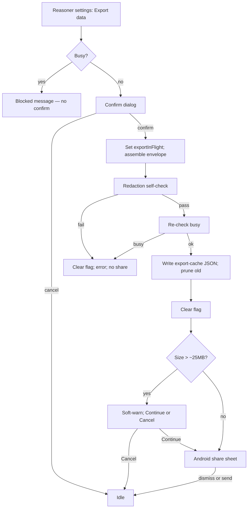

# feat: App data JSON export for offline analysis

## Summary

Add an owner-initiated **Export data** action that assembles the **allowlisted** local stores (see R2) into a versioned JSON file under an **app-private export cache** directory, redacts secrets, and opens the Android share sheet so the file can be sent for offline analysis. This plan ships export only; lap-rest timing, coach quality, and calorie-mismatch fixes are deferred until that dump is analyzed and prioritized one by one. Success of export means dump completeness for what is stored today — not that every deferred bug is already decidable from the dump (stamp evidence gaps in `knownOmissions`).

---

## Problem Frame

Swim, strength, vitals, and calorie issues are visible in the product, but diagnosis needs a single portable snapshot of what the app actually stores. There is no share/export path today — only prefs blobs and application-support side-files — so offline analysis requires ad-hoc device access. An intentional, redacted JSON dump unblocks analysis without shipping speculative metric fixes first.

---

## Requirements

### Entry & share UX

- R1. From Reasoner settings, the owner can start an **Export data** flow that produces one JSON file of local app data.
- R7. After a successful write and redaction self-check, Android share sheet opens with the JSON file; dismiss/cancel is non-failure; confirm cancel must not assemble.

### Export contents & envelope

- R2. The export includes these allowlisted stores: workout summaries (incl. segments/calories/counts), on-disk canonical swim side-files, sleep sessions, daily HR summaries, HR series side-files, and diagnostic meta (parser version, sync cursor, Gate A flags / home sync status, last R11 path, last auto-tracking enable JSON, Qwen installed flag). Intentionally skipped persisted keys/paths are listed in `knownOmissions`.
- R4. The envelope is versioned (`schemaVersion`, `exportedAt`), stamps `knownOmissions` for never-persisted streams and skipped prefs keys, stamps `consistencyClass: best_effort`, and stamps `sensitivityNotes` that the file contains health biometrics (not anonymized merely because secrets were redacted).
- R6. Empty or partial stores still produce a valid shareable envelope; corrupt sections are flagged via export-owned decode (`parseStatus`), not silent-empty repo loaders.

### Privacy & observability

- R3. Secrets and device identity material never appear in the file: Gemini API key, native Huawei secrets (`HuaweiSecretStore`), full MAC / userId (omit known keys and fail closed on recognizable shapes in the full serialized envelope).
- R8. Export contents never go to Sentry (coarse status strings only; no payload, path contents, envelope maps, or file attachments).

### Concurrency

- R5. Export blocks while workout/vitals sync or merge is in flight, while Forget is in flight (`forgetInFlight`), or while another export is in flight; re-check busy immediately before write.

### Forget residual

- R9. Forget wipe also prunes the export cache directory so a post-Forget device does not retain a shareable health dump.

---

## Scope Boundaries

- Do not fix lap rest / interval timing semantics.
- Do not improve coach/reasoner suggestion quality or persist coach outputs.
- Do not recompute diagnosis/recs into the export (derived offline from raw + canonical).
- Do not fix Home calories vs watch daily energy mismatch (document source only).
- Do not start persisting currently dropped `dataPages` / `paceBlocks` sample streams.
- Do not include Qwen3 model weights in the export.
- Do not add import/restore, cloud backup, encrypt-at-rest, or iOS share.
- Do not change Sync merge order, cursor rules, or side-file writers.
- Do not expand Forget wipe to delete canonical swim orphans (inventory only); only add export-cache prune.

### Deferred to Follow-Up Work

- Lap-rest timing fix (after analyzing exported segment/session clocks; GPS only if evidence warrants).
- Coach suggestion quality (after analyzing exported diagnosis/rec inputs vs owner expectation).
- Strength tracking UX + daily calorie alignment with watch (after analyzing exported workout calories vs owner watch totals).
- Optional later: persist native sample/pace page bodies so future exports contain raw swim streams.
- Optional later: wipe orphan `workouts/canonical_swim/` on Forget (separate integrity fix).

---

## Context & Research

### Relevant Code and Patterns

- Prefs SoT keys: `lib/features/device_pairing/domain/gate_a_prefs.dart` (`workouts_json`, sleep/HR prefs, sync/meta; secrets stay native-only).
- Canonical swim side-files: `lib/features/workout_history/data/canonical_swim_store.dart` (no Forget wipe today → orphans after Forget).
- HR series side-files: `lib/features/vitals/data/repositories/vitals_repository_impl.dart`.
- Busy gate pattern: Forget in `lib/features/device_pairing/data/repositories/device_pairing_repository_impl.dart` using `HuaweiLink.syncInFlight` + vitals `isSyncOrMergeInFlight`.
- Forget wipe extras: vitals `clearLocal` via DI callback — extend with export-cache prune only.
- Privacy scrub (defense-in-depth, not export allowlist): `lib/core/observability/sentry_privacy_scrub.dart`.
- Native secrets: `android/.../huawei/HuaweiSecretStore.kt` — never read during export.
- Natural UI home: `lib/features/workout_history/presentation/view/coach_settings_screen.dart` (`/coach_settings`).
- Architecture dual-store map: `docs/architecture/README.md`.
- Home calories = sum of today's workout calories: `lib/features/home/data/repositories/home_repository_impl.dart`.

### Institutional Learnings

- Local-first plaintext + `allowBackup=false` means export is a new intentional exfil path — owner-initiated only (`docs/catalogs/gt5-a07-full-metrics.md`, architecture README).
- Design fixture models per-interval `rest`, but wire/persisted models do not — export must not invent `restSec` (`docs/design/swim-analytics.js` vs segment models).
- FitnessTotals day calories are not persisted; only per-workout Totals `0x06` calories land in `workouts_json`.
- No `docs/solutions/` tree; prior art is plans + learnings + fixtures.

### External References

- [share_plus](https://pub.dev/packages/share_plus) — use plugin FileProvider; write under app-private cache/files; share `XFile` with `application/json`.
- Android FileProvider URI roots — share only paths under plugin-configured cache/files; never share SoT side-file paths directly.
- Sentry Flutter sensitive-data guidance — never log or attach export payloads.

---

## Key Technical Decisions

- **Export-only slice:** Ship diagnostic dump first; analyze and prioritize product fixes separately (owner-confirmed).
- **Module placement:** Host under `lib/features/diagnostics/` (service + envelope constants). Register from `diagnostics_di.dart` that the root injector calls into — assembler types stay out of `lib/core/`. Keep the module thin (no broader diagnostics framework).
- **Entry point:** Reasoner settings (`CoachSettingsScreen`); Home must not host this CTA.
- **Assembler from local stores:** Read prefs + **raw `Directory` listings** via `getApplicationSupportDirectory()` + `GateAPrefs.canonicalSwimDir` / `dailyHrSeriesDir` (test root overrides). Do **not** call `CanonicalSwimStore` / `loadAllCanonicalSwims` / `loadDailyHrSeries` (they create dirs and/or swallow corrupt). Do not re-query the watch.
- **Layered envelope:** Raw prefs workouts separate from on-disk canonical swim files; inventory lists missing/orphan as consistency observations.
- **Diagnosis/recs:** Out of v1 export — derived offline; stamp in `knownOmissions` / schema doc so absence is not read as a sync bug.
- **share_plus:** Add dependency; bundled FileProvider; write under app-private export cache only; refuse share if path escapes that dir; never `XFile` SoT paths.
- **Busy / concurrency:** Add `forgetInFlight` around `forgetDevice` body (`finally` clear). Export busy = `syncInFlight || vitals.isSyncOrMergeInFlight || forgetInFlight || exportInFlight`. Extend `isForgetBlocked` to OR `exportInFlight` only — do **not** treat `isForgetBlocked` itself as Forget-in-flight. Hold `exportInFlight` through assemble+write; re-check busy immediately before write. Stamp `consistencyClass: best_effort`.
- **Forget residual:** Compose wipe extras after vitals DI (never overwrite in isolation): `onForgetWipeExtras = () async { await vitals.clearLocal(); await export.pruneExportCache(); }` and `isForgetBlocked = () => vitals.isSyncOrMergeInFlight || export.exportInFlight`.
- **Redaction:** Allowlist meta; omit `gemini_api_key` (keys + values), full MAC shapes, userId shapes/keys, native secrets; recursive self-check over full serialized envelope; never call `HuaweiSecretStore` / auth channels; keep `rememberedName` only with sensitivity stamp acknowledging residual nickname PII.
- **Corrupt / partial:** Export-owned decode with per-section `parseStatus` (`ok|corrupt|absent`) — independent of workout silent-empty and vitals fail-closed loaders.
- **Prune:** Keep only the latest export file in the export cache dir.
- **Confirm dialog:** Named privacy control — cancel skips assemble; warn health data leaves the device; prune does not revoke already-shared copies.
- **Size:** Soft-warn ~25MB **after successful write, before share**; still allow. Prefer streaming/chunked assemble for HR series so OOM cannot occur before the warn; isolate if measured peak requires it.
- **Sentry contract:** Coarse status enums/strings only; scrub is defense-in-depth, not the primary control.
- **Trust model (v1):** Single-owner Android debug companion; unlocked-device possession + confirm dialog is sufficient authorization (no Gate A / biometric gate on Export).

---

## Open Questions

### Resolved During Planning

- Export vs fix-now: **Export only** (owner confirmed).
- Lap-rest / calorie truth / coach quality: **Out of scope** until post-export analysis.
- UI home: **Reasoner settings**.
- Module placement: **`features/diagnostics`** (thin; root injector calls feature DI).
- Diagnosis in envelope: **Omit** (recompute offline).
- Forget residual for export cache: **Prune on Forget** (composed wipe extras).
- Forget-in-flight signal: **new `forgetInFlight` flag** (not `isForgetBlocked`).
- Soft-warn timing: **after successful write, before share**.
- Trust model: **unlocked device + confirm** (single-owner).
- Busy / redaction / corrupt / inventory defaults: locked as above.

### Deferred to Implementation

- Exact class names.
- Soft-warn dialog copy and whether to show approximate byte size.
- Whether HR series needs an isolate vs chunked Future once fixtures measure peak memory.
- UX polish: exact blocked/disabled CTA strings; whether “Share last export” exists after dismiss (default v1: one-shot, re-run Export).

---

## High-Level Technical Design

> *This illustrates the intended approach and is directional guidance for review, not implementation specification. The implementing agent should treat it as context, not code to reproduce.*

### Flow



### Envelope shape (directional)

```text
{
  schemaVersion: 1,
  exportedAt: <ISO-8601 UTC>,
  sensitivityNotes: "Contains health biometrics and workout history. Not anonymized. Do not commit.",
  consistencyClass: "best_effort",
  knownOmissions: [
    "swim_sample_data_pages",
    "swim_pace_blocks",
    "ephemeral_coach_reasoner_outputs",
    "diagnosis_and_recommendation_snapshots",
    "daily_activity_calories_beyond_workout_totals_sum",
    "remembered_mac",
    "gemini_api_key",
    "native_huawei_secrets"
  ],
  meta: {
    swimSegmentParserVersion,
    lastSyncCursor,
    gateAPassed,
    gateAInterruptFlags,
    lastR11WinningPath,
    lastAutoTrackingEnable,
    homeLastSyncStatus / homeLastSyncAtMs,
    rememberedName,          // no MAC
    qwenInstalled,
    sideFileInventory: {
      missingCanonicalSwim,
      orphanCanonicalSwim,   // IDs only in v1 — bodies omitted until Forget wipe fix
      hrSeriesMissingDays,
      hrSeriesOrphanDays,
      parseErrors
    }
  },
  workouts: { parseStatus, items: [ WorkoutSummary JSON… ] },
  canonicalSwim: [ { file, parseStatus, body }… ],  // on-disk, non-orphan only
  vitals: {
    sleepSessions: { parseStatus, items },
    dailyHrSummaries: { parseStatus, items },
    hrSeries: [ { dayKey, parseStatus, samples? }… ]
  }
}
```

---

## Implementation Units

### U1. Export envelope assembler

**Goal:** Diagnostics-feature assembler that builds the versioned envelope from prefs + on-disk side-file inventories without UI or share.

**Requirements:** R2, R4, R6

**Dependencies:** None

**Files:**
- Create: `lib/features/diagnostics/data/app_data_export_service.dart`
- Create: `lib/features/diagnostics/data/app_data_export_envelope.dart` (schema constants, knownOmissions, sensitivityNotes)
- Create: `lib/features/diagnostics/data/diagnostics_di.dart` (feature registration; root injector calls it)
- Test: `test/features/diagnostics/app_data_export_service_test.dart`

**Approach:**
- Compose SharedPreferences + raw side-file dir listings (`GateAPrefs` dir constants + app-support root; temp overrides in tests).
- Inventory = directory listing vs prefs workout numbers / daily HR keys — **not** `CanonicalSwimStore` / `loadAllCanonicalSwims` / `loadDailyHrSeries`.
- Include orphan swim **IDs** in inventory; **omit orphan bodies** from `canonicalSwim` (privacy: Forget residue must not amplify into shareable payloads).
- Build layered JSON; stamp `schemaVersion`, `exportedAt`, `knownOmissions`, `sensitivityNotes`, `consistencyClass: best_effort`.
- Per-section export-owned decode for corrupt prefs; skip corrupt side-files with inventory errors.
- Never read `HuaweiSecretStore` or include Gemini key / MAC / userId.

**Execution note:** Implement assembler test-first with mock prefs + temp side-file dirs.

**Patterns to follow:**
- Temp root overrides in `test/features/workout_history/workout_history_repository_test.dart`
- Vitals side-file tests under `test/features/vitals/`

**Test scenarios:**
- Happy path: seeded prefs + N swim files + M HR day files → envelope counts match; schemaVersion + sensitivityNotes present.
- Edge case: empty stores → valid envelope with empty collections.
- Edge case: missing `swim_42.json` while workout 42 present → `missingCanonicalSwim` lists 42; export succeeds.
- Edge case: orphan `swim_99.json` not in prefs → `orphanCanonicalSwim` lists 99; **body omitted** from `canonicalSwim`.
- Edge case: corrupt `workouts_json` → `parseStatus: corrupt`, not silent empty.
- Edge case: unreadable HR day file → skipped with parse error; other days included.
- Happy path: `knownOmissions` + `consistencyClass` + `sensitivityNotes` present.

**Verification:** Unit tests pass against temp fixtures; no share/UI required.

---

### U2. Redaction, busy gates, export-cache write, Forget prune

**Goal:** Fail closed on secrets; enforce concurrency gates; write/prune export cache; prune that cache on Forget.

**Requirements:** R3, R5, R7, R8, R9

**Dependencies:** U1

**Files:**
- Modify: `lib/features/diagnostics/data/app_data_export_service.dart`
- Modify: `lib/features/vitals/data/di/vitals_di.dart` (or post-vitals hook) to **compose** wipe extras + `isForgetBlocked` — never a second isolated assignment
- Modify: `lib/features/device_pairing/data/repositories/device_pairing_repository_impl.dart` (`forgetInFlight` around `forgetDevice`)
- Test: `test/features/diagnostics/app_data_export_service_test.dart` (extend)
- Test: Forget wipe includes export-cache prune (extend existing gate/Forget tests if present)

**Approach:**
- Before assemble: if `syncInFlight || vitals.isSyncOrMergeInFlight || forgetInFlight || exportInFlight` → blocked (no write).
- Hold `exportInFlight` through assemble+write; clear on all exits.
- Pairing: set `forgetInFlight` true for `forgetDevice` body; clear in `finally`.
- Compose DI after vitals (never overwrite in isolation): wipe extras = vitals `clearLocal` then export-cache prune; `isForgetBlocked` = vitals sync/merge OR `exportInFlight`.
- After assemble: serialize; recursive self-check for forbidden keys/values/MAC/userId shapes; fail closed — no share path.
- Re-check busy immediately before write; if busy, fail without share.
- Write only under export cache dir; filename `fitness_os_export_v{schemaVersion}_{yyyyMMdd_HHmmss}.json`; prune prior exports.
- Refuse to return a share path outside that directory.
- Error reporting: coarse status only; never Sentry attachments / envelope extras.
- Stream/chunk HR series during assemble so large history cannot OOM before size warn.

**Patterns to follow:**
- Forget busy + wipe extras in `device_pairing_repository_impl.dart` / vitals DI
- `SentryPrivacyScrub` forbidden families as self-check inspiration (not as allowlist)

**Test scenarios:**
- Happy path: write creates file; second export leaves only one matching file.
- Error path: sync busy → blocked; no file.
- Error path: Forget-in-flight → blocked; no file.
- Error path: busy flips true before write → fail; no share path.
- Error path: prefs contain `gemini_api_key` → omitted; self-check passes.
- Error path: planted MAC or userId in prefs → omitted or self-check fails closed; no share if fail-closed triggers.
- Error path: write IO failure → failed; no share.
- Integration: Forget wipe removes export cache files; does not delete `workouts/canonical_swim/` (orphan inventory IDs only).
- Integration: composed wipe still runs vitals `clearLocal` (export prune must not replace vitals callback).

**Verification:** Busy/redaction/prune/Forget-cache behaviors covered by unit tests with temp directories.

---

### U3. share_plus + Reasoner settings Export UI

**Goal:** Owner-facing Export data control with confirm dialog, progress/busy UI, soft size warn, and Android share sheet.

**Requirements:** R1, R7

**Dependencies:** U1, U2

**Files:**
- Modify: `pubspec.yaml` (add `share_plus`)
- Modify: `lib/features/workout_history/presentation/view/coach_settings_screen.dart`
- Test: `test/features/workout_history/coach_settings_export_test.dart`

**Approach:**
- ListTile **Export data** below Qwen controls; reuse screen `_busy` so download and export cannot overlap.
- If sync/Forget/export/Qwen busy on tap → show blocked status (no confirm). Only open confirm when idle.
- Confirm dialog (privacy control): cancel → no assemble; confirm → export service. Body must warn: health biometrics leave the device; not anonymized; prune ≠ revoke shared copies; recipients may retain copies.
- On success: soft-warn if >~25MB (Continue → share / Cancel → idle, file kept until next export/Forget); share only `XFile` under export cache with `application/json`.
- Share dismiss/cancel → idle, no error snackbar; v1 one-shot (re-run Export to share again).
- If unmounted after assemble → do not open sheet / do not `setState`.
- Indeterminate progress + status while assembling/writing; Export disabled while `_busy`.
- Android-only; no iOS work.
- Accept plaintext share for v1 (single-owner diagnostic); no password container in this plan.

**Patterns to follow:**
- Existing `_busy` / progress / status on `CoachSettingsScreen`
- share_plus FileProvider defaults

**Test scenarios:**
- Happy path: tap Export → confirm → fake service success → share invoked once with JSON mime/path under export cache.
- Edge case: confirm cancel → no assemble call.
- Edge case: service blocked → status message; no share.
- Edge case: service failure → error status; no share.
- Edge case: double-tap while busy → second export not started.
- Integration: Qwen download `_busy` true → Export disabled or blocked.

**Verification:** Widget tests with fake export + fake share; device smoke opens share sheet with non-empty JSON.

---

### U4. Export schema note for offline consumers (optional / non-blocking)

**Goal:** Short in-repo note so offline analysis knows how to read the dump, what is sensitive, and what is intentionally missing. **Not required to ship R1–R9** — U1 envelope stamps + fixture asserts own R4.

**Requirements:** Supports R4 documentation; runtime R4 owned by U1

**Dependencies:** U1

**Files:**
- Create (optional): `docs/export/app-data-export-schema.md`

**Approach:**
- Document `schemaVersion` 1 fields, layered sections, redaction rules, `sensitivityNotes`, `consistencyClass`, `knownOmissions`, and inventory semantics (orphan IDs without bodies).
- Point analyzers at Home calories = Σ workout calories; rest not in wire; samples not persisted; diagnosis recomputed offline; which deferred bugs may still be underdetermined.
- State dumps are owner-private and must not be committed.

**Test expectation:** none — documentation only.

**Verification:** If written, doc matches envelope keys produced by U1 fixtures.

---

## System-Wide Impact

- **Interaction graph:** New diagnostics-feature reader of prefs + side-file dirs; Reasoner settings CTA; `share_plus` FileProvider merge; Forget wipe extras gain export-cache prune; `exportInFlight` participates in busy family with Sync/Forget.
- **Error propagation:** Export failures stay local to settings status — no store invalidation, no sync retry; Sentry receives no export bodies.
- **State lifecycle risks:** Best-effort snapshot (busy + re-check); orphan canonical swims after Forget remain SoT residue and appear in inventory; export cache is a derivative health store pruned on Forget and on each new export; never write/prune SoT dirs from export.
- **Security / privacy:** First intentional outbound path for plaintext health stores that otherwise stay on-device under `allowBackup=false`; confirm is a control; post-share copies are outside app custody; FileProvider limited to export-cache URIs.
- **API surface parity:** Android-only share; no iOS / no import API.
- **Integration coverage:** Unit tests for assemble/redact/busy/Forget-prune; widget test button→share; device smoke for URI grant of export file only.
- **Unchanged invariants:** Sync merge order/cursor/side-file writers; workout silent-empty and vitals fail-closed **loaders** (export uses its own decode); Home calorie formula; coach/reasoner persistence; canonical swim SoT layout (**orphans not wiped** by this plan — inventory IDs only); Sentry scrub implementation (export simply must not feed it). **Intentional Forget deltas:** wipe extras gain composed export-cache prune (R9); busy mutual exclusion via `forgetInFlight` + `exportInFlight` on `isForgetBlocked`.

---

## Risks & Dependencies

| Risk | Mitigation |
|------|------------|
| Accidental secret / MAC leakage in shared JSON | Allowlist meta; value + MAC-shape self-check; never read `HuaweiSecretStore` |
| Owner shares dump to unintended target / retains external copies | Blocking confirm; cancel skips assemble; document prune ≠ revoke shared copies |
| Sentry accidental capture of envelope fragments | Coarse status only; no attachments/extras with body/path contents; scrub is defense-in-depth |
| FileProvider path/grant leakage | Share only export-cache paths; fail closed on path escape; avoid custom broad `file_paths` |
| Torn snapshot (TOCTOU) during sync/Forget | Block sync/merge/Forget/export; hold `exportInFlight`; re-check before write; document best-effort |
| Concurrent Forget mid-export | Mutual exclusion via busy flags |
| Dump misread as anonymized | `sensitivityNotes` + schema doc |
| Omissions / inventory misread as sync bugs | `knownOmissions` + inventory labeled as consistency observations |
| Large HR history OOM / UI jank | Soft size warn; off-UI-isolate write if needed |
| Export treated as backup/restore | Explicit non-goals; no import path |
| Post-Forget residual export file | R9 prune export cache on Forget wipe |

---

## Documentation / Operational Notes

- Schema consumer doc in `docs/export/app-data-export-schema.md` is **optional** (U4); envelope stamps are authoritative.
- Owner workflow after ship: Export → share to Files/chat → analyze → prioritize lap-rest / coach / calories fixes one by one.
- **Evidence honesty:** Segment clocks + workout Totals may be enough to *start* lap-rest and calorie digs, but sample/pace streams and FitnessTotals day calories are still absent — treat those deferred fixes as “blocked on capture” when the dump proves insufficient, not as export bugs.
- Do not commit real export files to git.
- After Forget, expect orphan canonical swim files until a separate wipe fix; export lists orphan IDs only (no bodies).

---

## Sources & References

- Owner request (2026-08-05): export-first diagnostic dump; defer product fixes until analysis.
- `docs/architecture/README.md` — prefs + side-file layout
- `docs/plans/2026-07-23-001-product-roadmap-swim-bible-v0.md` — analytics context
- `docs/learnings/2026-07-18-huawei-gt5-companion-poc.md` — local-first / secrets
- `test/fixtures/huawei/README.md` — owner-private dump hygiene
- `lib/core/observability/sentry_privacy_scrub.dart` — forbidden payload families
- Deepening (2026-08-05): security-sentinel, data-integrity-guardian, architecture-strategist
