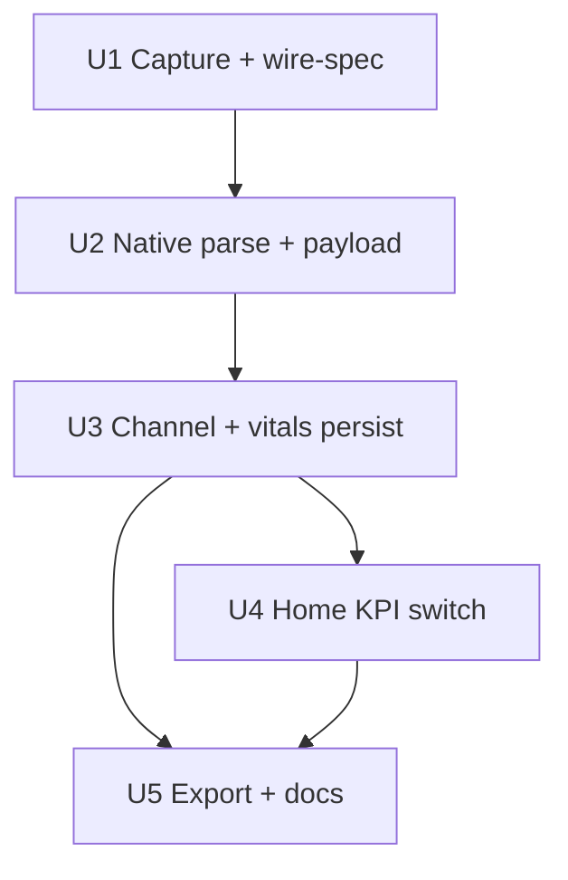
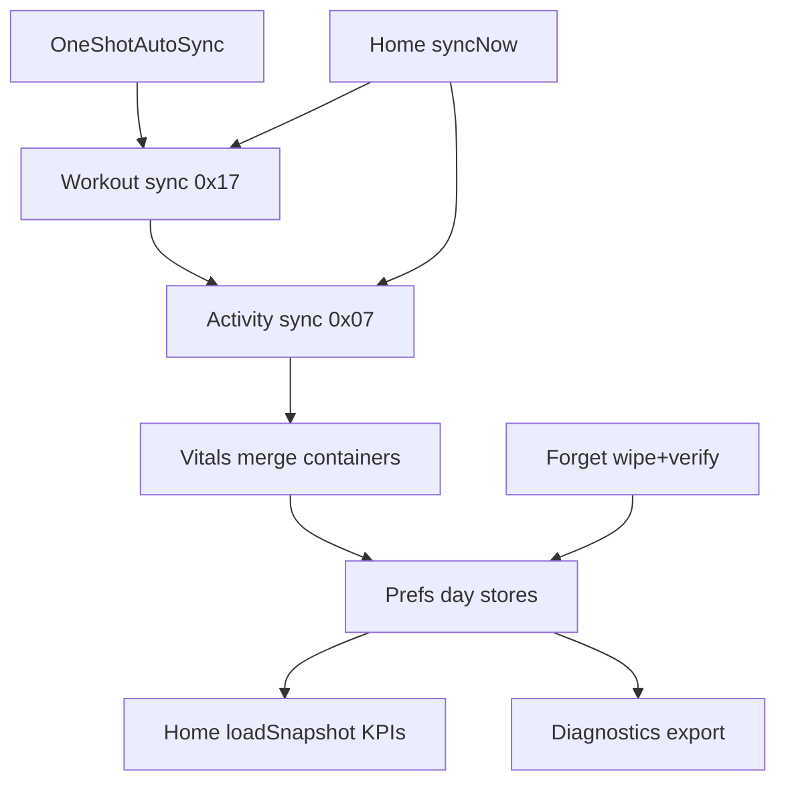

# feat: FitnessTotals day rollup for Home KPIs

## Overview

Home KPIs currently sum today’s **workout Totals** (calories, steps, duration). The watch Activity day view uses Huawei **FitnessTotals** (`0x07:0x03`), which already includes non-workout burn and exercise minutes. Activity sync already **requests** FitnessTotals as an opaque idle handoff and **discards** the response. This plan captures, parses, persists, and drives Home calories / steps / workout time from that day rollup so Home matches the watch.

## Problem Frame

Owner debug (export `fitness_os_export_v1_20260806_180552.json`) showed exact workout-sum math on Home:

| Metric | Home (workout sum) | Watch (day Activity) |
|--------|--------------------|----------------------|
| Calories | 781 (= 340 + 441) | 966 |
| Workout time | 120m (= ⌊7208/60⌋) | 127m |

Brand IA requires Home to show **today’s totals** (calories, steps, workout time) as calm “now” mix — not workout-only proxies `(see origin: docs/brainstorms/2026-07-25-fathom-companion-brand-ia-requirements.md)`. Export / prior plans already document the gap: FitnessTotals day calories are not persisted; Home = Σ workout calories.

## Requirements Trace

### Data & persistence
- R1. Persist FitnessTotals day rollup fields needed for Home: **calories**, **exercise/workout duration**, and **steps** when present on the wire.
- R6. Forget / vitals `clearLocal` wipes the new store; late merge after Gate A cleared remains a no-op.

### Home KPI behavior
- R2. Drive Home KPI labels from FitnessTotals for the **local calendar day** when that day’s row was merged from a completed `fitness_totals` container.
- R3. Fall back to today’s **workout-sum triple** (calories + steps + duration together) when no FitnessTotals row exists for local today (no blank regression after workout-only progress).

### Sync & parser
- R4. Reuse the existing activity sync chain slot for `0x07:0x03` (already after step data); do not invent a parallel sync path.
- R5. Promote owned wire-spec + probe evidence before treating the parser as normative (AGPL oracle only; no paste).

### Lifecycle & export
- R7. Diagnostic export includes the persisted day rollup; drop `daily_activity_calories_beyond_workout_totals_sum` from `knownOmissions` when the store is present with `parseStatus: ok`; update schema notes so Home calorie math is accurate. Non-blocking for Home↔watch MVP.

### UI scope
- R8. Vitals tab UI stays sleep + whole-day HR only — no new FitnessTotals charts on Vitals `(see origin)`.

## Scope Boundaries

- Do **not** persist SpO2 or minute-level step/cal samples from `0x0B` for this cut (still HR-extract-only unless a later plan opts in).
- Do **not** change workout Totals parsing or workout history UI calorie displays.
- Do **not** add FitnessTotals to Vitals presentation surfaces.
- Do **not** claim watch parity until owner confirms Home vs watch after a real sync (acceptance is evidence-backed).
- Do **not** backfill historical days beyond the existing `syncActivity` window without an explicit follow-up.

### Deferred to Separate Tasks

- Catalog score promotion to **4/5** after multi-session captures: update `docs/catalogs/gt5-a07-full-metrics.md` / probe matrix score rows in a docs-only follow-up once captures exist (Unit 1 updates probe Pending→observed text only as needed for the TLV table).
- Persisting interval steps/cal from `0x0B` bitmaps (if FitnessTotals lacks steps on some firmware): separate plan.
- Relabel-only honesty without FitnessTotals (workout-only copy): superseded by this plan.
- Full export/schema polish (Unit 5) if deferred from the Home KPI MVP train.

## Context & Research

### Relevant Code and Patterns

- Native activity chain + opaque handoff: `android/app/src/main/kotlin/com/example/fitness_os/huawei/HuaweiFitnessDataSync.kt` (`CMD_FITNESS_TOTALS = 0x03`; response ignored after step HR extract).
- Tests for chain / fixtures: `android/app/src/test/java/com/example/fitness_os/huawei/HuaweiFitnessDataSyncTest.kt`.
- Channel → Dart DTO: `lib/core/huawei/huawei_link.dart` (`ActivitySyncResult`, `completedContainers`).
- Merge + prefs + Forget wipe: `lib/features/vitals/data/repositories/vitals_repository_impl.dart` (`_mergeContainers`, `clearLocal`); prefs constants in `lib/features/device_pairing/domain/gate_a_prefs.dart`.
- Home KPI fold: `lib/features/home/data/repositories/home_repository_impl.dart` (today’s workouts → calories / steps / `durationSec ~/ 60`).
- Home sync pass: same file `syncNow` → workouts + vitals; auto path via `OneShotAutoSync`.
- Export omission hooks already named: `lib/features/diagnostics/data/app_data_export_service.dart`, `app_data_export_envelope.dart`, `docs/export/app-data-export-schema.md`.
- Wire / catalog status: `docs/wire-specs/huawei-br-gt5-fitness-data.md`, `docs/experiments/gt5-a07-full-metrics-probe-matrix.md` (FitnessTotals **Pending** / score **2**).
- Prior decision (superseded for this product need): vitals plan R13 — do not persist fitness-totals *that cut*; handoff-only — `docs/plans/2026-07-18-004-feat-vitals-sleep-hr-tab-plan.md`.

### Institutional Learnings

- No `docs/solutions/` tree; prior art is plans + wire-specs + catalogs.
- Evidence honesty: do not promote parsers from unobserved TLV tables; synthetic fixtures OK for scaffolding; owner capture required for normative claim.
- Privacy: log tag+len / counts only — never full health series or raw calorie dumps in Sentry.

### External References

- Skipped deep external framework research: local sleep/step TLV + channel/merge patterns are sufficient; FitnessTotals **field map** is intentionally capture-gated, not copied from AGPL sources.

## Key Technical Decisions

- **Source of truth for Home KPIs:** FitnessTotals day row for local `yyyy-MM-dd` when present in prefs from a prior completed merge; else workout-sum **triple** fallback (R3). Do not mix FT calories with workout steps in the same snapshot.
- **KPI scope:** All three Brand IA totals — calories, steps, workout time — from the same day rollup. Missing wire fields on a present row display as `0` / `0m` (row present ⇒ do not fall back to workout-sum for zeros).
- **Zero vs absent:** A completed parse that yields today’s row with zeros is **present** (show zeros) **only after Unit 1 owner cross-check** established the TLV map. **Sanity gate:** if today’s FT calories are 0 (or all KPIs zero) while today’s workout-sum calories exceed a small threshold, treat the FT row as **untrusted** for Home (use workout-sum triple; do not mark as successful parity). Absent means no row for local today, container never completed, **or fail-closed corrupt load** → workout-sum triple.
- **Home read path:** Home loads day totals **only** via vitals repository API (no direct prefs read in `HomeRepositoryImpl`) so fail-closed flags apply.
- **U4 gate:** Do not ship Home KPI switch (Unit 4) until Unit 1 verification is done (wire-spec `capture:…` + owner day cross-check). Synthetic fixtures may land in Unit 2/3 tests earlier, but must not drive production Home as “proven.”
- **Storage:** Single GateAPrefs key `fitness_totals_day_json` as **sole writer and sole export read**. Do not dual-read unused legacy probe key names unless a released build already wrote them (none expected).
- **Merge policy:** Replace-by-local-day across the activity window (default last **14** local days via `HuaweiLink.syncActivity` / `activityWindowDays`). Keep prior rows for days not in the completed payload. Corrupt JSON → fail-closed load flag (mirror sleep/HR), not silent `[]`.
- **Partial sync / early exits:** Today sleep/step `partial_batch` returns **before** the FitnessTotals exchange. Implementers must still attempt FitnessTotals when the link is up before returning `partial_batch` after sleep/HR progress (or after step timeout), so Home can refresh day KPIs independently of HR bitmap absence. Timeout/null on totals → omit `fitness_totals` from `completedContainers`; do not fail sleep/HR merges.
- **Overall sync status:** Include FitnessTotals in native `hasMergeable` so totals-only payloads return `ok` (not `empty`). Dart must merge on that path — today `VitalsRepositoryImpl` skips merge on `empty`. Preserve `partial_batch` = mid-chain abort only. Parse throw → log, omit completed bit, continue.
- **Stuck / sleepCount timeout:** Same starvation class as `partial_batch` — attempt FitnessTotals when link still usable before returning `stuck`, **or** explicitly accept no-totals on sleepCount timeout and cover with a fixture (document the chosen rule in Unit 2).
- **Parser gate:** Privacy-safe capture (tag+len histogram + presence/counts; debug-gated scalars only) → update wire-spec → parser against owned tables + synthetic fixtures. Behavioral oracle may suggest candidate tags only — no AGPL paste.
- **UI:** Home labels unchanged (“Calories”, “Steps”, “Workout time”); values change source to day exercise/energy rollup (accept 120→127 class semantic). No Vitals UI for day rollup.
- **Auto-sync quirk (unchanged):** `OneShotAutoSync` already runs vitals/activity but does not stamp `home_last_sync_*`; Home still refreshes via `StoreInvalidation`. Totals may land without flipping the sync pill — accept as existing behavior.
- **Rounding:** Prefer watch-aligned display once duration units are known (minutes vs seconds). Document units in wire-spec; store one canonical unit in prefs; format Home once.

## Open Questions

### Resolved During Planning

- KPI scope: all three Brand IA totals (calories, steps, workout time), not calories-only.
- Fallback granularity: **whole triple** — FT row for today ⇒ use FT for all three; else workout-sum for all three (no per-field mix).
- Zero semantics: legitimate FT zeros OK after capture-proven map; sanity gate when FT cal=0 but workout-sum cal high → untrusted → workout-sum.
- Prefs: one `fitness_totals_day_json` writer **and** sole export read (no speculative legacy dual-read).
- Unit 5 (export/schema) is **non-blocking for MVP watch acceptance** — ship after U1–U4 or in the same PR only if cheap; Home parity does not require export.
- Totals on partial path: attempt before `partial_batch` return when connected; soft-omit completed bit on failure.
- Supersedes vitals plan R13 **for FitnessTotals persistence only** (steps/SpO2 minute samples remain non-persisted).
- Home read path: vitals repo only (no direct prefs in Home).
- U4 blocked on Unit 1 capture verification.
- Fail-closed / corrupt FT load ⇒ absent for Home (workout-sum triple when synced).
- Intentional dual surface: Home day rollup vs Workouts per-session Totals — document in schema/export notes.

### Deferred to Implementation

- Exact TLV tag → field map for calories / steps / exercise duration / day anchor (requires capture) — **ship blocker for normative parser**; **also** whether steps live on `0x07:0x03` or only on minute samples / workouts.
- **Product decision if capture shows steps absent on FitnessTotals:** (a) delay claiming steps from FT and keep workout-sum for steps only after explicit plan amend, (b) require all three tags before FT row is authoritative, or (c) rename/narrow Home KPIs — **choose after Unit 1 evidence; do not guess**.
- Whether one FitnessTotals response returns multiple days or a single window aggregate (parser must match observed shape).
- Whether to rename Home “Workout time” after validating exercise-minute semantics — default keep Brand IA label; document source as day exercise rollup in schema notes.
- Exact JSON field names inside each day row and whether to retain raw wire units alongside display units.

## High-Level Technical Design

> *This illustrates the intended approach and is directional guidance for review, not implementation specification. The implementing agent should treat it as context, not code to reproduce.*

```mermaid
sequenceDiagram
  participant Home
  participant VitalsRepo
  participant Link
  participant Native as FitnessDataSync
  participant Prefs

  Home->>VitalsRepo: syncFromWatch / auto-sync
  VitalsRepo->>Link: syncActivity(window)
  Link->>Native: sleep → steps/HR → fitnessTotals
  Native-->>Link: + fitnessTotals days + completed
  Link-->>VitalsRepo: ActivitySyncResult
  VitalsRepo->>Prefs: replace-by-day merge
  Home->>VitalsRepo: loadFitnessTotalsForDay(today)
  Home->>Home: KPI triple = FT today else workout-sum
```

**Precedence matrix (Home, local today):**

| Home precedence / sync state | FitnessTotals today row | Workouts today | KPI labels |
|------------------------------|-------------------------|----------------|------------|
| `notPaired` / `pairedNeverSynced` | any | any | `null` (existing precedence — hide KPIs) |
| Synced / data available | Present (incl. legitimate zeros) | any | FitnessTotals row (all three) |
| Synced / data available | Absent or **load fail-closed** | non-empty | Workout-sum triple |
| Synced / data available | Absent or load fail-closed | empty | `0` / `0m` |

## Implementation Units



- [ ] **Unit 1: Capture FitnessTotals evidence and promote wire-spec**

**Goal:** Turn the already-issued `0x07:0x03` exchange into an owned, privacy-safe observation so parsing is normative.

**Requirements:** R4, R5

**Dependencies:** Owner device sync available for at least one real capture. **Unit 4 is hard-blocked** on this unit’s verification checklist (not merely on Unit 2 synthetic fixtures).

**Files:**
- Modify: `android/app/src/main/kotlin/com/example/fitness_os/huawei/HuaweiFitnessDataSync.kt` (privacy-safe capture logs)
- Modify: `docs/wire-specs/huawei-br-gt5-fitness-data.md`
- Modify: `docs/experiments/gt5-a07-full-metrics-probe-matrix.md`

**Approach:**
- On FitnessTotals response: record service/cmd and **TLV tag+len histogram + presence/counts only** in default/release logging.
- Restrict any decoded scalar cross-check (e.g. mapping candidates to ~966 kcal / ~127 min) to **owner-local, debug-gated, non-Sentry** paths; production builds must not log decoded day energy/steps/duration.
- Cross-check one owner day against watch Activity (target class: ~966 kcal / ~127 min vs workout-sum 781 / 120). **Also record whether watch day steps appear on this frame** — if steps are absent on `0x07:0x03`, document before Unit 4 claims all three KPIs from FT.
- Define **day-anchor → local `yyyy-MM-dd`** in the wire-spec (UTC unix + `toLocal()` like sleep/step; shared helper with HR merge). Unit 3/U4 must use the same helper so Home “today” cannot miss a row and silently fall back.
- Write owned TLV table into the wire-spec with `capture:…` citation; mark probe matrix row out of Pending.
- Catalog score bumps stay in Deferred to Separate Tasks (not this unit).

**Patterns to follow:**
- Sleep/step capture notes in `docs/wire-specs/huawei-br-gt5-fitness-data.md` (UTC anchors, privacy rules).
- Existing `FOS_HUAWEI` activity-sync log style (counts, not series).

**Test scenarios:**
- Test expectation: none for docs-only promotion — evidence is owner capture + wire-spec citation. If logging helpers are extracted as pure functions, unit-test histogram shaping only.

**Verification:**
- Wire-spec contains FitnessTotals TLV field table with capture id; probe matrix no longer Pending for `0x07:0x03`.

- [ ] **Unit 2: Parse FitnessTotals in native activity sync and return container**

**Goal:** Parse day rollup rows from `CMD_FITNESS_TOTALS` and include them in the activity sync result map with `completedContainers` membership.

**Requirements:** R1, R4, R5

**Dependencies:** Unit 1 field map (or synthetic fixture table explicitly marked pre-promotion if capture lags — must not ship Home-driving parser as “proven” without Unit 1).

**Files:**
- Modify: `android/app/src/main/kotlin/com/example/fitness_os/huawei/HuaweiFitnessDataSync.kt`
- Modify: `android/app/src/main/kotlin/com/example/fitness_os/huawei/HuaweiSession.kt` / `HuaweiBtPlugin.kt` only if result plumbing needs it
- Test: `android/app/src/test/java/com/example/fitness_os/huawei/HuaweiFitnessDataSyncTest.kt`

**Approach:**
- Replace discard-only exchange with parse → list of day maps (`dayKey` or unix dayStart, calories, steps?, exerciseDuration in documented units).
- Add `fitness_totals` to `completed` when ≥1 usable day row; timeout/null frame → soft-omit completed bit; keep prior Flutter rows.
- **Restructure early returns:** extract a shared finalize (directional: `attemptFitnessTotalsAndFinalize`) used by the happy path and sleep/step `partial_batch` / `stuck` paths when still connected — avoid duplicating battery/idle handoff and missing one exit. Update chain tests that currently expect timeout without a totals queue.
- Extend `resultMap` with a `fitnessTotals` list; treat totals as mergeable for overall status (`hasMergeable` includes non-empty fitness totals → `ok`, not `empty`).
- Cover sleepCount → `stuck` path: attempt totals when connected **or** document accepted no-totals + fixture.
- Runtime redaction: production logs stay tag+len/counts; no decoded day metrics. Never log channel `fitnessTotals` bodies — counts/dayKey cardinality only.
- Do not confuse workout Totals `0x17:0x08` / calorie tag `0x06` with FitnessData `0x07:0x03`.

**Execution note:** Characterization-first for the existing opaque handoff test fixtures — extend chain tests so FitnessTotals frames are asserted, not ignored.

**Patterns to follow:**
- `parseSleepStages` / `parseStepDataHr` style; `resultMap` + `completedContainers` contract in the same class.
- Workout Totals calorie TLV discipline in `HuaweiWorkoutSync.kt` (owned tags only).

**Test scenarios:**
- Happy path: fixture frame with known tags → parsed calories/duration/steps + `fitness_totals` in `completedContainers`.
- Edge case: empty TLVs / unknown tags only → not completed; sleep/HR results still returned.
- Edge case: multi-day window fixture → one row per day key; no cross-day merge in native.
- Error path: null/timeout on FitnessTotals after HR success → no crash; completed bit absent; sleep/HR still merged.
- Error path: stepData timeout path still issues FitnessTotals exchange when connected, then returns `partial_batch`.
- Integration: full chain fixture (sleep + step + totals) returns all three payload families; cmd order remains sleep → step → totals.

**Verification:**
- Kotlin tests green; real sync log shows parsed counts (not only handoff).

- [ ] **Unit 3: Channel DTO, vitals merge/persist, Forget wipe**

**Goal:** Land FitnessTotals in Dart stores with the same container-merge and Forget guarantees as sleep/HR.

**Requirements:** R1, R6

**Dependencies:** Unit 2

**Files:**
- Modify: `lib/core/huawei/huawei_link.dart` (`ActivitySyncResult` + model type)
- Modify: `lib/features/device_pairing/domain/gate_a_prefs.dart`
- Modify: `lib/features/vitals/data/repositories/vitals_repository_impl.dart` (merge + `clearLocal` + load API as needed)
- Modify: `lib/features/device_pairing/data/repositories/device_pairing_repository_impl.dart` (Forget verify includes new key)
- Test: `test/features/vitals/vitals_repository_test.dart` (and/or new focused test file)
- Optional Test: channel/DTO decode tests if present beside `huawei_link`

**Approach:**
- Decode `fitnessTotals` from platform map; merge replace-by-local-day when `completedContainers` contains `fitness_totals` — **including all-zero scalar rows** (do **not** copy the daily_hr `samples.isNotEmpty` guard).
- Gate A cleared → merge no-op (existing pattern).
- Day keys via the Unit 1 local-day helper shared with HR merge.
- Expose load-for-day on vitals repository — Home depends on vitals ownership of the store.
- `clearLocal` removes `fitness_totals_day_json`; Forget verify includes it beside sleep/HR/enable.
- Align export probe in Unit 5 to the same GateAPrefs constant only (no legacy dual-read).

**Patterns to follow:**
- `_mergeDailyHr` replace-by-day + `_hrLoadFailed` fail-closed; `clearLocal` + forget verify keys in `device_pairing_repository_impl.dart`.

**Test scenarios:**
- Happy path: sync result with completed fitness totals → prefs contain today’s calories/duration/steps.
- Happy path: **totals-only** payload (no sleep/HR) with status `ok` → Dart merge persists `fitness_totals_day_json`.
- Edge case: second sync replaces same `dayKey`, preserves other days in the 14-day set.
- Edge case: incomplete container → prior prefs retained.
- Error path: corrupt prefs JSON → fail-closed load (vitals style), not silent empty forever.
- Integration: Forget wipe removes fitness totals key; verify catches residue.

**Verification:**
- Vitals tests cover merge/wipe; no Gate A late-write after forget.

- [ ] **Unit 4: Drive Home KPIs from FitnessTotals with workout fallback**

**Goal:** Home calories / steps / workout time match day rollup when available.

**Requirements:** R2, R3, R8

**Dependencies:** Unit 3 **and** Unit 1 verification complete (capture cited + owner cross-check). Synthetic-only U2/U3 is insufficient to enable this unit in production.

**Files:**
- Modify: `lib/features/home/data/repositories/home_repository_impl.dart`
- Modify: `lib/features/home/domain/repositories/home_repository.dart` only if new dependency required
- Modify: `lib/features/home/data/di/home_di.dart` if constructor gains vitals totals loader
- Test: `test/features/home/home_repository_kpi_test.dart` (create); update `home_repository_session_copy_test.dart` only if it asserts numeric KPI sources — **no Home screen widget harness** unless a widget hard-codes workout-sum values.

**Approach:**
- For local today: if FT row present (and passes sanity gate), bind all three KPIs from that row; else fold today’s workouts as the triple.
- Count FitnessTotals prefs presence toward `everSynced` (or equivalent) so totals-only days still show KPI labels.
- Keep precedence / sync pill behavior otherwise unchanged (including OneShot not stamping `home_last_sync_*`).
- Do not surface FitnessTotals on Vitals UI.
- Duration formatting: convert wire units once; keep `Nm` label shape unless wire proves fractional minutes need different rounding (document choice).
- Today with FT and **zero workouts** still shows FT.

**Execution note:** Test-first for KPI precedence matrix (FT vs workout-sum) before changing `loadSnapshot`. No home calorie aggregation tests exist today — add `home_repository_kpi_test.dart`.

**Patterns to follow:**
- Existing today filter via `_localDayKey`; `_formatInt` / `workoutSec ~/ 60` display helpers; vitals dayKey loading.

**Test scenarios:**
- Happy path: FT today calories=966, duration→127m, steps=S → labels match; workouts ignored for KPIs.
- Happy path: no FT, two workouts 340+441 / 7208s → `781` / `120m` (fallback characterization).
- Edge case: FT today all zeros with **no** workouts → show zeros.
- Edge case: FT today all zeros (or cal=0) **with** workout-sum calories above threshold → untrusted → workout-sum triple (sanity gate).
- Edge case: FT for yesterday only → today workout-sum triple.
- Edge case: fitness_totals load fail-closed → treat as absent → workout-sum or empty zeros per synced state.
- Edge case: never synced / pairedNeverSynced → labels remain null per precedence.
- Integration: mocked vitals FT prefs + empty workouts → Home still shows FT after sync invalidation.

**Verification:**
- Unit tests encode the precedence matrix; Home UI still shows three KPIs without new chrome.

- [ ] **Unit 5: Export envelope + schema honesty** *(non-blocking for Home↔watch MVP acceptance)*

**Goal:** Exports include FitnessTotals when persisted; documentation no longer claims Home = workout-sum only.

**Requirements:** R7

**Dependencies:** Unit 3 (persist key); Unit 4 for doc accuracy on Home behavior. May ship after U1–U4.

**Files:**
- Modify: `lib/features/diagnostics/data/app_data_export_service.dart`
- Modify: `lib/features/diagnostics/data/app_data_export_envelope.dart` if omission list / always-omitted semantics change
- Modify: `docs/export/app-data-export-schema.md`
- Modify: `docs/plans/2026-08-05-001-feat-app-data-json-export-plan.md` only if needed for cross-links (optional)
- Test: `test/features/diagnostics/app_data_export_service_test.dart`

**Approach:**
- When prefs key present with usable parse, emit under **`vitals`** (parallel to sleep/HR) using the GateAPrefs-aligned name; confirm `sensitivityNotes` covers multi-day day-rollup biometrics; Forget/export-cache prune continues to cover export files.
- Treat R7 “store present” as: canonical key exists **and** section `parseStatus` is `ok`. Corrupt/fail-closed → keep omission marker (or emit corrupt section without dropping the beyond-workout omission inconsistently — match neighboring vitals section behavior).
- Omit `daily_activity_calories_beyond_workout_totals_sum` from `knownOmissions` only when store present per above.
- Update schema offline analysis note: Home prefers FitnessTotals day energy/time/steps with workout-sum fallback; Workouts list remains per-session Totals (intentional dual surface).
- Prefer canonical key only (no legacy alias read unless proven needed).

**Patterns to follow:**
- Existing optional daily-calorie pref probes in `app_data_export_service.dart` — retarget to `GateAPrefs.fitnessTotalsDayJson` (name directional).

**Test scenarios:**
- Happy path: prefs with fitness totals → export body includes them under vitals; omission list lacks the beyond-workout marker.
- Happy path: prefs absent → omission present; export still succeeds.
- Edge case: corrupt totals JSON → section `parseStatus` corrupt; omission handling per R7 “present = ok parse” rule.

**Verification:**
- Export tests updated; schema doc matches runtime Home behavior.

## System-Wide Impact



- **Interaction graph:** `syncActivity` result shape → vitals merge → Home snapshot; OneShotAutoSync / Home `syncNow` already pull vitals — no new sync CTA required. StoreInvalidation refreshes Home after auto-sync even when `home_last_sync_*` unset.
- **Error propagation:** FitnessTotals parse soft-failure must not demote successful sleep/HR merges; Home falls back per R3. Early `partial_batch` paths must not skip the totals exchange when connected.
- **State lifecycle risks:** Forget verify must include `fitness_totals_day_json`; single writer; 14-day replace-by-day must not delete unrelated older retained rows unless an explicit retention policy is added (default: keep union of prior + incoming keys).
- **API surface parity:** Platform channel map keys must stay aligned Kotlin ↔ Dart; workout sync path unchanged; do not merge workout Totals clocks with FitnessTotals.
- **Integration coverage:** Owner check — sync then compare Home KPIs to watch Activity for the same local day (target class: 966 / 127 vs prior 781 / 120).
- **Unchanged invariants:** Workout history calories remain per-workout Totals; Vitals UI remains sleep + HR; FeatureUpload hard-off / single-flight sync locks unchanged; minute step/SpO2 still not persisted.

## Risks & Dependencies

| Risk | Mitigation |
|------|------------|
| TLV map wrong → Home shows plausible but incorrect KPIs | Capture gate + watch cross-check day; workout-sum triple fallback; privacy-safe histograms for retune |
| FitnessTotals duration semantics ≠ “workout time” label | Validate on debug day (127 vs 120); keep Brand IA label; document source as day exercise rollup |
| Steps absent on wire day rollup | Show `0` when FT row present; defer `0x0B` step persist — do not mix workout steps into FT snapshot |
| Partial sync never reaches totals today | Attempt FitnessTotals before `partial_batch` return when connected |
| Totals-only day with empty sleep/HR marked `empty` | Count FitnessTotals toward mergeable/completed so merge runs |
| Opaque handoff required for idle stability even when parse fails | Always exchange; completion bit optional |
| Privacy / Sentry leakage of day energy | Counts + status enums only in telemetry; export remains owner-initiated |
| Dual prefs keys / export drift | One GateAPrefs writer; export alias-read only |

## Documentation / Operational Notes

- Update wire-spec + probe matrix as part of Unit 1 (not optional docs debt).
- Owner acceptance: after implement, one sync on GT5-A07 comparing Home vs watch for calories / steps / workout time.
- No feature flag required for owner-only app; fallback covers old installs until first successful totals parse.

## Sources & References

- **Origin document:** [docs/brainstorms/2026-07-25-fathom-companion-brand-ia-requirements.md](../brainstorms/2026-07-25-fathom-companion-brand-ia-requirements.md)
- Related plans: `docs/plans/2026-07-18-004-feat-vitals-sleep-hr-tab-plan.md`, `docs/plans/2026-08-05-001-feat-app-data-json-export-plan.md`
- Wire-spec: `docs/wire-specs/huawei-br-gt5-fitness-data.md`
- Debug evidence: owner export + Home workout-sum identity (781 / 120)
- Related code: `HuaweiFitnessDataSync`, `VitalsRepositoryImpl`, `HomeRepositoryImpl`
