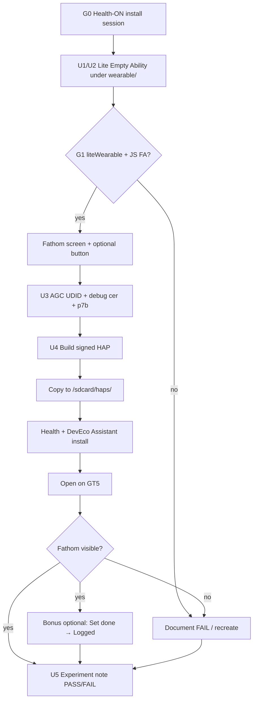

# feat: Hello GT5 Lite Wearable install spike

## Summary

Prove Fathom can put a custom UI on the Huawei Watch GT5 by creating a separate HarmonyOS **Lite Wearable** (JS FA) project under `wearable/`, showing **Fathom** (optional **Set done** → **Logged**), signing a debug HAP for this watch’s UDID, installing via Huawei Health + DevEco Assistant, and recording PASS/FAIL in `docs/experiments/`. The Flutter / LPv2 companion stays untouched; `wearable/` must never ship in the phone APK/AAB.

---

## Problem Frame

Later product work (KeepStrong-style strength set-confirm) is the **motivation** for proving on-watch UI is possible. Today Fathom only talks to the GT5 as a phone companion over LPv2; there is no on-watch app surface and no institutional knowledge for DevEco / HAP install. This spike answers **only** whether we can install and open a trivial custom screen on **this** GT5 via the supported Lite Wearable debug path — not whether Lite Wearable can eventually host KeepStrong UX.

---

## Requirements

### Project & UI

- R1. Create the smallest DevEco **`[Lite]Empty Ability`** project (FA + JS/HML/CSS, `deviceType: ["liteWearable"]`) under repo-root `wearable/` — not ArkTS / Stage / Smart Wearable.
- R2. One on-watch screen shows the text **Fathom**.
- R3. Optional bonus: a **Set done** button that changes the label to **Logged** (in-memory; non-blocking for PASS).

### Signing & secrets

- R4. Register this watch’s UDID in AppGallery Connect; sign with a **debug** certificate + UDID-bound provisioning profile for **this** app + watch.
- R10. Keep signing secrets (`.p12`, passwords, local `.cer`/`.p7b` if policy requires) out of git; experiment note may name material *kinds* and versions only.

### Install & Health session

- R5. Build a **signed** `.hap` and install it on the GT5 via Huawei Health + DevEco Assistant (phone-mediated path; not DevEco Run / `hdc` to the watch).
- R9. Run as a **Health-ON install session** (no concurrent Gate A Health-disabled companion experiments). After the on-watch result, restore **Gate A Health-off posture** (force-stop Health and strip permissions per interrupt-matrix; also force-stop Gadgetbridge), run companion reconnect smoke, then record those outcomes in the experiment note (G10) before further companion work.

### Packaging & Flutter isolation

- R7. Keep `wearable/` out of the Flutter/Android package graph: never under `android/`, never a Gradle `include`, never a `pubspec` path dep or Flutter asset; do **not** use ProGuard/R8 to “exclude” it (wrong tool).
- R8. Do not modify Flutter Fathom / LPv2 companion feature code for this spike.

### Experiment record

- R6. Write `docs/experiments/2026-08-09-hello-gt5-lite-wearable-spike.md` with exact steps, errors, versions, and **PASS / FAIL / BLOCKED**.

**PASS bar:** App appears on GT5 and opens to the **Fathom** screen.  
**BONUS:** Button toggles to **Logged**.  
**Non-claim:** Hello PASS proves only the Lite debug install path on this GT5 — it does **not** prove KeepStrong set-confirm feasibility, Wear Engine readiness, or AppGallery release.  
**FAIL / BLOCKED:** Document the blocking stage and error (cert, UDID, Health/Assistant, wrong template, phone/OS, etc.) — a clear documented blocker completes the spike’s learning goal.

---

## Scope Boundaries

- Muscular load, GPT workout plans, set/rep/weight logging logic
- Sync with Fathom Flutter companion / Wear Engine messaging
- AppGallery **public** release / release certificates
- IMU / auto rep detection
- Changing Fathom LPv2 / Android companion feature code
- ArkTS / Watch 5 Smart Wearable templates or ports
- Non-Huawei phone install hosts as a primary path
- Factory-reset / unlink of the watch to unblock install (too much blast radius for Gate A state)
- CI packaging of HAP into the phone APK
- ProGuard rules as an exclusion mechanism for `wearable/`

### Deferred to Follow-Up Work

- KeepStrong-style set-confirm UX on-watch (after Hello PASS)
- Wear Engine phone↔watch messaging for set confirm → companion
- Strength of packaging CI guard (`flutter build apk` zip-listing for `wearable` / `.hap`) once CI exists
- Promoting a durable learning doc under `docs/learnings/` if install path stabilizes

---

## Context & Research

### Relevant Code and Patterns

- Phone packaging surface (leave wearable out of): `pubspec.yaml` (`flutter.assets` today only `assets/brand/discobolus.png`), `android/settings.gradle.kts` (`include(":app")` only), `android/app/build.gradle.kts` (`flutter { source = "../.." }`)
- ProGuard today is Tink/errorprone `-dontwarn` only: `android/app/proguard-rules.pro` — **irrelevant** to folder exclusion. Flutter’s Gradle plugin enables minify/R8 for release by default (those rules exist for `minifyReleaseWithR8`); ProGuard still only rewrites bytecode and cannot keep `wearable/` out of the APK.
- Experiment note style: `docs/experiments/gt5-a07-companion-feasibility.md` (Recommendation first + step table), `docs/experiments/gate-a-interrupt-matrix.md` (preconditions + failure-accept)
- Architecture intent (watch as LPv2 endpoint today): `docs/architecture/README.md` — this spike adds a **parallel** on-watch Lite app track, not a change to LPv2 ownership
- Gate A Health-off posture (session rival): `docs/experiments/gate-a-interrupt-matrix.md`, companion brainstorm R11

### Institutional Learnings

- `docs/solutions/` is empty; nearest corpus is `docs/learnings/`, `docs/experiments/`, `docs/handoffs/`
- No prior Lite Wearable / HAP / DevEco / AppGallery Connect install notes in-repo — this experiment becomes the first institutional record
- Existing “watch UI” language means **vendor pairing UI clearing**, not a custom Fathom watch app

### External References

- Lite vs Smart Wearable (GT5 = Lite; Watch 5 ≠ GT5): [architecture FAQ](https://developer.huawei.com/consumer/cn/doc/architecture-guides/socialcontact-v1_2-ts_35-0000002401060969)
- Lite Wearable = JS only (no ArkTS/NDK): [NDK FAQ](https://developer.huawei.com/consumer/cn/doc/architecture-guides/common-v1_26-ts_545-0000002550005885)
- Wearables hub: [multidevice/wearables](https://developer.huawei.com/consumer/cn/multidevice/wearables/)
- AGC debug profile / credentials: [debug profile](https://developer.huawei.com/consumer/en/doc/app/agc-help-debug-profile-0000002248181278), [credentials](https://developer.huawei.com/consumer/en/doc/app/agc-help-credential-0000002415263317)
- Run Lite Wearable on GT devices (incl. GT5): [Huawei Developers Medium](https://medium.com/huawei-developers/running-lite-wearable-apps-on-huawei-gt-devices-d4d26db1251c)
- Install via Health + DevEco Assistant + `/sdcard/haps/`: [How to test on Lite Wearable watches](https://dev.to/harmonyos/how-to-test-the-app-on-lite-wearable-watches-d9e)
- Local DevEco 6.1.1.280 at `/Applications/DevEco-Studio.app` includes template **`[Lite]Empty Ability`** (`deviceType: liteWearable`, FA, UI syntax JS)

---

## Key Technical Decisions

- **Project home = `wearable/` under fitness_os:** Owner chose nested location; keep as sibling of `android/` / `lib/`, never under `android/app` or Flutter assets.
- **Packaging isolation ≠ ProGuard:** ProGuard/R8 only rewrites bytecode. Exclusion controls are path + “do not reference” (no Gradle `include`, no `pubspec` assets/path dep, no copying `.hap` into phone assets). Document the invariant in `wearable/README.md` and harden with `.gitignore` for DevEco build outputs + signing secrets. Optional one-line comment near `flutter { source }` in `android/app/build.gradle.kts` — **no** wearable exclude rules in `proguard-rules.pro`.
- **Template lock = `[Lite]Empty Ability` / JS FA / `liteWearable`:** GT5 is Lite Wearable; ArkTS Stage HAPs commonly fail with decompress errors on GT-class devices.
- **PASS = on-watch Fathom screen; button is bonus:** Avoid false FAIL on optional UI.
- **Install path = Health + DevEco Assistant + `/sdcard/haps/`:** Manual AGC signing; no USB/`hdc` Run to watch as primary path.
- **Health-ON install session:** Invert Gate A’s Health-off precondition for this spike only; do not run concurrent Fitness OS Gate A / Gadgetbridge pairing work.
- **No factory reset for unblock:** Prefer FAIL/BLOCKED documentation over nuking Gate A pairing state.
- **One debug cert + one profile for this spike:** Cert quota exhaustion → FAIL with notes; do not thrash AGC apps unless owner approves.
- **Separate AGC bundleName from phone `applicationId`:** Avoid signing/profile confusion with `com.example.fitness_os`.

---

## Open Questions

### Resolved During Planning

- Where does the Lite project live?: Nested under `wearable/` inside fitness_os (owner).
- How to keep it out of the phone app?: Packaging isolation + docs/gitignore — **not** ProGuard (owner intent preserved; mechanism corrected).
- Is the Set done button required for PASS?: No — bonus only (original brief).
- Concurrent companion experiments?: Forbidden during install session; after on-watch result, restore Gate A Health-off posture (force-stop Health + strip perms; force-stop Gadgetbridge), run companion reconnect smoke, then record in the experiment note.
- Factory reset allowed?: No for this spike.

### Deferred to Implementation

- Exact DevEco wizard field values (bundleName, ability name) once the project is created — stay within Lite constraints (bundleName length, label length, icon sizes per Huawei guidance).
- Whether Assistant UI labels differ by version (Apps vs Install watch app) — follow on-device labels; record verbatim.
- Whether this Huawei phone’s OS build has Assistant quirks — observe and document; do not invent workarounds beyond bounded retries.
- Final filename under `wearable/` (e.g. `hello_gt5` vs wizard default) — choose a short, clear folder name at create time.

---

## Output Structure

```text
wearable/
  README.md                          # DevEco-only; never part of Flutter APK
  hello_gt5/                         # DevEco [Lite]Empty Ability project (name flexible)
    entry/src/main/
      config.json                    # deviceType: ["liteWearable"]
      js/MainAbility/
        pages/index/                 # index.hml / .css / .js — Fathom (+ bonus button)
        app.js
        i18n/
      resources/base/
    build-profile.json5             # signingConfigs (local; secrets not committed)
    ...                              # other DevEco scaffold files as generated

docs/experiments/
  2026-08-09-hello-gt5-lite-wearable-spike.md
```

---

## High-Level Technical Design

> *This illustrates the intended approach and is directional guidance for review, not implementation specification. The implementing agent should treat it as context, not code to reproduce.*



Lite UI shape (directional): keep a static headline `"Fathom"`; optional button label starts as `"Set done"` and on click becomes `"Logged"` (or a dedicated status line shows Logged). Headline does not change for the bonus path. In-memory only — relaunch resets. No Wear Engine, sensors, storage, or network.

---

## Implementation Units

### U1. Repo home + packaging isolation

**Goal:** Establish `wearable/` as the DevEco-only home and hard-document that it never ships in the Flutter/Android APK/AAB.

**Requirements:** R7, R10

**Dependencies:** None

**Files:**
- Create: `wearable/README.md`
- Modify: `.gitignore` (DevEco `wearable/**/build/`, common signing secret patterns such as `*.p12`, and local profile/cert artifacts per policy)
- Modify (optional comment only): `android/app/build.gradle.kts`
- Do **not** modify: `android/app/proguard-rules.pro` for exclusion; `android/settings.gradle.kts` must stay `include(":app")` only; `pubspec.yaml` must not list `wearable/`

**Approach:**
- Add a short README invariant: DevEco-only; install via Health + Assistant as signed HAP; never a Flutter package, Gradle module, or asset.
- Gitignore build outputs and signing secrets; commit **source** of the Lite project, not signed HAPs or keystores.
- Explicitly reject ProGuard as the exclusion mechanism (document in README why).

**Patterns to follow:**
- Sibling isolation spirit of keeping study trees out of the Flutter package graph (`docs/handoffs/2026-07-18-huawei-gt5-gate-a-stack-handoff.md`)

**Test scenarios:**
- Happy path: After `wearable/` exists, `android/settings.gradle.kts` still only includes `:app`; `pubspec.yaml` has no `wearable` asset or path dependency.
- Edge case: Confirm no `.hap` was copied into `android/app/src/main/assets` or Flutter `assets/`.
- Integration: Optional operator check — unzip/list a phone APK and confirm no `wearable` / `.hap` entries (manual; no CI required this spike).

**Verification:**
- README exists; gitignore covers build/secrets; Gradle/`pubspec` unchanged in ways that would package wearable.

---

### U2. Create Lite Wearable Hello UI

**Goal:** Scaffold `[Lite]Empty Ability` under `wearable/` and implement the Fathom screen (+ optional button).

**Requirements:** R1, R2, R3, R8

**Dependencies:** U1

**Files:**
- Create: `wearable/hello_gt5/**` (or wizard-chosen folder name) — DevEco scaffold including `entry/src/main/config.json`, `js/.../pages/index/*`
- Do **not** modify: `lib/**`, `android/app/src/main/kotlin/**` companion code

**Approach:**
- In DevEco 6.1.1: Application → **`[Lite]Empty Ability`** → Lite Wearable only.
- Hard gate before signing: `config.json` contains `"deviceType": ["liteWearable"]` and pages are JS/HML/CSS (not ArkTS `.ets`).
- Replace Hello World copy with **Fathom**; optionally add **Set done** → **Logged** via page data + click handler using Lite JS components only.
- Keep UI tiny (Lite page size limits); no Wear Engine / sensors / network.
- Choose a distinct `bundleName` from the phone `applicationId`.

**Execution note:** Prove template correctness (G1) before spending AGC cert quota.

**Patterns to follow:**
- Official Lite Empty Ability layout from DevEco; external Lite Wearable JS samples for component vocabulary only — do not invent ArkTS APIs.

**Test scenarios:**
- Happy path: Project builds in DevEco; index shows **Fathom** in source (and IDE preview if available).
- Happy path (bonus): Button press updates displayed label to **Logged** in preview or on-device.
- Error path: If an ArkTS/Smart Wearable template was created by mistake → stop, recreate; do not proceed to AGC.
- Edge case: Launcher label may differ from on-screen **Fathom**; PASS still keyed to on-screen text.

**Verification:**
- Lite project builds; G1 template checks recorded; Fathom UI present in source.

---

### U3. AppGallery Connect debug signing for this watch

**Goal:** Bind this watch UDID to a debug cert + provisioning profile and configure DevEco manual signing.

**Requirements:** R4, R10

**Dependencies:** U2 (stable `bundleName`)

**Files:**
- Local only (not committed): keystore/CSR, `.cer`, `.p7b`, signing passwords
- Modify locally: DevEco signing config / `build-profile.json5` signingConfigs (ensure secrets stay gitignored)

**Approach:**
- Obtain UDID from DevEco Assistant with watch paired in Huawei Health.
- AGC: HarmonyOS app matching `bundleName` → register device UDID → Generate Key/CSR in DevEco → debug certificate → debug profile bound to **this** app + cert + UDID.
- Configure DevEco Project Structure → Signing Configs (HarmonyOS) with `.p12` / `.cer` / `.p7b`.
- On UDID change: re-register and re-issue profile before rebuild.
- Cert quota exhaustion → stop and FAIL (do not create thrashing alternate apps unless owner approves).

**Patterns to follow:**
- AGC debug profile / credential docs linked in Context & Research; Huawei Lite signing runbooks (manual sign, not auto USB-to-watch).

**Test scenarios:**
- Happy path: Profile lists this UDID; DevEco signing config validates without path errors.
- Error path: Profile/UDID mismatch → re-bind profile; record AGC/Assistant error text verbatim.
- Error path: Cert quota / “配置文件格式错误” → FAIL/BLOCKED with stage G3 notes.
- Edge case: Do not commit `.p12` / passwords; experiment note references material kinds only.

**Verification:**
- Debug profile + signing config ready for a signed HAP build; secrets not in git status.

---

### U4. Build signed HAP and install on GT5

**Goal:** Produce `*-signed.hap`, sideload via `/sdcard/haps/`, install with Health + DevEco Assistant, and verify on-watch PASS (and bonus).

**Requirements:** R5, R9

**Dependencies:** U3

**Files:**
- Build artifact (gitignored): `wearable/hello_gt5/**/entry-default-signed.hap` (path may vary slightly by DevEco)
- No Flutter/Android source changes

**Approach:**
- Build → Build Hap(s) → use the **signed** HAP only.
- USB phone in file transfer mode; copy HAP to `/sdcard/haps/` (create folder if missing).
- Health: watch paired; DevEco Assistant: watch visible → Install watch app / Apps install.
- Open app on GT5 → confirm **Fathom** (PASS); try bonus button.
- Before declaring install FAIL, walk **Install Recovery Ladder** rungs 1–4 (under Risks); never invent `hdc` / USB-Run-to-watch as primary path.
- After on-watch result (PASS or documented FAIL): leave Health-ON session — perform G10 restore (Gate A Health force-stop posture) + companion reconnect smoke; record last ladder rung used.
- **Verification mode:** Operator gates only. Do **not** add Flutter widget/unit/integration tests, mock Assistant, or CI HAP install. Optional APK zip-list for isolation remains manual (U1).

**Patterns to follow:**
- Health + DevEco Assistant install guides in External References; staged gates G4–G8 from verification matrix below; Install Recovery Ladder under Risks.

**Test scenarios:**
- Happy path: Assistant install succeeds; watch opens to **Fathom** → PASS.
- Happy path (bonus): **Set done** → **Logged**.
- Error path: Decompress failure → suspect wrong template (return to U2); do not chase ArkTS workarounds.
- Error path: Signature / profile errors → return to U3; record codes/text.
- Error path: HAP missing from Assistant list → verify `/sdcard/haps/` path before blaming signing.
- Error path: Ladder exhausted → FAIL/BLOCKED at named rung + verbatim Assistant/AGC text; still record restore attempt if Health was left ON.
- Integration (operator): Health-ON during G4–G7; Health-off restored before closing U4; companion reconnect smoke recorded (`ok` / `failed` / `skipped-with-reason`).

**Verification:**
- On-watch PASS or documented FAIL/BLOCKED with stage + verbatim error; restore/smoke **actions performed** (G10); signed HAP path noted for the experiment record.
- No new tests under `test/` / `android/app/src/test/`. U5 owns writing those fields into the checked-in experiment note.

---

### U5. Experiment note (PASS/FAIL)

**Goal:** Land the institutional record of steps, errors, and outcome.

**Requirements:** R6, R9, R10

**Dependencies:** U4 (or earlier FAIL stop)

**Files:**
- Create: `docs/experiments/2026-08-09-hello-gt5-lite-wearable-spike.md`

**Approach:**
- Mirror feasibility / interrupt-matrix style: metadata header, Recommendation first, hard rules, staged gate table, failure-accept rule, privacy redaction.
- Metadata: date, GT5 model/firmware, phone model, Health version, DevEco Assistant version, DevEco Studio version, bundleName, AGC app id (non-secret), template used.
- Include: G0 session mutex, filled G0–G10 table, Install Recovery Ladder rung reached (or “unused — happy path”), signing privacy attestation (“no secrets committed; kinds only”), and post-install Health ownership restore + companion smoke.
- Cross-link this plan, `wearable/README.md`, and the Install Recovery Ladder in Risks.
- Explicit non-goal: **no automated unit tests** — this doc *is* the verification artifact for the spike.

**Patterns to follow:**
- `docs/experiments/gt5-a07-companion-feasibility.md`
- `docs/experiments/gate-a-interrupt-matrix.md`

**Test scenarios:**
- Happy path: Note records PASS + ladder unused + Health-off restore + companion smoke `ok`.
- Edge case: Early FAIL still produces a complete note (learning goal met) including privacy attestation + whether Health was returned to Gate A posture.
- Edge case: On-watch PASS but companion smoke `failed` → Recommendation distinguishes **Hello PASS** vs **companion restore debt** (do not flip Hello to FAIL solely for restore).
- Edge case: No secrets, raw keystores, or full UDID dumps beyond what the team already treats as device inventory (prefer redaction if uncertain).

**Verification:**
- Experiment note checked in with enough detail for another operator to reproduce or understand the blocker.
- Operator-readable reproduction / blocker only — no Flutter test checklist invented for U5.

---

## Verification matrix (operator)

| Gate | Check | Pass evidence |
|------|--------|----------------|
| G0 Session | Health ON; no concurrent Gate A Health-off / GB pairing | Checklist in note |
| G1 Template | `[Lite]Empty Ability`; `liteWearable`; JS/HML | Snippet / paths in note |
| G2 UI source | **Fathom** in index; button optional | Source cite / screenshot |
| G3 Signing | Profile includes this UDID; DevEco signing config valid (ready to build) | Signing config check / profile notes |
| G4 Sideload prep | Signed HAP built and present under `/sdcard/haps/` | Artifact path + Files / `ls` confirmation |
| G5 Assistant | Watch visible in DevEco Assistant | Status / screenshot |
| G6 Install | Install without decompress/profile errors | Assistant result |
| G7 On-watch | App opens; **Fathom** readable | **PASS** |
| G8 Bonus | Set done → Logged | Bonus PASS / skip |
| G9 Isolation | `wearable/` not in Gradle/`pubspec` packaging graph | Confirm settings + pubspec |
| G10 Wrap-up | Note complete; Gate A Health-off posture restored (Health force-stop + strip perms; Gadgetbridge force-stop); companion reconnect smoke recorded; ladder rung noted; no signing secrets in git/note | Doc path + restore/smoke fields (`ok` / `failed` / `skipped-with-reason`) |

**Failure-accept:** A clear blocking error with versions + stage + next-step hypothesis is a valid FAIL for the spike — do not expand into Wear Engine, store release, or Flutter sync to force green.

---

## System-Wide Impact

- **Health ownership (session rival, not code coupling):** Gate A companion work treats Huawei Health as a **force-stopped / permissions-stripped** precondition (`docs/experiments/gate-a-interrupt-matrix.md`, companion brainstorm R11). This spike **inverts** that: install requires **Health ON + paired watch + DevEco Assistant**. Flutter/LPv2 code stays untouched; the only real system interaction is **who owns the watch radio/session** on the same phone+GT5.
- **Interaction graph:** None to Flutter MethodChannels / LPv2. Operational interaction only via Health ownership during the install session.
- **Failure propagation:** DevEco/AGC/Assistant/HAP failures **do not** enter Flutter error surfaces, MethodChannels, or Gate A prefs — they stop at the operator gate + experiment note. Conversely, a Health-ON install session **can** leave companion reconnect broken even when on-watch Fathom PASS succeeded — treat companion restore as a **separate wrap-up outcome**, not implied by G7.
- **State lifecycle (explicit phases):**
  1. **Pre:** Confirm no concurrent Gate A / GB pairing run; start **Health-ON install session** (G0).
  2. **During:** Health is the sideload pipe; Fitness OS companion is idle / not under test.
  3. **Post (mandatory before next Gate A work):** Restore usual Gate A Health posture (force-stop Health / strip perms per interrupt-matrix); run **companion reconnect smoke** against remembered device; record result in G10. **Do not** factory-reset or unlink the watch to “clean up” install fallout.
- **Companion meaning of “untouched”:** No Flutter source edits. It does **not** mean pairing memory, bond quality, or Gate A unlock readiness are unchanged. If reconnect smoke fails after restore, document **companion restore debt** with the Install Recovery Ladder rung used; do not start Gate A interrupt matrix runs until Health-off posture is restored and smoke is recorded.
- **API surface parity:** N/A (no phone API change).
- **Integration coverage:** On-device install only proves Hello PASS; DevEco preview alone is insufficient. G10 restore/smoke is required evidence for wrap-up, separate from G7.
- **Unchanged invariants:** Flutter companion code, LPv2 stack, phone `applicationId`, ProGuard Tink rules, and Architecture “no Health Kit SDK” stance remain unchanged. Health is used here only as the **sideload pipe**, not as a Fitness OS runtime dependency. Packaging isolation ≠ ProGuard.

---

## Risks & Dependencies

| Risk | Mitigation |
|------|------------|
| Wrong template (ArkTS/Stage) → decompress fail | G1 hard stop before AGC; recreate as Lite Empty Ability; ladder rung 3 |
| UDID not in profile / signature errors | Re-copy UDID from Assistant; re-issue debug `.p7b`; rebuild signed HAP; ladder rung 2 |
| Debug cert quota | One cert/profile; quota fail = FAIL — don’t thrash |
| HAP not under `/sdcard/haps/` | Fix path before blaming signing; ladder rung 1 |
| Health/Assistant can’t see watch | ≤3 bounded retries then FAIL with phone/OS notes; ladder rung 1 / 4 |
| Health-ON install vs Gate A Health-off | **Session mutex** G0; forbid concurrent Gate A/GB; Install Recovery Ladder + mandatory G10 Health-off restore + reconnect smoke |
| Install succeeds but companion dead afterward | **Restore failure**, not Hello FAIL; ladder rung 5; no factory reset; no Flutter edits in this spike |
| Accidental APK inclusion of wearable | Path isolation + README + gitignore; no Gradle/`pubspec` references; no ProGuard pretend-fix |
| Signing secrets leak (`.p12`, passwords, local `.cer`/`.p7b`) | **Privacy gate:** U1 gitignore; secrets only in DevEco local signing / outside repo; pre-commit `git status` check; experiment note names material *kinds* + versions only (R10) |
| Operator expands into Flutter/unit tests to green the spike | **No automated unit tests**; verification is operator gates G0–G10 only |
| Phone OS / Assistant quirks | Prefer owner Huawei phone; document BLOCKED rather than invent hdc path |

### Install Recovery Ladder

Operator-bounded; no factory reset. Experiment note records which rung was used (or “unused — happy path”).

1. **Path / visibility:** Confirm HAP under `/sdcard/haps/`; watch visible in Health + DevEco Assistant; ≤3 retries (re-pair Health, restart Assistant, reboot phone/watch).
2. **Signing / profile:** Re-copy UDID from Assistant; re-issue debug `.p7b` bound to this app+cert+UDID; rebuild **signed** HAP only.
3. **Template:** Decompress / install format errors → stop; return to G1/U2 Lite Empty Ability — do not chase ArkTS/`hdc` workarounds.
4. **Session conflict:** If Assistant/Health never sees the watch while Fitness OS or GB was recently active → end companion experiments, ensure Health-ON session, retry step 1; then FAIL/BLOCKED with phone/OS notes.
5. **Post-install companion restore (after PASS or documented FAIL):** Force-stop Health (and strip perms if it auto-restarts) per Gate A preconditions → companion reconnect smoke → if auth/reconnect fails, follow existing companion R11 for *pairing* recovery — **still no factory reset for this spike**; record winning/next step and leave Gate A unlock untouched.
6. **Stop rule:** Exhausting rungs 1–4 without on-watch Fathom = spike **FAIL/BLOCKED** (learning goal met). Exhausting rung 5 without reconnect = **documented companion restore debt**, not a reason to widen into Flutter fixes.

**Prerequisites:** DevEco Studio 6.1.1.280 (Mac ARM) installed; Huawei phone + GT5 paired; Huawei Health + DevEco Assistant; Huawei developer / AGC access.

---

## Documentation / Operational Notes

- Primary deliverable doc: `docs/experiments/2026-08-09-hello-gt5-lite-wearable-spike.md`
- `wearable/README.md` is the standing invariant for future watch apps in this repo
- Experiment note must cross-link the **Install Recovery Ladder** (Risks) and record which rung was used
- Do not promote this spike into companion architecture docs until PASS is observed
- After PASS, a follow-up plan can tackle set-confirm UX + Wear Engine — out of scope here

---

## Sources & References

- Related experiments: `docs/experiments/gt5-a07-companion-feasibility.md`, `docs/experiments/gate-a-interrupt-matrix.md`
- Related architecture: `docs/architecture/README.md`
- Related companion (orthogonal): `docs/brainstorms/2026-07-17-huawei-gt5-companion-mvp-requirements.md`
- Packaging anchors: `pubspec.yaml`, `android/settings.gradle.kts`, `android/app/build.gradle.kts`, `android/app/proguard-rules.pro`
- External: Lite vs Smart FAQ, Lite JS-only FAQ, AGC debug profile docs, Huawei Developers GT Lite run article, Lite Wearable Health+Assistant install guide
