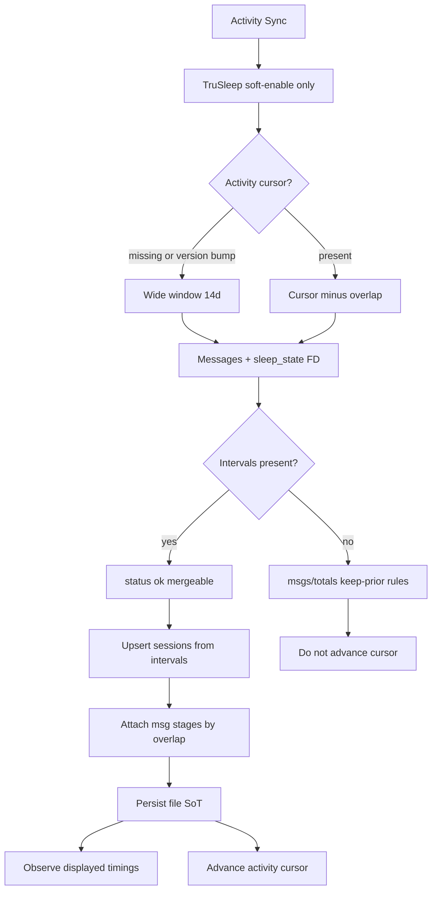
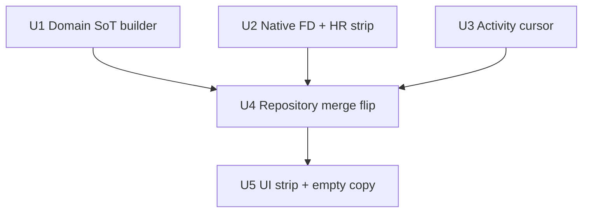
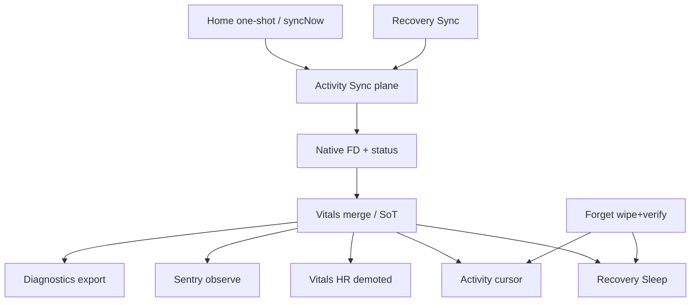

# feat: TruSleep primary sleep SoT + strip continuous HR

## Summary

Promote TruSleep FileDownload `sleep_state` intervals (gap-merge ≤3m, prefer recent overnight) to the **primary sleep display SoT**. Demote message-path `0x0C`/`0x0D` timings to compare/observe-only while **keeping message stages attached** onto file-derived windows until `sleep_data` parse exists. **Fully strip continuous HR** (sleep-detail UI, `daily_hr` pull/merge, auto-HR soft-enable on Sync). Keep `TruSleepTimestampObserve` logging **displayed** timings for multi-session Sentry samples. After the first Sync that **persists file-interval display SoT**, pull only **recurring/incremental** windows (dedicated activity cursor; do not reuse workout `lastSyncCursor`). Wide window = existing `activityWindowDays` (14). This cut downloads **`sleep_state.bin` only** (skip unused `sleep_data.bin` until parse exists).

---

## Problem Frame

Huawei Health overnight for the owner night matched TruSleep file duration (281m) after gap-merge, while FitnessData message-path sleep did not. FileDownload + `stateIntervals` already ship as enrich/observe plumbing, but UI timing still comes from messages. Continuous HR remains coupled into Sync and sleep detail even though this cut drops it as a product path. Activity Sync always uses a fixed 14-day window, so repeated Syncs re-pull large FileDownload payloads (`sleep_data.bin` ~678 KiB) unnecessarily. (see origin: `docs/handoffs/2026-08-11-trusleep-primary-sleep-handoff.md`)

This plan **supersedes** message-path-as-SoT and continuous-HR-as-BPM-SoT from `docs/brainstorms/2026-08-09-vitals-sleep-detail-stages-hr-requirements.md` (R3, R6, R13–R14) while keeping stages/survey/IA context from that doc until a TruSleep-owned stage source exists.

---

## Requirements

**Sleep display SoT**
- R1. Display overnight (and naps when file intervals justify them) from TruSleep `stateIntervals`, using recent-overnight preference + near-adjacent gap-merge ≤3m — not global `longest=` across history.
- R2. After the SoT flip, message-path `0x0C`/`0x0D` must never own display begin/end (including messages-only Syncs after a prior file SoT); stages from messages attach onto file-derived windows until `sleep_data` parse exists.
- R12. On SoT flip, atomically migrate feel-on-wake + stage/enrich side-files onto file-window mergeKeys (longest-overlap wins); do not orphan surveys or wipe stages before attach.

**Sync merge / keep-prior**
- R3. Native FileDownload enrich (and Flutter merge) must succeed when message-path sleep is empty but files/`stateIntervals` are present; file intervals count as mergeable Sync success.
- R4. Empty/error/busy/not_ready Sync outcomes keep prior sleep prefs (never wipe-as-error); FileDownload absent must not clear prior file SoT / enrich refs (enrichment-monotonic).

**Continuous HR strip**
- R5. Fully strip continuous HR: remove sleep-detail continuous-HR mode/toggle; stop activity Sync `daily_hr` pull + repository merge; stop auto-HR soft-enable on Sync (**dual-layer**: native + Flutter). Keep TruSleep soft-enable. Enable path may still arm auto-HR, but Sync must not soft-arm or refresh whole-day HR.
- R6. Recovery Vitals / Enable / Sync empty copy never imply Sync will refill whole-day HR after strip.

**Activity cursor**
- R7. Until the first Sync that **persists file-interval display SoT**, use wide window = `activityWindowDays` (14). After that, use a dedicated activity cursor + overlap. Forget clears and **verifies** the activity cursor.
- R11. Activity cursor advances only when file-interval display SoT was **persisted** this Sync from this pull’s intervals; value = `max(endUnix of sessions upserted from this Sync’s intervals) + 1`. Never advance on totals-only / messages-only / empty / error / gate-discard / enrich-absent keep-prior / **partial_batch or incomplete FD**.

**Observe / Forget / Privacy**
- R8. `TruSleepTimestampObserve` remains this cut and reports **persisted displayed** begin/end/duration (plus useful message deltas for investigation); do not remove observe or `watchClock` until ~5–6 Sync samples are collected later.
- R9. Forget/wipe stays consistent: sleep prefs, feel-on-wake, stages/enrich/sleep_files dirs, HR series residue, and the new activity cursor; late merge after wipe is a no-op.
- R10. Privacy unchanged: never log/commit PPG/`sleep_data` bodies; observe stays scalar keys + compact `tails` only.
- R13. This cut FileDownload pulls **`sleep_state.bin` only**; skip `sleep_data.bin` until a later parse cut (primary transfer-cost lever alongside the activity cursor).

**Origin actors (carried):** Owner-athlete, GT5-A07, Companion Sync  
**Origin flows (carried/adapted):** Activity Sync sleep path; post-sync display; Forget  
**Superseded acceptance examples:** Aug 9 AE2/AE3 continuous-HR toggle cases are out; replace with file-SoT + no continuous-HR mode

---

## Scope Boundaries

- No `sleep_data.bin` parse / TruSleep-owned stages / SpO2 / Quality score / PPG→BPM product claims
- No inventing stages from `sleep_state` flags
- Do not remove `TruSleepTimestampObserve` / native `watchClock` in this cut (follow-up after samples)
- Do not fix the open `timezone-id` / `supportsCommand` fragility except where required for observe correctness
- Do not change Gate A pairing, workout Gate B cursor semantics, or FeatureUpload policy
- Do not reuse `GateAPrefs.lastSyncCursor` for activity Sync

### Deferred to Follow-Up Work

- Strip observe + unused `watchClock` after ~5–6 Sync samples in the Sentry Issue
- `sleep_data` stage parse, resume `sleep_data.bin` download, and retirement of message-path stages
- Optional tighter FileDownload window once transfer cost is measured post-cursor
- TZ `supportsCommand` / `0x32` conflation bugfix

---

## Context & Research

### Relevant Code and Patterns

- Sleep merge / enrich: `lib/features/vitals/data/repositories/vitals_repository_impl.dart` (`_mergeSleep`, `_mergeSleepEnrich`, `_mergeContainers`, `_mergeDailyHr`)
- Gap-merge helper (promote into SoT): `lib/core/observability/trusleep_timestamp_observe.dart` (`mergeNearAdjacent`, `mergeGapSec = 180`)
- Bridge DTOs: `lib/core/huawei/huawei_link.dart` (`SleepStateInterval`, `SleepEnrichOutcome`, `activityWindowDays = 14`)
- Native FileDownload + gate on empty messages: `android/.../huawei/HuaweiFitnessDataSync.kt` (`attemptSleepFileDownload`, `hasMergeable`)
- FileDownload SM: `android/.../huawei/HuaweiFileDownload.kt`, wire-spec `docs/wire-specs/huawei-br-gt5-sleep-files.md`
- Continuous HR UI: `lib/features/vitals/presentation/view/sleep_detail_screen.dart` (`sleep_mode_continuous_hr`)
- Workout incremental cursor template: `lib/features/workout_history/data/repositories/workout_history_repository_impl.dart` (`_resolveSyncStartUnix`, `cursorOverlapSec`, parser-version bump)
- Forget / prefs: `lib/features/device_pairing/domain/gate_a_prefs.dart`, `device_pairing_repository_impl.dart`, `vitals` `clearLocal`
- Tests: `test/features/vitals/vitals_repository_test.dart`, `test/core/observability/trusleep_timestamp_observe_test.dart`, `test/features/vitals/presentation/sleep_detail_screen_test.dart`, `android/.../HuaweiFileDownloadTest.kt`, workout cursor tests as template

### Institutional Learnings

- `docs/solutions/` is empty; closest SoT is the handoff + vitals merge contracts in `docs/plans/2026-07-18-004-feat-vitals-sleep-hr-tab-plan.md` (keep-prior, container-scoped, enrichment-monotonic, Forget wipe+verify)
- Health ~30m clock delta is **not** TZ/skew (`skewSec=0`); do not “fix” via zone push — observe multi-session deltas instead
- Filename-only FileDownload init already failed once — keep filename + type + time window

### External References

- None — local FileDownload, merge, and workout-cursor patterns are sufficient

---

## Key Technical Decisions

| Decision | Choice | Rationale |
|----------|--------|-----------|
| Sleep display SoT | TruSleep `stateIntervals` → sessions via gap-merge ≤3m + recent overnight | Matches Health duration; handoff evidence |
| Message-path role | Stages attach + observe compare only; **never** own display begin/end after flip (keep prior file SoT on messages-only) | Stages still honest until `sleep_data` parse |
| Continuous HR scope | Full strip (UI + Sync pull/merge + soft-enable), dual-layer native+Flutter; **hard-disable** Sync HR path (no new skip flags unless a second caller needs them) | Owner choice; defense-in-depth against mistaken samples |
| Stale `daily_hr` residue | **One-shot clear** on activity sync-impl version bump (same gate as wide-window force) | Avoid fake “synced HR” in UI/export/everSynced |
| FileDownload blobs this cut | **`sleep_state.bin` only** — skip `sleep_data.bin` until parse exists | Unused ~678 KiB was the main Sync cost; cursor alone may not shrink it |
| Incremental Sync | Dedicated `last_activity_sync_cursor` + activity-impl version bump (owner-requested recurring diffs) | Must not collide with workout `lastSyncCursor` |
| Cursor advance | Only after file SoT upsert from this Sync’s intervals; no advance on partial/incomplete FD | Totals-only / FD-miss / partial must not skip nights |
| Wide window | `HuaweiLink.activityWindowDays` (14) when cursor missing or impl-version bumps | Matches today’s activity window constant |
| File SoT merge | **Upsert** file-built sessions from this pull; retain prior file-SoT nights outside the pull span — never replace-all from a partial interval set | Incremental windows would otherwise wipe history |
| Empty-message enrich shape | Prefer per-file-session enrich rows after U1 build; if bridge requires one row first, do not use mega-span for feel/stage migrate | Avoid nap+overnight mega-window poisoning migrate |
| FileDownload init window | Prefer activity Sync `[start,end]` (not message `min(begin)` alone) | Wrong/short message night must not starve SoT files |
| Stage / feel rekey | Atomic migrate; longest-overlap wins; stable file mergeKey (wireType policy fixed in U4) | ~30m window shift otherwise orphans surveys/stages |
| Window resolution site | Resolve activity start in vitals repository (mirror workouts), pass into link | Avoid hard-coded 14d as sole path inside `HuaweiLink` |
| File-only success | Intervals present ⇒ native `ok` + Flutter merges (empty-branch does not apply) | Unlocks SoT when messages miss Health’s night |
| Observe | Keep; log **persisted displayed** timings after merge | Samples compare what UI shows; strip later |
| Vitals / Enable / Sync copy | Retire Sync-as-HR-refill messaging | Enable may arm; Sync no longer refreshes HR |

---

## Open Questions

### Resolved During Planning

- Continuous HR strip scope: **full strip** (UI + Sync pull/merge + soft-enable)
- Stages while flipping SoT: **keep message-path stages** on file windows until `sleep_data` parse
- Observe vs display math: **flip display now**; observe logs displayed timings; wait for multi-session samples before removing observe
- Post-first-sync pulls: **recurring/incremental diffs only** via dedicated activity cursor
- Activity cursor key: **new pref**, not workout `lastSyncCursor`
- Empty-message enrich: prefer per-session enrich after U1; avoid mega-span migrate
- Cursor advance predicate: **file SoT upsert from this Sync’s intervals only** (exclude totals-only / partial / incomplete FD)
- Stale `daily_hr`: **clear on activity sync-impl version bump**
- Feel multi-overlap: **longest overlap wins**
- FileDownload blobs: **`sleep_state` only** this cut
- Incremental history merge: **upsert**, never replace-all from partial interval set

### Deferred to Implementation

- Exact stage-overlap buffer minutes once real file vs message windows are compared in tests
- Exact activity `cursorOverlapSec` value (prefer overnight-scale overlap, not blindly workout 86400, unless measured otherwise)
- File-built session `wireType` sentinel vs omitted empty string in `mergeKey` (must be one stable choice in U4)
- Whether FileDownload init `[start,end]` filters on-watch blob contents vs full-file transfer (measure during U2/U3)

---

## High-Level Technical Design

> *This illustrates the intended approach and is directional guidance for review, not implementation specification. The implementing agent should treat it as context, not code to reproduce.*

**Display session builder (directional):** sort intervals → `gapMergeChains` (≤180s) → one session per chain → classify recent overnight vs naps → upsert into prefs SoT. Message sessions never replace that list after flip.

---

## Implementation Units

### U1. Domain builder: intervals → display sleep sessions

**Goal:** Pure Dart builder that turns `stateIntervals` into display sessions using gap-merge ≤3m and recent-overnight preference (shared by repository merge and observe).

**Requirements:** R1, R8, R10

**Dependencies:** None

**Files:**
- Create: `lib/features/vitals/domain/trusleep_sleep_sot.dart` (name flexible)
- Modify: `lib/core/observability/trusleep_timestamp_observe.dart` (reuse/share `mergeNearAdjacent` rather than duplicate rule)
- Test: `test/features/vitals/domain/trusleep_sleep_sot_test.dart`; extend `test/core/observability/trusleep_timestamp_observe_test.dart` if helpers move

**Approach:**
- Extract shared `gapMergeChains(intervals, gapSec=180) → List` (multi-chain); keep trailing-only helper only if observe still needs it
- Build one session per contiguous ≤3m chain (not only the trailing overnight) so history/naps work; hero still prefers recent overnight over older longest fragment
- Do not invent stages

**Execution note:** Implement builder test-first from handoff Aug 11 fragment fixtures (03:59→08:40 after ≤3m merges; 4m gap splits).

**Patterns to follow:**
- `TruSleepTimestampObserve.mergeNearAdjacent`
- Existing `SleepSessionSummary` shape in `huawei_link.dart`

**Test scenarios:**
- Happy path: Aug 11 three fragments with ≤3m gaps → one 281m session 03:59→08:40
- Edge case: 4m gap between fragments → two sessions
- Edge case: older longer interval exists → recent overnight still preferred for “today/hero” selection
- Edge case: empty intervals → empty session list
- Edge case: single interval nap-length → one nap session (no false overnight merge)

**Verification:**
- Unit tests encode merge/prefer rules without Flutter/native
- Observe and repository can both call the same helper without divergent gap constants

---

### U2. Native: FileDownload without message gate + stop Sync HR path

**Goal:** Emit FileDownload enrich/intervals even when message sleep is empty; treat file intervals as mergeable success; stop auto-HR soft-enable and `daily_hr` container pull on activity Sync.

**Requirements:** R3, R5, R10, R13

**Dependencies:** None (parallel with U1/U3)

**Files:**
- Modify: `android/.../huawei/HuaweiFitnessDataSync.kt` (`attemptSleepFileDownload`, `hasMergeable`, hard-disable HR soft-enable / HR pull)
- Modify: `android/.../huawei/HuaweiFileDownload.kt` if needed to request `sleep_state` only
- Modify: `lib/core/huawei/huawei_link.dart` / channel only if existing soft-skip args must be forced off — prefer hard-disable over new flags
- Test: `android/.../HuaweiFitnessDataSyncTest.kt` (and/or FileDownload tests)

**Approach:**
- Remove `sleep.isEmpty()` short-circuit that returns `emptyList()` after a present FileDownload
- Emit enrich/intervals without message sessions; prefer rows aligned to U1 sessions (avoid mega-span for migrate)
- Include non-empty `stateIntervals` in mergeable `ok` computation (`hasMergeable`)
- Prefer FileDownload init `[start,end]` = activity Sync window
- **Download `sleep_state.bin` only**; skip `sleep_data.bin` this cut
- Hard-disable auto-HR soft-enable and daily HR pull on activity Sync (`daily_hr` ∉ completed)
- Keep TruSleep soft-enable; incomplete/failed downloads fail-closed without wiping message sleep

**Patterns to follow:**
- Existing fail-closed FileDownload try/catch (never wipe message sleep)
- Wire-spec init: filename + type + time window

**Test scenarios:**
- Happy path: messages empty + FileDownload present with intervals → synthetic enrich + status `ok`
- Happy path: messages present + FileDownload present → enrich still emitted (regression)
- Error path: FileDownload failure → empty enrich, message sleep unchanged
- Integration: Sync skips auto-HR soft; `daily_hr` not in completed; HR samples not pulled
- Edge case: FileDownload present but zero intervals → do not claim sleep SoT success from files alone
- Edge case: messages present with short night + wider Sync window → FD init still covers Sync window

**Verification:**
- Kotlin tests prove empty-message + present-files → `ok` + enrich shape Flutter can parse
- Activity Sync no longer soft-arms auto-HR or completes `daily_hr`

---

### U3. Activity Sync incremental cursor

**Goal:** First post-implementation activity Sync uses a wide window; later Syncs pull recurring diffs via a dedicated activity cursor cleared on Forget.

**Requirements:** R7, R9

**Dependencies:** None (parallel with U1/U2; wired in U4)

**Files:**
- Modify: `lib/features/device_pairing/domain/gate_a_prefs.dart` (new activity cursor + impl/version key)
- Modify: `lib/features/vitals/data/repositories/vitals_repository_impl.dart` (resolve `startUnix` like workouts)
- Modify: `lib/core/huawei/huawei_link.dart` (accept caller `startUnix`; stop using always-14d as sole internal resolver)
- Modify: `lib/features/device_pairing/data/repositories/device_pairing_repository_impl.dart` (Forget clears + verifies activity cursor)
- Modify: `lib/features/diagnostics/data/app_data_export_service.dart` (export new cursor)
- Modify: home “ever synced” checks only if needed after HR clear — avoid workout-only breakage
- Test: `test/features/vitals/` (window resolution) and/or extend `test/features/device_pairing/gate_a_unlock_test.dart`, `test/features/diagnostics/app_data_export_service_test.dart`
- Pattern reference: `test/features/workout_history/workout_history_repository_test.dart`

**Approach:**
- Add `last_activity_sync_cursor` distinct from workout `lastSyncCursor`
- Add activity sync-impl version so upgrading forces **one wide read** (14d) and HR clear-on-strip; do not write cursor until file SoT upsert success
- Resolve Sync start in **vitals repository**; pass `startUnix` into `HuaweiLink.syncActivity`
- Advance cursor **only** when this Sync upserted file SoT from intervals; cursor = max(end of those upserted sessions) + 1
- Never advance on totals-only, messages-only, empty/error/busy/gate-discard, enrich-absent keep-prior, or **partial/incomplete FD**
- Forget clears + verifies activity cursor; export includes the key

**Patterns to follow:**
- `WorkoutHistoryRepositoryImpl._resolveSyncStartUnix` + parser-version full-history bump
- Sentry window class tags (`full_history` vs `incremental`) if already emitted for activity

**Test scenarios:**
- Happy path: no cursor → wide start; after file SoT persist cursor = max end + 1
- Happy path: cursor present → start = cursor − overlap
- Edge case: impl version bump → one wide pull then incremental
- Edge case: empty/error Sync → cursor unchanged
- Edge case: fitness_totals-only ok → cursor unchanged
- Edge case: partial_batch / incomplete FD → cursor unchanged even if some intervals landed
- Edge case: messages-only ok / FD absent → cursor unchanged when no new file SoT upsert
- Integration: Forget clears + verifies activity cursor; workout cursor untouched; next Sync wide again
- Edge case: until first file-SoT upsert, repeated Home one-shot / Recovery Sync may re-wide-pull — expected until cursor sticks; mitigated by sleep_state-only FD (R13)

**Verification:**
- Second Sync after file SoT success uses a shorter window than the first
- Forget verify + export/tests include the new key; totals-only cannot advance cursor

---

### U4. Repository SoT flip, stages attach, observe displayed, stop HR merge

**Goal:** Persist file-derived sessions as UI SoT; attach message stages by overlap with atomic mergeKey migrate; keep enrich monotonic; dual-layer stop HR merge; clear stale `daily_hr` on strip; retarget observe to displayed timings; advance activity cursor only on file SoT persist.

**Requirements:** R1–R5, R8–R12

**Dependencies:** U1, U2, U3

**Files:**
- Modify: `lib/features/vitals/data/repositories/vitals_repository_impl.dart`
- Modify: `lib/core/observability/trusleep_timestamp_observe.dart` (payload fields for displayed windows)
- Modify: stage/feel/enrich path helpers as needed for rekey
- Test: `test/features/vitals/vitals_repository_test.dart`; `test/core/observability/trusleep_timestamp_observe_test.dart`

**Approach:**
- When intervals present: (1) build sessions via U1, (2) **upsert** into prefs (retain prior file-SoT nights outside pull span — never replace-all), (3) migrate feel by longest overlap, (4) attach stages under file mergeKeys, (5) rewrite/orphan-clean enrich, (6) observe persisted displayed, (7) advance cursor from this Sync’s upserted ends only
- Hard gate after flip: messages never own begin/end; enrich absent ⇒ leave SoT + enrich refs untouched
- On activity sync-impl version bump: one-shot clear HR prefs + series; Flutter never `_mergeDailyHr`; native hard-disables Sync HR
- Flutter must merge when intervals arrive even if message `sleepSessions` is empty
- Required test: wide Sync persists N nights → incremental Sync with only last-night intervals → older nights remain

**Execution note:** Characterization-first on existing `vitals_repository_test` force-pull/enrich cases before rewriting merge expectations.

**Patterns to follow:**
- Container-scoped merge + keep-prior contracts from vitals plan
- Existing `_sleepOverlaps` helper for join
- Privacy-safe observe scalars + `tails`

**Test scenarios:**
- Happy path: intervals present → prefs sessions match gap-merged file windows
- Happy path: messages empty + intervals present → UI sessions from file; stages empty/honest; cursor advances
- Integration: FileDownload fail after prior file SoT → prior windows kept; enrich refs not cleared; cursor unchanged
- Integration: second Sync messages-only (enrich `[]`) → display windows unchanged
- Edge case: fragmented night ≤3m vs 4m gaps match U1 rules
- Edge case: prefer recent overnight over older longest
- Edge case: ~30m file vs message shift → stages attach + feel migrated (longest overlap)
- Error path: Sync empty/error with prior prefs → no wipe; cursor unchanged
- Integration: observe payload uses persisted displayed begin/end after flip
- Happy path: Sync does not merge `daily_hr`; strip clears prior HR prefs/series
- Integration: Forget mid-flight still blocked; after Forget late merge discarded

**Verification:**
- Repository tests encode file-primary SoT + monotonic enrich + no HR merge + cursor gate + feel migrate
- Observe test asserts displayed fields present and privacy-safe

---

### U5. UI: remove continuous HR sleep mode + demote Vitals HR

**Goal:** Remove sleep-detail continuous-HR mode/toggle and retire Sync-as-HR-refill copy across Sleep detail, Vitals, and Enable-related empty states.

**Requirements:** R5, R6

**Dependencies:** U4

**Files:**
- Modify: `lib/features/vitals/presentation/view/sleep_detail_screen.dart`
- Modify: related widgets/bloc copy (`sleep_hr_chart` usage, TruSleep↔HR toggle)
- Modify: `lib/features/vitals/presentation/view/vitals_screen.dart` and/or `vitals_bloc.dart` empty/HR/Enable copy
- Test: `test/features/vitals/presentation/sleep_detail_screen_test.dart`; vitals presentation tests as needed

**Approach:**
- Delete continuous-HR detail mode and `sleep_mode_continuous_hr` affordances
- Detail shows file-window timing + stages (when attached); no HR line/stats mode
- Vitals / Enable / Sync empty copy: never promise Sync will refill whole-day HR (Enable may still arm)
- Rely on U4 clear-on-strip so UI does not show stale Sync-fed BPM

**Patterns to follow:**
- Existing honest-empty copy patterns in Recovery Sleep detail
- Aug 9 honesty guards (never invent BPM) — now by removing the surface

**Test scenarios:**
- Happy path: sleep detail opens without continuous-HR mode/toggle
- Happy path: stages still render when attached to file window
- Edge case: enrich present no longer introduces TruSleep↔HR toggle
- Integration: Vitals HR area shows honest empty after Sync with sleep but no HR pull
- Integration: Enable/Sync copy never says wear→Sync will refill whole-day HR

**Verification:**
- Widget tests fail if continuous-HR mode keys remain
- Sync success with sleep-only does not surface HR-centric empty/error copy

---

## System-Wide Impact

- **Interaction graph:** Home one-shot (`one_shot_auto_sync_di`) and Home `syncNow` share the same activity Sync plane as Recovery — first wide pull + `sleep_data` cost hits resume paths, not only Recovery Sync. Enable auto-tracking still arms `auto_hr` but Sync no longer soft-arms or refreshes HR. Diagnostics export + Forget verify must include activity cursor / side dirs.
- **Error propagation:** Native↔Flutter status triple is load-bearing: (1) intervals ⇒ `ok`, (2) synthetic enrich when messages empty, (3) Flutter merges intervals even if message sleep list empty. FileDownload fail-closed must not wipe priors or advance cursor. Home `syncNow` AND of workout+vitals means vitals `Left` still fails the whole Home pass.
- **State lifecycle risks:** mergeKey drift for feel/stages/enrich (atomic migrate); dual cursors; totals-only must not advance activity cursor; repeated wide pulls until first file-SoT success; clear-on-strip for `daily_hr` residue; incomplete FD blobs never promoted.
- **API surface parity:** Channel soft-skip args; export metadata; Forget verify list; onboarding HLD Activity plane still saying “Sleep + daily HR” becomes docs debt.
- **Integration coverage:** empty-message+files→displayed sleep+cursor; totals-only→cursor unchanged; Forget clears/verifies activity cursor without breaking workout cursor; Enable/Sync copy never promises Sync HR refill; Home one-shot wide-window transfer until cursor sticks.
- **Unchanged invariants:** Gate A auth/remember; workout Gate B cursor; TruSleep soft-enable on Sync; FeatureUpload hard-off during Sync; privacy scrub rules; no `sleep_data` product parse

---

## Risks & Dependencies

| Risk | Mitigation |
|------|------------|
| Native drops enrich when `sleep.isEmpty()` | U2 removes gate + synthetic enrich row; Kotlin tests |
| File-only night marked `empty` → no Flutter merge | Intervals in `hasMergeable` + Flutter merge path when intervals present |
| Cursor advances on totals-only / wall-clock end → skipped nights | Advance only after file SoT persisted; cursor = max display end + 1 |
| Messages-only Sync overwrites file SoT | Hard gate: messages never own begin/end when file SoT exists |
| Incomplete FD / narrow window orphans blobs | Fail-closed refs; FD init prefers Sync window; no promote without intervals |
| mergeKey / feel / stages orphan on ~30m shift | Atomic longest-overlap migrate before dropping old keys |
| Forget leaves activity cursor or `sleep_files` | Verify cursor + side dirs; pairing wipe path |
| Stale `daily_hr` looks Sync-fed | Clear-on-strip + retire Sync-as-HR-refill copy |
| Repeated wide pulls until first file-SoT upsert | Expected until cursor sticks; mitigated by **sleep_state-only** FD (R13) + then incremental (U3) |
| Incremental replace-all wipes history | U4 upsert retains prior file-SoT nights outside pull span |
| Health ~30m boundary still unexplained | Keep observe on displayed timings; no TZ “fix”; owner accepted flip-now |
| Observe removed too early | Out of scope until multi-session samples |
| Enable arms auto-HR but Sync never refills | R6 copy + clear-on-strip; product split-brain accepted for this cut |

---

## Documentation / Operational Notes

- Update handoff status or add a short note in `docs/wire-specs/huawei-br-gt5-sleep-files.md` that display SoT is file intervals (messages = stages/compare) and this cut pulls `sleep_state` only
- Catalog/experiment docs may note continuous HR sleep path removed from product Sync
- When docs are touched, update onboarding HLD Activity plane to drop daily HR from Sync product scope and mention the dedicated activity incremental cursor
- Operational: collect ~5–6 Sync samples in Sentry Issue `trusleep`/`timestamp-observe`, then schedule observe strip follow-up

---

## Sources & References

- **Origin document:** [docs/handoffs/2026-08-11-trusleep-primary-sleep-handoff.md](docs/handoffs/2026-08-11-trusleep-primary-sleep-handoff.md)
- Related requirements (partially superseded): [docs/brainstorms/2026-08-09-vitals-sleep-detail-stages-hr-requirements.md](docs/brainstorms/2026-08-09-vitals-sleep-detail-stages-hr-requirements.md)
- Wire: [docs/wire-specs/huawei-br-gt5-sleep-files.md](docs/wire-specs/huawei-br-gt5-sleep-files.md), [docs/wire-specs/huawei-br-gt5-fitness-data.md](docs/wire-specs/huawei-br-gt5-fitness-data.md)
- Prior plans: [docs/plans/2026-07-18-004-feat-vitals-sleep-hr-tab-plan.md](docs/plans/2026-07-18-004-feat-vitals-sleep-hr-tab-plan.md), [docs/plans/2026-08-09-002-feat-recovery-sleep-detail-plan.md](docs/plans/2026-08-09-002-feat-recovery-sleep-detail-plan.md)
- Evidence: owner-private Aug 2026 Sync logcat (off-repo; zone/skew findings summarized in handoff)
