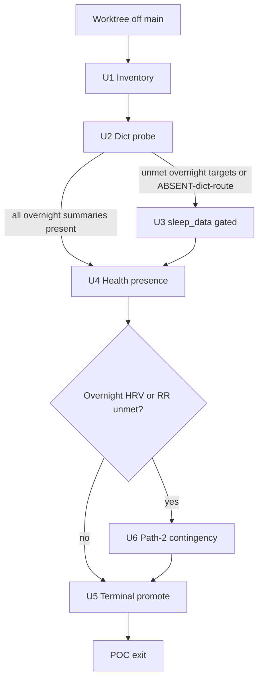
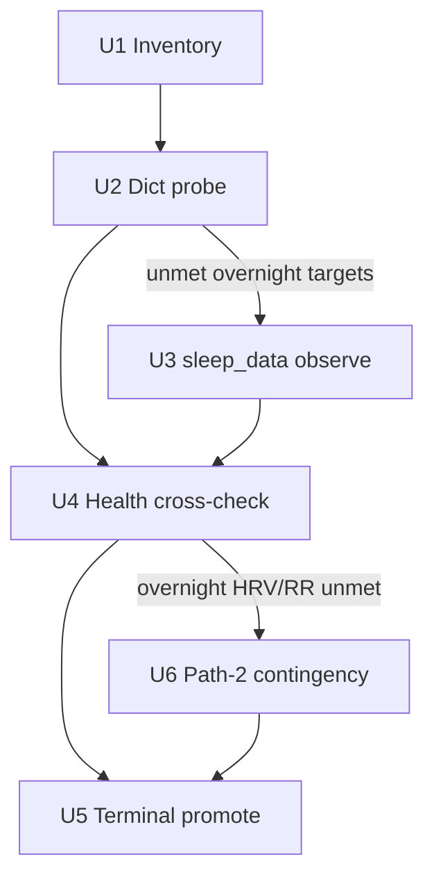

# feat: GT5 overnight physio dict/file capture POC

## Summary

Prove whether GT5-A07 can supply overnight HRV, sleep HR, respiratory rate, and sleep SpO₂ **summaries** via dictionary / TruSleep file paths, with FitnessData intervals only as a gated contingency that cannot close overnight-summary rows by itself. Implement a gated capture path (dict/`SLEEP_DETAILS`-class first → optional `sleep_data.bin` observe → optional path-2 intervals) that exits with a dual-class availability matrix, privacy-safe fixtures, and honest catalog / wire-spec / probe-matrix promotion — not recovery UI. Execute in a **parallel git worktree** on a dedicated branch off `main` so this stays isolated from Hooper-4 and other product tracks.

---

## Problem Frame

TruSleep file SoT already covers sleep **timing**. Recovery analytics still need overnight physiology (HRV, sleep HR, RR, sleep SpO₂). Community prior art (Huawhoop on Band 10) got those summaries from `sequence_data/SLEEP_DETAILS`; Fathom has already seen `sleep_data.bin` present (~678 KiB) but skips download. Desk research has diminishing returns without a GT5-A07 capture POC that can honestly promote or mark `ABSENT-…` each target (see origin: `docs/handoffs/2026-08-13-gt5-physio-dict-file-capture-handoff.md`).

---

## Requirements

**Capture path**
- R1. Prefer dict / `SLEEP_DETAILS`-class download; fall through to gated `sleep_data.bin` observe for unmet overnight-summary targets; only then optional FitnessData interval path (contingency; cannot mint overnight-summary `present`)

**Evidence & docs**
- R2. Produce a per-metric availability matrix with classes: `overnight-summary` | `interval-proxy` | `ABSENT-…`, plus source pipe and unit/timestamp notes when knowable
- R4. Update catalog, sleep-files / fitness-data wire-specs, and probe-matrix with `capture:…` or `ABSENT-…` (dual-axis score ≠ observation) in a **single terminal promotion** after all executed pipes

**Privacy**
- R3. Privacy-safe fixtures **and runtime logs**: route/id + length + redacted field-key / tag-histogram maps only; never commit or log PPG/ACC blobs, body hex, sample values, full HR/SpO₂ series, or `sleep_data` bodies (logcat, MethodChannel payloads, crash breadcrumbs included)

**SoT / safety**
- R5. FileDownload / dict / `sleep_data` failure must not wipe TruSleep `sleep_state` SoT or advance the activity cursor on incomplete FD

**Scope exclusions**
- R6. No recovery UI, baselines, P4 composite, avgHrv charts, or continuous-HR product chart restore in this cut

**Clean-room**
- R7. Gadgetbridge / Huawhoop = behavioral oracle only — no AGPL paste; clean-room from owned captures + wire-specs; PR gate cites owned capture ids only

**Branch / worktree**
- R8. Work lands in a parallel worktree on a dedicated branch off `main`, not bundled with Hooper-4

**Origin acceptance examples:** AE1 (route+len+keys without bodies), AE2 (honest ABSENT after budget), AE3 (FD fail does not wipe sleep_state SoT), AE4 (no recovery UI as exit)

**Alias note:** In this plan, *dict* / *SLEEP_DETAILS-class* / *sequence* / *dictionary* name the same U2 probe plane unless U1 splits them into distinct named candidates.

---

## Scope Boundaries

- No recovery / baseline / P4 morning-state UI or coaching
- No Hooper-4 feel migration (existing `.worktrees/feat/hooper4-morning-wellness` stays untouched; this POC still creates its own worktree/branch)
- No inventing TruSleep stages from `sleep_state` flags or BPM/HRV from raw PPG
- No AGPL paste; no committing HCI dumps or Health cloud Kit architecture
- No silent restore of product continuous/daily HR charts on Sync or sleep detail

### Deferred to Follow-Up Work

- Product parsers / domain models that surface overnight HRV/RR/SpO₂ in Recovery UI (after promotion)
- TruSleep stage decode from `sleep_data` if summaries prove absent but structure is owned later
- Live RRI / stress-calibration windows (not morning overnight SoT)
- Compounding this POC into `docs/solutions/` after ship

---

## Context & Research

### Relevant Code and Patterns

- FileDownload SM (live `0x2c`): `android/app/src/main/kotlin/com/example/fitness_os/huawei/HuaweiFileDownload.kt` — `sleep_state.bin` only today; `FILE_SLEEP_DATA` / type `0x0f` exist but skipped
- Sync hook + enrich fail-closed: `HuaweiFitnessDataSync.kt` → `attemptSleepFileDownload`; Session wiring in `HuaweiSession.kt` (`liveDownloadEnabled = true` for product Sync)
- Auto-HR / auto-SpO₂ arm (path 2): `enableAutoTracking` / `HuaweiFitnessDataEnableTest.kt`; Sync currently **skips** daily_hr `0x0B` pull
- Privacy-safe FD tests: `android/app/src/test/java/com/example/fitness_os/huawei/HuaweiFileDownloadTest.kt`
- Fixture policy: `test/fixtures/huawei/README.md` (no GB golden bytes; hex vectors in unit tests)
- Exit docs: `docs/catalogs/gt5-a07-full-metrics.md`, `docs/wire-specs/huawei-br-gt5-sleep-files.md`, `docs/wire-specs/huawei-br-gt5-fitness-data.md`, `docs/experiments/gt5-a07-full-metrics-probe-matrix.md`
- **No in-repo dict / `SLEEP_DETAILS` client** — Band 10 Huawhoop route is a lead only; invent probe from inventory + capture

### Institutional Learnings

- `docs/solutions/` is empty; constraints live in learnings / handoffs / prior plans
- Sync invariants: FeatureUpload hard-off during Sync; never blanket DataSync; serialize activity vs workout (`docs/learnings/2026-07-18-huawei-gt5-companion-poc.md`)
- TruSleep SoT: enrichment-monotonic FD; cursor advances only on successful file-SoT upsert; incomplete blobs never promoted (`docs/plans/2026-08-11-001-feat-trusleep-primary-sleep-sot-plan.md`)
- Catalog dual-axis + `capture:` / `ABSENT-…` promotion; SpO₂ empty recipe includes one reboot; ≤2 wear cycles (`docs/plans/2026-07-18-003-feat-gt5-full-metrics-catalog-plan.md`)
- GB behavioral-only; SpO₂ reboot tip (`docs/learnings/2026-07-22-community-prior-art.md`)
- `feat/recovery-sleep-detail` is **merged into `main`**; FD/sleep SoT Kotlin/Dart match — prefer branching off `main`

### External References

- Huawhoop Band 10 sample fields (`avgHrv`, `avgHeartRate`, `avgBreathRate`, `avgOxygenSaturation`) — lead, not GT5 proof: [Huawhoop](https://github.com/Kuberwastaken/Huawhoop)
- Research digest: `docs/learnings/2026-08-13-gt5-overnight-physio-capture-research.md`

---

## Key Technical Decisions

- **Parallel worktree + dedicated branch off `main`:** Isolates capture POC from Hooper-4 (`.worktrees/feat/hooper4-morning-wellness`) and other product work; `main` already contains TruSleep FD SoT + this handoff/research. Suggested branch name: `feat/gt5-physio-dict-file-capture` under `.worktrees/`.
- **Path order locked:** Dict / sequence first → gated `sleep_data` for unmet overnight-summary targets → Health presence notes → optional path-2 only if overnight HRV/RR still unanswered → **single terminal promote/ABSENT (U5 last)**.
- **Per-metric thin / U3 gate:** Promote present overnight-summary candidates from U2 immediately into the working matrix. Enter U3 only while ≥1 overnight-summary target remains unmet (route absent counts as all unmet). Do not treat Huawhoop string equality alone as `present` — require typed scalar overnight aggregates (or an explicit `unknown-schema-keys` bucket before escalating).
- **Post-Sync diagnostic SM (default):** Product Sync never adds `sleep_data` to `downloadSleepFiles`. Dict / `sleep_data` / path-2 pulls run via a separate Session diagnostic entry that `tryAcquire`s `HuaweiSyncLock`, sets `productSyncActive` for FeatureUpload hard-off, returns privacy-safe maps, and never feeds Flutter SoT merge. In-band FD composition only if U1 proves the candidate must share the `0x2c` init window — then composed fail-closed tests become primary, not a footnote.
- **Diagnostic surface is debug/release-gated:** Flags and any MethodChannel that starts capture are unavailable in release product builds (BuildConfig/debug-only or equivalent), default off, and must be left off after probe nights.
- **`sleep_data` retention:** After structure/tag inventory is written, delete or overwrite the full body; exclude capture files from Android Auto Backup; wipe truncated buffers (never keep as “pending present”).
- **Path-2 must include gated `0x0B` diagnostic pull:** Enable alone is insufficient while Sync skips daily_hr; restore pull only behind the diagnostic flag; product charts stay stripped. Interval evidence may mint `interval-proxy` only — never overnight-summary `present` for HRV/RR unless summary keys are proven.
- **Health UI ≠ companion proof:** Health presence notes annotate the matrix (boolean only — no screenshots or numeric values in git); catalog promotion requires companion pipe evidence (or honest `ABSENT-companion` + Health note, score ≤2).
- **Dict probe is invent-then-capture with hard gate:** No U2 production/diagnostic code until U1 names a concrete GT5 route/service id (or documents `ABSENT-dict-route` and skips to U3 with docs-only U2). Max **3** inventory-surviving candidates; one clean attempt each. Classify each candidate’s transport (`FD 0x2c` pull / `FU 0x28` receive / other) before applying FeatureUpload hard-off.
- **Wide diagnostic window:** Capture nights use the existing force-wide lever (`activitySyncImplVersion` / clear `lastActivitySyncCursor` → 14d window in `HuaweiLink.activityWindowDays`), diagnostic-only, then restore prior cursor/window after the probe.
- **ABSENT disproof budget (AE2):** Before minting any `ABSENT-…` overnight-summary row: caps dump attempted (or documented blocked), `ABSENT-dict-route` or ≥1 named candidate tried, ≥1 capture night with firmware id when available, and U4 same-night Health notes recorded.

---

## Open Questions

### Resolved During Planning

- Branch base: **`main` in a parallel worktree** (not `feat/recovery-sleep-detail` tip — that lineage is already merged; user asked for parallel worktree + different branch)
- Path-2: **in this plan as gated U6**, not a separate plan; cannot close overnight-summary HRV/RR by itself
- `sleep_data` resume: **debug-gated diagnostic flag + post-Sync SM**, not always-on product Sync
- Promotion: **U5 is terminal** after U2/U3/U4 and U6-if-run (no interim ABSENT that freezes before contingency)
- Health vs companion mismatch: **`ABSENT-companion` + Health note**, never promote from Health alone
- FD composition: **post-Sync diagnostic default**; in-band only if U1 falsifies out-of-band feasibility
- Candidate cap: **max 3** dict/sequence candidates from U1
- Diagnostic entry shape: minimal `probePhysioCapture`-style Session/MethodChannel (debug-only) sharing SyncLock + `productSyncActive`

### Deferred to Implementation

- Exact GT5 dict service / filename / TLV shape after U1 inventory (may be absent)
- Whether `sleep_data` contains summary dictionaries vs PPG/ACC-only (structure observe decides; no product decode)
- Prefs vs channel wiring details inside the debug-only gate
- Firmware string discovery path when device available (required on ABSENT rows when obtainable)

---

## Dependencies / Prerequisites

- Parallel worktree created before code changes: e.g. `.worktrees/feat/gt5-physio-dict-file-capture` on branch `feat/gt5-physio-dict-file-capture` from current `main`
- Paired GT5-A07 with overnight TruSleep data available (prefer night ≥2 after pair per probe-matrix)
- Do not share branch/PR with `feat/hooper4-morning-wellness`

---

## High-Level Technical Design

> *This illustrates the intended approach and is directional guidance for review, not implementation specification. The implementing agent should treat it as context, not code to reproduce.*

Probe planes (conceptual):

| Plane | Mechanism | Yield hope | Gate |
|-------|-----------|------------|------|
| Dict / sequence | Invented probe from U1 names (max 3) | Nightly overnight-summary scalars | session_ready; transport-aware FeatureUpload policy |
| TruSleep file | Post-Sync gated `sleep_data.bin` FD | Summaries **or** PPG/ACC-only structure | Debug flag; product Sync stays `sleep_state`-only |
| FitnessData | Enable + gated `0x0B` pull | `interval-proxy` HR ± SpO₂ | Only if overnight HRV/RR still open |
| Health UI | Manual same-night notes | Boolean presence cross-check only | Never sole promote source |

---

## Implementation Units

U-IDs are stable anchors. **Execution order is not numeric:** U6 (path-2 contingency) runs only when overnight HRV/RR remain unmet after U2–U4, and **before** terminal promotion U5.

### U1. Inventory FileDownload and dict/sequence candidates

**Goal:** Map live companion FileDownload + Sync hooks; list GB/Huawhoop **behavioral names only**; confirm GT5 caps for file/dict-like services; produce named probe candidates with transport class (or document `ABSENT-dict-route`).

**Requirements:** R1, R7, R8

**Dependencies:** Worktree + branch prerequisite

**Files:**
- Create: `docs/experiments/gt5-a07-physio-dict-file-inventory.md` (or equivalent probe-matrix addendum)
- Modify: `docs/experiments/gt5-a07-full-metrics-probe-matrix.md` (inventory row / caps dump status)
- Reference (read-only): `android/.../huawei/HuaweiFileDownload.kt`, `HuaweiFitnessDataSync.kt`, `HuaweiSession.kt`, `docs/wire-specs/huawei-br-gt5-sleep-files.md`

**Approach:**
- Confirm product Sync downloads `sleep_state` only; note soft-skip / `pending_capture` patterns to reuse
- Record that no dict client exists in-repo
- Caps dump for file/dict-related services if still Pending in probe matrix
- **Exclude** DataSync `0x37` cmd `0x04` (“dict” FeatureManager config) — not SLEEP_DETAILS
- For each surviving candidate (max **3**): record transport class `FD-0x2c-pull` | `FU-0x28-receive` | `other`, and whether out-of-band post-Sync probe is feasible
- If none survive, write `ABSENT-dict-route` and treat U2 as docs-only pass-through to U3 (no native collaborator)

**Patterns to follow:**
- Probe-matrix budget language; Gate A clean-room (names only from GB)
- Prior TruSleep inventory style in sleep-files wire-spec

**Test scenarios:**
- Test expectation: none — documentation / inventory unit; no production behavior change

**Verification:**
- Inventory artifact lists FD status, ≤3 candidates with transport class (or `ABSENT-dict-route`), caps notes, and out-of-band feasibility call — enough to start U2 without guessing Band-10 paths or DataSync config cmds

---

### U2. Dict / SLEEP_DETAILS-class probe

**Goal:** Attempt inventory-named sleep-sequence / dictionary download; log route + size + redacted key inventory; write privacy-safe fixture if present.

**Requirements:** R1, R2, R3, R5, R7

**Dependencies:** U1 (hard-gated: concrete route/service id **or** `ABSENT-dict-route` short-circuit)

**Files:**
- Create (only if U1 names a route): native dict/sequence probe collaborator under `android/.../huawei/` — extend FileDownload only if inventory proves same `0x2c` SM
- Modify: `HuaweiSession.kt` + debug-only channel entry for post-Sync `probePhysioCapture` (or smallest equivalent)
- Test: `android/app/src/test/java/com/example/fitness_os/huawei/` — synthetic frames when a route exists
- Create (if present): privacy-safe redacted field map following `test/fixtures/huawei/README.md` (or docs/experiments checklist that references that policy)

**Approach:**
- If `ABSENT-dict-route`: docs-only unit; skip code; continue to U3
- Else: one clean attempt per candidate via diagnostic SM under SyncLock; apply FeatureUpload hard-off only for phone-initiated pulls; for FU-receive candidates use a controlled listen window that does not poison product Sync
- Prefer night ≥2 + force-wide Sync window (restore after)
- On success: record route, byte length, redacted keys / unknown-schema bucket; do not treat Huawhoop name equality alone as present
- On fail/unmet targets: do not wipe sleep_state SoT; do not advance cursor; proceed toward U3 for remaining overnight-summary gaps
- Execution note: Characterization-first for any new frame parser — synthetic TLV tests before live device nights

**Patterns to follow:**
- `HuaweiFileDownload` soft-skip / present / absent outcomes
- `HuaweiFileDownloadTest` synthetic queues; tag+len logging norms

**Test scenarios:**
- Happy path: synthetic dict response with typed overnight-summary scalars → status present; fixture/redaction contains keys not values/bodies
- Edge case: empty payload / zero-length file → unmet; prior TruSleep prefs unchanged
- Error path: timeout / disconnect mid-probe → fail-closed; no cursor advance; sleep_state SoT retained (Covers AE3)
- Integration: probe while Sync busy → reject/busy without FeatureUpload storm
- Privacy: committed artifact and log payload must not include PPG/ACC, body hex, or series (Covers AE1)

**Verification:**
- Logs/fixtures show route+len+keys **or** documented unmet/`ABSENT-dict-route`; SoT intact after failures; no U2 code landed when route was absent

---

### U3. Gated `sleep_data.bin` structure observe

**Goal:** When overnight-summary targets remain unmet after U2, download `sleep_data` via **post-Sync diagnostic** (not product Sync); observe structure enough to know if summary/HRV-like fields exist — no full-body commit, no PPG→HRV invention.

**Requirements:** R1, R3, R5, R6

**Dependencies:** U2 (or U1 when U2 is `ABSENT-dict-route` docs-only)

**Files:**
- Modify: `HuaweiFileDownload.kt` — support `TYPE_SLEEP_DATA` download from the diagnostic entry; **do not** add `sleep_data` to product Sync’s `downloadSleepFiles` specs
- Modify: `HuaweiSession.kt` — post-Sync diagnostic path under SyncLock + `productSyncActive`
- Test: `HuaweiFileDownloadTest.kt`, Session/diagnostic tests as needed
- Docs: `docs/wire-specs/huawei-br-gt5-sleep-files.md` (observe notes only until U5 promotion)

**Approach:**
- Flag default off + debug-only → regression: product Sync still skips `sleep_data`
- When on: transfer ~678 KiB; persist app-private briefly; log id + len + tag histogram / redacted structure map; then delete/overwrite body; exclude from Auto Backup
- Incomplete / mid-block fail → null/absent; wipe truncated buffers; never advance cursor
- Explicitly split catalog concepts: “file present by size” vs “overnight-summary fields present”
- Do not decode PPG to BPM/HRV in this unit

**Patterns to follow:**
- Existing `downloadSleepFiles` skip comment and soft-skip reasons
- TruSleep plan R4/R11 cursor + incomplete-blob rules

**Test scenarios:**
- Happy path: flag on + synthetic full `sleep_data` transfer → present + len; structure map without body in git; body deleted after observe
- Edge case: flag off → skipped/`pending_capture` as today (regression); product Sync specs unchanged
- Error path: diagnostic mid-block fail → no present fixture; product Sync sleep_state enrich unaffected (Covers AE3)
- Error path: truncated persist must not be promoted as structure proof
- Privacy: no sleep_data body in committed fixtures or logs (Covers AE1)

**Verification:**
- With flag on, device or synthetic path yields structure/tag inventory **or** honest transfer failure without SoT wipe; flag off preserves current Sync behavior; no `sleep_data` in product Sync specs

---

### U4. Same-night Health UI cross-check

**Goal:** For the capture night(s), record which of HRV / RR / SpO₂ / sleep HR appear in Huawei Health (boolean presence only).

**Requirements:** R2

**Dependencies:** U2 and/or U3 capture night

**Files:**
- Modify: `docs/experiments/gt5-a07-full-metrics-probe-matrix.md` (or physio inventory addendum) with presence matrix rows
- Optional: short notes in research digest / wire-spec “Health presence” column — no product code required

**Approach:**
- Same capture id / night as companion probes
- Boolean presence only — forbid Health screenshots, numeric values, and user-identifying captions in git
- Explicitly record Health-present / companion-absent mismatches for U5 honesty

**Patterns to follow:**
- Probe-matrix observation language; catalog dual-axis discipline

**Test scenarios:**
- Test expectation: none — manual device/UI observation unit

**Verification:**
- Probe matrix has same-night Health presence notes for all four targets (or “not shown in Health UI”) without values/screenshots

---

### U5. Catalog, wire-spec, and probe-matrix promotion (terminal)

**Goal:** After all executed pipes (U2–U4 and U6 if run), promote or `ABSENT-…` each target so the POC exit criterion is met without product UI (Covers AE2, AE4).

**Requirements:** R2, R3, R4, R6

**Dependencies:** U2–U4; **and U6 when overnight HRV/RR were unmet after U3**

**Files:**
- Modify: `docs/catalogs/gt5-a07-full-metrics.md`
- Modify: `docs/wire-specs/huawei-br-gt5-sleep-files.md`
- Modify: `docs/wire-specs/huawei-br-gt5-fitness-data.md` (if path-2 or interval evidence)
- Modify: `docs/experiments/gt5-a07-full-metrics-probe-matrix.md`
- Optional privacy-safe redacted maps under docs/experiments following fixture README policy (no bodies)

**Approach:**
- Dual-axis updates: score 0–5 and observation status separately; matrix class `overnight-summary` | `interval-proxy` | `ABSENT-…`
- Never mint high scores without `capture:…`; after disproof budget use `ABSENT-…` / `absent-in-observed-sessions` and score ≤2
- Keep PPG/ACC file-present rows distinct from overnight-summary rows
- Interval-only HRV/RR from U6 → `interval-proxy` (or `ABSENT-overnight-summary`) — not overnight-summary `present`
- Do not accept recovery charts as exit
- PR checklist: no GB/Huawhoop source in worktree; wire-spec cites owned capture ids; fixture-policy check before merge

**Patterns to follow:**
- Existing catalog R2a privacy; prior `capture:POC-…` citations; full-metrics catalog plan promotion rules

**Test scenarios:**
- Test expectation: none for doc-only edits — verify by review checklist: every target has `capture:` or `ABSENT-…` with correct class; no series/bodies committed; AE4 satisfied (no UI exit)

**Verification:**
- All four targets documented with companion source field **or** honest ABSENT after budget; Health notes attached where relevant; privacy + AGPL gates intact

---

### U6. Optional path-2 interval HR/SpO₂ (contingency)

**Goal:** Only if overnight HRV/RR still unanswered after U2–U3: arm auto-HR + auto-SpO₂, wear, Sync with **gated diagnostic `0x0B` pull**, optional one SpO₂ reboot, ≤2 cycles; record tag+len series presence as `interval-proxy` — not product charts, not overnight-summary present.

**Requirements:** R1, R3, R5, R6

**Dependencies:** U4 gate “overnight HRV or RR still unmet” (runs before terminal U5)

**Files:**
- Modify: `HuaweiFitnessDataSync.kt` (gated diagnostic daily_hr / SpO₂ pull behind debug flag)
- Modify: enable path only if needed (`enableAutoTracking` already exists)
- Test: `HuaweiFitnessDataSyncTest.kt`, `HuaweiFitnessDataEnableTest.kt`
- Docs: fitness-data wire-spec + probe-matrix SpO₂ reboot row (finalized in U5)

**Approach:**
- Sequence: Enable when Sync idle → wear ≥4h / overnight → morning Sync with diagnostic pull on → if SpO₂ empty, reboot once → re-Sync
- Cap ≤2 empty cycles then ABSENT for that pipe
- Product sleep-detail / Sync UI charts remain stripped
- Weak for RMSSD alone — matrix class stays `interval-proxy`

**Patterns to follow:**
- Probe-matrix SpO₂ reboot tip; enable outcome tests; Sync lock busy behavior

**Test scenarios:**
- Happy path: flag on → diagnostic pull records tag+len histogram without committing series
- Edge case: Enable during Sync → `busy`; no FeatureUpload retry storm
- Error path: flag off → Sync still skips daily_hr (regression vs stripped SoT line)
- Integration: empty SpO₂ after enable+wear → document reboot attempt once then ABSENT path
- Privacy: no full HR/SpO₂ series in git or logs

**Verification:**
- If executed: interval evidence or ABSENT after budget; product charts still absent; overnight-summary rows left for U5 to mark honestly

---

## System-Wide Impact

- **Interaction graph:** Diagnostic probes share `HuaweiSyncLock` with product Sync / enable; FileDownload remains non-blocking enrich relative to message-path history; Flutter vitals merge must keep fail-closed SoT on probe miss
- **Error propagation:** Probe failures → skipped/absent enrich only; never `Left` that clears prefs; Home `syncNow` AND semantics unchanged unless a probe is wrongly inlined into product Sync failure
- **State lifecycle risks:** Large `sleep_data` mid-transfer; partial side-files; cursor starvation on narrow windows; diagnostic flag accidentally left on (battery/Sync time)
- **API surface parity:** New MethodChannel / debug entry if added must be clearly diagnostic; no iOS Huawei parity expected
- **Integration coverage:** Device nights + Health presence cannot be fully unit-tested — probe-matrix rows are the integration evidence
- **Unchanged invariants:** TruSleep `sleep_state` gap-merge SoT; FeatureUpload hard-off during Sync; no AGPL paste; continuous-HR product charts stay stripped; Hooper-4 worktree untouched

---

## Risks & Dependencies

| Risk | Mitigation |
|------|------------|
| Band 10 dict route absent on GT5 | `ABSENT-dict-route` → U3 → U4 → U6 (if overnight HRV/RR unmet) → terminal U5 ABSENT |
| `sleep_data` is PPG/ACC only | Structure observe; no PPG→HRV invention; keep file-present ≠ overnight-summary |
| ~678 KiB transfer hurts Sync | Debug flag; post-Sync SM; product Sync stays `sleep_state`-only; delete body after observe |
| Path-2 Enable without `0x0B` pull observes nothing | U6 explicitly restores gated diagnostic pull |
| Incomplete FD advances cursor / wipes SoT | Characterization tests + post-Sync data download; AE3 acceptance |
| U6 intervals mistaken for overnight HRV | Matrix class `interval-proxy` / `ABSENT-overnight-summary` only |
| AGPL contamination | Behavioral names only; PR gate cites owned captures; no GB/Huawhoop source in worktree |
| Parallel-track collision with Hooper-4 | Separate worktree/branch/PR |
| Health shows metrics companion lacks | Matrix records both; promote companion only |

---

## Alternative Approaches Considered

- **Path-2 intervals first:** Rejected — weak for overnight RMSSD; Huawhoop lead and handoff lock dict/file first
- **Always-on `sleep_data` in product Sync:** Rejected — Sync time/battery and privacy risk before parse ownership
- **Implement on `feat/recovery-sleep-detail` tip:** Rejected — lineage merged; user requested parallel worktree off a different branch from `main`
- **Separate plan for path-2:** Rejected for this POC — keep as gated U6 so exit can still answer HRV/RR after file paths fail

---

## Success Metrics

- All four targets have companion `capture:…` or `ABSENT-…` rows with correct class (`overnight-summary` | `interval-proxy` | `ABSENT-…`)
- Zero committed PPG/ACC bodies or full series; runtime logs stay tag+len / key-map only
- AE3 holds on intentional FD/dict failure tests
- Work shipped (or ready to PR) from the dedicated worktree branch without Hooper-4 entanglement

---

## Documentation / Operational Notes

- Create worktree before U1 code: `git worktree add .worktrees/feat/gt5-physio-dict-file-capture -b feat/gt5-physio-dict-file-capture main` (or equivalent; exact flags are executor choice)
- Stamp capture ids with date + firmware when known
- Leave diagnostic flags **off** after probe nights; restore force-wide cursor/window after capture
- Update handoff status to shipped/blocked after terminal U5
- Owner Downloads recovery PRD Phase 0 spirit is satisfied by this exit — product analytics remain follow-up

---

## Sources & References

- **Origin document:** [docs/handoffs/2026-08-13-gt5-physio-dict-file-capture-handoff.md](docs/handoffs/2026-08-13-gt5-physio-dict-file-capture-handoff.md)
- Research SoT: [docs/learnings/2026-08-13-gt5-overnight-physio-capture-research.md](docs/learnings/2026-08-13-gt5-overnight-physio-capture-research.md)
- Related: [docs/handoffs/2026-08-12-trusleep-file-sot-shipped-stages-handoff.md](docs/handoffs/2026-08-12-trusleep-file-sot-shipped-stages-handoff.md)
- Constraint from sleep-detail brainstorm R9: [docs/brainstorms/2026-08-09-vitals-sleep-detail-stages-hr-requirements.md](docs/brainstorms/2026-08-09-vitals-sleep-detail-stages-hr-requirements.md)
- Parallel fence: [docs/handoffs/2026-08-13-hooper4-feel-upgrade-handoff.md](docs/handoffs/2026-08-13-hooper4-feel-upgrade-handoff.md)
- Related code: `HuaweiFileDownload.kt`, `HuaweiFitnessDataSync.kt`, `HuaweiSession.kt`
- External: [Huawhoop](https://github.com/Kuberwastaken/Huawhoop)
