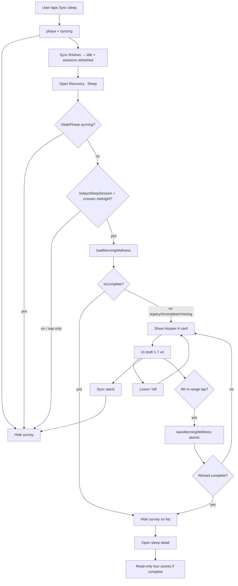

# feat: Hooper-4 morning wellness feel upgrade

## Summary

Replace the Recovery · Sleep single-emoji feel-on-wake survey with a **four-dimension Hooper-style morning wellness check** (sleep quality, fatigue, muscle soreness, stress) on a classic **1–7** scale (1 = best / least symptom, 7 = worst). Persist complete answers once per overnight `mergeKey`; offer the survey only for **today’s overnight** when not syncing; surface completed answers on the **sleep detail** screen (planning lock beyond origin brainstorm — owner requested). Keep TruSleep wellness rekey working for the new payload; leave export and recovery coaching out of this cut.

---

## Problem Frame

A single global emoji is too coarse for recovery learning, and muscle soreness cannot come from the GT5. The owner needs a short multi-item self-report on the same overnight trigger as today, without intensity coaching or claiming the watch measured DOMS. (see origin: `docs/brainstorms/2026-08-13-hooper4-morning-wellness-requirements.md`)

---

## Requirements

### Survey UX
- R1. Replace single “How do you feel waking up?” emoji row with four prompts: sleep quality, fatigue, muscle soreness (DOMS), stress (origin R1)
- R2. One consistent **1–7** ordinal scale for all four; classic Hooper polarity (**1 = best / least symptom, 7 = worst**); honest endpoint labels; no medical cutoffs (origin R2)
- R5. Keep survey completable in ~10–15s; one card with four rows + progress `N/4`; emoji OK only inside survey prompts (origin R5)
- R7. No recovery intensity suggestion (hard/easy/rest) in this cut (origin R7)
- R8. Do not claim or derive DOMS/soreness from Huawei watch metrics (origin R8)

### Persistence & gating
- R3. Persist **once per overnight session** `mergeKey` when complete; **today’s overnight only** for survey offer (no historical catch-up UI — planning lock); naps do not get a survey (origin R3 + planning lock)
- R4. Treat as answered only when all four values are present and in-range; **atomic save** of the full object — no prefs partial that blocks re-prompt (origin R4 / AE2 atomic branch)
- R6. Migrate/supersede legacy single-string feel keys; keep TruSleep `_migrateFeelOnWake` longest-overlap rekey for string **and** object values (origin R6)
- R9. Local prefs only; no wellness values in Sentry/hex logs; extend scrub forbidden keys for wellness field/prefs names (origin R9)
- R10. **Presence gate (no “once synced” survey signal):** show when **not syncing** and **today’s overnight is already on the page** (`todaysSleepSession` + `sleepCrossesLocalMidnight`) and wellness is incomplete. Cold open with cached overnight is OK — do **not** require a sync transition this visit, and do **not** introduce a one-shot post-sync event. Hide while `VitalsPhase.syncing` via **build-time** `showSurvey` predicate (phase can flip without session list changes)

### Detail
- R11. Show completed Hooper-4 **response details** on `sleep_detail_screen` for that session (read-only); survey entry remains on the Sleep list (owner planning lock)

**Origin actors:** A1 Owner-athlete, A2 Recovery · Sleep UI  
**Origin flows:** F1 Morning multi-prompt  
**Origin acceptance examples:** AE1 (four items → hide), AE2 (partial leave → still prompt — atomic branch), AE3 (nap-only → no survey), AE4 (legacy string loads safely), AE5 (no intensity / no watch-DOMS copy)

---

## Scope Boundaries

- Out: GT5 HR/HRV/RR/SpO₂ capture POC (parallel track)
- Out: Baseline engine, P4 Good/Moderate/Caution composite, training-load join, intensity coaching
- Out: Collapsing back to one tap after 30 days
- Out: Historical catch-up for older incomplete overnights (accepted: unanswered nights can become permanent holes after local midnight / missed same-day window)
- Out: Same-day edit after complete save (mis-tap after save is not correctable this cut — review-only on detail)
- Out: Adding wellness JSON to app data export (prefs key remains intentionally omitted; document if export notes touched)
- Out: Changing TruSleep file SoT timing / stage attach
- Out: Empty-state explainers for nap / syncing / legacy re-prompt (omit UI; same blank Hooper card for legacy)

### Deferred to Follow-Up Work

- Historical backfill / multi-night catch-up UI: later product cut if baselines need hole-filling
- Optional export of wellness under an explicit schema bump + sensitivity stamp
- Same-day correction / detail edit if mis-tap rate becomes painful

---

## Context & Research

### Relevant Code and Patterns

- Survey UI today: `lib/features/vitals/presentation/view/sleep_tab_screen.dart` — `_FeelOnWakeSurvey`, `_feelAnswer`, `_loadExtras` (prefer today overnight else first unanswered overnight — **catch-up path removed by this plan**)
- Overnight helpers: `lib/features/vitals/presentation/widgets/sleep_formatters.dart` — `sleepCrossesLocalMidnight`, `todaysSleepSession` (**nap fallback exists — midnight check required**)
- Repo contract: `lib/features/vitals/domain/repositories/vitals_repository.dart` — `loadFeelOnWake` / `saveFeelOnWake(String)`
- Repo impl: `lib/features/vitals/data/repositories/vitals_repository_impl.dart` — `_feelOnWakeMap`, once-per-key via `containsKey` (**must become completeness-gated**), `_migrateFeelOnWake`, `clearLocal` removes `GateAPrefs.sleepFeelOnWakeJson`
- Prefs key (legacy name retained): `lib/features/device_pairing/domain/gate_a_prefs.dart` — `sleepFeelOnWakeJson`
- Privacy scrub: `lib/core/observability/sentry_privacy_scrub.dart` — extend `forbiddenKeys` for wellness
- Detail host: `lib/features/vitals/presentation/view/sleep_detail_screen.dart` — loads stages; overnight chrome present; **no wellness display yet**
- Tests / fakes: `test/features/vitals/vitals_repository_test.dart`, `test/features/vitals/presentation/sleep_tab_history_test.dart` (**behavioral rewrite**, not signature-only), `sleep_detail_screen_test.dart`, `recovery_tab_host_test.dart`, `vitals_bloc_test.dart`, home KPI/session-copy fakes
- Prior plans: `docs/plans/2026-08-09-002-feat-recovery-sleep-detail-plan.md` (feel origin), `docs/plans/2026-08-11-001-feat-trusleep-primary-sleep-sot-plan.md` (R12 feel migrate)

### Institutional Learnings

- No `docs/solutions/` corpus in this repo. Carry TruSleep longest-overlap migrate + vitals prefs fail-closed + Forget wipe discipline from prior plans/handoffs.

### External References

- None required — local prefs/survey/migrate patterns are sufficient; Hooper polarity locked by product.

---

## Key Technical Decisions

- **Domain type `MorningWellness`:** Immutable four ints (`sleepQuality`, `fatigue`, `soreness`, `stress`) in 1–7 plus `isComplete`; set `answeredAt` (UTC ISO) on successful save; include `schema: 2` as a bump marker. Parsing lives in domain/data helpers — not forever in the widget. Prefer redacted/`isComplete`-only `toString`; never put scores in thrown messages.
- **API replace (not wrappers):** Replace `loadFeelOnWake` / `saveFeelOnWake` with `loadMorningWellness` / `saveMorningWellness`; update all `VitalsRepository` fakes. Sleep-tab fake must **behaviorally** store complete-only wellness (no `containsKey` twin).
- **Atomic UI draft + complete save:** Draft stays in widget memory; prefs write only when all four are set. **Auto-save on the 4th in-range tap** (no separate Confirm). Changing prior rows before the 4th is allowed. Hide survey only after save succeeds and reload shows complete; on save failure keep draft visible.
- **Progress:** Card header `N/4 answered`; unanswered rows visually distinct without severity/traffic-light colors.
- **Completeness-gated once-per-key:** Save no-ops only when an **already complete** Hooper-4 exists for the key (`existing.isComplete` via shared parser — **forbid residual `containsKey`**). Legacy string / incomplete / corrupt / out-of-range map entries are **not** answered — survey shows and save **upserts**.
- **Legacy string policy:** Treat as incomplete → re-prompt full Hooper-4 (clean baselines). Leave junk until overwrite. No “upgrade your answer” banner.
- **Scale polarity:** Classic Hooper — **1 = best / least symptom, 7 = worst / most symptom** for all four. Endpoint labels must match (e.g. sleep quality Very good↔Very poor; fatigue/soreness/stress Very low↔Very high). Selected state only — not severity coloring.
- **Survey gate (presence, not event):** Candidate = `todaysSleepSession`; show/save only if `sleepCrossesLocalMidnight(candidate)` (never treat nap fallback as survey session). Build-time: `!syncing && overnightCandidate && wellness == null`. No dedicated “once synced → show survey” signal — sync only refreshes sessions / sets `everSynced`; the survey appears because overnight data is present and we are idle. Remove older-night unanswered scan.
- **List placement:** Sync chrome → Hooper-4 card (if gated) → today’s overnight / history. One card, four rows.
- **Mid-sync draft:** Hide survey while syncing (no toast); in-UI draft is ephemeral and may clear — after sync, empty survey returns if incomplete. No recovery UI this cut.
- **Detail display:** Read-only “Morning wellness” card after overnight chrome / with session facts; dimension name + integer + same endpoint words as survey; **no** green/amber/red, **no** emoji summary, **no** average/composite. Missing/incomplete/legacy → omit card. No edit this cut.
- **Migrate collision matrix:** Parse source and destination via the same completeness helper (not blind opaque copy). Longest-overlap selection unchanged. Then: (1) incomplete/legacy dest + complete source → write source; (2) complete dest + incomplete/legacy source → keep dest; (3) both complete → **keep destination** (do not use `answeredAt` for migrate tie-break this cut); (4) always remove source key when migrated or skipped-as-downgrade so answers are not duplicated under two keys.
- **Privacy:** Extend `SentryPrivacyScrub.forbiddenKeys` for wellness field names + prefs key; primary control remains never attaching payloads. Device-local plaintext prefs accepted for this cut; Forget/`clearLocal` remains wipe path.
- **Export:** Do not read/write wellness into export; if export docs touched, stamp intentional omission of `sleep_feel_on_wake_json` / morning wellness.
- **Worktree / branch:** Implement on `feat/hooper4-morning-wellness` (from `main`, which already includes merged sleep/feel). Handoff’s `feat/recovery-sleep-detail` SoT is historical for this worktree.
- **Terminology:** Prose uses **wellness** for the feature; **feel** only for retained legacy symbols (`sleepFeelOnWakeJson`, `_migrateFeelOnWake`).

---

## Open Questions

### Resolved During Planning

- Atomic vs partial prefs save (AE2): **Atomic complete save**; draft in UI only; **auto-save on 4th tap**
- Legacy string handling: **Re-prompt** full Hooper-4
- Scale polarity: **Classic Hooper** (1 best / least symptom → 7 worst)
- Historical catch-up: **Out** — today’s overnight only (accepted permanent same-day miss holes)
- Survey timing: **Presence gate** — not syncing + today’s overnight present (cold open OK; no post-sync one-shot signal)
- Where answers are reviewed: **Sleep detail screen** (read-only) — owner lock beyond origin
- Mid-survey sync draft: **Ephemeral** — hide while syncing; empty re-entry OK
- Export this cut: **Untouched** (wellness remains omitted)
- Migrate both-complete: **Keep destination**; `answeredAt` set on save but unused for migrate tie-break
- Mis-tap after complete: **Not correctable** this cut

### Deferred to Implementation

- Exact 1–7 tap control chrome (compact number row vs segmented chips) within Recovery / `blueprint_ui` card language — min ~48dp targets; Semantics include dimension + value + endpoint meaning; fixed row order: sleep quality → fatigue → soreness → stress
- Precise endpoint copy strings (must honor polarity + R7/R8 tone)

---

## High-Level Technical Design

> *This illustrates the intended approach and is directional guidance for review, not implementation specification. The implementing agent should treat it as context, not code to reproduce.*



Note: there is **no** separate “onceSynced → showSurvey” event. Sync completion only returns the screen to the presence gate above (overnight present + not syncing + incomplete).

**Target prefs value shape (directional):**

```text
mergeKey -> {
  sleepQuality, fatigue, soreness, stress: 1..7,
  answeredAt: ISO-8601,
  schema: 2
}
```

Legacy `mergeKey -> "good"` remains readable as incomplete.

---

## Implementation Units

### U1. MorningWellness domain model

**Goal:** Introduce a small immutable wellness value type with completeness and tolerant parsing from prefs JSON (string legacy vs map).

**Requirements:** R2, R4, R6, R9

**Dependencies:** None

**Files:**
- Create: `lib/features/vitals/domain/entities/morning_wellness.dart` (or equivalent under `lib/features/vitals/domain/`)
- Test: `test/features/vitals/domain/morning_wellness_test.dart`

**Approach:**
- Four required ints in 1–7; `isComplete` true only when all four are present and in range
- Parser: `String` → incomplete; `Map` with missing/out-of-range/wrong types → incomplete; complete map → model
- Serializer for complete saves includes `schema: 2` and `answeredAt`
- No logging of field values; safe `toString`

**Patterns to follow:**
- Existing vitals domain files such as `lib/features/vitals/domain/sleep_hr_window.dart` (small pure helpers, no freezed)

**Test scenarios:**
- Happy path: map with four ints 1–7 → complete model round-trips
- Edge case: legacy string `"good"` → incomplete / null for answered semantics
- Edge case: map missing `soreness` → incomplete
- Edge case: int `0` or `8` → incomplete
- Error path: wrong-typed field (e.g. string where int expected) → incomplete, no throw

**Verification:**
- Domain tests pass; answered semantics are expressible without UI

---

### U2. Repository wellness load/save/migrate/clear

**Goal:** Replace string feel APIs with wellness load/save; completeness-gated once-per-key; TruSleep migrate applies the collision matrix; Forget still clears the prefs key; scrub keys extended.

**Requirements:** R3 (persist/once-per-key portion), R4, R6, R9

**Dependencies:** U1

**Files:**
- Modify: `lib/features/vitals/domain/repositories/vitals_repository.dart`
- Modify: `lib/features/vitals/data/repositories/vitals_repository_impl.dart`
- Modify: `lib/core/observability/sentry_privacy_scrub.dart` (+ scrub tests)
- Modify: all `VitalsRepository` fakes under `test/` (stubs + sleep-tab behavioral rewrite)
- Test: `test/features/vitals/vitals_repository_test.dart`

**Approach:**
- `Future<MorningWellness?> loadMorningWellness(session)` returns non-null only when complete
- `Future<void> saveMorningWellness(session, MorningWellness)` no-ops unless complete; no-ops if key already complete; otherwise upsert — gate via shared parser, **not** `containsKey`
- Keep prefs key `GateAPrefs.sleepFeelOnWakeJson`
- `_migrateFeelOnWake`: longest-overlap; parse both sides; apply collision matrix; remove source key on migrate or skip-as-downgrade
- `clearLocal` continues to remove wellness prefs
- Extend Sentry forbidden keys for wellness field/prefs names
- Do not log wellness payloads

**Execution note:** Extend existing feel-on-wake and TruSleep migrate tests before/while changing save gate so once-per-key and legacy upsert stay green.

**Patterns to follow:**
- Current `_feelOnWakeMap` fail-closed decode; TruSleep migrate loop in `vitals_repository_impl.dart`

**Test scenarios:**
- Happy path: Covers AE1. Save complete set once → load returns model; second save does not overwrite
- Edge case: Covers AE2. Partial/incomplete never persisted; load stays null
- Edge case: Covers AE4. Legacy string at key → load null; complete save replaces string
- Edge case: Corrupt/out-of-range map entry → load null; complete save upserts
- Integration: TruSleep migrate moves string onto new mergeKey (longest overlap)
- Integration: TruSleep migrate moves complete object intact onto new mergeKey
- Integration: Complete dest + incomplete/legacy source → dest preserved; source key removed
- Integration: Incomplete dest + complete source → source wins; source key removed
- Integration: `clearLocal` / Forget removes `sleepFeelOnWakeJson` (seed + assert)
- Edge case: Scrub drops wellness-shaped keys/maps

**Verification:**
- Repository tests cover once-complete, legacy upsert, migrate matrix, clearLocal wipe, scrub keys
- All fakes compile; sleep-tab fake is complete-only (no `containsKey`)

---

### U3. Sleep tab Hooper-4 survey (today + not-syncing)

**Goal:** Replace emoji survey with four-row Hooper-4 card on Sleep list; gate on not-syncing + today’s overnight (midnight-checked); atomic draft with auto-save on 4th tap; hide when complete.

**Requirements:** R1, R2, R3, R4, R5, R7, R8, R10

**Dependencies:** U2

**Files:**
- Modify: `lib/features/vitals/presentation/view/sleep_tab_screen.dart`
- Test: `test/features/vitals/presentation/sleep_tab_history_test.dart`

**Approach:**
- Replace `_FeelOnWakeSurvey` with four labeled rows, 1–7 controls, progress `N/4`
- Draft in State; auto-save on 4th in-range tap; await save then reload before hide; on failure keep draft
- Build-time `showSurvey`: `!syncing && overnightCandidate && wellness == null` where candidate = `todaysSleepSession` **and** `sleepCrossesLocalMidnight`
- Do not show until wellness load settles (avoid flash-then-hide)
- Remove older-night unanswered scan
- Placement: sync chrome → Hooper card → today overnight / history
- Copy: neutral athlete language; no intensity coaching; no “watch measured soreness”; no nap/sync empty explainers

**Patterns to follow:**
- Existing Recovery Card + `FathomColors` / `blueprint_ui` language in `sleep_tab_screen.dart`
- Sync pill / `VitalsPhase.syncing` already available in the same builder

**Test scenarios:**
- Happy path: Covers AE1. Unanswered today overnight → survey shows; after four answers + successful save → hidden
- Edge case: Covers AE2. Answer two dims, rebuild/leave → survey shows again with empty draft (no prefs write)
- Edge case: Covers AE3. Nap-only day (`todaysSleepSession` nap fallback) → survey hidden
- Edge case: While `VitalsPhase.syncing` → survey hidden even if overnight exists (build-time)
- Edge case: Complete wellness already stored → survey hidden
- Edge case: Save failure → survey remains with draft
- Edge case: Covers AE5. Widget copy audit — no intensity / watch-DOMS strings in survey chrome

**Verification:**
- Sleep tab widget tests cover show/hide, nap skip, sync gate, atomic partial leave, save-fail keeps survey

---

### U4. Sleep detail read-only wellness card

**Goal:** Show completed Hooper-4 answers on the sleep detail screen for the viewed session.

**Requirements:** R11, R7, R8

**Dependencies:** U2

**Files:**
- Modify: `lib/features/vitals/presentation/view/sleep_detail_screen.dart`
- Test: `test/features/vitals/presentation/sleep_detail_screen_test.dart`

**Approach:**
- On load, also `loadMorningWellness(session)`
- If complete, render read-only “Morning wellness” card (dimension + int + endpoint words)
- If missing/incomplete/legacy/load error, omit the card
- Match existing detail Card sections; no edit controls; no traffic-light / emoji / composite

**Patterns to follow:**
- `_StructureSection` card layout in `sleep_detail_screen.dart`

**Test scenarios:**
- Happy path: Complete wellness for session → four scores visible on detail
- Edge case: No wellness / incomplete → no wellness card
- Edge case: Nap session without wellness → no wellness card
- Edge case: Covers AE5. Detail copy does not claim watch measured soreness or suggest intensity

**Verification:**
- Detail widget tests assert presence/absence of wellness section from repository load result

---

## System-Wide Impact

- **Interaction graph:** Sleep list survey ↔ `VitalsRepository` prefs; TruSleep SoT flip ↔ `_migrateFeelOnWake`; Forget wipe ↔ `clearLocal`; Sleep detail read path newly depends on wellness load; Sentry scrub gains wellness keys
- **Error propagation:** Corrupt wellness JSON stays fail-closed (empty map / incomplete); UI treats as unanswered; save failure keeps survey draft
- **State lifecycle risks:** Completeness must gate both show and save (avoid legacy `containsKey` permanent block); migrate must apply full collision matrix + source-key cleanup; sync can clear in-UI draft; today-only creates permanent holes after midnight
- **API surface parity:** All `VitalsRepository` implementors/fakes must move to wellness APIs together; sleep-tab fake needs behavioral rewrite
- **Integration coverage:** Repo migrate matrix + tab survey + detail display; Forget wipe assertion; scrub keys
- **Unchanged invariants:** Overnight detection helpers; TruSleep SoT timing; stage attach; export assembly (wellness still omitted); no coaching surfaces

---

## Risks & Dependencies

| Risk | Mitigation |
|------|------------|
| Legacy `containsKey` blocks overwrite forever | Completeness-gated save + tests for legacy/incomplete upsert; rewrite sleep-tab fake |
| TruSleep migrate overwrites or orphans completes | Full collision matrix + parse both sides + source-key removal tests |
| Fake blast radius (6+ implementors) | Replace APIs in one unit; stubs + behavioral sleep-tab fake |
| Sync mid-survey clears draft | Accepted; hide while syncing; document empty re-entry |
| Today-only + sync-hide + draft wipe → permanent night holes | Accepted this cut; documented in Scope; catch-up deferred |
| Mis-tap after complete poisons night | Accepted; no same-day edit; noted in Scope |
| Wrong 1–7 polarity / traffic-light UI | Locked classic Hooper + anti-slop presentation rules |
| Accidental Sentry leak of scores | Forbidden-key extension + no payload attach + safe toString |
| Scope creep into coaching / physio | Explicit out-of-scope; copy audit tests |

---

## Documentation / Operational Notes

- Prefer updating `docs/handoffs/2026-08-13-hooper4-feel-upgrade-handoff.md` only if still used as SoT after plan (branch name + completeness-gated save + detail surface)
- If `docs/export/app-data-export-schema.md` is touched, stamp that morning wellness / `sleep_feel_on_wake_json` remains intentionally omitted
- No Sentry breadcrumbs with wellness field values

---

## Sources & References

- **Origin document:** [docs/brainstorms/2026-08-13-hooper4-morning-wellness-requirements.md](docs/brainstorms/2026-08-13-hooper4-morning-wellness-requirements.md)
- **Handoff:** [docs/handoffs/2026-08-13-hooper4-feel-upgrade-handoff.md](docs/handoffs/2026-08-13-hooper4-feel-upgrade-handoff.md)
- Related plans: `docs/plans/2026-08-09-002-feat-recovery-sleep-detail-plan.md`, `docs/plans/2026-08-11-001-feat-trusleep-primary-sleep-sot-plan.md`
- Related code: `sleep_tab_screen.dart`, `sleep_detail_screen.dart`, `vitals_repository_impl.dart`, `GateAPrefs.sleepFeelOnWakeJson`
