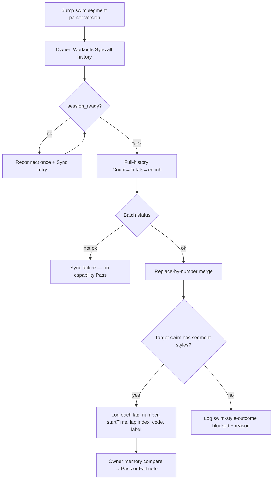

# feat: Log-first swim stroke style capability proof

## Summary

Prove GT5 pool-swim segments carry per-lap stroke style by forcing a full-history Gate B Sync tonight, then emitting owner-readable `FOS_HUAWEI` logs (workout identity, lap index, style code, label) plus an explicit blocked outcome when segments are empty. Style UI and enrichment-monotonic merge stay out of this slice; Pass/Fail/Blocked is recorded manually after the owner’s memory check.

---

## Problem Frame

Mixed pool sessions surface as session-level Medley while the owner needs lap-level stroke identity before any Style UI or per-stroke product. Wire parse and storage already carry per-lap `style`; the gap is an honest capability proof on real GT5-A07 data via force full-history Sync and inspectable logs (see origin: `docs/brainstorms/2026-08-14-swim-stroke-style-capability-requirements.md`).

---

## Requirements

### Force Sync path

- R1. Force Sync must be usable tonight without waiting for a new swim (full-history window so the existing Medley/latest pool workout is in range).

### Capability logging

- R2. When swim segments are present after Sync, each lap is logged with workout identity, lap index, style code, and human-readable stroke label (existing map; unknown codes log raw).
- R3. Logs are readable enough for the owner to compare lap order to memory without Style UI.
- R4. If Sync yields no segments (dropped workout, empty enrichment, timeout/empty parse), the outcome is clearly **blocked / empty**, not a silent false pass.

### Acceptance & gating

- R5. “Getting it right” means working-lap stroke **order** approximately matches the owner’s memory (not Huawei Health UI parity). Rest/transition laps may be unknown/Medley. Fail only when styles are present but order clearly mismatches; all-null styles are Blocked, not Fail.
- R6. Style UI / Intervals Style column only after a recorded Pass (or explicit owner proceed-despite-partial); not delivered in this plan.

**Origin actors:** A1 Owner-athlete, A2 GT5-A07, A3 Fathom workout sync  
**Origin flows:** F1 Tonight capability check  
**Origin acceptance examples:** AE1 (styles present + memory compare), AE2 (empty → blocked), AE3 (overnight force Sync without new swim)

---

## Scope Boundaries

- No Style column or stroke labels in Intervals UI
- No per-stroke improvement, trends, or coaching
- No Huawei Health lap-label parity as a hard bar
- No inventing stroke styles when the watch sends none
- No single-workout MethodChannel re-enrich API (use windowed full-history Sync)
- No enrichment-monotonic merge rewrite this slice (keep replace-by-number; rely on explicit blocked logs)

### Deferred to Follow-Up Work

- Style column in Intervals UI — after recorded Pass / owner override (separate plan)
- Enrichment-monotonic merge so Totals-only cannot wipe richer local segments — separate hardening
- Optional native MethodChannel single-workout re-enrich — only if full-history proves too heavy later

---

## Context & Research

### Relevant Code and Patterns

- Sync CTA / window: `lib/features/workout_history/presentation/view/workout_history_screen.dart` (“Sync all history”), `lib/features/workout_history/data/repositories/workout_history_repository_impl.dart` (`syncFromWatch`, `_resolveSyncStartUnix`, `currentSwimSegmentParserVersion`)
- Native enrichment: `android/.../HuaweiWorkoutSync.kt` (`enrichWorkout`, swim `0x17:0x0e`, style TLV `0x0a`); native `fetchSwimSegment` exists but is **not** MethodChannel-exposed
- Flutter models: `lib/core/huawei/huawei_link.dart` (`WorkoutSegment.style`), `lib/features/workout_history/domain/canonical_swim_session.dart`, `swim_p0_metrics.dart` (`SwimLapMetrics.style`)
- Stroke map (private today): `lib/features/workout_history/presentation/view/workout_detail_screen.dart` (`_swimStrokeLabel` — 1 Breaststroke, 2 Freestyle, 3 Butterfly, 4 Backstroke, 5 Medley; unknown → `Stroke $n`)
- Logging: `lib/core/huawei/fos_huawei_log.dart` (`FosHuaweiLog` — **debug-only** via `kDebugMode`; silent in profile/release); native `Log.i/w` tag `FOS_HUAWEI`
- Export fallback: `lib/features/diagnostics/data/app_data_export_service.dart` (canonical swim files may already carry `style`)
- Tests: `test/features/workout_history/workout_history_repository_test.dart` (parser-version → full-history), `android/.../HuaweiWorkoutSyncTest.kt` (style parse), swim domain tests with fixture `style: 2`

### Institutional Learnings

- `docs/solutions/` does not exist; use `docs/learnings/` + swim roadmap
- W0 PASS already proved pool segments on GT5-A07; tonight’s unknown is retention of **this** Medley’s segment pages (`docs/plans/2026-07-23-001-product-roadmap-swim-bible-v0.md`)
- Empty enrichment playbook: one reconnect + Sync retry; do **not** Forget (`docs/experiments/2026-07-22-owner-25m-pool-probe.md`)
- Soft timeouts ~20s → `partial_batch` / stuck; Flutter merge skipped on non-`ok` batch
- Never ship segment/style sequences to Sentry (`docs/plans/2026-07-27-001-feat-sentry-sync-observability-plan.md`)
- Prefer roadmap W0 over stale catalog “unobserved” for swim `0x0e`

### External References

- None required — local sync/parse/logging patterns are sufficient

---

## Key Technical Decisions

- **Full-history windowed Sync, not single-workout API:** Tonight’s force path bumps `currentSwimSegmentParserVersion` so `_resolveSyncStartUnix` uses `fallbackStartUnix`; owner uses Workouts → Sync all history while connected. (Confirmed with owner.)
- **Primary inspect = debug build + logcat:** `adb logcat -s flutter FOS_HUAWEI` (and native `FOS_HUAWEI`). Profile/release builds are silent for Flutter `FosHuaweiLog` — do not treat them as the primary path. Coach Settings JSON export is documented fallback only — not a first-class required path for this slice.
- **Keep replace-by-number merge:** Do not implement enrichment-monotonic merge here; emit explicit blocked / empty style outcome logs so Sync UI success is not mistaken for capability Pass.
- **Shared stroke label helper:** Lift the existing 1–5 map out of the private detail-screen helper so logs (and later UI) share one vocabulary; known 1–5 → full names; unknown codes → `Stroke $n` (include raw numeric); null → stable non-empty `"null"` that does not invent a stroke name.
- **Log all parsed laps:** Dump every parsed lap style (not invent-guard-filtered Intervals rows); include workout `number` + `startTime` so the wrong workout cannot be confused with Blocked.
- **Verdict recording is manual:** Pass / Fail / Blocked written as a short dated note in the runbook’s **Verdict** section — no in-app state machine this slice.
- **Approx Pass bar:** Working-lap stroke **order** matches the owner’s remembered set; rest/transition laps may be unknown/Medley; Fail only when styles are present but order clearly mismatches; all-null styles → Blocked, not Fail.

---

## Open Questions

### Resolved During Planning

- How is force-sync exposed tonight?: Workouts Sync CTA + parser-version bump for full-history (no single-workout re-fetch).
- Best log surface?: Debug-only `FosHuaweiLog` / `FOS_HUAWEI` logcat; export as fallback.
- Merge policy this slice?: Keep replace-by-number; explicit blocked logs; monotonic merge deferred.
- Where is Pass/Fail/Blocked recorded?: Manual note after memory check (gate for Style UI).

### Deferred to Implementation

- Whether GT5 still holds segment pages for the specific Medley after hours/days — runtime probe only; Blocked is a valid terminal (then schedule next-swim seed with the same logging landed).
- Exact log line string formatting — implementer chooses consistent prefixes (e.g. `swim-style` / `swim-style-outcome`) matching existing `FosHuaweiLog` style.
- Whether Flutter post-merge logging alone is enough vs also adding native per-lap lines — prefer Flutter for labels; add native only if needed for timing/debug.
- If full-history Sync repeatedly returns `partial_batch` tonight — whether to stop as Sync failure vs escalate the deferred single-workout MethodChannel path in a follow-up (out of this slice unless owner expands scope).

---

## High-Level Technical Design

> *This illustrates the intended approach and is directional guidance for review, not implementation specification. The implementing agent should treat it as context, not code to reproduce.*

---

## Implementation Units

### U1. Shared swim stroke label helper

**Goal:** One shared map/helper for stroke code → label so capability logs do not depend on opening workout detail UI.

**Requirements:** R2, R3

**Dependencies:** None

**Files:**
- Create: `lib/features/workout_history/domain/swim_stroke_label.dart` (or adjacent domain helper — keep next to swim metrics)
- Modify: `lib/features/workout_history/presentation/view/workout_detail_screen.dart` (replace private `_swimStrokeLabel` with shared helper)
- Test: `test/features/workout_history/swim_stroke_label_test.dart`

**Approach:**
- Encode the existing vocabulary: 1 Breaststroke, 2 Freestyle, 3 Butterfly, 4 Backstroke, 5 Medley (match `_swimStrokeLabel`).
- Known 1–5 → map labels; unknown codes → `Stroke $n` (raw numeric included); null → stable non-empty `"null"` that does not invent a stroke name.

**Patterns to follow:**
- Existing `_swimStrokeLabel` in `workout_detail_screen.dart`
- Thin domain helpers like `swim_p0_metrics.dart`

**Test scenarios:**
- Happy path: codes 1–5 map to the five known labels.
- Edge case: null input → non-empty raw/unknown label, not a crash.
- Edge case: unknown code (e.g. 0, 6, 99) → label contains the raw numeric value.

**Verification:**
- Detail screen still shows the same session swim-type labels; unit tests cover the map edge cases.

---

### U2. Force full-history Sync via parser-version bump

**Goal:** Ensure tonight’s Sync window includes the existing Medley / older pool workout without a single-workout API.

**Requirements:** R1, AE3

**Dependencies:** None (can land before or with U3)

**Files:**
- Modify: `lib/features/workout_history/data/repositories/workout_history_repository_impl.dart` (`currentSwimSegmentParserVersion` — bump past stored prefs, e.g. 2 → 3)
- Test: `test/features/workout_history/workout_history_repository_test.dart` (extend or assert stale version → `fallbackStartUnix`)

**Approach:**
- Bump `currentSwimSegmentParserVersion` so devices with older stored version take the full-history path once.
- Do not clear secrets / Forget device; do not add UI for “force one workout.”
- Document in runbook (U4) that Workouts → Sync all history is the CTA (Home Sync may be hidden after a prior successful sync).

**Patterns to follow:**
- Existing `_resolveSyncStartUnix` full-history triggers (stale parser version, missing cursor, any `enrichmentStatus == 'partial'`)
- Existing repository tests for parser-version → fallback window

**Test scenarios:**
- Happy path: stored parser version &lt; current → sync start resolves to `fallbackStartUnix`.
- Happy path: stored version == current and valid cursor / no partial → incremental window still used (no permanent full-history lock after one successful bump sync).
- Integration: after a successful sync that writes the new parser version, subsequent sync uses incremental rules (characterization of existing behavior).

**Verification:**
- Stale-version full-history behavior remains covered by tests; bump value is intentional and commented as the tonight force lever.

---

### U3. Per-lap style logs and explicit blocked outcome

**Goal:** After Sync merge (or when a pool/Medley workout has no usable lap styles), emit owner-readable capability logs and a single outcome line so empty never looks like Pass.

**Requirements:** R2, R3, R4, AE1, AE2

**Dependencies:** U1

**Files:**
- Modify: `lib/features/workout_history/data/repositories/workout_history_repository_impl.dart` (post-sync logging hook after successful merge / when inspecting returned swim rows)
- Optionally modify: `lib/core/huawei/fos_huawei_log.dart` only if a tiny shared prefix helper is warranted — prefer call-site strings
- Test: `test/features/workout_history/workout_history_repository_test.dart` and/or a focused `test/features/workout_history/swim_style_capability_log_test.dart` (fake link + prefs; assert log side-effects via injectable logger or captured `FosHuaweiLog` seam if one exists — otherwise extract a small pure “format style log lines” function and unit-test that)

**Approach:**
- After `WorkoutSyncStatus.ok` merge, iterate only **incoming** sync swim rows (`result.workouts` / merged incoming summaries)—not the pre-sync local catalog and not invent-guard-filtered Intervals rows.
- For each candidate swim, classify from this Sync’s `WorkoutSummary.segments[].style` and `segmentsCount`:
  - no segments / `segmentsCount == 0` → `status=blocked` reason `segments_empty` or `segments_count_zero`
  - segments present and every `style` null → `status=blocked` reason `all_styles_null`
  - any non-null style present → emit one line per parsed lap (`number`, `startTime`, lap index, style code, label from U1) and `status=styles_logged` (partial nulls allowed; owner Pass/Fail uses working-lap order)
- Do **not** send style sequences to Sentry.
- Do **not** treat Sync UI “Synced N workouts” as capability Pass in logs.
- If batch status is not `ok` (busy, stuck, partial_batch), do not claim blocked-empty styles for a specific workout unless no merge occurred — log Sync failure distinctly from capability Blocked.

**Execution note:** Implement the pure log-line formatter / outcome classifier test-first so R4 cannot regress silently.

**Patterns to follow:**
- Existing `FosHuaweiLog.i(..., op: 'sync')` call sites in `huawei_link.dart`
- Native count-only swim logs in `HuaweiWorkoutSync.kt` (do not duplicate noisy native dumps unless Flutter path is insufficient)
- Honesty posture from empty-enrichment probe docs

**Test scenarios:**
- Happy path: Covers AE1. Workout with three laps styles 2/4/1 → three log records + outcome `styles_logged` with correct codes/labels.
- Edge case: Covers AE2. `segmentsCount == 0` or empty `segments` → outcome `blocked`, no success claim.
- Edge case: Segments present but all `style` null → `blocked` / `all_styles_null`, not Fail.
- Edge case: Unknown style code → raw value appears in the log line.
- Error path: Sync batch not `ok` → no false `styles_logged` for unmerged workouts.
- Integration: After merge, canonical swim / summary style fields remain unchanged aside from logging (no Style UI).

**Verification:**
- Debug Sync of a fixture swim produces inspectable per-lap lines and a clear blocked line for empty cases; profile/release Flutter logs remain silent (documented in U4).

---

### U4. Tonight runbook and verdict recording

**Goal:** Owner can run the check overnight and record Pass / Fail / Blocked before any Style UI work.

**Requirements:** R1, R3, R5, R6, AE3

**Dependencies:** U2, U3

**Files:**
- Create: `docs/runbooks/2026-08-14-swim-stroke-style-capability-check.md`
- Modify: origin requirements status note optional — only if the team normally flips `ready-for-plan` → `in-progress` / links the plan

**Approach:**
- Steps: **debug** build (not profile/release) → ensure Gate A / `session_ready` → Workouts → Sync all history → capture logcat filter → if empty, one reconnect + Sync → stop and mark Blocked (do not Forget) → if styles logged, owner compares order to memory → write dated verdict (Pass / Fail / Blocked + workout number + sequence + notes) into a **Verdict** section at the bottom of this runbook.
- Document export fallback: Coach Settings JSON → canonical swim file → inspect lap `style` if logcat unavailable.
- Explicitly: Sync success toast ≠ Pass; Style UI gated on recorded Pass or owner override.

**Patterns to follow:**
- `docs/experiments/2026-07-22-owner-25m-pool-probe.md` checklist tone
- Origin acceptance examples AE1–AE3
- Existing `docs/runbooks/sentry-owner-setup.md` placement under `docs/runbooks/`

**Test scenarios:**
- Test expectation: none — operational doc only.

**Verification:**
- An implementer or owner can follow the runbook without reading the plan internals; verdict lives in the runbook’s Verdict section for R6 handoff.

---

## System-Wide Impact

- **Interaction graph:** Workouts Sync CTA → repository `syncFromWatch` → native Gate B enrichment → Flutter merge → new log emission. No Home IA or Intervals table changes.
- **Error propagation:** Soft Sync failures remain Sync failures; capability Blocked is a separate post-merge / empty-style signal.
- **State lifecycle risks:** Replace-by-number can still overwrite richer local segments with Totals-only if the watch returns empty — accepted this slice; mitigated by explicit blocked logs and deferred monotonic merge.
- **API surface parity:** No new MethodChannel methods.
- **Integration coverage:** Device probe with real Medley remains the truth for R5; automated tests cover formatter / window / blocked classification.
- **Unchanged invariants:** Session-level Medley label; invent-guard; Sentry scrubbing of segments; Style UI deferred.

---

## Risks & Dependencies

| Risk | Mitigation |
|------|------------|
| Watch dropped segment pages for the Medley | Treat as Blocked; one reconnect+Sync; no Forget; may need tomorrow’s swim |
| Incremental Sync skips old Medley | Parser-version bump forces full-history once (U2) |
| Flutter logs silent outside debug | Runbook requires **debug** build (`kDebugMode`); profile/release silent for Flutter; export documented as fallback |
| Replace-by-number clobbers richer local data | Explicit blocked logs; monotonic merge deferred (accepted); pre-Sync export snapshot recommended in runbook |
| Owner confuses Sync toast with Pass | Outcome log lines + runbook wording |
| Catalog/wire-spec drift (“unobserved” swim) | Trust W0 PASS + code; don’t re-litigate parse |

---

## Documentation / Operational Notes

- Primary owner path: **debug** APK + `adb logcat -s flutter FOS_HUAWEI` (profile/release Flutter logs are silent)
- Secondary: Coach Settings app data export → canonical swim JSON `style` fields
- After Pass: open Style UI follow-up plan; after Blocked: schedule new pool seed / W0-style probe
- Do not enable Style UI work from an unrecorded “looked fine” Sync

---

## Sources & References

- **Origin document:** [docs/brainstorms/2026-08-14-swim-stroke-style-capability-requirements.md](../brainstorms/2026-08-14-swim-stroke-style-capability-requirements.md)
- Related: [docs/plans/2026-07-23-001-product-roadmap-swim-bible-v0.md](2026-07-23-001-product-roadmap-swim-bible-v0.md) (W0 PASS)
- Related: [docs/experiments/2026-07-22-owner-25m-pool-probe.md](../experiments/2026-07-22-owner-25m-pool-probe.md)
- Related: [docs/wire-specs/huawei-br-gt5-gate-b-enrichment.md](../wire-specs/huawei-br-gt5-gate-b-enrichment.md)
- Related: [docs/learnings/2026-07-22-community-prior-art.md](../learnings/2026-07-22-community-prior-art.md)
- Code: `workout_history_repository_impl.dart`, `HuaweiWorkoutSync.kt`, `fos_huawei_log.dart`, `workout_detail_screen.dart` (`_swimStrokeLabel`)
