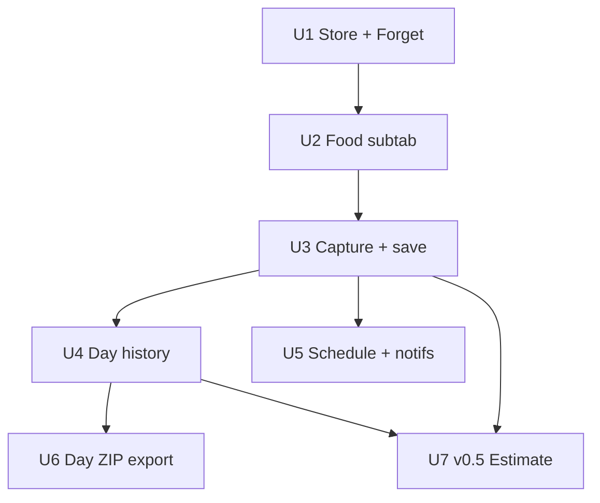
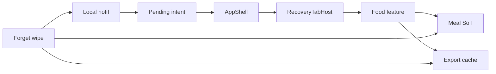

# feat: Food logging photo AI (v0 habit → v0.5 estimate)

## Summary

Ship a dedicated Food feature under Recovery as **Vitals | Sleep | Food**, delivering the PRD in two product phases: **v0 habit logger** (schedule, local reminders, photo-required save with optional name/note/kcal, day history, sibling day-food ZIP export) then **v0.5 cloud approximate estimate + edit/confirm** after ~7 days of dogfood. Implementation follows store + Forget wipe first, then IA shell, capture, history, reminders/deep-link, export — with AI only after the habit rail is real.

---

## Problem Frame

Athletes using Fitness OS can train and sleep better but still lack in-app intake visibility for unweighed home-cooked meals. The PRD locks habit capture before AI so logging is never blocked on network or estimates (see origin: `docs/brainstorms/2026-09-05-food-logging-photo-ai-prd.md`).

---

## Requirements

### Schedule & reminders (v0)

- **R1–R4 / US-01:** Meal slots + local times; pre-meal local notifications (configurable lead; **default 15 min**); notification opens Food capture (or Food home if camera unavailable); pause/disable without deleting meals

### Capture & offline save (v0)

- **R5, R5a, R9, R10a / US-02a:** Camera or gallery photo required; name/note/kcal optional; offline save (no network/AI in v0)

### Day history (v0)

- **R11–R12 / US-03:** Day list with thumbnails; kcal when present; daily total only sums meals with kcal (label incomplete); edit/delete

### Day export (v0)

- **R13–R15 / US-04:** Owner-initiated day export of meals + images + metadata via share sheet; sensitive health-data care parity with app-data export

### AI approximate (v0.5)

- **R6–R8, R10 / US-02b:** Cloud approximate kcal (+ optional macros later); approximate copy; confirm/edit before confirmed totals; AI failure keeps photo / allows manual

### Explicit non-goals

- **R16–R19:** No Recovery coaching; no local train/fine-tune; Food is Recovery subtab only; Food works without Sleep/Vitals data

**Origin flows:** F1 schedule setup, F2 pre-meal log, F3 missed/late log, F4 day export, F5 AI approximate + confirm  
**Origin acceptance:** US-01, US-02a, US-03, US-04 (v0); US-02b (v0.5)

---

## Scope Boundaries

### Deferred for later (from origin)

- Recovery next-day coaching / eat-less nudges
- Local VLM / on-device fine-tune on corrected logs
- Barcode / restaurant DB as primary path
- Weighing / Bluetooth scale
- Multi-user / cook-facing UI
- Clinical nutrition claims / opaque nutrition scores
- Third-party Cal AI as dependency

### Outside this product's identity (from origin)

- MyFitnessPal-style search-heavy database logger as the primary path
- Clinical / medical nutrition precision product

### Deferred to Follow-Up Work

- Stuffing meal photos into the full diagnostic app-data JSON dump (optional later allowlist / `knownOmissions` stamp only)
- Exact-alarm (`SCHEDULE_EXACT_ALARM`) meal reminders
- “Assign to yesterday” late-log day picker
- Quiet hours UX polish beyond a simple default lead time
- Macros beyond kcal in v0.5 (kcal-first per origin Q5)

---

## Context & Research

### Relevant Code and Patterns

- Recovery IA: `lib/features/vitals/presentation/view/recovery_tab_host.dart`, `lib/features/vitals/presentation/widgets/recovery_subtabs.dart` (`RecoverySubtab { vitals, sleep }` → add `food`); segment chrome mirrors `lib/features/workout_history/presentation/widgets/sport_tabs.dart`
- Feature scaffold: `./create_feature.sh food` → `lib/features/food/{presentation,domain,data}` + DI; `ONBOARDING.md`
- Persistence: SharedPreferences summaries + side-files under `getApplicationSupportDirectory()`; `GateAPrefs` key/dir registration; `CanonicalSwimStore` / vitals HR series as blob templates; `StoreInvalidation` after Forget
- Forget compose: `lib/features/diagnostics/data/diagnostics_di.dart` (`onForgetWipeExtras` chains vitals clear + export prune — Food must **compose**, not overwrite)
- Day export pattern (sibling, not overload): `AppDataExportService` / coach settings confirm → private export cache → path-guard → `SharePlus`; schema docs in `docs/export/app-data-export-schema.md`
- Gemini (v0.5): `GeminiCoachClient` text-only today; reuse device-local key prefs + Dio + Sentry scrub; extend multimodal parts + structured JSON
- Gaps: no `image_picker` / camera, no `flutter_local_notifications`, no notification→tab deep-link queue, no food module

### Institutional Learnings

- No `docs/solutions/` tree; prior art is plans + learnings + export plan
- Export plan: never share SoT paths; prune export/share cache on Forget; confirm sensitivity; soft size warn ~25MB
- Swim orphan pitfall: register food photo wipe from day one
- Recovery honesty: no invented scores/coaching in Food v0/v0.5

### External References

- `flutter_local_notifications` + `timezone` + `flutter_timezone`: `zonedSchedule`, `DateTimeComponents.time`, prefer `AndroidScheduleMode.inexactAllowWhileIdle`
- `image_picker`: Photo Picker (avoid broad `READ_MEDIA_*`); copy out of cache; `retrieveLostData`
- `archive` + `share_plus`: single ZIP share more reliable than multi-`XFile` for ChatGPT QA
- Android 14 exact-alarm policy: meal nudges should not require exact alarms by default

---

## Key Technical Decisions

| Decision | Choice | Rationale |
|----------|--------|-----------|
| Feature boundary | New `lib/features/food/` module | Matches ONBOARDING feature layout; keeps Recovery host thin; independent of Gate A / VitalsBloc (R19) |
| IA | Extend `RecoverySubtab` + host `IndexedStack` with Food | Locked in origin R18; not a fourth bottom-nav item |
| Photo capture | `image_picker` (camera + gallery) | Enough for meal snaps; avoid full `camera` package until custom viewfinder needed |
| Photo SoT | App-support side-files `food/meals/{dayKey}/{mealId}.jpg` + lean meal index (prefs or JSON side-file) | Mirrors vitals/swim blob pattern; picker paths are temporary |
| Save rule | Photo required; name/note/kcal optional; offline | Origin R5a / R10a |
| Late-log day | Local calendar day of capture | Confirmed at plan synthesis; no yesterday picker in v0 |
| Schedule gate | Logging allowed before schedule setup; soft CTA | Confirmed at plan synthesis |
| Reminders | Local inexact `zonedSchedule` + payload route + boot receivers + cold/warm launch queue | Greenfield; exact alarms unnecessary for ±few-min meal nudges |
| Deep link | Notification payload → single pending `FoodCaptureIntent` slot (coalesce; not a multi-intent queue) consumed when shell + Recovery + Food ready | `AppShell.selectTab` exists but no host Food API today; cold start is the failure mode |
| Day export | Sibling ZIP: `manifest.json` + `images/*` under peer cache dir (e.g. temp/`day_food_exports/`), **not** nested under app-data `exports/` | Locks origin Q7; avoids app-data prune wiping food ZIPs; never SoT paths |
| Kcal fields | v0: optional `kcal` (manual). U7: add `aiSuggestionKcal`; treat manual/`kcal` as `confirmedKcal`; daily totals + export use confirmed/manual only — drafts never count | Prevents v0/v0.5 naming drift |
| EXIF | Strip/re-encode on ingest before SoT; same for ZIP copies and v0.5 upload | Avoid GPS/device metadata leaving device |
| Estimate consent | Explicit Estimate tap + confirm **each** send (dogfood) | Locks planning-lock ambiguity of first-vs-each |
| Forget wipe site | Extend the **last-writer** body in `diagnostics_di` (vitals clear → app export prune → food clear → food export prune); never assign a parallel wipe from `food_di` alone | `onForgetWipeExtras` is overwrite-by-assignment today; a food-only setter silently drops vitals/export wipe (or vice versa) |
| Forget busy gate | OR `foodExportInFlight` into the same diagnostics `isForgetBlocked` assignment (`vitalsSync \|\| appDataExport \|\| foodExport`) | Same overwrite hazard as wipe |
| Forget verify | Residue check must fail if food prefs/index or `food/meals/` files remain (not prefs-only) | Swim side-file orphans prove dir residue can survive prefs wipe |
| Deep link contract | Pending `FoodCaptureIntent` consumed by Recovery host; Sleep remains default when no intent | `selectTab(Recovery)` alone leaves Sleep selected |
| StoreInvalidation | Food listens to existing bus; wipe completes before notify (pairing already wipe-then-onForgot) | Stale Food UI after Forget if no listener |
| Reminder teardown | Forget and reminder-pause cancel scheduled IDs and clear pending intent | Avoid post-wipe notification reopening capture |
| v0.5 AI | Reuse Gemini key plumbing; multimodal + structured draft; store suggestion vs confirmed; edit-before-confirm | Origin R6–R8, Q1 deferred to dogfood, Q4 both stored |
| Trust boundary | Meal SoT + index + reminder prefs + Gemini key stay local; only intentional egress is owner ZIP share (v0) and explicit Estimate upload (v0.5) | Health-adjacent PII; no background upload |
| Diagnostic dump | Do not embed meal photos in app-data export in this plan | Prefer sibling day-food package (origin Dependencies) |

---

## Open Questions

### Resolved During Planning

- **Plan coverage:** One Deep plan with Phased Delivery for v0 + v0.5 (user confirmed)
- **Q7 export format:** ZIP + JSON manifest + images
- **Late-log day:** Capture local day only
- **Pre-schedule logging:** Allowed with soft CTA
- **Reminder precision:** Inexact local notifications (no exact-alarm Play path in v0)
- **Capture package:** `image_picker` over `camera`
- **Same-slot duplicates:** Allow multiple meals per slot; do not auto-suppress reminder after first log (tune after metrics)
- **Food export busy gate:** Block on Forget + food export in-flight (not full watch sync) unless implementation discovers shared-store contention
- **Edit photo:** Allow replace (new file, delete previous) and delete meal (remove metadata + file)

### Deferred to Implementation

- Exact notification copy (origin Q8) — follow Fathom tone in UI strings pass
- Image compression quality / max dimension for SoT vs v0.5 upload (affects ZIP size and API cost)
- Whether meal index lives in SharedPreferences vs a single JSON side-file (choose when store unit lands)
- Gemini model ID pin for v0.5 after dogfood (origin Q1); optional short bake-off vs nutrition APIs
- Quiet hours beyond default lead time (origin Q3) — ship configurable lead (default 15 min); quiet hours optional polish
- Image retention policy beyond Forget wipe (origin Q6) — **decision still open:** indefinite vs N-day image TTL (metadata longer)
- After logging a slot today, suppress that slot’s reminder vs keep firing (fatigue vs multi-meal)
- Whether v0 needs an explicit “paste kcal after ChatGPT QA” write-back — Success Metrics now treat export as external QA only
- iOS `NSURLIsExcludedFromBackupKey` if iOS ship becomes real (Android already `allowBackup=false`)

---

## Output Structure

```text
lib/features/food/
  data/
    di/food_di.dart
    food_meal_store.dart
    food_notification_scheduler.dart   # with schedule prefs
    food_day_export_service.dart
    food_estimate_client.dart          # Phase B only
  domain/
    models/...
  presentation/
    view/food_tab_screen.dart
    view/food_capture_route.dart
    view/food_schedule_route.dart
    widgets/...
test/features/food/
  ...
docs/export/day-food-export-schema.md
```

---

## High-Level Technical Design

> *This illustrates the intended approach and is directional guidance for review, not implementation specification. The implementing agent should treat it as context, not code to reproduce.*

```mermaid
flowchart TB
  subgraph shell [App shell]
    AS[AppShell Recovery tab]
    DL[Pending FoodCaptureIntent queue]
  end
  subgraph recovery [RecoveryTabHost]
    ST[Vitals | Sleep | Food]
    FT[FoodTabScreen]
  end
  subgraph food [Food feature]
    CAP[Capture: image_picker → copy SoT]
    STORE[Meal store + schedule prefs]
    NOTIF[Local notification scheduler]
    EXP[Day ZIP export cache]
    AI[v0.5 estimate client]
  end
  NOTIF -->|payload warm/cold| DL
  DL --> AS
  AS --> ST
  ST --> FT
  FT --> CAP
  CAP --> STORE
  FT --> EXP
  CAP -.->|v0.5| AI
  AI -->|draft only| CAP
  Forget[Forget wipe extras] --> STORE
  Forget --> EXP
```

**v0 save integrity (directional):** copy/compress image into SoT path → write meal record referencing that path → on failure, delete orphan file or mark incomplete; never invent kcal.  
**Notification handoff (directional):** persist one pending intent (slot + localDay); coalesce duplicates; consume after Recovery mounts Food; if camera unavailable, open Food home (R3).

---

## Phased Delivery

### Phase A — v0 Habit logger (ship + dogfood ~7 days)

Units **U1–U6**. Success for the **habit rail:** photos logged most days (≥2/day target) and ≥1 day export used within ~7 days. Full eval window for origin habit metric (≥2 meals on ≥10 of 14 days) may continue past the U7 calendar gate. Reminders (U5) ship in Phase A but are not required for the 7-day dogfood gate if capture+export already stick.

### Phase B — v0.5 Approximate (after dogfood)

Unit **U7**. Gate: owner has real meal photos from Phase A dogfood; then cloud estimate + edit/confirm. Provider choice (Gemini vs other) finalized at start of U7.

---

## Implementation Units



### U1. Food store + Forget wipe

**Goal:** Persist meal metadata and photos under app-support; wipe+verify on Forget; expose reload via `StoreInvalidation`.

**Requirements:** R5a, R10a, R19 foundation; Forget residue privacy (see Key Technical Decisions)

**Dependencies:** None

**Files:**
- Create: `lib/features/food/data/food_meal_store.dart`, `lib/features/food/data/di/food_di.dart`, lean domain models under `lib/features/food/domain/` (prefer concrete store over heavy repository interfaces unless tests need a seam)
- Modify: `lib/features/device_pairing/domain/gate_a_prefs.dart` (keys/dir names), **`diagnostics_di.dart` last-writer wipe/busy body only** (food_di must not assign wipe alone), extend Forget **verify** in pairing to fail if food prefs or `food/meals/` files remain, feature registration in app injector
- Test: `test/features/food/data/food_meal_store_test.dart`

**Approach:**
- Scaffold feature via `./create_feature.sh food` if useful
- Side-file layout `food/meals/{dayKey}/{mealId}.jpg` + lean index
- Save integrity: write JPEG to temp name in SoT dir → rename to final → only then commit index; on failure delete orphans; never index a missing path; replace photo = new file → index → delete old
- Startup orphan sweep: delete unreferenced files under `food/meals/**`; drop/mark index rows whose file is missing
- `clearLocal()` deletes prefs/index + meal dirs + cancels reminder IDs when scheduler exists; extend **diagnostics** wipe body (last writer), do not set wipe solely from `food_di`
- Forget verify fails closed if food prefs or meal files remain
- Busy: OR `foodExportInFlight` into diagnostics `isForgetBlocked` once U6 exists

**Patterns to follow:**
- `CanonicalSwimStore` / vitals repository `clearLocal`
- Diagnostics DI wipe composition (vitals → export prune → food)

**Test scenarios:**
- Happy path: save meal with photo path + optional empty kcal → reload returns meal; daily total ignores empty kcal
- Edge case: delete meal removes metadata and photo file; empty day dirs pruned
- Error path: kill after copy before index → no dangling meal row; orphan file cleaned on next load
- Error path: replace photo crash mid-way → index never points at missing file
- Integration: Forget wipe empties food dirs and prefs; verify residue check fails if JPEGs remain
- Integration: DI composition still clears vitals + app export cache + food (overwrite regression)

**Verification:** Forget after logging leaves no meal photos/prefs; store reload after `StoreInvalidation` is empty; planted orphan JPEG is swept on load.

---

### U2. Recovery Food subtab shell

**Goal:** Add Food as third Recovery subtab with a Food home that does not depend on Vitals/Sleep data.

**Requirements:** R18, R19, US-03 entry surface

**Dependencies:** U1 (DI registered; empty home OK)

**Files:**
- Modify: `lib/features/vitals/presentation/widgets/recovery_subtabs.dart`, `lib/features/vitals/presentation/view/recovery_tab_host.dart`
- Create: `lib/features/food/presentation/view/food_tab_screen.dart` (empty/list placeholder)
- Test: `test/features/vitals/presentation/recovery_tab_host_test.dart` (extend), `test/features/food/presentation/food_tab_screen_test.dart`

**Approach:**
- Extend `RecoverySubtab` with `food`; IndexedStack index 2
- Food body is feature-owned; host stays chrome + subtab state
- Default subtab remains Sleep (unchanged) unless a pending Food intent forces Food (U5)
- Soft CTA on empty state: “Log meal” and “Set meal times”

**Patterns to follow:**
- Existing `RecoverySubtabs` / `SportTabs` chrome
- Embedded vitals/sleep screens under host Scaffold

**Test scenarios:**
- Happy path: selecting Food shows Food home; Vitals/Sleep still switch correctly
- Edge case: Food home renders without Gate A / without vitals data
- Integration: host IndexedStack length 3; existing recovery tests updated

**Verification:** Manual Recovery → Food opens without requiring watch sync.

---

### U3. Photo capture + optional fields save

**Goal:** Log meal via camera/gallery with optional name/note/kcal; photo required; fully offline.

**Requirements:** R5, R5a, R9, R10a; F2, F3; US-02a

**Dependencies:** U1, U2

**Files:**
- Create: `lib/features/food/presentation/view/food_capture_route.dart` (+ widgets); register from `RouteRegistry.registerAll()` mirroring `SleepDetailRoute` / `CoachSettingsRoute`
- Modify: Android manifest (`CAMERA` only; avoid broad media perms), iOS Info.plist usage strings even if Android-first
- Add deps: `image_picker` in `pubspec.yaml`
- Test: `test/features/food/presentation/food_capture_test.dart`, store integration tests

**Approach:**
- `ImagePicker` camera/gallery → copy/compress **and strip EXIF / re-encode** into meal SoT → form for optional fields → save via U1 store
- Allow log before schedule; optional slot tag for late/missed (F3); day = local capture calendar day (**note:** post-midnight late dinners can land on the wrong diagnostic day until a later reassignment UX — v0 day totals are habit-first, not balance-diagnosis-grade)
- `retrieveLostData` on startup after camera intents
- Permissions: request camera at capture time; gallery via Photo Picker (no `READ_MEDIA_*`)

**Execution note:** Implement save contract test-first (photo-only save, optional kcal, no invented daily total).

**Patterns to follow:**
- Sleep named push routes with typed args
- Export/coach settings confirm patterns for destructive/sensitive copy only where needed

**Test scenarios:**
- Happy path: Covers US-02a photo-only save → meal on today with photo; kcal empty; daily total does not invent calories
- Happy path: Covers US-02a optional manual kcal/name/note stored
- Edge case: late log with optional slot tag still saves to capture local day
- Error path: camera denied but gallery works; both denied → no empty meal row
- Error path: user cancels picker → no meal created
- Integration: kill mid-write does not leave permanent dangling meal without photo (cleanup or recoverable state)

**Verification:** From Food home, Log meal → save photo-only offline → appears on today list (U4 may be stub list on Food home until U4 fleshes UI).

---

### U4. Day history (today + past day for export)

**Goal:** Review meals by day with thumbnails, kcal when present, incomplete daily total labeling; edit/delete; enough past-day browse for export dogfood.

**Requirements:** R11, R12; US-03; enables F4 selected day

**Dependencies:** U3

**Files:**
- Modify: `lib/features/food/presentation/view/food_tab_screen.dart`, meal row/edit widgets
- Create: day selector or simple previous-day navigation
- Test: `test/features/food/presentation/food_day_history_test.dart`

**Approach:**
- Today-first UX; minimal day switcher (not a full calendar product)
- Daily total = sum of meals with kcal only; copy when any meal lacks kcal (“kcal pending” / incomplete)
- Edit: name/note/kcal/slot; replace photo; delete meal
- After Forget, list empty via invalidation

**Patterns to follow:**
- Sleep list/card patterns under Recovery
- Blueprint tokens / existing list chrome

**Test scenarios:**
- Happy path: Covers US-03 day list — thumbnails, kcal when present, incomplete total labeling, edit/delete
- Edge case: all meals kcal-empty → incomplete label, not invented `0` total presented as complete
- Edge case: empty day state with CTA to log
- Integration: switch to past day shows that day’s meals only

**Verification:** Multiple meals today + one past day browseable; edit/delete persist.

---

### U5. Meal schedule + local notifications + deep-link queue

**Goal:** Configure meal slots/times; schedule inexact local reminders; notification opens Food capture for slot (or Food home); pause without losing history.

**Requirements:** R1–R4; F1; US-01

**Dependencies:** U2, U3 (capture target exists)

**Files:**
- Create: schedule UI route, schedule prefs + `food_notification_scheduler.dart`, single pending `FoodCaptureIntent` holder (GetIt or similar; coalesce by slot+localDay)
- Modify: `lib/app/bootstrap.dart` (or equivalent) for `tz.initializeTimeZones()` + `flutter_timezone` + plugin init; `lib/app/shell/app_shell.dart` (reach `selectTab` via agreed key/DI); `recovery_tab_host.dart` public API to select Food + open capture; AndroidManifest receivers/`POST_NOTIFICATIONS` runtime request after opt-in
- Add deps: `flutter_local_notifications`, `timezone`, `flutter_timezone`
- Test: `test/features/food/data/food_notification_scheduler_test.dart`, `test/features/food/presentation/food_schedule_test.dart`, shell/host deep-link tests with fakes

**Approach:**
- Slots: breakfast/lunch/dinner + optional snacks; lead **default 15 min** (configurable); enable/pause reminders
- `zonedSchedule` + `DateTimeComponents.time` + `inexactAllowWhileIdle`; stable notification IDs per slot; reschedule on edit / timezone refresh / boot
- Runtime notification permission only after user enables reminders; if denied, keep schedule, explain no pushes
- Payload treated as untrusted: whitelist slots, validate localDay; single pending slot coalesce; cold start via `getNotificationAppLaunchDetails`; warm via response callback
- Handoff: `selectTab(Recovery)` **and** Recovery host selects Food + opens capture (or Food home if camera unavailable); Sleep remains default when no pending intent
- Reminder copy: slot/time only (no meal names/notes); private lock-screen visibility
- Pause reminders and Forget both cancel scheduled IDs and clear pending intent (history intact on pause)
- Logging before schedule remains allowed

**Patterns to follow:**
- Plugin README manifest receivers; existing `AppShellState.selectTab` + new host intent consumer

**Test scenarios:**
- Happy path: Covers US-01 — save schedule → notifications scheduled for slots; disable reminders without losing meals
- Edge case: permission denied → schedule saved, reminders off with clear UX
- Edge case: second notification tap while capture open → single capture, no duplicate meal
- Edge case: no pending intent → Recovery still defaults to Sleep
- Integration: cold start from breakfast notification lands Food capture with slot (not default Sleep)
- Integration: warm start from Workouts tab switches to Recovery → Food → capture
- Integration: Forget cancels prior slot notification IDs and clears pending intent

**Verification:** Enable reminders → fire/test notification → lands on capture with slot; pause stops future schedules; meals remain; Forget stops stale reminder fires.

---

### U6. Day-food ZIP export

**Goal:** Owner-initiated export of a selected day’s meals + images as a shareable ZIP for ChatGPT QA.

**Requirements:** R13–R15; F4; US-04

**Dependencies:** U4 (day selection), U1 (SoT)

**Files:**
- Create: `lib/features/food/data/food_day_export_service.dart`, `docs/export/day-food-export-schema.md`
- Modify: Food UI export action + confirm copy; Forget wipe to prune food export cache; optionally stamp diagnostic `knownOmissions` that meal photos are not in app-data dump
- Add dep: `archive` (if not present)
- Test: `test/features/food/data/food_day_export_service_test.dart`, UI share-seam tests with overrides

**Approach:**
- Dedicated food export cache dir peer to app-data exports (e.g. temp/`day_food_exports/`), **never** nested under `exports/` (app-data prune deletes that tree recursively)
- Blocking confirm before assemble (parity with coach settings): sensitive health data; ZIP is plaintext; cancel = no write/share; copy notes shared copies may outlive cache prune
- Assemble: `manifest.json` + `images/{mealId}.jpg` copies only (optional in-ZIP README is follow-up polish, not required)
- Path-guard before share; soft size warn ~25MB; prune food export cache after successful share and on Forget / next launch
- Empty day (zero meals): disable export
- Missing image: `photoStatus: absent|corrupt`, omit bytes, never fall back to SoT URI
- Busy: `foodExportInFlight` for assemble→share; OR into diagnostics `isForgetBlocked`; late share after Forget race must refuse

**Patterns to follow:**
- `AppDataExportService` + coach settings `_onExportTapped` confirm / path-guard / `ShareParams`

**Test scenarios:**
- Happy path: Covers US-04 — export day with images + metadata → shareable ZIP from cache path after confirm
- Edge case: meal with empty kcal still included; kcal field absent/null in manifest
- Error path: missing image → `photoStatus` flagged omit, share from cache only
- Error path: path outside food export cache refused (including SoT meal paths)
- Integration: Forget after export clears food export cache and share residuals
- Integration: Forget while export in flight is blocked

**Verification:** Export a logged day → share sheet receives one ZIP → unzip shows manifest + images; SoT meal files untouched.

---

### U7. v0.5 Approximate estimate + edit/confirm

**Goal:** After dogfood gate, add cloud photo estimate with approximate copy and mandatory edit/confirm; AI failure never drops the photo.

**Requirements:** R6–R8, R10; F5; US-02b

**Dependencies:** U3, U4 (and dogfood ~7 days of real logs — product gate, not code dep)

**Files:**
- Create: `lib/features/food/data/food_estimate_client.dart` (separate from `GeminiCoachClient`; reuse `GateAPrefs.geminiApiKey` + Dio + Sentry scrub), estimate/confirm UI on capture and on existing meal
- Modify: meal model `aiSuggestionKcal` vs `confirmedKcal` (migrate v0 `kcal` → confirmed); Food UI copy “approximate”
- Test: `test/features/food/data/food_estimate_client_test.dart`, `test/features/food/presentation/food_estimate_confirm_test.dart`

**Approach:**
- Finalize provider at unit start (default posture: Gemini multimodal + structured JSON); short bake-off allowed against real dogfood photos
- Explicit Estimate + confirm **each** send; no silent auto-upload
- Validate AI JSON before draft persist (typed fields, clamp kcal, length-cap text); invalid = soft-fail like network failure
- Draft values never enter daily totals until confirm; always editable
- Failed/offline estimate → manual kcal or empty; photo retained
- Cap/resize + EXIF-stripped upload; client rate cap per day; document key-compromise blast radius (BYOK dogfood)
- Feature-flag or settings toggle so v0 builds stay habit-only until ready

**Execution note:** Contract tests for draft-vs-confirmed and failure fallback before wiring live API.

**Patterns to follow:**
- `GeminiCoachClient` key + Dio + invent-guard mindset → edit-before-confirm
- Origin honesty: approximate copy; no coaching

**Test scenarios:**
- Happy path: Covers US-02b — AI returns draft → user edits/confirms → confirmed kcal saved distinct from suggestion
- Happy path: estimate on previously photo-only meal backfills confirmed kcal
- Error path: Covers US-02b AI failure — manual or empty save; photo kept
- Edge case: user abandons estimate mid-flow → meal remains photo-only
- Integration: daily total uses confirmed/manual only, never raw unconfirmed suggestion

**Verification:** Estimate → edit → confirm updates day total; failure path still shows photo in history.

---

## System-Wide Impact

- **Interaction graph:** Recovery host subtabs; AppShell tab selection; notification launch callbacks; Forget wipe extras + `isForgetBlocked` composition in `diagnostics_di` (last writer); Food `StoreInvalidation` listener; optional diagnostic `knownOmissions`; Gemini key prefs shared with coach
- **Error propagation:** Capture/export failures stay user-visible in Food; never crash shell; AI errors soft-fail to manual/empty; Forget fail-closed if food residue remains
- **State lifecycle risks:** Mid-save orphans (temp→rename→index); replace-photo ordering; notification pending-intent races; export cache growth; DST/timezone reschedule; wipe must cover prefs + SoT + food export cache + share_plus leftovers + cancel reminder IDs; Food UI must reload empty after Forget without remount
- **API surface parity:** Android-first; still add iOS usage strings when adding picker/notifications packages
- **Integration coverage:** Cold-start notification → Recovery + Food + capture (not Sleep); Forget mid-export blocked; DI wipe still clears vitals+export+food; ZIP path-guard rejects SoT; photo-only totals
- **Privacy egress:** Only owner-confirmed ZIP share and (v0.5) explicit Estimate upload leave the device; no Sentry meal text/photo bytes; Photo Picker only (no `READ_MEDIA_*`)
- **Unchanged invariants:** Bottom nav stays Home | Recovery | Workouts; Sleep default subtab when no Food intent; app-data diagnostic export schema unchanged except optional omission note; no Recovery coaching from Food



---

## Risks & Dependencies

| Risk | Likelihood | Impact | Mitigation |
|------|------------|--------|------------|
| Habit without kcal feels useless | Med | Med | Export→ChatGPT path; optional manual kcal; clear “AI coming” framing (origin) |
| Reminder fatigue / OEM delay | Med | Med | Inexact OK; easy pause; measure reminder→log later |
| Cold-start deep link lands on Sleep | Med | High | Pending intent + host Food consume; Sleep default when no intent (U5) |
| Forget leaves meal JPEG/index residue | Med | High | U1 wipe prefs + `food/meals/` + export caches; verify fails on residue |
| DI overwrite drops vitals or food wipe | Med | High | Append-only last-writer body in `diagnostics_di`; composition test |
| Mid-save / replace orphans or dangling index | Med | High | Temp→rename→index; no meal row without resolvable photo; startup orphan sweep |
| Export missing image → crash or SoT share | Med | High | Manifest `photoStatus`; cache copies only; path-guard |
| Play policy media permissions | Med | High | Photo Picker only; strip transitive `READ_MEDIA_*`; no broad gallery grant (see Privacy trust boundaries) |
| ZIP too large for share | Med | Low | Compress SoT images; soft-warn ~25MB |
| Photo AI weak on thalis / oil (v0.5) | High | Med | Edit-before-confirm; approximate copy; export QA |
| API cost/latency (v0.5) | Med | Med | Resize uploads; explicit estimate action; budget |
| Coach-before-habit anti-pattern | Low | High | Phase B gated; R16 out of scope |
| Meal photos leave device via share/AI without clear consent | Med | High | Local-first SoT; blocking confirm on day ZIP + on first/estimate upload; cancel skips assemble/network (mirror app-data export) |
| Sentry / logs leak meal PII or photo bytes | Med | High | Extend scrub + instrumentation forbid list: meal names/notes, kcal, image paths/bytes, estimate prompts/responses; tags/counts only |
| Post-share / post-Gemini copies out of app custody | High | Med | Confirm copy: prune ≠ revoke; ChatGPT/Gemini retention is recipient policy; no silent re-upload |
| Silent gallery auto-estimate or background sync of meal photos | Low | High | Explicit owner tap only (export or Estimate); v0 offline; no background photo upload job |
| Manifest/ZIP includes secrets or SoT paths | Low | High | Day-food package: meal metadata + image copies under export cache only; never `gemini_api_key` (already omitted from app-data export); never share SoT URIs |

### Privacy trust boundaries (planning lock)

**Must stay on device (default):**
- Meal photo SoT files under app-support (no-backup posture; Android `allowBackup=false` already; iOS exclude-from-backup if/when iOS ships)
- Meal index prefs (name, note, optional/manual/confirmed kcal, slot, timestamps, AI draft fields)
- Reminder schedule prefs
- Device-local Gemini API key (prefs; never in ZIP, never in Sentry, never in day-food manifest)
- Diagnostic app-data JSON dump stays photo-free (`knownOmissions` stamp: meal photos not embedded)

**Leaves device only when owner initiates:**
| Path | Payload | Gate |
|------|---------|------|
| **v0 day ZIP → share sheet → ChatGPT (or other target)** | That day’s meal images + structured metadata (name, note, kcal if any, timestamps, slot; later AI-vs-confirmed) | Blocking confirm before assemble; path-guard share from export cache only |
| **v0.5 Estimate → cloud Gemini multimodal** | Resized/capped image bytes + minimal prompt for structured kcal JSON | Explicit Estimate action + confirm (or clear “sends photo to Google/Gemini” copy) before first send / each send if product prefers; never auto on save |
| **Sentry** | Crash/perf envelopes only | Never meal bodies, photo bytes, or free-text meal notes; `gemini_api_key` already scrubbed — keep that invariant |

**Does not leave device in this plan:** background sync of meal photos; embedding photos in app-data export; analytics/marketing SDKs for food; silent gallery crawl.

---

## Success Metrics

Carry origin metrics:

- **v0 habit rail (7-day dogfood gate):** photos logged (≥2/day target on most days) + ≥1 day export in first 7 days; median time-to-save &lt;45–60s
- **v0 habit eval (14-day window):** ≥2 meals logged on ≥10 of 14 days (origin primary)
- **Visibility (honest split):** v0 may leave many meals kcal-empty; in-app energy totals are not the Phase A success bar — export is external QA, not automatic write-back. Manual kcal entry remains the in-app path until U7
- **Reminder→log %:** define once notifications ship
- **v0.5:** discard rate &lt;20%; track edit rate; owner trust weekly trend yes/no after 14 days with AI

---

## Dependencies / Prerequisites

- Flutter packages: `image_picker`, `flutter_local_notifications`, `timezone`, `flutter_timezone`, `archive` (+ existing `share_plus`, `path_provider`, `shared_preferences`)
- Android: runtime `POST_NOTIFICATIONS` on reminder opt-in; `CAMERA`; boot/schedule receivers per plugin README
- v0.5: device-local Gemini (or chosen) API key; multimodal generateContent
- Product gate: ~7 days dogfood before U7

---

## Documentation Plan

- Add `docs/export/day-food-export-schema.md` in U6
- Update Recovery IA mentions in onboarding/architecture docs when Food ships (brand docs lag noted in research)
- After ship, consider a `docs/solutions/` note for notifications + day-food export (tree currently absent)

---

## Operational / Rollout Notes

- Ship Phase A (U1–U6) to dogfood users first; keep estimate behind flag/settings until U7
- No auto-upload of meal photos; outbound only on owner estimate/export
- Reminder channel: create once; document that channel sound settings are immutable after create on Android

### Privacy / security ops (v0 → v0.5)

**Local-first storage**
- Meal photos + index live only under app-private storage; treat as health-adjacent sensitive data (same care class as biometrics export).
- Rely on existing Android `allowBackup=false`; do not introduce backup-eligible meal dirs. If iOS becomes real, set `NSURLIsExcludedFromBackupKey` on meal SoT + food export cache (already noted under deferred iOS).
- Forget wipe must delete prefs + SoT photos + food export cache + share residuals (U1/U6); verify empty after wipe.

**Confirm dialogs (parity with app-data export)**
- **Day ZIP export:** Blocking confirm before assemble. Body must state: meal photos and notes leave the device via the share target; package is not anonymized; pruning the export cache does not revoke copies already shared (ChatGPT/Files/etc. may retain). Cancel → no ZIP assemble, no share.
- **v0.5 Estimate:** Explicit owner action; confirm (or equally clear one-shot disclosure) that the meal photo is sent to the cloud provider (Gemini) for approximate kcal only; draft never becomes daily total until edit/confirm. Cancel/abandon → no network (or abort in-flight); photo stays local.
- Trust model (v0 dogfood): unlocked-device possession + confirm is sufficient authorization (same as app-data export); no Gate A / biometric gate required on Food export/estimate.

**Play Photo Picker / media permissions**
- Gallery: Android Photo Picker / `image_picker` system picker only — **no** `READ_MEDIA_IMAGES` / `READ_MEDIA_VIDEO` / broad storage permission in the Food feature or merged manifest from transitive deps (strip if a dependency adds them).
- Camera: request `CAMERA` at capture time only; do not imply gallery full-access.
- After pick/capture: copy into app-private meal SoT; do not keep long-lived URIs into shared media collections as the durable store.
- Release checklist: APK permission audit before Play upload; fail the unit if `READ_MEDIA_*` reappears.

**Logging & redaction**
- Instrumentation may log: meal counts, day keys, estimate status enums, latency, resize dimensions, export size class — never image bytes, Base64, file contents, meal name/note free text, or full local paths that embed user content.
- Sentry: extend forbidden list (and scrub tests) for food: meal note/name strings, photo attachments, estimate request/response bodies; keep `gemini_api_key` / `geminiApiKey` scrub (already present). Prefer counts/tags over breadcrumbs that echo user text.
- Day-food ZIP / app-data export: never include API keys; day ZIP has no reason to touch `gemini_api_key`; app-data dump continues to omit it and does not embed meal photos (`knownOmissions`).
- Owner smoke after U6/U7: one intentional Sentry test event + one export — confirm no photo/PII in Sentry UI and no key material in ZIP/JSON.

**Outbound inventory (dogfood ops)**
- v0: share sheet is the only intentional photo egress; treat ChatGPT (or any share target) as third-party custody after handoff.
- v0.5: Gemini multimodal is second intentional egress; cap/resize before upload; no retry storms that re-send without user action.
- Monitor cost/latency separately from privacy; privacy regression = any upload without confirm or any meal media in Sentry.

---

## Alternative Approaches Considered

- **Fourth bottom-nav Food tab:** Rejected — origin R18 locks Recovery subtab
- **AI in v0:** Rejected — blocks habit on network; origin phased delivery
- **Overload app-data JSON export with photos:** Rejected — poor ChatGPT UX; origin prefers sibling day-food package
- **Multi-XFile share without ZIP:** Rejected — fragile on Android share targets; ZIP is one upload
- **Exact alarms for meal reminders:** Deferred — Play scrutiny; inexact sufficient for nudges
- **Co-locate Food only under `vitals/presentation`:** Rejected — weaker module boundary vs ONBOARDING feature package (host still owns subtab chrome)

---

## Sources & References

- **Origin document:** [docs/brainstorms/2026-09-05-food-logging-photo-ai-prd.md](docs/brainstorms/2026-09-05-food-logging-photo-ai-prd.md)
- Related plans: [docs/plans/2026-08-09-002-feat-recovery-sleep-detail-plan.md](docs/plans/2026-08-09-002-feat-recovery-sleep-detail-plan.md) (Food deferred), [docs/plans/2026-08-05-001-feat-app-data-json-export-plan.md](docs/plans/2026-08-05-001-feat-app-data-json-export-plan.md)
- Related code: `RecoveryTabHost`, `RecoverySubtabs`, `AppDataExportService`, `GeminiCoachClient`, `diagnostics_di.dart` Forget compose
- External: [flutter_local_notifications](https://pub.dev/packages/flutter_local_notifications), [image_picker](https://pub.dev/packages/image_picker), [share_plus](https://pub.dev/packages/share_plus), [archive](https://pub.dev/packages/archive), Android exact-alarm / Photo Picker policy docs
