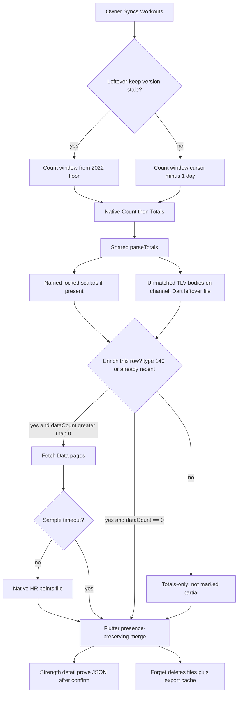
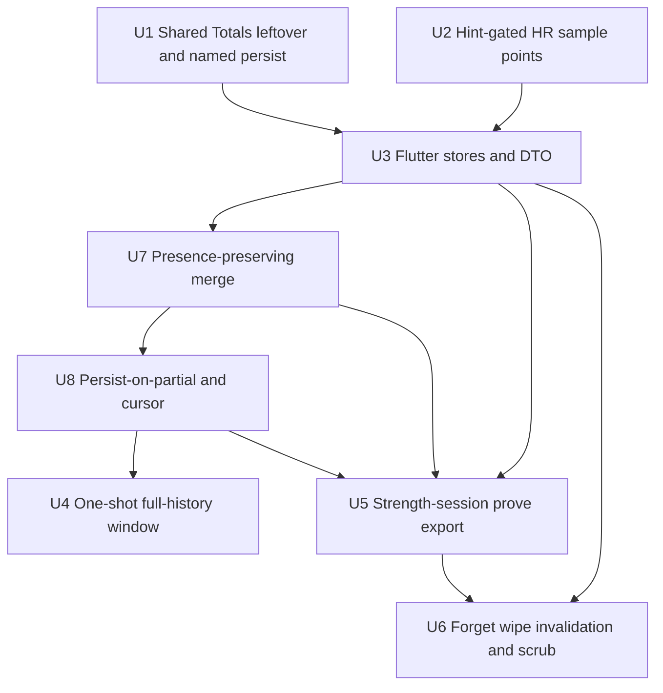

# feat: Persist and export GT5 strength session metrics

## Summary

Extend the shared workout parser and persist path so a GT5 strength session (`type=140`) keeps every locked Totals field that actually arrived, unnamed leftover Totals as on-device bytes, and in-session HR points when Count says sample pages exist. A one-shot full-history workout Sync re-pulls already-stored sessions so leftover-keep can land; a dedicated Strength-path prove dump of the opened session is the owner artifact. Existing session detail does not gain unconfirmed community tiles. Health stays closed.

---

## Problem Frame

Fathom already lists GT5 strength sessions with duration and active calories, but the shared Totals parser drops unmatched TLVs and Flutter drops native `partial_batch` maps, so a later strength analytics screen has no honest evidence. The watch recap may show heart rate, zones, load, training stress, recovery time, and a recovery-looking percent — none of which can be compared in Huawei Health without wiping the Fathom bind. This cut stops payload loss and yields one-session evidence. It does not close analytics if this session has no samples and no leftover percent. (see origin: `docs/brainstorms/2026-09-08-gt5-strength-session-metrics-requirements.md`)

---

## Requirements

**Fetch and persist**
- R1. Workout Sync must pull strength sessions without Huawei Health, including already-stored history via a one-shot full-history Count window so leftover-keep can land before export.
- R2. When Totals arrive, persist each **locked Totals** field that is present; omit if absent. Do not require every locked name to appear.
- R3. Unnamed leftover Totals payload must be persisted **on-device as opaque bytes** on the **shared** workout parser. Git, logs, Sentry, and fixtures record identity/length only.
- R4. Keep the existing hint-gated sample fetch. If those pages are fetched, persist HR sample **points** (not only page headers). Opaque Data-page bodies count as equivalent points until a GT5 capture promotes the bitmap layout (origin AE5).
- R5. If sample-page fetch times out or is partial, still persist Totals scalars and leftover bytes. Do not drop the session or treat missing samples as proof that locked Totals fields were absent.
- R6. Set/rep breakdown is not expected and must not be invented if absent.

**Session truth vs invent**
- R7. Existing session detail may show only already-true scalars: duration, calories, HR min/max peaks when decoded. Newly decoded community scalars stay in store + export until this session’s recap confirms the mapping.
- R8. Recovery % must not appear in product UI. A native leftover candidate, if found, is recorded in the prove dump — not as the watch’s figure until recap confirms it is session-scoped.
- R9. Time-in-zone minutes must not appear in product UI. Missing samples mean **unobserved this session**, not zero and not “watch does not send zones.”

**Export and Forget**
- R10. Owner can export the **opened** strength session from the Workouts strength path after a blocking sensitive-health confirm. Default is that session. All-sessions is an explicit extra action, not the default.
- R11. The dump includes decoded locked fields that were present, leftover **bytes**, Count hints, and fetched HR samples or an honest sample-fetch flag. Omit Huawei secrets, remembered MAC, and account id. Do not commit real exports to git.
- R12. Forget Device must delete leftover blobs, fetched sample pages, recovery-HR blobs, and the strength-export cache.

**Honesty**
- R13. Watch recap is the visual check. Huawei Health must not be opened.
- R14. A tile on the watch is not proof the field arrived over Bluetooth.
- R15. After one successful Totals pull, missing locked or prove fields are **unobserved this session**, not “GT5 strength never sends them.”
- R16. Companion bind loss is the same blocked/empty outcome as Totals fail — not a claim that load/recovery were absent.

**Origin actors:** A1 (owner-athlete), A2 (GT5-A07), A3 (Fathom companion)
**Origin flows:** F1 (prove fetch on the unsynced / re-pulled strength session)
**Origin acceptance examples:** AE1 (persist locked fields; detail unchanged), AE2 (Count says no pages → no force-fetch; zones unobserved), AE3 (leftover bytes in dump; no recovery % UI), AE4 (target-session Strength-path export after confirm), AE5 (samples in dump for offline zone reconstruction), AE6 (sample timeout keeps Totals + leftovers), AE7 (Totals fail / dropped session / bind loss → blocked/empty)

---

## Scope Boundaries

- No Huawei Health / HMS as oracle, SDK, or comparison path
- No strength-only parser fork
- No force-pull of empty Data/Pace when Count is zero
- No set/rep UI; no GPS / pace / swim rendered as strength truth
- No live HR overlay, iOS, or other-sports enrichment as part of this cut
- No inventing recovery % from recovery time; rolling Workout-status recovery / 7-day load is out
- No reconstructing or labeling zone minutes as the watch’s in product UI or as watch-truth in the dump
- No new strength analytics screen; existing detail does not gain load / training stress / recovery time / training points tiles
- No always-on “pull everything every tap” Sync (one-shot full-history only)
- Do not merge workout sample HR into daily minute HR

### Deferred to Follow-Up Work

- Origin deferred: swim-class strength analytics, in-app zone reconstruction, showing load/stress/recovery on detail after recap confirms, using load/recovery to plan tomorrow, a second strength session if this one has no samples and no leftover percent
- Wipe already-orphaned `workouts/canonical_swim/` on Forget (known hole; not required by this origin)
- Permanent owner-facing “always full-history” control (rejected in favor of one-shot)
- Promoting newly observed Totals tags into the Gate B wire-spec as **normative product truth** after the dump (this cut may persist-if-present and export; catalog promotion is a follow-up)

### Planning-confirmed origin expansions

These are not origin F1 as written; they were confirmed during planning and stay in this cut:

- One-shot full-history Count window so already-stored on-watch workouts can gain leftover-keep (origin said not to assume history is re-pulled)
- Canonical swim skip-if-thinner as completeness of that one-shot (Totals-only re-pull would otherwise clobber lap files)

---

## Context & Research

### Relevant Code and Patterns

- Shared Totals parser: `android/app/src/main/kotlin/com/example/fitness_os/huawei/HuaweiWorkoutSync.kt` (`parseTotals` has no unmatched-tag `else`; unmatched TLVs vanish. Swim/Data parsers already `recordUnknown` as id+len only.)
- Hint-gated enrich: same file (`enrichWorkout` — Swim then Data then Pace only when Count hints > 0). Native sample timeout already keeps Totals maps and returns `partial_batch` (`HuaweiWorkoutSyncTest`).
- Workout Data pages: headers only today (`WorkoutDataPageSummary`; test `parseWorkoutDataPage_readsHeaderSummaryWithoutSamples`). Sample bodies discarded.
- Flutter DTO: `lib/core/huawei/huawei_link.dart` (`WorkoutSummary.fromMap` / `toJson` drop `dataPages` and have no leftover field).
- Merge: `lib/features/workout_history/data/repositories/workout_history_repository_impl.dart` — replace-by-number; persist only on `ok`; `partial_batch` / `stuck` return Left and drop native maps. Contrast vitals `partial_batch` merge in `lib/features/vitals/data/repositories/vitals_repository_impl.dart`.
- Side-file SoT: `lib/features/workout_history/data/canonical_swim_store.dart`, vitals HR series under `GateAPrefs.dailyHrSeriesDir`. Register new dirs on `lib/features/device_pairing/domain/gate_a_prefs.dart`.
- One-shot wide window: `GateAPrefs.activitySyncImplVersion` (vitals). Do **not** bump `currentSwimSegmentParserVersion` (intentionally left at v2 with no full-history force). Native floor: `HuaweiWorkoutSync.FALLBACK_START_UNIX`.
- Target-scoped export: `lib/features/food/data/food_day_export_service.dart` (confirm, cache copy, Forget prune, `XFile` by path). Full dump: `lib/features/diagnostics/data/app_data_export_service.dart` (Coach Settings — not this CTA).
- Forget last-writer: `lib/features/diagnostics/data/diagnostics_di.dart` only. Food documents the overwrite hazard.
- Strength UI: `lib/features/workout_history/presentation/view/workout_history_screen.dart` (Strength tab), `workout_detail_screen.dart` (duration / calories / HR peaks; AppBar currently Reasoner settings).
- Invalidation: `lib/core/storage/store_invalidation.dart` — Home and Vitals listen; `WorkoutHistoryBloc` does not.
- Privacy: `lib/core/observability/sentry_privacy_scrub.dart`; `test/fixtures/huawei/README.md`; `docs/architecture/README.md` (clean-room, hint-gated fetch).

### Institutional Learnings

- No `docs/solutions/` tree. Standing rules live in `docs/architecture/README.md`, `ONBOARDING.md`, and Huawei wire-specs.
- Strength type **140** is on-device proven (N=1). Load / recovery-HR `0x66` / calories values on that POC log remain **unobserved**. Count hints for that session were not logged.
- Community tag **IDs** in `docs/plans/2026-07-18-002-feat-gt5-workout-data-catalog-plan.md` are planning seeds (load `0x0d`, aerobic `0x0e`, recoveryTime `0x11`, anaerobic `0x20`, trainingPoints `0x63`, recoveryHeartRates `0x66`). Exact layouts must stay capture-driven and clean-room — no AGPL paste.
- Hex trap: Totals TLV `0x0c` is HR peaks; Pace **command** is `0x17:0x0c`.
- Opening Health wipes the Fathom bind. Recap is the only visual check.
- Catalog plan wanted enrichment-monotonic merge and persist-on-partial; neither is implemented. Swim-style work accepted replace-by-number clobber.

### External References

- Android app-specific files (`filesDir` / application support) vs cache eviction: [Access app-specific files](https://developer.android.com/training/data-storage/app-specific)
- SharedPreferences is for small key-values, not blobs: [Save simple data](https://developer.android.com/training/data-storage/shared-preferences)
- MethodChannel large payloads: prefer file + path ([flutter/flutter#128427](https://github.com/flutter/flutter/issues/128427)); Binder 1MB is a separate Intent/Parcel limit
- `share_plus`: share by path; `XFile.fromData` leaves cache residue ([share_plus](https://pub.dev/packages/share_plus))
- Sentry: do not attach confidential payloads; `beforeSend` is last-chance ([Sentry Flutter sensitive data](https://docs.sentry.io/platforms/dart/guides/flutter/data-management/sensitive-data/))

---

## Key Technical Decisions

- **Shared parser, not a strength fork** (see origin R3): leftover-byte keep and sample-point persist apply to every sport Totals/Data parse. Strength is the prove path and export CTA; swim/run must not regress.
- **Side-files are SoT for leftovers, recovery-HR blobs, and HR points.** Prefs `workoutsJson` stays a lean index (scalars, Count hints, relative paths, lengths, sample-fetch status). Register dirs on `GateAPrefs` in the same cut as the native writer so Forget cannot miss a second tree. Cache is share copies only. Do not inventory these dirs into Coach Settings the way canonical swim bodies are inlined today.
- **Locked writer split (do not defer):** Native `parseTotals` is the only leftover **capture** site (tag+len+body; logs id+len). Dart leftover store is leftover **file SoT**, including the recovery-HR Totals blob (same size class as leftover — not a third native path). Bodies cross the channel once; `WorkoutSummary.fromMap` keeps them until the store write; `toJson` / prefs never embed bodies. Native writes **HR sample point files** only, under the same `GateAPrefs` relative dir Flutter wipes, via an optional persist callback injected from `HuaweiSession.syncWorkouts` (TruSleep `persistSleepFile` peer — `HuaweiWorkoutSync` stays Context-free). Channel returns path + counts + `sampleFetch`. Write the sample file **before** the result map. Rejected: native leftover files (dual Forget trees); sample points on the channel (batch size on the 2022 one-shot); size-based writer switch; stuffing leftover bodies into `enrichmentTags`.
- **Persist-if-present named decode uses local catalog tag IDs plus this parser’s existing integer helpers.** Strip a TLV from leftover only when it is in the locked local ID set **and** width matches. Do not strip an unknown tag because a helper could parse it (that deletes the recovery-% hunt). No AGPL paste; no treating community IDs as GT5 proof until recap.
- **Presence-preserving merge is per artifact, keyed by workout number and `startTime`.** Same number + different startTime is a new session (replace, do not glue old leftover/HR onto it). Same number + same startTime: keep present leftover / recovery-HR / HR points when incoming is empty or header-only; if local is empty and incoming has leftover bodies, take incoming; if both have leftover bodies, **keep local** (do not use length). Named scalars: null ≠ 0. **Canonical swim `saveAll` overwrite is in-scope for this cut** — a Totals-only re-pull will otherwise clobber richer lap files. Follow vitals “absent ⇒ leave prior” honesty, not vitals container grain. Native sample writers must obey the same richer-file rule; Flutter union cannot resurrect a file already truncated on disk.
- **Persist-on-partial is a commit, distinct from leftover-keep stamp.** Merge non-empty maps on `ok`, `partial_batch`, and Totals-prefix `stuck`. Empty Dart-abandon `stuck` stays blocked (AE7). Returning Left for UI “incomplete” must not mean “nothing written.”
- **Three clocks must not be fused.** (1) Leftover-keep impl version = 2022 Count floor. (2) `lastSyncCursor` = Totals coverage. (3) `enrichmentStatus=partial` already widens `_resolveSyncStartUnix`. Stamp leftover-keep only after leftover persist was **attempted** for every workout in the native `workouts` list and status is `ok` or `partial_batch`. Empty leftover (all TLVs named, or no unmatched bodies) is a valid landed outcome — not a missing file that blocks the stamp. **Do not stamp** Totals-prefix `stuck`. Do not copy vitals stamp-on-empty. After stamp, historical Totals-only rows must **not** be marked `partial` or clock 3 reopens 2022.
- **One-shot is Count+Totals for history, not enrich-everything since 2022** (confirmed force-sync, bounded). Mismatch → Dart Count `startUnix` equals the native 2022 floor (new repository constant). Pass a separate **`enrichStartUnix`** on `syncWorkouts` (through `HuaweiLink`, channel, plugin, session) equal to the normal incremental window. Hint-gated Data/Pace/Swim during that pull for **`(type=140` with `dataCount>0)` or (`startTime >= enrichStartUnix`)** — not type=140 AND already-recent. Other historical sports store Totals+leftovers as totals-only. Workouts Sync remains the CTA; no always-on control. Copy `activitySyncImplVersion` mismatch+stamp **shape** only — not vitals’ 14-day window or stamp-on-empty.
- **Recovery-HR Totals blob rides the leftover file tree** (not a third GateAPrefs dir). Forget deletes leftover blobs (including recovery-HR bytes), sample pages, and the strength-export cache. Residue verify is leftover dir + sample dir (+ export cache / `share_plus`), not a phantom recovery-HR directory.
- **Narrow prove JSON**, not a filtered app-data dump (confirmed). Copy food-day cache/path-guard/confirm-before-assemble + Coach Settings **dialog copy**. Do **not** run AppData envelope regex self-check across leftover/sample bytes (compact hex/base64 false-positives). Identity omit by allowlist on metadata keys only. CTA on the opened strength session; reload SoT by workout number at share time (detail route passes a copied summary). All-sessions is a separate extra action with its own confirm copy. Busy gate: Sync **or** merge **or** Forget (workouts need a merge-in-flight flag; `syncInFlight` clears before Dart persist).
- **Forget compose in `diagnostics_di` last-writer only.** `WorkoutHistoryRepository.clearLocal` deletes leftover/sample/recovery-HR dirs **and** the leftover-keep version key (or pairing’s hardcoded prefs list, peer to `swimSegmentParserVersion` — pick one, not two divergent sets). Residue **verify** fails if those dirs still have files (do not copy the swim-orphan hole). Prune strength-export cache **and** `share_plus` in this extras chain (do not depend on app-data prune remaining). Late merge after Gate A clear is a no-op. `WorkoutHistoryBloc` stays a **factory**; inject `StoreInvalidation` like Vitals, add reload event, cancel in `close()`.
- **Sample honesty flags in the dump:** Count page hint, pages-fetched, points-persisted, and `sampleFetch` in `{none, ok, partial, timeout}` — never a zone-minutes object labeled as the watch’s.
- **Health stays closed.** Owner recap notes vs dump is a device checklist. Bind loss = AE7 blocked.

---

## Open Questions

### Resolved During Planning

- On-device store for leftover bytes and HR points: application-support side-files, not prefs or EncryptedSharedPreferences.
- Strength-path CTA: dedicated prove JSON (food-day pattern), not a filtered Coach Settings dump.
- Merge vs clobber: presence-preserving union; required once leftover-keep exists because Count overlap re-fetches recent numbers.
- Persist-on-partial: merge returned maps; empty Dart-abandon `stuck` stays blocked.
- Default export target: the session on the detail screen the CTA sits on. All-sessions is extra.
- Force-sync shape: one-shot full-history Count window, then incremental (confirmed).
- Named community tags: persist-if-present when local integer width matches; otherwise leftover-only.
- Native vs Dart writers: Dart leftover files (including recovery-HR Totals blob); native sample files via `HuaweiSession` persist callback; no size-based switch.
- Leftover-keep stamp: only `ok` / `partial_batch` after leftover files exist for every Count number; never stamp Totals-prefix `stuck`.
- One-shot enrich scope: Count+Totals for all history; hint-gated Data only for strength (`type=140`) and already-recent sessions — not years of swim/run Data pages.

### Deferred to Implementation

- Whether this firmware puts a native session-scoped recovery % in leftover Totals, or only recovery time — leftover hunt after the dump; never convert time into a percent.
- Whether Count on this session reports sample pages — persist-if-present; dump flags must distinguish none vs timeout vs points.
- Exact leftover / sample file names and checksum fields.
- Exact confirm-dialog wording (reuse Coach Settings / food-day sense: leftover bytes, HR samples, and recovery-HR are sensitive and not anonymized; recipients may keep copies).
- Whether a second full-history retry is needed if the first one-shot returns unstamped Totals-prefix `stuck` — follow existing reconnect copy; do not invent a new product state.
- Which recap tiles the owner actually saw — device checklist, not a parser rule. If the % looks like rolling Workout-status recovery, leftover hunt must not be stretched to satisfy it.

---

## High-Level Technical Design

> *This illustrates the intended approach and is directional guidance for review, not implementation specification. The implementing agent should treat it as context, not code to reproduce.*

Locked vs prove vs out (carried from origin; implementers must not promote prove/out into session-truth UI):

| Metric | This cut | Honesty |
|--------|----------|---------|
| Start / end / duration / id, calories, distance / steps, HR min/max | Locked Totals — persist if present | May already show on detail |
| Training load, training stress (aerobic / anaerobic effect), session recovery time, training points, recovery-HR blob | Locked Totals — persist if present | Export-only until recap confirms |
| In-session HR samples | Locked samples — if Count says pages exist | Dump only; no detail chart |
| Session HR average | Derived from samples if they exist | Samples in dump; average is offline analysis, not a dump field |
| Recovery % | Prove — leftover bytes hunt | Never convert recovery time; no UI |
| Time in HR zone | Prove — samples for offline reconstruction | Unobserved if no points; not zeros |
| Rolling status recovery / 7-day load, set/rep, GPS/pace | Out | Do not invent |

---

## Implementation Units

### U1. Shared Totals leftover-byte keep and persist-if-present named scalars

**Goal:** Unmatched Totals TLVs survive as opaque bodies; locked community-named scalars persist when present and width-match, without a strength-only fork.

**Requirements:** R2, R3, R6, R7, AE1, AE3

**Dependencies:** None

**Files:**
- Modify: `android/app/src/main/kotlin/com/example/fitness_os/huawei/HuaweiWorkoutSync.kt` (`parseTotals`, `WorkoutTotals`, channel map)
- Modify: `android/app/src/test/java/com/example/fitness_os/huawei/HuaweiWorkoutSyncTest.kt`
- Test: same Kotlin test (synthetic TLVs only)

**Approach:**
- Add an unmatched-tag path on `parseTotals` that keeps **tag + length + body**. Logs stay id+len.
- Persist-if-present for locked names whose local catalog candidate IDs are already in Fathom docs: load, aerobic/anaerobic effect (canonical training stress — not a second “training effect” field), session recovery time, training points. Decode with `parseScalar*` (null on mismatch), never `u8`/`u16`/`u32` 0-defaults. Recovery-HR `0x66` stays an **opaque leftover blob** — do not integer-decode it.
- Strip a TLV from leftover only when it is in the locked local ID set **and** width matches. Do not strip an unknown tag because a helper could parse it.
- Do not invent set/rep. Do not decode recovery % from recovery time. Elevation / pace-zone / `hrZoneType` stay leftover unless they already have a local named path.
- Channel map may carry leftover bytes once (small). Do not put bodies on `enrichmentTags`. Recovery-HR Totals blob rides leftover, not a native sample file.
- Clean-room: synthetic fixtures; no Gadgetbridge golden bytes; no AGPL paste.
- Do not change shared swim `recordUnknown` to keep bodies (id+len stays; leftover-keep is Totals-only).

**Execution note:** Characterization-first. Existing Totals tests document current named tags; add coverage that unmatched bodies survive before changing product maps.

**Patterns to follow:**
- Totals currently has **no unmatched `else`** — bodies vanishing is the defect, not a copy of swim `recordUnknown` (id+len only)
- `parseHrPeakTlv` length-flexible persist-if-present without failing the whole Totals parse

**Test scenarios:**
- Happy path: synthetic Totals with known list tags plus one unmatched TLV → named scalars present; leftover contains that body; log line has tag+len only.
- Happy path: synthetic load / recovery-time / training-stress / training-points widths that match helpers → named fields set; those tags absent from leftover.
- Edge case: locked tag present with unexpected length → named field omitted; body in leftover; Totals still returned.
- Edge case: locked name absent → field omitted, not zero.
- Error path: Totals missing number or start → still null overall (do not persist a leftover-only ghost session).
- Integration: Count → Totals map includes leftover length on the workout entry without hex in the log.

**Verification:**
- A synthetic unmatched TLV is recoverable after `parseTotals` without a second frame.
- Strength and swim Totals still parse existing named fields.
- No leftover body appears in log assertions.

---

### U2. Hint-gated Data pages persist HR sample points

**Goal:** When Count says Data pages exist, persist HR sample points on-device; when Count says none, do not force-fetch.

**Requirements:** R4, R9, AE2, AE5, AE6

**Dependencies:** None (can land in parallel with U1)

**Files:**
- Modify: `android/app/src/main/kotlin/com/example/fitness_os/huawei/HuaweiWorkoutSync.kt` (`parseWorkoutDataPage` / page DTO / enrich; optional persist callback, no Context)
- Modify: `android/app/src/main/kotlin/com/example/fitness_os/huawei/HuaweiSession.kt` (`syncWorkouts` injects persist peer to `persistSleepFile`; `appFilesDir` already plumbed)
- Modify: `lib/features/device_pairing/domain/gate_a_prefs.dart` (sample dir constant — same relative path native writes)
- Modify: `android/app/src/test/java/com/example/fitness_os/huawei/HuaweiWorkoutSyncTest.kt`
- Test: same Kotlin tests with an in-memory/temp sink; do not put real HR series in git

**Approach:**
- Keep Count gate. Do not request Data/Pace when hints are zero.
- Keep unmatched Data TLV **bodies** (tag+len+body) the same way Totals leftover is kept. Native-write those opaque page payloads plus header metadata. Do not decode per-sample HR from an unowned bitmap until a GT5 capture promotes the layout (clean-room). Dump those bytes as equivalent points (origin AE5). Fetch status stays honest when pages exist but HR is unobserved in the bitmap.
- Native writes the series under the **GateAPrefs sample dir** (relative to `filesDir`) **before** the channel result. Channel returns path, `sampleCount`, `dataCount` hint, and fetch status — not the series list. Do not change `HuaweiBtPlugin` unless `appFilesDir` plumbing is missing (it is not).
- Richer-file rule at the writer: header-only / empty must not replace a present series.
- Sample timeout: Totals + leftovers already on the map remain; status `partial_batch`. Points file may be absent or partial; fetch status must say `timeout` / `partial`, not `ok`.
- Do not merge these points into daily vitals HR.
- During the leftover-keep one-shot (U4), Data fetch is **not** “every historical `dataCount>0` row” — see U4 enrich scope. U2 still implements the parser/writer used when enrich **does** run.

**Execution note:** Characterization-first. The header-only test currently encodes “success without samples”; replace that contract with points-kept vs header-only distinguished.

**Patterns to follow:**
- TruSleep `persistSleepFile`: relative `GateAPrefs` path, path-escape, log id+len, write before the channel map
- Hint-gated `enrichWorkout` order unchanged when enrich is in scope

**Test scenarios:**
- Happy path: `dataCount > 0` and a synthetic page with HR points → file (or testable byte sink) has points; map has count + path; log has count only.
- Covers AE2: `dataCount == 0` → Data not requested; fetch status `none`.
- Edge case: pages fetched, header `sampleCount > 0`, zero HR points in bitmap → fetch status is not `ok` with points; dump later must not claim a series.
- Error path: Covers AE6. Enrichment timeout after Totals → `partial_batch` still has Totals; no claim that load was absent.
- Integration: channel payload stays metadata-sized (path + counts), not a multi-thousand-point list.

**Verification:**
- Header-only is no longer treated as “samples persisted.”
- Count-zero still skips Data.
- Timeout still keeps Totals on the native result.

---

### U3. Flutter leftover store, DTO round-trip, write on `ok`

**Goal:** Leftover bodies and sample-file refs survive the Dart boundary and disk on a successful Sync, without embedding prove bytes in prefs.

**Requirements:** R2, R3, R4, R7, AE1
**Origin flow:** F1

**Dependencies:** U1, U2

**Files:**
- Create: leftover store under `lib/features/workout_history/data/` (FoodMealStore peer for temp→rename + `clearLocal` + `rootOverride` — not CanonicalSwimStore)
- Modify: `lib/features/device_pairing/domain/gate_a_prefs.dart` (leftover dir if not already added with U2’s sample dir)
- Modify: `lib/core/huawei/huawei_link.dart` (`WorkoutSummary` lean index: named optional scalars, leftover len/present, sample-fetch status, **relative** paths — not bodies, not absolute native paths)
- Modify: `lib/features/workout_history/data/repositories/workout_history_repository_impl.dart` (write leftover file + attach sample path on existing `ok` path; merge-in-flight flag around persist)
- Modify: `lib/features/workout_history/data/di/workout_history_di.dart` (register stores; do **not** assign `onForgetWipeExtras`)
- Test: `test/features/food/data/food_meal_store_test.dart` as store-test peer; new leftover store tests
- Test: `test/features/workout_history/workout_history_repository_test.dart` (`ok` round-trip)
- Detail UI: do not add load/stress/recovery tiles. For `type==140`, also do not show the empty enrichment prompt that asks to sync data/pace/segments. Keep duration, calories, HR min/max when present. Missing samples stay omitted, not zeros.

**Approach:**
- After native maps arrive, Dart writes leftover bytes to the GateAPrefs leftover dir. Sample files are already native-written (U2); attach the relative path. Prefs JSON stores lengths, statuses, optional named scalars — never series, never leftover bodies.
- This unit still uses replace-by-number on `ok` only. Union and persist-on-partial are U7 / U8.
- Repository exposes `clearLocal` over leftover/sample dirs (vitals-style) for U6 to compose.
- Missing file + present index flag loads as unobserved, not zero.

**Execution note:** Characterization of `ok` persist first; do not encode drop-on-partial here (that contract is implicit in code, not a named test today).

**Patterns to follow:**
- `FoodMealStore` temp→rename, `clearLocal`, `rootOverride`
- `FosHuaweiLog` identity + lengths + sample counts only
- Relative paths under registered dirs (TruSleep), never absolute `filesDir` strings in prefs

**Test scenarios:**
- Happy path: `ok` Totals with leftover bytes → side-file exists; prefs have len not body; reload round-trips named scalars that were present.
- Edge case: native sample path present → prefs store relative path only; encoded `workoutsJson` has no HR series.
- Error path: leftover write fails → do not claim leftover-keep landed (U4 must not stamp).
- Integration: `WorkoutSummary.toJson` used for prefs does not embed leftover bodies or HR series.

**Verification:**
- An `ok` strength Totals pull keeps leftover bytes on disk and a lean prefs index.
- Coach Settings reading `workoutsJson` cannot inline leftover bodies from this unit.

---

### U7. Presence-preserving merge (including canonical swim)

**Goal:** A later thinner Sync of the same session cannot erase leftover bytes, HR points, or richer swim lap files.

**Requirements:** R5, R15, AE1, AE6
**Origin flow:** F1

**Dependencies:** U3

**Files:**
- Modify: `lib/features/workout_history/data/repositories/workout_history_repository_impl.dart` (`_mergeAndPersist` union; swim `saveAll` skip-if-thinner)
- Test: `test/features/workout_history/workout_history_repository_test.dart` (current contract is replace-by-number)

**Approach:**
- Same number + same startTime: keep present leftover when incoming is empty/absent; take incoming leftover when local is empty and incoming has bodies; if **both** have leftover bodies, keep local. HR points: keep when incoming is header-only; replace only when incoming has a more complete series.
- Same number, different `startTime`: replace (new session); do not glue old blobs onto the new row.
- Canonical swim: do not `saveAll` overwrite if incoming lacks segments/laps the local file has. This is required because the U4 one-shot re-emits swim numbers as Totals-only.
- Native writers (U2) remain the first line of defense for sample files; this unit covers Dart index + leftover + swim JSON.

**Execution note:** Test-first. Existing tests encode replace-by-number; change that contract explicitly.

**Patterns to follow:**
- Vitals “absent ⇒ leave prior” honesty — not vitals container-level `_mergeContainers`
- Do not copy CanonicalSwimStore `saveAll` overwrite

**Test scenarios:**
- Happy path: second incoming Totals-only row, same number and startTime → leftover file and points remain.
- Happy path: incoming has a more complete sample series → replace the thinner local file.
- Edge case: same number, different startTime → blobs replaced, not unioned.
- Edge case: swim row with local lap file + incoming Totals-only `looksLikeSwim` → lap file remains.
- Error path: header-only Data must not wipe persisted points.

**Verification:**
- Count overlap re-fetch cannot undo leftover-keep.
- Full-history Totals re-pull cannot empty canonical swim files.

---

### U8. Persist-on-partial and cursor

**Goal:** Sample timeout and Totals-prefix `stuck` still persist maps that arrived, with honest incomplete UI, without closing leftover-keep or sample retry incorrectly.

**Requirements:** R5, R15, AE6, AE7
**Origin flow:** F1

**Dependencies:** U7

**Files:**
- Modify: `lib/features/workout_history/data/repositories/workout_history_repository_impl.dart` (`syncFromWatch` status switch)
- Test: `test/features/workout_history/workout_history_repository_test.dart` (drop-on-partial is **not** a named test today — add it here)

**Approach:**
- Persist returned workouts on `ok`, `partial_batch`, and `stuck` with a non-empty list (commit). Return **Right** with an honest incomplete message so the Strength list shows the persisted session (do not leave pre-sync rows because the bloc only replaces the list on Right). Empty `stuck` → no merge (AE7).
- Do **not** stamp leftover-keep (U4).
- Do **not** advance `lastSyncCursor` on Count-incomplete Totals-prefix `stuck`.
- On enrich `partial_batch` (Totals complete): cursor may advance for Totals coverage; keep `enrichmentStatus=partial` only on rows whose **samples** are incomplete **and** that remain in the incremental enrich scope — not on every historical Totals-only row (that reopens 2022 via clock 3).
- Merge-in-flight stays set across this persist (U3 flag) so Forget/export cannot interleave.

**Patterns to follow:**
- Vitals merge of `partial_batch` without treating missing containers as proof of absence
- Do not copy vitals stamp-on-empty or 14-day-only semantics onto leftover-keep

**Test scenarios:**
- Covers AE6: `partial_batch` with Totals map and leftover → persisted; samples missing → fetch status timeout/partial, not “load absent.”
- Edge case: `stuck` with non-empty prefix → those maps persist; cursor **not** advanced past unfetched Count numbers.
- Error path: `stuck` with empty `workouts` → no merge; prior rows kept.
- Integration: UI may still say incomplete; disk has Totals+leftovers.

**Verification:**
- Flutter no longer drops native Totals on sample timeout.
- A mid-list Totals timeout does not advance the cursor as if the whole Count set landed.

---

### U4. One-shot full-history workout Sync

**Goal:** Re-pull already-stored workouts once so leftover-keep and export can run on history, then return to incremental Count windows without pinning 2022 via sample-partial widening.

**Requirements:** R1, R5, R16, AE7
**Origin flow:** F1

**Dependencies:** U8 (stamp is unsafe until persist-on-partial and cursor-on-stuck are explicit)

**Files:**
- Modify: `lib/features/device_pairing/domain/gate_a_prefs.dart` (new leftover-keep impl version key)
- Modify: `lib/features/workout_history/data/repositories/workout_history_repository_impl.dart` (`_resolveSyncStartUnix` + stamp after leftover **files** for every Count number)
- Modify: native enrich gating in `HuaweiWorkoutSync` / `HuaweiSession` / `HuaweiBtPlugin` / `lib/core/huawei/huawei_link.dart` / `lib/core/huawei/huawei_bt_channel.dart` so Count uses the 2022 floor and enrich uses `enrichStartUnix`
- Test: `test/features/workout_history/workout_history_repository_test.dart` (existing incremental / swim-version-does-not-force-full-history tests)
- Cite: `lib/core/huawei/one_shot_auto_sync_di.dart` (Home already calls `workouts.syncFromWatch()`)

**Approach:**
- Stored leftover-keep version < current → Dart Count `startUnix` is a new repository constant equal to the native 2022 floor. Pass **`enrichStartUnix`** (normal incremental `_resolveSyncStartUnix` result) through `HuaweiLink` / `huawei_bt_channel` / `HuaweiBtPlugin` / `HuaweiSession.syncWorkouts` / `HuaweiWorkoutSync.sync`. Do not leave gating as “as needed” on a one-window API.
- Hint-gated Data/Pace/Swim for **`(type=140` with `dataCount>0)` or (`startTime >= enrichStartUnix`)**. Other historical rows are totals-only and **must not** be `enrichmentStatus=partial`.
- Stamp only after leftover persist was attempted for every workout in the native `workouts` list and status is `ok` or `partial_batch`. Empty leftover is a valid landed outcome. Sample-page `partial_batch` must not block the stamp.
- Do **not** stamp empty `stuck`, Count timeout, or Totals-prefix `stuck` (next Count startUnix stays 2022 floor).
- Workouts Sync (and Home one-shot) is the CTA. No new toolbar control.

**Patterns to follow:**
- `GateAPrefs.activitySyncImplVersion` mismatch + stamp after persist
- Existing tests showing stale swim parser version still uses delta (do not revive that as a force lever)

**Test scenarios:**
- Happy path: stored leftover-keep version stale + valid cursor → `lastStartUnix` equals the 2022 floor; after leftover files for the full Count set, version stamps; next sync uses cursor − overlap.
- Happy path: version already current → incremental window unchanged.
- Edge case: full-history `partial_batch` (enrich timeout on in-scope rows) → leftovers persisted; version **stamps**; next Count window is incremental; historical totals-only rows do **not** widen startUnix to 2022.
- Error path: full-history `stuck` with empty list → version **not** stamped.
- Error path: `stuck` with non-empty Totals prefix → leftovers persist (U8); version **unstamped**; next startUnix still 2022 floor.
- Integration: Home auto-sync uses the same repository window.

**Verification:**
- First Sync after this ships can re-fetch a calories-only strength row still on the watch.
- Later Syncs are not permanently full-history, including via earliest-partial widening.
- Failure to Count/Totals does not get recorded as “strength has no load.”

---

### U5. Strength-path target-session prove export

**Goal:** Owner exports the opened strength session after a blocking sensitive-health confirm, with leftover bytes and samples or honest flags.

**Requirements:** R8, R9, R10, R11, AE3, AE4, AE5
**Origin flow:** F1

**Dependencies:** U3, U7, U8

**Files:**
- Create: `lib/features/workout_history/data/strength_session_export_service.dart` (peer to `food_day_export_service.dart`)
- Modify: `lib/features/workout_history/presentation/view/workout_detail_screen.dart` (CTA when `type == 140`; do not send the owner to Reasoner settings)
- Modify: `lib/features/workout_history/presentation/view/workout_history_screen.dart` + `workout_history_formatters.dart` (`isStrengthWorkout`) for the explicit **all-sessions extra** only
- Modify: `lib/features/workout_history/data/di/workout_history_di.dart` to **register** the service only (wipe/prune stay U6)
- Test: `test/features/workout_history/strength_session_export_service_test.dart` (peer `test/features/food/data/food_day_export_service_test.dart`)
- Test: `test/features/workout_history/workout_detail_screen_test.dart` (confirm-then-share peer `test/features/workout_history/coach_settings_export_test.dart` — not `food_tab_screen_test.dart`)

**Approach:**
- For `type==140` only, replace the Reasoner AppBar action with **Export this session** (tooltip) that starts the blocking confirm. Keep Reasoner on swim/run. Do not put the default prove CTA on the Strength list.
- Blocking confirm **before** assemble. Reuse Coach Settings **structure** (AlertDialog, Cancel / Export, recipients may keep copies). Body must name leftover bytes, HR samples, and recovery-HR as non-anonymized health — do not reuse the full-dump “workout, sleep, and heart-rate data” sentence. All-sessions uses a separate, stronger confirm that states session count.
- All-sessions lives only on the Strength tab (not detail), visible when at least one `type=140` row exists, disabled/empty-copy when none. Scope is stored strength sessions, not swim/run.
- Reload SoT by workout number at share time (detail route passes a copied `WorkoutSummary`). If that number is gone after Forget: “Session no longer on this device,” no file.
- Assemble: decoded locked fields that were present, leftover **bytes**, Count hints, sample points **or** `sampleFetch` flag. Omit MAC, account id, Huawei secrets, Gemini. No reconstructed zone minutes labeled as the watch’s. No Fathom-computed recovery % labeled as the watch’s.
- Write a **copy** under a temp cache peer to `day_food_exports/` (not nested under app-data `exports/`). Share by path. Path-guard to that cache only — never native sample/leftover SoT paths, never `XFile.fromData`.
- Block while Forget or Sync **or** merge is in flight; re-check immediately before write.
- Identity omit by allowlist on metadata. Do **not** run AppData envelope regex self-check across leftover/sample bytes.
- Coach Settings must not start inventorying leftover/sample/recovery-HR dirs as inline bodies. Named unconfirmed scalars on the lean index **will** appear in the full dump — document as a sensitivity change, not leftover-keep.

**Patterns to follow:**
- `FoodDayExportService` cache prune, path-guard, share-by-path, `exportInFlight`
- Coach Settings confirm dialog copy
- AppData `isBusy` (sync or merge or Forget), not food-day Forget-only

**Test scenarios:**
- Covers AE4: confirm → one session dump; cancel → no file. CTA does not navigate to Coach Settings.
- Covers AE3: leftover bytes present in the file; product UI still has no recovery %.
- Covers AE5: points persisted → dump contains points (or equivalent); no zone-minutes object labeled as the watch’s.
- Covers AE2 via dump flags: `sampleFetch=none` when Count said no pages — not a row of zeros.
- Edge case: two strength sessions → detail CTA dumps the opened number, not silently the other.
- Error path: Forget in flight → blocked, no file. Sync or merge in flight → blocked.
- Integration: assembled JSON omits remembered MAC / userId / secrets; leftover bodies are in the **confirmed dump only**.

**Verification:**
- Owner can share the target session without dumping all history or opening Reasoner settings.
- Dump is sufficient for leftover % hunt and offline zone reconstruction **or** honestly says unobserved.

---

### U6. Forget wipe, Workouts invalidation, Sentry scrub

**Goal:** New blobs and export cache die with Forget; Workouts UI does not show ghost rows; crash reports never attach leftover/HR series.

**Requirements:** R11, R12

**Dependencies:** U3, U5

**Files:**
- Modify: `lib/features/diagnostics/data/diagnostics_di.dart` (compose workout `clearLocal` + strength-export prune + `share_plus` prune; extend `isForgetBlocked` with strength `exportInFlight` and workout merge-in-flight)
- Modify: `lib/features/device_pairing/data/repositories/device_pairing_repository_impl.dart` if leftover-keep version is wiped on the pairing prefs list (peer `swimSegmentParserVersion`) **or** rely on workout `clearLocal` — not two divergent sets
- Modify: pairing Forget **verify** to fail closed if leftover/sample dirs, the strength-export cache, or `getTemporaryDirectory()/share_plus` still have files (food-meals bar, not prefs-empty-only)
- Modify: `lib/features/workout_history/presentation/bloc/workout_history_bloc.dart`, `workout_history_event.dart`, `workout_history_di.dart` (factory + `StoreInvalidation` + reload event + `close()`)
- Modify: `lib/core/observability/sentry_privacy_scrub.dart` + `test/core/observability/sentry_privacy_scrub_test.dart`
- Test: extend `test/features/food/integration/forget_wipe_integration_test.dart` (simulated compose)
- Cite: `lib/app/shell/app_shell.dart` (`IndexedStack` is why the subscription matters); `lib/features/food/data/di/food_di.dart` (register, do not assign wipe)

**Approach:**
- Last-writer extras: vitals clear → app export prune → food clear → food export prune → **workout `clearLocal` → strength export prune → `share_plus` prune** → cancel notifs. Do **not** assign `onForgetWipeExtras` from workout DI.
- Residue verify must fail if new dirs still have files. Do not expand this unit to canonical swim orphans; do not copy that hole onto leftover/sample dirs.
- If the open detail’s workout number is gone after Forget, replace the body with Session removed and disable export (do not leave ghost tiles). List invalidation still does not live-subscribe the copied detail summary.
- Late merge after Gate A clear is a no-op.
- Scrubber is defense-in-depth (`leftover`, `leftoverBytes`, `hrPoints`, `recoveryHr` and aliases). Instrumentation still must not attach maps/files. Do not rely on space/colon hex regex for compact leftover encodings. Native Kotlin `beforeSend` stays deferred — native logs remain tag+len only.

**Patterns to follow:**
- `diagnostics_di.dart` last-writer compose; food_di never assigns the callback
- `VitalsBloc` listen + `close()`
- `FoodMealStore.clearLocal` + vitals `_wipeSideFiles`

**Test scenarios:**
- Happy path: Forget → leftover/sample/recovery-HR files gone; leftover-keep version key gone; strength-export cache gone; `share_plus` gone even if app-data prune were skipped in a test double.
- Edge case: Forget during export in-flight → export blocked; wipe still completes.
- Error path: missing optional store on DI → compose still wipes the stores that exist (no silent overwrite of vitals/food wipe).
- Integration: after invalidation, Workouts list reloads without restarting the process.

**Verification:**
- Post-Forget device cannot export a prior strength prove dump from SoT, export cache, or `share_plus`.
- Forget verify fails closed if leftover dirs remain.
- Sentry fixtures reject new payload key names.

---
## System-Wide Impact

- **Interaction graph:** Workouts Sync (tab + Home one-shot) → native Count/Totals (one-shot: all history) → Dart leftover files → optional hint-gated Data for strength/recent only → native sample files → Flutter union → Strength detail export → share sheet. Forget last-writer in diagnostics DI. `StoreInvalidation` now fans into Workouts as well as Home/Vitals. Native sample files are written during enrich, **before** Flutter merge.
- **Error propagation:** `partial_batch` with Totals = persist + honest sample flag (commit, then incomplete UI). Totals-prefix `stuck` = persist prefix, **do not** stamp leftover-keep. Empty `stuck` / Count fail = no persist, no stamp (AE7). Bind loss ≠ field absence.
- **State lifecycle risks:** Three clocks (leftover-keep version, `lastSyncCursor`, partial-start widening) must not be fused. Stamp leftover-keep only after leftover files exist for **every** Count number; sample partial must not block stamp and must not re-widen Count to 2022. Union is by number **and** `startTime`; native writers must not clobber richer files; index vs blobs is best-effort (missing file + present flag = unobserved). Forget verify fails if new dirs are non-empty; leftover-keep key dies with identity. Canonical swim save-on-incoming remains a clobber path unless U7 unions it. Late merge after Gate A clear is a no-op.
- **API surface parity:** Shared parser + one-shot persist leftover/named scalars for swim/run as well as strength. Lean prefs may gain unconfirmed named fields in Coach Settings; leftover **bodies** stay off prefs and must not be inventoried from new SoT dirs. Hint-gated fetch unchanged when in scope; do not merge workout HR into daily vitals HR.
- **Integration coverage:** Kotlin leftover → channel → Dart file; persist-on-partial **commit**; second Sync same-number/`startTime` union; Totals-only incoming must not wipe swim files or HR points; stamp vs prefix-`stuck` vs sample-`partial`; Forget dir verify + leftover-keep key gone; `share_plus` gone; auto-sync while Workouts tab mounted.
- **Unchanged invariants:** Gate A secrets native-only; session detail tiles; Health closed; `allowBackup=false`; swim orphan wipe still deferred; Coach Settings full dump remains the diagnostic path, not the prove CTA.

---

## Risks & Dependencies

| Risk | Mitigation |
|------|------------|
| Full-history Sync times out or `partial_batch` | Persist Totals+leftovers; stamp leftover-keep only when every Count number has leftover files (`ok` / `partial_batch`); never stamp Totals-prefix `stuck`; do not mark historical totals-only rows `partial` (that reopens 2022); reconnect copy for empty `stuck` |
| One-shot Data-fetches years of swim/run | Count+Totals for all history; hint-gated Data only for type=140 and already-recent sessions |
| Community tag IDs do not match this firmware | Leftover bodies still kept; named fields omitted if width fails; dump enables hunt; do not claim GT5 never sends them |
| Presence-preserving merge bugs clobber swim | U7 skip-save-if-thinner for canonical swim; leftover union does **not** by itself protect swim files |
| Channel / prefs / Coach Settings leak leftover or HR | Bodies off `workoutsJson`; do not inventory new SoT dirs into app-data; fail-closed if leftover/HR keys or byte/base64 bodies appear in the full envelope; named community scalars in the full dump are a documented sensitivity change |
| MethodChannel leftover/HR maps reach Sentry or logcat | Path+counts except one leftover hop; never attach maps/files; native logs tag+len; do not rely on space/colon hex regex for compact encodings; native crash path stays payload-free while Kotlin `beforeSend` is deferred |
| FileProvider grants leftover/sample SoT, or `share_plus` keeps the prove JSON | Share cache copies only; path-guard to strength-export cache; never `XFile.fromData`; Forget extras prune strength cache **and** `share_plus` |
| Forget reports success with leftover/HR or export residue | Register every dir on `GateAPrefs`; last-writer compose only; residue **verify** fails on remaining files; leftover-keep version dies with identity |
| All-sessions or assemble-before-confirm over-shares | Confirm before assemble; all-sessions is a separate stronger confirm |
| Workout sample HR merged into daily vitals | Keep stores separate |
| Health opened “to check load” | Recap-only checklist; Health wipes bind |
| Prove dump leaked to git | Synthetic fixtures; do not commit owner dumps |
| One empty session treated as analytics unlock | Success criteria + dump flags; no new truth tiles |

**Prerequisite:** unsynced or still-on-watch strength Totals at force-sync time. If the watch already dropped the session, F1 is blocked (AE7) — leftover-keep cannot invent it.

---

## Documentation / Operational Notes

- Owner device checklist (not CI): photograph watch recap **before** Sync; Health stays closed; Workouts Sync (one-shot full-history on first run); open the strength session; confirm; export; compare dump to recap as match / unobserved / blocked. If samples timeout, assert Totals + leftovers still in the dump.
- After the dump: leftover hunt for a session-scoped recovery % candidate; do not convert recovery time. Zone minutes stay offline analysis.
- Coach Settings full dump may start showing newly named load/recovery/stress scalars on the lean workout index. That is not leftover-keep and is not a Strength-path confirm. Do not inline leftover/HR/recovery-HR files into that envelope.
- Catalog / wire-spec promotion of newly observed tags is follow-up, not this cut’s product-truth unlock.
- Real exports stay off git. Fixtures remain synthetic or owner-captured identity/length only (`test/fixtures/huawei/README.md`).

---

## Alternative Approaches Considered

- **Filtered app-data export as the prove path:** Rejected. Full dump includes vitals, meals, and all workouts; filter-then-share is a leak class; origin wants a Strength-path default of one session.
- **Prefs-only leftover keep:** Rejected. `workoutsJson` would leak bodies into Coach Settings export and RAM; house pattern is side-files for series/blobs.
- **Always-on full-history every Sync:** Rejected by confirmed scope. Too heavy; one-shot then incremental.
- **Enrich every historical row during the one-shot:** Rejected. Data/Pace/Swim on years of sessions would mark them `partial` and reopen the 2022 Count window. Totals-only for old sports; Data only for strength and already-recent rows.
- **Strength-only parser fork:** Rejected by origin R3; leftover-keep belongs on the shared Totals parse.
- **Show load/recovery on detail using the calories pattern:** Rejected by origin prove-then-show; recap mapping is unconfirmed.

---

## Sources & References

- **Origin document:** [docs/brainstorms/2026-09-08-gt5-strength-session-metrics-requirements.md](docs/brainstorms/2026-09-08-gt5-strength-session-metrics-requirements.md)
- Shared parser: `android/app/src/main/kotlin/com/example/fitness_os/huawei/HuaweiWorkoutSync.kt`
- Merge / window: `lib/features/workout_history/data/repositories/workout_history_repository_impl.dart`
- Export patterns: `lib/features/food/data/food_day_export_service.dart`, `lib/features/diagnostics/data/app_data_export_service.dart`
- Forget compose: `lib/features/diagnostics/data/diagnostics_di.dart`
- Catalog tag seeds: `docs/plans/2026-07-18-002-feat-gt5-workout-data-catalog-plan.md`
- Strength evidence: `docs/catalogs/gt5-a07-full-metrics.md`, `docs/wire-specs/huawei-br-gt5-gate-b-enrichment.md`
- Prior export plan (completed; deferred sample-body persist): `docs/plans/2026-08-05-001-feat-app-data-json-export-plan.md`
