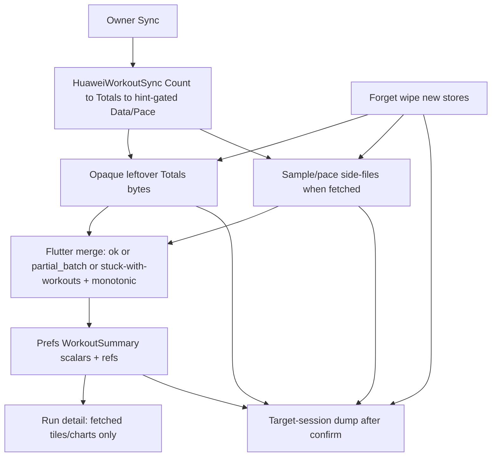
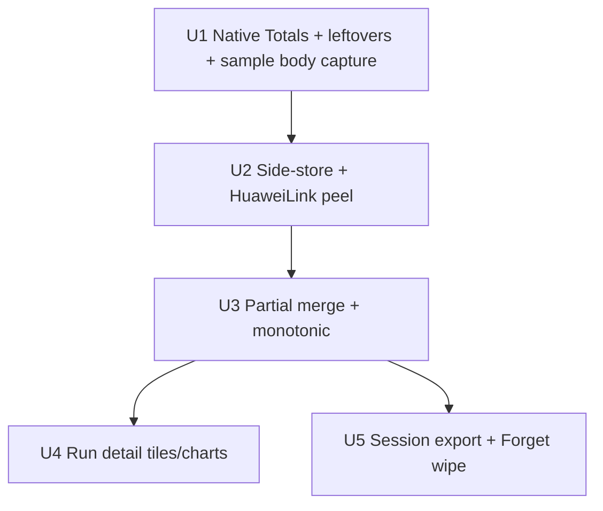
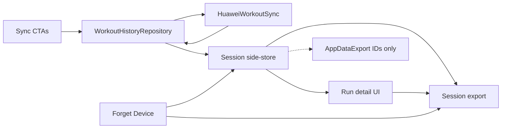

# feat: GT5 Outdoor Run session metrics — persist, Run summary, AI export

## Summary

Extend the existing Gate B workout path so an Outdoor Run Sync persists present 15-tile Totals fields plus opaque leftover bytes, keeps hint-gated sample/pace bodies on-device, merges Totals even when enrichment is partial, shows only fetched tiles/charts on the existing Run detail, and offers a narrower target-session dump for AI after the same sensitive-health confirm posture as full app-data export. Missing tiles stay omitted/unobserved; Health stays closed; rolling Workout-status and AI coaching stay out.

---

## Problem Frame

After an Outdoor Run the GT5 recap shows recovery, training stress, form, and stream tiles the owner today can only read on-wrist. Fathom already Syncs workouts and lists Runs, but Totals unknowns are dropped, WorkoutData/Pace channel maps are page summaries only (no sample bodies), Flutter drops those maps at `WorkoutSummary`, partial enrichment is rejected wholesale, and there is no Run-path session export — so off-wrist summary and honest AI input cannot exist without inventing values or opening Health (see origin).

---

## Requirements

**Fetch and persist**
- R1. Workout Sync pulls the unsynced Outdoor Run without Huawei Health.
- R2. When Totals arrive for an Outdoor Run, persist each present **target Totals** field; omit if absent. Do not require all 15.
- R3. Persist unnamed leftover Totals payload **on-device as opaque bytes** (shared workout parser). Git/logs/Sentry/fixtures: identity/length only.
- R4. Hint-gated enrichment only: request WorkoutData/Pace when Count says pages exist; **capture and** persist sample points and pace blocks when fetched (today’s channel maps are page/block summaries only — sample bodies are net-new native work).
- R5. If sample/pace fetch times out or is partial, still persist Totals scalars and leftover bytes. Do not drop the session or treat missing streams as proof Totals tiles were absent.
- R6. **Prove-session freeze:** after successful Outdoor Totals pull, freeze Outdoor type from observed Totals `0x14` for this prove. **Global** GB vs FOS enum conflict remains unresolved this cut.

**15-tile target list (this cut)**

| Watch tile | Expected surface | This cut |
|------------|------------------|----------|
| VO2 max | Totals VO2-like / maxMET | Persist + show if present; omit if absent |
| Recovery time | Totals session recovery time | Persist + show if present (session-scoped only) |
| Training stress (aerobic + anaerobic) | Totals aerobic / anaerobic effect | Persist + show if present |
| Training load | Totals session load (if present) | Persist + show if present as session load |
| Vertical oscillation | Unclear | Persist + show only if decoded; else omit / unobserved |
| Ground contact time | WorkoutData samples | Persist + show avg/series if samples present |
| Splits | Pace blocks (prefer) | Show pace-block table when blocks exist; else omit (no sample-derived splits UI this cut) |
| Pace charts | Sample speed and/or Pace blocks | Chart only when stream fetched |
| Heart rate during the run | WorkoutData HR samples | Chart/series when samples fetched |
| Heart rate zone | Totals zone type and/or native zone fields | Show only native fetched zone fields; no invented zone minutes |
| Altitude | Totals elev and/or sample altitude | Persist + show if present |
| Cadence | WorkoutData cadence / step rate | Persist + show if present |
| Steps | Totals steps | Persist + show if present |
| Avg stride | Sample step length / stride | Persist + show if present |
| Balance | Unclear | Persist + show only if decoded; else omit / unobserved |

**Run summary UI**
- R7. Use existing Workouts **Run** tab and session detail — no new sport surface.
- R8. On Outdoor Run detail, show every target tile that was fetched/decoded; omit the rest; never invent to fill the 15.
- R9. Pace and in-run HR charts only when matching streams were fetched; missing → no chart (product “unobserved”), not empty zeros.
- R10. Do not label heart-rate zone minutes as the watch’s unless a native minutes field was fetched.
- R11. Indoor Run under Run follows show-what-we-fetched; omitted outdoor-leaning tiles do not fail the Outdoor prove.

**Export**
- R12. Export the **target Outdoor** session from Run **detail** (that open Outdoor session). This cut does **not** ship an all-sessions affordance (deferred). Indoor detail does not export as Outdoor prove.
- R13. After blocking sensitive-health confirm (showing session identity: workout number, start, type, distance/duration), dump includes present decoded fields, leftover bytes, Count hints, and streams or honest no-pages/partial flags. Always omit: Huawei secrets, remembered MAC, account id, bind/auth tokens. GPS/location series: omit from dump this cut unless catalog later promotes them as confirm-include. Confirm must state shared copies are not revoked by Forget. Do not commit real exports.
- R14. Forget Device deletes leftover blobs, sample/pace side-files, and run-export cache, and **directory-empty-verifies** those paths; also clear lean `workoutsJson` health rows (existing prefs wipe) as one privacy unit.

**Honesty**
- R15. Watch recap is the visual check. Huawei Health must not be opened for this work.
- R16. A tile on the watch is not proof the field arrived over Bluetooth.
- R17. After one successful Outdoor Totals pull, missing target tiles are **unobserved this session**, not “GT5 never sends them.”
- R18. Companion bind loss is the same blocked/empty outcome as Totals fail — not a claim that recovery/form tiles were absent.

**Origin actors:** A1 Owner-athlete, A2 GT5-A07, A3 Fathom companion  
**Origin flows:** F1 Outdoor Run Sync → Run summary → AI export  
**Origin acceptance examples:** AE1 (Totals + freeze + show-fetched), AE2 (Count=0 → no force-fetch / no empty charts), AE3 (samples present; VO/balance omit if undecoded), AE4 (no invented zone minutes), AE5 (target-session export), AE6 (partial streams keep Totals), AE7 (fail/bind → blocked/empty), AE8 (Indoor thinner show-fetched)

---

## Scope Boundaries

- In scope: Outdoor Run prove; persist-if-present of the 15-tile list; leftover Totals bytes; hint-gated sample/pace **body** capture + persist; existing Run tab/detail summary; Outdoor detail-session AI export; Forget wipe + verify for **new** leftover/sample/run-export stores
- Deferred for later (from origin): rolling Workout-status load/recovery-to-100%; AI coaching product; inventing zone minutes as watch’s; requiring all 15 present; Indoor as Outdoor prove substitute
- Out (from origin): Huawei Health / HMS / Health Kit; new Run sport surface; force-pull empty Data/Pace; live HR overlay, iOS, swim/strength enrichment as part of this cut; treating rolling Workout-status as this session’s leftover hunt

### Deferred to Follow-Up Work

- Closing known canonical-swim side-file orphans on Forget (adjacent wipe gap; not required for R14 this cut)
- Explicit “export all Run sessions” affordance and list-context newest-Outdoor export
- Catalog score promotions for VO/balance/load until Outdoor wire observation lands
- Named UI labels for new oracle tags until post-seed recap cross-check promotes them (first Outdoor Sync may keep new tags as leftover/`undecoded` for UI)

---

## Context & Research

### Relevant Code and Patterns

- Gate B sync: `android/app/src/main/kotlin/com/example/fitness_os/huawei/HuaweiWorkoutSync.kt` — Count → Totals → hint-gated Swim/Data/Pace; returns `partial_batch` on enrichment timeout. **`dataPages` / `paceBlocks` today are summaries only** (`WorkoutDataPageSummary`: “no sample payload in channel map”) — sample **bodies** are net-new native work
- Flutter bridge DTO: `lib/core/huawei/huawei_link.dart` — `WorkoutSummary.fromMap` drops `dataPages`/`paceBlocks`; peel must happen in `HuaweiLink.syncWorkouts` (or extended result) **before** lean summary construction
- Merge/persist: `lib/features/workout_history/data/repositories/workout_history_repository_impl.dart` — today **rejects** `partialBatch`/`stuck` without merge; soft-incomplete precedent: `VitalsRepositoryImpl`
- Side-file precedent: swim = lean derived JSON + dir layout; vitals = lean prefs + series side-files (correct body precedent)
- Run UI / export / Forget: `workout_detail_screen.dart`, `app_data_export_service.dart`, `diagnostics_di.dart`, `device_pairing_repository_impl.dart` (verify today covers vitals/food only — must extend for new run dirs)
- Oracle hypotheses (clean-room): `docs/plans/2026-07-18-002-feat-gt5-workout-data-catalog-plan.md`, `docs/wire-specs/huawei-br-gt5-gate-b-enrichment.md`, `docs/catalogs/gt5-a07-full-metrics.md`
- Tests to extend: `HuaweiWorkoutSyncTest.kt`, `workout_history_repository_test.dart`, invent-guard tests, `app_data_export_service_test.dart`, forget-wipe integration tests

### Institutional Learnings

- No `docs/solutions/` corpus; use `docs/learnings/` + wire-specs. Outdoor Run still unobserved — first Sync is prove/catalog update, not “tiles proven absent”
- Hint-gated Data/Pace is already the contract; disambiguate Totals TLV `0x0c` (HR peaks) vs Pace command `0x17:0x0c`
- Community prior art favors keeping raw blobs for later reparse — today’s `enrichmentTags` id+len does **not** satisfy R3
- Session recovery/stress tiles ≠ Recovery v1 product / rolling Workout status — label as this-run only
- Privacy: tag id+len in git/logs/Sentry; never commit leftover bodies, HR/form series, GPS, or real exports

### External References

- Skipped framework research — local Gate B / export / Forget patterns are sufficient; TLV decode hypotheses come from in-repo community oracle docs only

---

## Key Technical Decisions

- **Reuse Gate B orchestration; extend parse/persist/UI/export** — no new sync service or sport surface (see origin Approach 1).
- **Native sample/pace body capture is blocking for charts/streams:** today’s `dataPages`/`paceBlocks` are summaries only; U1/U2 must capture bodies (decoded points and/or opaque page TLV bytes).
- **Peel at HuaweiLink:** retain raw leftovers/dataPages/paceBodies for store write in `HuaweiLink.syncWorkouts` (or extended result), then pass lean `WorkoutSummary` into merge/prefs.
- **Sport-agnostic leftover keep:** opaque Totals leftover bodies for every workout type; wipe with new store dirs on Forget; Run UI/export are the only product consumers this cut.
- **Store shape:** vitals-style body side-files + swim-style dir/`rootOverride`/keyed-by-number. Ship `clearLocal` from U2 day one; U5 composes wipe in `diagnostics_di` + **required** pairing_impl directory-empty verify.
- **Partial enrichment merge (repo-global):** follow `VitalsRepositoryImpl` — merge `ok` / `partial_batch` / `stuck`(with workouts); stamp `enrichmentStatus: 'partial'`. Characterize Swim/Strength; soft incomplete ≠ Run-tile absence.
- **Enrichment-monotonic merge:** prefer richer stream completeness; fill-null Totals; retain non-empty side-files when incoming lacks them. **Allow** leftover/scalar replacement when `parserGeneration` increases (so R3 remapping is not frozen on a bad first write).
- **Honesty stamps (minimum):** `present` | `unobserved` (count_none / absent_on_wire / undecoded) | `partial` | `blocked`. Never stamp complete unless prefs refs and side-files agree.
- **Named decode vs leftover:** first Outdoor Sync treats new oracle tags as observation; named UI/export labels only after recap/catalog promote — until then leftover/`undecoded`.
- **Outdoor type freeze:** prove-session freeze from Totals `0x14` after owner-seeded Outdoor; global enum conflict stays open.
- **Target-session export:** Outdoor Run **detail** affordance only; exports that open Outdoor session. No list-context / all-sessions this cut. Prefer session-scoped builder sharing `AppDataExportService` confirm/busy; dedicated assembler only if filtering full dump cannot include leftovers/streams without secrets.
- **Busy-family parity:** session export blocks on Sync/Forget/app/food export; Forget blocks on session `exportInFlight`; mid-assemble recheck.
- **AppDataExport body policy (normative):** inventory new side-files as **IDs/lengths only** — never bodies.
- **Forget wipe:** compose + directory-empty verify for new dirs + assert lean workouts prefs cleared; swim orphans deferred; R14 verified wipe is a ship gate.
- **Splits UI:** pace-block table when blocks exist; else omit (no sample-derived splits UI this cut).
- **Run detail IA:** (1) session header, (2) this-run recovery + aerobic/anaerobic stress + session load, (3) native zones if present, (4) form tiles (cadence/steps/stride/GCT/elev/VO₂) when present, (5) splits then pace then HR charts last. Indoor same hierarchy with omissions. Partial streams: silent omit (no “tiles absent” copy).

---

## Open Questions

### Resolved During Planning

- Partial_batch Flutter merge?: **Yes** — merge Totals+leftovers (+ any streams); stamp `partial` (R5/AE6).
- Leftover store shape?: **Side-file per workout number**; wipe on Forget; id+len only outside device.
- Target-session default?: **Outdoor detail-open session only** (no list newest-Outdoor this cut).
- Export shape?: **Session dump** sharing AppDataExport confirm/busy posture; all-sessions deferred.
- Swim orphan wipe?: **Deferred**.
- Mid-batch Totals `stuck`?: **Merge completed Totals returned**; stamp `partial`; characterize Swim/Strength; AE7 for hard fails with no workouts.
- Leftover keep blast radius?: **Sport-agnostic**; wipe-all new dirs on Forget.
- AppDataExport body policy?: **IDs/lengths only** — never bodies.
- Sample bodies?: **Native capture required** — summaries are not enough.
- Peel site?: **HuaweiLink (or extended sync result) before lean WorkoutSummary**.
- Named UI for new tags?: **Gate on post-seed catalog/recap promote**.

### Deferred to Implementation

- Exact TLV decode success for each of the 15 tiles (unknown until Outdoor seed).
- Whether vertical oscillation / balance map on this firmware.
- Whether session load and training stress arrive as distinct Totals fields.
- Exact side-file directory / DTO field names.
- Cursor advancement details for `partial_batch`/`stuck`.
- Native body capture medium: MethodChannel vs native files + path refs (prefer path refs if Binder size bites).
- Minimum net-new tile yield that declares problem-frame prove “valuable” vs plumbing-only (product call after first seed).

---

## High-Level Technical Design

> *This illustrates the intended approach and is directional guidance for review, not implementation specification. The implementing agent should treat it as context, not code to reproduce.*

**Observation → UI/export (directional):**

| Condition | Totals/leftovers | Charts | Honesty stamp |
|-----------|------------------|--------|---------------|
| Totals ok, Count=0 | Persist | No chart | `unobserved` |
| Totals ok, enrichment timeout | Persist | No or partial | `partial` |
| Totals ok, field missing | Omit tile | — | `unobserved` |
| Count/Totals/bind fail | No new claim | — | `blocked` |
| Tag seen, undecoded (e.g. VO/balance) | Keep leftovers | Omit tile | `unobserved` |

---

## Implementation Units

### U1. Native target Totals decode + leftover keep + sample/pace body capture

**Goal:** Decode/capture Totals target fields and opaque leftover TLV bodies; **and** capture WorkoutData/Pace sample bodies (not page summaries only) so streams can persist on-device.

**Requirements:** R2, R3 (native half), R4 (body capture), R6, R15–R17; F1 Totals/leftover/stream steps; AE1 (Totals), AE2/AE3 (stream capture foundation)

**Dependencies:** None

**Files:**
- Modify: `android/app/src/main/kotlin/com/example/fitness_os/huawei/HuaweiWorkoutSync.kt`
- Modify: `android/app/src/test/java/com/example/fitness_os/huawei/HuaweiWorkoutSyncTest.kt`
- Modify: `lib/core/huawei/huawei_link.dart` (channel field surface)
- Docs: `docs/catalogs/gt5-a07-full-metrics.md` (observation notes when freeze lands)

**Approach:**
- Totals `else` leftover body keep (sport-agnostic); continue id+len for logs/Sentry.
- Capture WorkoutData/Pace **bodies** (decoded points and/or opaque page bytes). Prefer native path refs if Binder size is a risk.
- New oracle tags: keep as leftover/`unobserved` for named UI until post-seed catalog/recap promote.
- Freeze Outdoor type from `0x14` after owner-seeded Outdoor observe; do not resolve global enum conflict.

**Execution note:** Characterization-first for existing Totals fixtures; then leftover-body + sample-body cases.

**Patterns to follow:** `recordUnknown` privacy posture; clean-room oracle docs only; vitals FileDownload path-ref pattern if bodies stay native-side.

**Test scenarios:**
- Happy path: known Totals tags present → scalars exposed; unknown TLV → opaque body + id/len
- Happy path: Data/Pace pages with bodies → bodies (or path refs) present on workout payload — not summary-only
- Edge case: target tag absent → null/omit, not zero-fill; failed known-tag parse → leftover/`unobserved`
- Integration: Swim Totals scalars unchanged; Outdoor `0x14` freeze recorded without Indoor substitute

**Verification:** Native tests prove leftover + sample body capture; Sentry scrub strips bodies; swim/strength known tags unchanged

---

### U2. Side-store, HuaweiLink peel, and lean DTO survival

**Goal:** Peel leftovers/sample/pace bodies at HuaweiLink before lean `WorkoutSummary`, persist them in side-files, and ship directory wipe API with the store.

**Requirements:** R3 (on-device half), R4, R9, R13 (stream portion), R14 (wipe surface); F1 stream persist; AE2, AE3

**Dependencies:** U1

**Files:**
- Create: `lib/features/workout_history/data/run_session_store.dart`
- Modify: `lib/features/device_pairing/domain/gate_a_prefs.dart`
- Modify: `lib/core/huawei/huawei_link.dart` (**peel before** `WorkoutSummary.fromMap`)
- Modify: `lib/features/workout_history/data/repositories/workout_history_repository_impl.dart` (consume peeled payloads / write via store)
- Modify: `lib/core/observability/sentry_privacy_scrub.dart`
- Test: `test/features/workout_history/run_session_store_test.dart`, `workout_history_repository_test.dart`

**Approach:**
- HuaweiLink retains raw leftovers/dataPages/paceBodies for store write, then builds lean summaries for prefs.
- Prefs: refs/counts/lengths + honesty stamps only.
- Count=0 → `unobserved` streams; never invent empty series.
- Store ships `clearLocal` + `rootOverride` from day one.
- Observability must never log raw leftover/dataPages/paceBodies (length-only).

**Execution note:** Store + peel round-trip test-first.

**Patterns to follow:** vitals series side-files; swim dir/`rootOverride`; existing Sentry scrub keys.

**Test scenarios:**
- Happy path: peeled bodies → side-files written; prefs lean without series/leftover bodies
- Happy path: Count=0 → `unobserved`; no zero series
- Edge case: partial pages → persist arrived; stamp `partial`; never claim complete unless refs+files agree
- Error path: side-file write failure → incomplete; Totals still mergeable (U3)
- Integration: reload after restart; `clearLocal` empties dirs

**Verification:** Streams/leftovers survive persist/load; prefs/test dumps never embed bodies; wipe API exists before U5

---

### U3. Partial-batch merge and enrichment-monotonic persistence

**Goal:** Merge soft-incomplete Syncs so Totals+leftovers survive enrichment timeout; stamp `partial` for cursor overlap; monotonic prefs **and** side-files with parserGeneration escape hatch. Policy is workout-history-wide.

**Requirements:** R5, R16–R18; F1 honesty/escape; AE6, AE7

**Dependencies:** U2

**Files:**
- Modify: `lib/features/workout_history/data/repositories/workout_history_repository_impl.dart`
- Modify: `lib/core/huawei/huawei_link.dart` as needed
- Test: `test/features/workout_history/workout_history_repository_test.dart`

**Approach:**
- Merge arms: `ok`, `partialBatch`, `stuck` with workouts; Left: `notReady`/`busy`/`error`.
- Follow `VitalsRepositoryImpl`; stamp `enrichmentStatus: 'partial'`; call U2 persist on soft-incomplete.
- Monotonic streams + fill-null Totals; allow replacement when `parserGeneration` increases.
- Characterize Swim/Strength soft-incomplete before treating stuck merge as production-safe.

**Execution note:** Characterize current reject-`partialBatch`/`stuck` before flip.

**Patterns to follow:** `VitalsRepositoryImpl`; wire-spec enrichment-monotonic notes.

**Test scenarios:**
- `partial_batch` with Totals → prefs + leftover files updated; `partial` stamped; not “tiles absent”
- Full `ok` → complete only when refs+files agree
- Later Totals-only Sync → does not wipe richer side-files
- Partial merge → next Sync start extends via partial-window overlap
- Hard fail / bind loss → Left/`blocked`; no absence claims
- Stuck with earlier Totals → merge those; incomplete overall
- Swim/Strength characterization: merge does not invent Run tiles or clobber richer swim segments incorrectly

**Verification:** AE6 merge + cursor overlap + side-file clobber-guard; AE7 hard-fail honesty

---

### U4. Run detail show-fetched tiles and gated charts

**Goal:** Render fetched/decoded target tiles with fixed IA; charts only when streams exist; invent-guard zone minutes / VO/balance.

**Requirements:** R7–R11; F1 summary; AE1–AE4, AE8

**Dependencies:** U3

**Files:**
- Modify: `lib/features/workout_history/presentation/view/workout_detail_screen.dart`, `workout_history_formatters.dart`
- Create/Modify: run chart/splits widgets under `presentation/widgets/`
- Test: `test/features/workout_history/run_session_detail_test.dart`; invent-guard sibling

**Approach:**
- IA: header → this-run recovery/stress/load → native zones → form tiles → splits → pace/HR charts.
- Named new-oracle tiles only after catalog promote; otherwise omit/`unobserved`.
- Charts/splits gated; missing → section absent. Loading while side-files load; side-file error → omit chart (no zeros). Empty-of-new-tiles → legacy header only.
- Partial enrichment: silent omit of missing streams (no absence claim).
- This-run copy only — not Recovery tab / rolling status.

**Patterns to follow:** omit-null `_SectionCard`; swim invent-guard; `fl_chart` structure from swim charts.

**Test scenarios:**
- Covers AE1/AE2/AE3/AE4/AE8 as before; plus IA order smoke; splits only when pace blocks exist; no invented zone minutes

**Verification:** Invent-guard + omit/unobserved for charts/zones; Indoor/Outdoor share honesty

---

### U5. Target-session AI export and Forget wipe composition

**Goal:** Outdoor detail export after identity + sensitive-health confirm; Forget wipes and directory-empty-verifies new stores; AppDataExport inventories IDs/lengths only.

**Requirements:** R12–R14; F1 export; AE5

**Dependencies:** U3 (data). Affordance on Outdoor detail can land with minimal chrome — does not require full U4 tile set.

**Files:**
- Create/Modify: session dump assembler (prefer session-scoped path on/near `AppDataExportService`; dedicated file only if needed)
- Modify: `workout_detail_screen.dart` (Outdoor detail export affordance + confirm)
- Modify: `lib/features/diagnostics/data/app_data_export_service.dart` (IDs/lengths inventory for new dirs)
- Modify: `lib/features/diagnostics/data/diagnostics_di.dart` (wipe + busy composition)
- Modify: `lib/features/device_pairing/data/repositories/device_pairing_repository_impl.dart` (**required** directory-empty verify for new dirs)
- Test: session export tests; forget-wipe integration with planted residue must fail verify
- Docs: `docs/export/` session-dump schema (redaction matrix; no real payloads)

**Approach:**
- Affordance: Outdoor detail overflow “Export for AI” only.
- Confirm: session identity + sensitive non-anonymized health + shared copies not revoked by Forget.
- States: confirm → assembling (block double-tap) → share → dismiss to detail; busy → explicit blocked; error → no share; cancel → no file.
- Redaction matrix per R13; GPS omit this cut.
- Compose wipe in `diagnostics_di`; pairing verify fails if new dirs or run-export cache non-empty; assert workouts prefs cleared.
- AppDataExport: IDs/lengths only for new side-files.

**Patterns to follow:** AppDataExport confirm/busy/prune; diagnostics_di sole composition site.

**Test scenarios:**
- Covers AE5 for Outdoor detail session
- Cancel / busy / mid-assemble abort
- Forget after export → dirs empty; planted residue fails verify
- Privacy: secrets/MAC/account/bind tokens/GPS omitted; AppDataExport has no bodies
- Confirm text matches assembled session key

**Verification:** R12–R14 with directory-empty verify + redaction tests; schema docs without real dumps

---

## System-Wide Impact

- **Interaction graph:** Home/Workouts Sync CTA → `WorkoutHistoryRepositoryImpl.syncFromWatch` → native Gate B; repository peels raw channel map into side-files then lean prefs; Run detail reads prefs + session store; session export shares busy flags with diagnostics Forget composition; pairing Forget triggers wipe extras + directory verify
- **Error propagation:** Soft incomplete enrichment becomes mergeable success with honesty flags (repo-wide); hard notReady/busy/bind failures remain Left/blocked without absence claims
- **State lifecycle risks:** Prefs↔side-file dual-store crash windows; side-file orphans if wipe incomplete; Totals-only re-sync clobber (mitigated by prefs+file monotonic merge); export cache residues; sport-agnostic leftover bodies for swim/strength must stay inside wipe scope
- **API surface parity:** Full `AppDataExportService` remains but must not embed leftover/sample bodies; Run session dump is the intentional sensitive path. Swim invent-guard / Strength thin detail unchanged as product surfaces; shared Totals leftover keep + soft-incomplete merge are workout-history-wide
- **Integration coverage:** AE5/AE6/AE7/R14 need cross-layer tests (native + Flutter merge + UI/export/Forget directory verify), not unit-only
- **Unchanged invariants:** Hint-gated enrichment (no force empty Data/Pace); single-flight Sync lock; Health Kit stays unused; Recovery v1 / rolling Workout-status surfaces unchanged; no new sport tab; deferred swim orphan wipe remains a separate follow-up

---

## Risks & Dependencies

| Risk | Mitigation |
|------|------------|
| Outdoor Run still unobserved — wire tiles unknown | Ship show-fetched + leftovers; omit/unobserved acceptable; catalog update after seed |
| VO / balance watch-only | Do not invent decode; leftovers enable later remap |
| Flutter historically discarded `partial_batch`/`stuck` | U3 vitals-style merge + tests for AE6; stamp `partial` for cursor |
| Soft-incomplete merge is repo-global | Characterization for Swim/Strength; honesty copy must not imply Run-tile absence |
| Prefs vs side-file crash / partial write | Never stamp complete unless refs+files agree; Forget wipes whole dirs (indexed + unindexed) |
| Monotonicity only on prefs scalars | Per-artifact retain non-empty side-files; no Totals-only clobber of denser streams |
| Forget verify misses new dirs (swim orphan pattern) | Compose wipe **+** directory-empty verify for leftovers/samples/pace/run-export; R14 ship gate for new stores |
| DI last-writer drops wipe chain | Append only in `diagnostics_di`; block Forget while run-export in flight |
| Orphan bodies amplify into exports | Session dump is sensitive path; AppDataExport IDs/len only; prune caches; post-Forget residue must not share |
| Sample series residual risk > deferred swim orphans | Verified wipe for new stores is release-blocking; swim orphans stay deferred explicitly |
| Session vs rolling load confusion | UI copy “this-run”; deferred rolling status stays out |
| Owner must seed unsynced Outdoor Run | Document as prerequisite; empty window ≠ prove |
| New Totals tags disturb swim/strength contracts | Additive nullable fields; no Swim/Strength UI binding; failed parse → undecoded |

---

## Documentation / Operational Notes

- Update catalog observation notes when Outdoor `0x14` and present tags are seen (`docs/catalogs/gt5-a07-full-metrics.md`)
- Add a short export schema note under `docs/export/` for the session dump (flags + redaction; AppDataExport body-omit policy); never commit real exports
- Owner prove checklist: Sync with Health closed → compare Run detail + dump to watch recap → Forget → confirm new run dirs empty **and** workouts prefs cleared
- Forget integration: plant residue under new dirs and assert verify fails; do not rely on OS uninstall as the wipe story
- Sentry: continue tag id+len only; confirm scrub covers new payload keys; sync maps must never log leftover/dataPages/paceBodies
- Shared copies via share_plus are not revoked after Forget — confirm dialog discloses this; prune local cache only
- After first Outdoor seed, decide minimum net-new tile yield before declaring problem-frame prove “valuable” vs plumbing-only (Open Questions)
---

## Sources & References

- **Origin document:** [docs/brainstorms/2026-09-11-gt5-running-session-metrics-requirements.md](../brainstorms/2026-09-11-gt5-running-session-metrics-requirements.md)
- Related code: `HuaweiWorkoutSync.kt`, `workout_history_repository_impl.dart`, `huawei_link.dart`, `workout_detail_screen.dart`, `app_data_export_service.dart`, `diagnostics_di.dart`, `canonical_swim_store.dart`
- Related plans/docs: `docs/plans/2026-07-18-002-feat-gt5-workout-data-catalog-plan.md`, `docs/plans/2026-08-05-001-feat-app-data-json-export-plan.md`, `docs/wire-specs/huawei-br-gt5-gate-b-enrichment.md`, `docs/catalogs/gt5-a07-full-metrics.md`, `docs/learnings/2026-07-22-community-prior-art.md`, `docs/export/app-data-export-schema.md`
