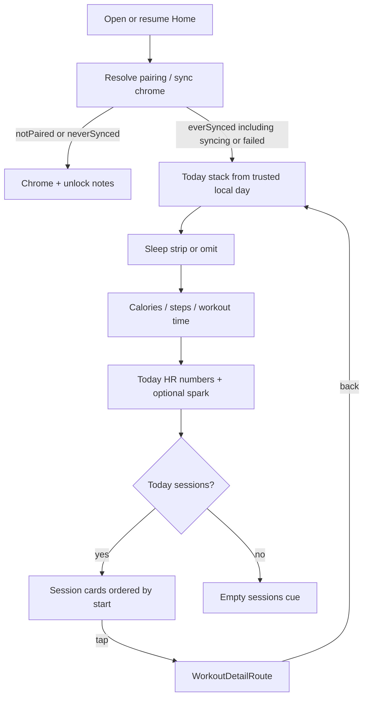
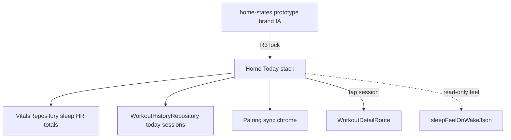

# feat: Home Today instrument stack

## Summary

Replace Home’s swim-takeaway + KPI strip with a fixed **Today stack** — last-night sleep, trusted activity totals, today-only body HR (optional one tiny spark), and multi-sport session cards with omit-when-absent load/TE/recovery — while keeping pairing/sync as supporting chrome. Extend the existing Home snapshot/repository/BLoC path, reuse Recovery/Workouts formatters and detail navigation, and amend design/IA SoT so the 2026-07-25 Home conflicts named in origin R3 no longer fight Flutter.

---

## Problem Frame

Home still answers “what today has been?” only for a thin KPI strip and a swim-only takeaway, while sleep, multi-sport sessions, and load/TE/recovery live on other tabs. The owner-athlete must tab-hop for a day picture, and the old brand IA charter (swim-only, absolute no-graphs) no longer matches the multi-sport product or an AI-ready attributable instrument (see origin).

---

## Requirements

**Today stack layout**
- R1. Fixed Today composition: sleep → totals → body HR (≤1 spark) → today’s session cards.
- R2. Graph budget: at most one tiny today-HR spark; no hypnogram, workout charts, history calendars, diagnoses, or reasoner settings on Home.
- R3. Supersede conflicting 2026-07-25 Home charter items (swim-only takeaway; absolute never-graphs; KPI strip without multi-sport entry) in product, Flutter, and design/IA SoT.

**Sleep strip**
- R4–R6. Sleep strip: duration + timing when available; feel-on-wake cue only if already answered for the displayed session; no stages/hypnogram; no new survey on Home; sleep strip display-only (not tappable this cut).

**Activity totals**
- R7–R8. Totals: calories/steps from trusted FitnessTotals day path with existing workout-sum fallback; workout time remains Σ today’s session `durationSec` (not FT `exerciseDurationSec`); omit/empty when unavailable — no invented averages or “on track.”

**Body snapshot**
- R9–R10. Body HR: today-keyed min/avg/max (or equivalent rollup); optional one tiny spark from today series; no SpO₂/stress/PAI; no non-today HR fallback.

**Today’s sessions**
- R11–R14. All today’s workouts as tappable cards into existing session detail; identity + volume cues + load/TE/recovery when present as plain numbers; empty sessions cue when none; replaces swim-only takeaway.

**Instrument honesty**
- R15–R17. No composite readiness/recovery/strain scores; every metric attributable to a known local signal; copy must not imply planner/food advisor is active.

**Sync / pairing chrome**
- R18. Pairing/sync chrome remains supporting (six chrome states), not the hero of the day picture.

**Origin actors:** A1 Owner-athlete, A2 Paired watch (GT5)
**Origin flows:** F1 Open Home — day picture, F2 Enter today’s session, F3 Empty or partial day
**Origin acceptance examples:** AE1 multi-sport cards / swim takeaway gone, AE2 load/TE/recovery plain numbers / no composite, AE3 rest day empty sessions, AE4 one HR spark max, AE5 feel-on-wake read-only

---

## Scope Boundaries

- Workout planning / daily intensity prescription on Home
- Food guidance or food totals/meals block on Home
- Composite readiness / recovery / strain scores
- Full charts, history calendars, diagnoses, reasoner settings on Home
- Time-aware layout shifts (morning vs post-session) and session-first-only layout
- Fitness / fatigue / form (CTL/ATL/TSB) or ACWR on Home
- New morning wellness survey UX on Home
- SpO₂, stress, PAI, battery as Home heroes
- Bottom-tab IA changes beyond Home content
- Tappable sleep strip → sleep detail (display-only this cut)
- New persisted “day context” store/API for a future model (this cut uses structured `HomeSnapshot` only)

### Deferred to Follow-Up Work

- Persisted structured day-context export/API for future training/food models (beyond in-app `HomeSnapshot`)
- Sleep strip navigation into Recovery sleep detail
- Optional design polish of `home-prototype/` advanced chart demos after SoT amendment (only if still misleading after U5)

---

## Context & Research

### Relevant Code and Patterns

- Home feature: `lib/features/home/presentation/view/home_screen.dart`, `home_bloc.dart`, `home_state.dart`, `lib/features/home/domain/home_precedence.dart` (`HomePrecedence`, `HomeSnapshot`), `lib/features/home/data/repositories/home_repository_impl.dart`, `lib/features/home/domain/usecases/get_home_data.dart`
- Sleep SoT / formatters: `todaysSleepSession` in `lib/features/vitals/presentation/widgets/sleep_formatters.dart` (Home selector — do **not** use `TruSleepSleepSot.pickHeroSession`, which is a 36h hero heuristic); `VitalsRepository.loadSleepSessions` / `loadFeelOnWake`
- Totals / HR: `FitnessTotalsDay`, `DailyHrDaySummary`, `DailyHrSample`; `VitalsRepository.loadFitnessTotals`, `loadDailyHr`, `loadDailyHrSeries`; existing Home KPI assembly already prefers FT calories/steps and sums workout durations for workout time
- Spark: `HrSparkline` in `lib/features/vitals/presentation/widgets/hr_sparkline.dart` (Recovery-sized — Home needs a tiny height budget)
- Sessions: `WorkoutSummary` (`load`, `aerobicEffect`, `anaerobicEffect`, `recoveryTime`); `WorkoutSessionRow`; `WorkoutDetailRoute.go`; run TE via `RunSessionMetrics` (÷10); strength via `StrengthSessionMetrics` / `strengthSessionMeta`
- Tests: `test/features/home/home_screen_test.dart`, `home_precedence_test.dart`, `home_repository_kpi_test.dart`, `home_repository_session_copy_test.dart`
- Design/IA: `docs/design/home-states.html`, `docs/design/home-prototype/`, `docs/design/design-system.html`, `docs/brainstorms/2026-07-25-fathom-companion-brand-ia-requirements.md`, `ONBOARDING.md`

### Institutional Learnings

- `docs/solutions/` is empty; constraints live in origin + Recovery honesty + FitnessTotals Home KPI plan + strength/run session-metrics docs
- FitnessTotals plan: do not mix FT calories with workout-sum steps; zeros in FT row are real; workout time must not use `exerciseDurationSec`
- Recovery / Hooper: feel-on-wake survey stays Recovery-scoped; no opaque Recovery score; no hypnogram on Home
- Strength/run metrics: show if present, omit if absent; never invent recovery %; session-scoped load/TE/recovery only

### External References

- None — local patterns are sufficient

---

## Key Technical Decisions

- **Chrome × stack decoupling:** Keep the six pairing/sync chrome states, but stop using swim presence (`hasSwimTakeaway`) as the gate for day content. After ever-synced (including syncing/failed with last trusted local data), render Today stack blocks from attributable local day data; mute/stale cues stay on chrome. Replace `dataAvailable` / `noSwimDataYet` semantics with day-context-oriented labels (e.g. trusted day present vs chrome-only) without inventing values during unpaired / never-synced.
- **Structured day context this cut = `HomeSnapshot`:** Expand the Home domain snapshot to carry sleep, feel cue, today HR rollup/series, and today’s session list. Do **not** invent a separate persisted day-context store/API for a future model in this cut.
- **Sleep selection:** Reuse `todaysSleepSession` (overnight ending today preferred; else longest ending today). Feel-on-wake only when keyed to that displayed session’s merge key.
- **Today-only HR:** Body block uses today’s dayKey rollup only — remove non-today `hrDays.first` fallback. Spark only when today series has ≥2 samples; otherwise numbers-only / omit spark silently (no Recovery empty-chart copy).
- **Workout-time KPI unchanged:** Continues as Σ today’s `WorkoutSummary.durationSec`; never FT `exerciseDurationSec` (see origin R7 + existing KPI honesty).
- **Session cards:** Filter local workouts to local today; order by `startTime` ascending; open `WorkoutDetailRoute.go` with that `WorkoutSummary` (identity via workout `number` / start — not “first of type”). Reuse per-sport display paths for load/TE/recovery (run ÷10 TE, strength raw ints + recovery **time** only; never recovery %). Null/absent → omit field; watch-sent `0` may render as `0`.
- **Reuse over invent:** Prefer compact reuse of sleep formatters, `WorkoutSessionRow` (or a Home-thin variant), and height-tuned `HrSparkline` rather than new chart libraries or parallel stores.
- **Design/IA in the same cut:** Amend `home-states`, Home prototype never-list / takeaway, design-system Home bullets, and brand IA Home conflicts to cite the 2026-09-12 requirements as the new Home lock (origin R3).

---

## Open Questions

### Resolved During Planning

- Workout-time SoT vs watch exercise minutes: Keep Σ session durations; document in plan/tests; do not surface FT `exerciseDurationSec` as workout time.
- Load/TE/recovery per sport: Reuse existing per-sport formatters; omit when absent; ban recovery % on Home.
- HR spark source: Today `loadDailyHrSeries(dayKey)` when ≥2 samples; else omit spark.
- Session card order: Start time ascending (day narrative).
- Deep-link for same-type multiples: Pass the concrete `WorkoutSummary`; detail identity is that summary’s fields.
- Design SoT amendment: Same cut as Flutter (U5).
- Future day-context shape: `HomeSnapshot` only this cut; persisted model store deferred.
- Sleep strip navigation: Display-only this cut.
- Syncing/failed with prior day data: Show last trusted Today stack under muted/stale chrome (matches design Failed/stale posture).
- Non-today HR fallback: Removed — omit body HR if no today rollup.

### Deferred to Implementation

- Exact Home chrome copy when rest day vs multi-session day (tone only — keep attributable, no coach narrative).
- Whether Home session rows share `WorkoutSessionRow` verbatim or a thinner Home wrapper — choose during UI to keep calm density without forking meta logic twice.
- Tiny spark height/token values — tune to “one tiny spark” budget against R2; not a product fork.
- Missing/deleted workout after tap: Prefer existing detail “Workout not found” + pop back to Home; exact reload-by-number helper only if current route args prove insufficient at implement time.

---

## High-Level Technical Design

> *This illustrates the intended approach and is directional guidance for review, not implementation specification. The implementing agent should treat it as context, not code to reproduce.*

**Chrome × stack matrix (directional):**

| Chrome state | Today stack |
|---|---|
| notPaired / pairedNeverSynced | No invented day metrics; chrome owns the message |
| syncInProgress | Prior trusted stack kept, muted; chrome shows syncing |
| syncFailed | Prior trusted stack kept + stale/retry cue |
| Trusted synced day | Full stack; omit individual blocks when signals absent |

---

## Implementation Units

### U1. Home domain snapshot + precedence rewrite

**Goal:** Make Home’s domain model carry a structured Today context and stop swim-gating day content.

**Requirements:** R1, R3, R11, R13–R18; F1, F3

**Dependencies:** None

**Files:**
- Modify: `lib/features/home/domain/home_precedence.dart`
- Modify: `lib/features/home/presentation/bloc/home_state.dart` (if snapshot fields surface through state)
- Test: `test/features/home/home_precedence_test.dart`

**Approach:**
- Expand `HomeSnapshot` with structured fields for sleep (duration/window labels + optional feel cue), totals (existing KPI labels), today HR (rollup label + optional series samples), and today’s session summaries (or view-models) including omit-able load/TE/recovery display values.
- Remove swim-takeaway fields as the day hero (`swimTakeaway*` / `hasSwimTakeaway` gate).
- Redefine terminal precedence after sync chrome so day stack can render on rest days and multi-sport days without a swim.
- Preserve six chrome states for pairing/sync UX; document that day blocks are independent of swim presence.
- Update `HomeSnapshot.forPrecedence` fixtures for the new semantics without inventing fake metrics.

**Execution note:** Characterization-first on existing precedence tests before renaming/replacing swim-gated branches.

**Patterns to follow:**
- Current pure `resolveHomePrecedence` + `HomeSnapshot.forPrecedence` fixture style
- Honesty: null means omit — do not default missing load/TE/recovery to `0` in the domain model

**Test scenarios:**
- Happy path: Paired + ever synced + no swim + run present → day-context precedence allows stack (not swim-empty hero semantics).
- Happy path: Paired + ever synced + swim + strength → day-context available; swim is just another session, not a special takeaway gate.
- Edge case: notPaired / pairedNeverSynced → chrome-only; no invented sleep/HR/sessions in fixtures.
- Edge case: syncInProgress / syncFailed inputs still resolve to those chrome states regardless of session presence.
- Edge case: Rest day (no sessions) after sync → day context allowed; sessions list empty is data, not a precedence failure.

**Verification:**
- Precedence tests no longer require `hasSwimTakeaway` for “has day content.”
- Snapshot can represent sleep + HR + multi-sport sessions without swim-takeaway fields.

---

### U2. Repository assembly — attributable Today data

**Goal:** Load and assemble honest Today signals into `HomeSnapshot` from existing local SoTs.

**Requirements:** R4–R10, R12, R15–R16; F1, F3

**Dependencies:** U1

**Files:**
- Modify: `lib/features/home/data/repositories/home_repository_impl.dart`
- Modify: `lib/features/home/domain/usecases/get_home_data.dart` (only if signature/DI needs widen)
- Test: `test/features/home/home_repository_kpi_test.dart`
- Test: `test/features/home/home_repository_session_copy_test.dart` (or new `home_repository_today_stack_test.dart` if clearer)

**Approach:**
- Load sleep via vitals sleep API; select with `todaysSleepSession`; format duration/window; attach feel-on-wake only when present for that session’s key.
- Keep existing FT calories/steps + workout-sum fallback rules; keep workout time = Σ today’s durations.
- Load today HR rollup by dayKey only; omit vitals body block if today missing (delete non-today fallback).
- Load today HR series for spark eligibility (≥2 samples).
- Filter `WorkoutHistoryRepository` locals to today; sort by start ascending; map each to card fields using per-sport formatter paths for load/TE/recovery (omit nulls; never recovery %).
- Under syncInProgress/syncFailed, preserve last trusted assembled stack while chrome reflects sync (align with BLoC preserve behavior).
- Sync/pairing chrome copy stays supporting; remove swim-session-ready copy that implies swim-only Home.

**Patterns to follow:**
- Existing KPI assembly in `home_repository_impl.dart` and `home_repository_kpi_test.dart`
- `RunSessionMetrics` / `StrengthSessionMetrics` honesty (omit absent; run TE ÷10)
- FitnessTotals Home KPI plan: no mixed FT/workout-sum sources

**Test scenarios:**
- Happy path: FT present → calories/steps from FT; workout time from session duration sum even when FT `exerciseDurationSec` differs.
- Happy path: Sleep + feel map entry for that merge key → sleep labels + feel cue on snapshot.
- Edge case: Feel answered for a different sleep key than displayed session → no feel cue.
- Edge case: No today HR dayKey in store (other days present) → body HR omitted (not yesterday’s rollup).
- Edge case: Today rollup present, series empty or 1 sample → numbers present, spark series absent/ineligible.
- Edge case: Session with null load/TE/recovery → card model omits those fields; session with watch `0` load → `0` retained.
- Edge case: Two pool swims today → both included, ordered by start time.
- Integration: Partial day (sleep+HR, zero workouts) → snapshot has sleep/HR and empty sessions list without fake session.
- Error path: Unpaired / never synced → no invented totals/sleep/sessions beyond chrome.

**Verification:**
- KPI honesty tests still pass (especially workout-time vs `exerciseDurationSec`).
- Non-today HR cannot appear as today’s body snapshot.
- Multi-sport today sessions appear on the snapshot without swim gating.

---

### U3. Today stack UI + session navigation

**Goal:** Render the fixed Today composition on Home and route session taps to existing detail.

**Requirements:** R1–R2, R4–R6, R9–R14, R17–R18; F1, F2, F3; AE1–AE5

**Dependencies:** U2

**Files:**
- Modify: `lib/features/home/presentation/view/home_screen.dart`
- Modify: `lib/features/home/presentation/bloc/home_bloc.dart` (only if preserve/refresh paths need stack fields)
- Possibly reuse: `lib/features/vitals/presentation/widgets/hr_sparkline.dart`, `lib/features/workout_history/presentation/widgets/workout_session_row.dart`, sleep formatters
- Test: `test/features/home/home_screen_test.dart`

**Approach:**
- Replace `_SwimTakeawayCard` / `_SwimEmptyCard` hero with ordered sections: sleep strip → totals → body HR (+ optional spark) → session list or empty cue.
- Keep brand header + today chip + sync pill + `_SyncCard` as supporting chrome; adjust `_sectionsFor` so stack can show under syncing/failed when snapshot has trusted day data.
- Sleep strip: duration + window; optional short feel cue; not tappable; no stages.
- Body HR: min·avg·max when present; one tiny `HrSparkline` (or equivalent) only when eligible; no SpO₂/stress/PAI; no full charts.
- Session cards: all sports; show identity + primary volume cue + load/TE/recovery fields when present; `onTap` → `WorkoutDetailRoute.go(context, workout)`; back returns to Home.
- Empty sessions: clear empty cue while upper blocks remain.
- Keys/semantics: replace `home-swim-takeaway` / open-session-to-list with stack keys; keep forbidden-section assertions for hypnogram, food, composites, reasoner, workout charts.
- Copy must not imply planner/food advisor.

**Patterns to follow:**
- Existing `_SurfaceCard` / KPI strip calm styling
- Workouts list tap → `WorkoutDetailRoute`
- Home test Key conventions (`home_state_*`, `home-kpi-*`)

**Test scenarios:**
- Covers AE1. Happy path: Morning swim + evening strength in snapshot → both cards visible; no swim-only takeaway widget.
- Covers AE2. Happy path: Run card shows plain load/TE/recovery numbers; no readiness/composite score text on Home.
- Covers AE3. Happy path: Sleep+HR present, zero sessions → upper blocks render + empty sessions cue.
- Covers AE4. Happy path: Eligible HR series → at most one spark; no hypnogram / workout chart widgets.
- Covers AE5. Edge case: Feel present → short cue; feel absent → no survey CTA/controls on Home.
- Integration: Tap session card → detail route receives that workout; back lands on Home.
- Edge case: Sparse/no series → HR numbers without spark; no heavy empty-chart copy.
- Edge case: syncInProgress/syncFailed with prior stack → chrome muted/stale + stack still visible when snapshot carried forward.
- Error path: Forbidden sections (food block, reasoner, diagnosis list, full charts) remain absent.

**Verification:**
- Visual/section order matches R1.
- Swim takeaway path is gone; multi-sport entry works from Home.
- Graph budget and honesty bans hold in widget tests.

---

### U4. Home test suite hardening for honesty edges

**Goal:** Lock AE coverage and the honesty edges origin + flow analysis require beyond happy-path UI.

**Requirements:** R7–R8, R12, R15–R16; AE1–AE5

**Dependencies:** U1, U2, U3

**Files:**
- Modify/Create: `test/features/home/home_screen_test.dart`
- Modify/Create: `test/features/home/home_precedence_test.dart`
- Modify/Create: `test/features/home/home_repository_kpi_test.dart`
- Create (optional): `test/features/home/home_repository_today_stack_test.dart`

**Approach:**
- Rewrite six-state Home screen fixtures around chrome × stack rather than swim takeaway.
- Add repository/UI cases for: non-today HR must not surface; TE scale consistency via formatter reuse; strength recovery time without recovery %; two same-type sessions; midnight/dayKey refresh on next load/resume path if testable without flaking.
- Keep KPI regression that FT `exerciseDurationSec` never drives workout-time label.

**Execution note:** Prefer extending existing Home test files; add a dedicated today-stack repository test file only if `home_repository_kpi_test.dart` becomes unwieldy.

**Patterns to follow:**
- Inject `HomeSnapshot.forPrecedence` / explicit snapshots; Key-based finders; forbidden-section assertions

**Test scenarios:**
- Covers AE1–AE5 via U3 screen tests (ensure still green after suite rewrite).
- Edge case: Adjacent run + strength cards use sport-appropriate TE/recovery formatting (no raw-int vs ÷10 confusion in asserted labels).
- Edge case: Strength card may show recovery time; asserted absence of recovery `%`.
- Integration: Two pool swims → tapping each targets distinct workout identity.
- Edge case: Workout-time label ignores FT exercise duration field.
- Edge case: Non-today HR days in fake repo → Home body HR omitted.

**Verification:**
- Home test suite encodes the new charter (one spark allowed; swim takeaway not required) and the honesty locks above.

---

### U5. Design SoT + brand IA Home lock amendment

**Goal:** Make design/IA documents cite the 2026-09-12 Today instrument as Home lock so Flutter and design stop diverging on R3 conflicts.

**Requirements:** R2, R3, R14–R15, R18

**Dependencies:** U3 (UI shape should be known enough to mirror)

**Files:**
- Modify: `docs/design/home-states.html`
- Modify: `docs/design/home-prototype/` (index and any takeaway/never-list copy that still mandates swim-only / absolute no graphs)
- Modify: `docs/design/design-system.html` (Home never-list / sparks language)
- Modify: `docs/brainstorms/2026-07-25-fathom-companion-brand-ia-requirements.md` (Home bullets that conflict — supersession note pointing at 2026-09-12)
- Modify: `docs/design/DESIGN_REVIEW.md` and/or `ONBOARDING.md` Home one-liners if they still say swim-only takeaway
- Test expectation: none — documentation SoT alignment

**Approach:**
- Replace swim-takeaway hero gallery with Today stack composition + empty sessions state.
- Document one today-HR spark allowance; keep bans on hypnogram, workout charts, calendars, diagnoses, reasoner, composites, food on Home.
- Keep six sync/pairing chrome states as chrome around the stack.
- Add explicit supersession note: conflicting 2026-07-25 Home items yield to `docs/brainstorms/2026-09-12-home-today-instrument-requirements.md`.

**Patterns to follow:**
- Existing home-states six-state gallery structure; design-system never-list tone

**Test scenarios:**
- Test expectation: none — documentation / design SoT only

**Verification:**
- A reader of `home-states` / brand IA Home section is pointed at the 2026-09-12 requirements and no longer required to ship swim-only takeaway or absolute no-graphs.

---

## System-Wide Impact

- **Interaction graph:** Home BLoC refresh on Huawei link + store invalidation must rebuild expanded snapshot (sleep/HR series/sessions). Session taps push `WorkoutDetailRoute` from Home tab stack (not Workouts tab). Design HTML consumers of Home charter update in U5.
- **Error propagation:** Sync failures stay in chrome; day blocks omit missing signals rather than failing the whole Home. Detail missing-workout path pops back to Home.
- **State lifecycle risks:** Preserve prior trusted stack while syncing; dayKey rollover on next refresh/resume; feel cue must track displayed sleep merge key after sleep rebuilds.
- **API surface parity:** No new native MethodChannel contracts required; reuse existing vitals/workout local loads.
- **Integration coverage:** Chrome × stack under syncing/failed; multi-sport navigation identity; HR today-only; formatter-consistent TE/recovery on cards vs detail.
- **Unchanged invariants:** Bottom tabs Home | Recovery | Workouts; Recovery owns sleep survey + hypnogram; Workouts list remains thin history; FT vs workout-time KPI honesty; no composite scores anywhere on Home; food stays off Home.

---

## Risks & Dependencies

| Risk | Mitigation |
|------|------------|
| Swim-gated precedence left half-migrated | U1+U4 rewrite tests first; rest-day fixture must pass before UI polish |
| Non-today HR honesty regression | Explicit repository test; remove fallback in U2 |
| TE/recovery scale drift vs detail | Mandate per-sport formatter reuse; assert labels in U4 |
| Design SoT still fights Flutter | U5 in same cut; supersession note on brand IA |
| Spark becomes a chart surface | Height budget + ≥2-sample gate + forbidden full-chart tests |
| Session tap opens list again | U3 navigates to `WorkoutDetailRoute` only; screen test covers it |

---

## Documentation / Operational Notes

- Update ONBOARDING / design review Home blurbs as part of U5.
- No feature flag required — local-first UI replacement.
- No native sync protocol change; relies on existing sleep/totals/HR/workout stores.

---

## Sources & References

- **Origin document:** [docs/brainstorms/2026-09-12-home-today-instrument-requirements.md](docs/brainstorms/2026-09-12-home-today-instrument-requirements.md)
- Related plans: `docs/plans/2026-08-06-001-feat-fitness-totals-home-kpis-plan.md`, `docs/plans/2026-08-11-001-feat-trusleep-primary-sleep-sot-plan.md`, `docs/plans/2026-09-09-001-feat-gt5-strength-session-metrics-plan.md`, `docs/plans/2026-09-11-001-feat-gt5-running-session-metrics-plan.md`
- Brand IA (partially superseded on Home): `docs/brainstorms/2026-07-25-fathom-companion-brand-ia-requirements.md`
- Design SoT: `docs/design/home-states.html`, `docs/design/home-prototype/`, `docs/design/design-system.html`
- Related code: `lib/features/home/**`, `HrSparkline`, `WorkoutDetailRoute`, `todaysSleepSession`
