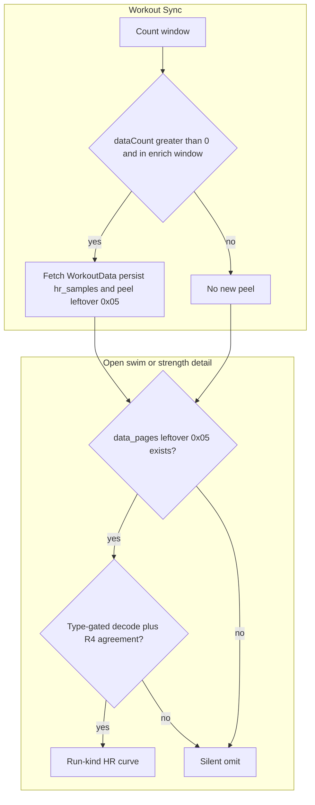

# feat: GT5 swim and strength in-session HR curve

## Summary

Reuse the existing Count-hinted WorkoutData persist path. On swim (types 6 and 8) and strength (type 140) session detail, load the same peeled sample stream running already charts, lock it as real in-session HR, and draw that curve as a sibling of swim interval charts when those exist, and beside strength min–max tiles. The swim curve must not require laps. Omit silently when the stream does not lock. Do not invent a new fetch command, Health Kit path, or empty “HR absent” chart.

---

## Problem Frame

Run detail already shows an in-session HR curve from locked WorkoutData samples. The GT5 watch history also shows HR for swimming and strength, but Fathom does not: swim hides a “no sample stream” note and never draws a series (even when `sampleCount` is present), and strength shows min–max tiles plus sample export with no time series. The owner still has to read session shape on the watch (see origin).

---

## Requirements

**Fetch**
- R1. Workout Sync must pull swim and strength sample pages through the same Count-hinted WorkoutData path used for running, without opening Huawei Health.
- R2. Do not add a Health Kit, whole-day HR, or live-HR path to build this curve.

**Lock and chart**
- R3. When a swim or strength session has a sample stream that locks as real in-session HR, session detail must show an in-session HR curve of the same kind as running — including opening an already-stored session whose `data_pages` leftover `0x05` peel locks, without a new Sync.
- R4. A stream locks as real HR only when decoded values are plausible bpm and, when that session already has `hrMin` and/or `hrMax`, the series agrees with those bounds. If both are absent, plausible bpm is enough to lock. `hrPeak` alone is not a totals bound. If decode fails or they disagree, omit the chart.

**Honesty**
- R5. Omit the curve when there is no lockable sample stream. Count-no, a timed-out, or a partial fetch is not itself a reason to omit if a persisted peel still locks. Do not draw an empty chart as “HR absent,” and do not invent points from totals or from whole-day HR.
- R6. A session already stored without a `data_pages` leftover `0x05` peel does not grow a curve until a later Sync pulls samples while the watch still holds them. Native `hr_samples` without a peel does not count as lockable. That later Sync must still request sample pages when Count says they exist for that row. Missing peels on an old row is not proof the watch never recorded HR.

**Unchanged surfaces**
- R7. Existing min/max tiles and swim interval charts stay as they are. This cut does not add zone minutes, training load, recovery, or average HR as new session-truth tiles.
- R8. This cut is swim (pool and open water) and strength only. Running already has the curve.

**Origin actors:** A1 Owner-athlete, A2 GT5-A07, A3 Fathom companion  
**Origin flows:** F1 Sync persist → open detail → lock stored peel → curve or omit  
**Origin acceptance examples:** AE1 (swim lock → curve), AE2 (strength lock → curve), AE3 (Count-zero + no peel → omit), AE4 (decode/disagree → omit), AE5 (stored no-peel without listing Sync → omit), AE6 (partial/timeout persist that still locks → curve)

---

## Scope Boundaries

- Heart-rate zone minutes, training load, training stress, recovery time, and recovery %
- Whole-day / continuous HR as a fallback series for the session window
- Opening Huawei Health or using Health Kit APIs
- Live in-workout HR notify
- Other sports; running already has this chart (do not add R4 min/max rejection to Run this cut)
- Replacing swim interval charts or strength min–max tiles
- Re-deriving a curve from totals alone
- Decoding native `workouts/hr_samples` `0x81` containers for the curve (export stays on that file; the curve uses the run peel)
- Automatically widening Count / leftover-keep to hunt old totals-only rows the watch no longer lists

### Deferred to Follow-Up Work

- Catalog-promoting swim/strength sample packing in `docs/catalogs/gt5-a07-full-metrics.md` after an owner lock (id + marker only; no sample bodies in git)
- Wiring a distinct `enrichStartUnix` narrower than Count start (not required for current product Sync, where enrich floor equals Count start)

---

## Context & Research

### Relevant Code and Patterns

- Native fetch/persist: `android/app/src/main/kotlin/com/example/fitness_os/huawei/HuaweiWorkoutSync.kt` — `dataCount > 0` → WorkoutData `0x17:0x0a`; persist `workouts/hr_samples/{number}_{startTime}.bin`; channel `samplePath` / `sampleCount` / `sampleFetch`
- Flutter peel (curve source): `lib/core/huawei/huawei_link.dart` (`WorkoutChannelPeel`, `PeeledPageBodies`) → `lib/features/workout_history/data/run_session_store.dart` (`loadDataPages` / `save`) under `workouts/data_pages/{number}/`
- Run decode/lock: `lib/features/workout_history/domain/gt5_run_sample_parser.dart` — 8-byte `00 00 <marker> <cadence> 
 00 <u16>`; Walk `0x22`; Outdoor/Indoor run `0x23`; types 6/8/140 currently `markerForWorkoutType` null → empty
- Run chart host: `lib/features/workout_history/presentation/widgets/run_session_charts.dart` — empty points → `SizedBox.shrink()`; HR-only points still render the HR block
- Swim: `lib/features/workout_history/domain/swim_p0_metrics.dart` (`SwimHrCoverage` = `sampleCount`, not decode lock); `lib/features/workout_history/presentation/widgets/swim_session_charts.dart` (lap-gated; “no sample stream” note); `workout_detail_screen.dart` mounts swim charts only when laps nonempty
- Strength: `lib/features/workout_history/presentation/widgets/strength_session_analytics.dart` — min/max tiles, no stream loader; export reads opaque `hr_samples`
- Types: swim pool `6`, open water `8`, strength `140` (`workout_history_formatters.dart`)
- Tests: `test/features/workout_history/run_session_detail_test.dart`, `run_invent_guard_test.dart`, `swim_session_charts_test.dart`, `swim_p0_metrics_test.dart`; `android/.../HuaweiWorkoutSyncTest.kt`

### Institutional Learnings

- No `docs/solutions/` tree. Wire-spec Gate B still labels WorkoutData pre-promotion; **run packing SoT is now the parser**, not the July bitmap-oracle list.
- Health Kit `exerciseHeartRate` documents the data model for swim and core/physical training; it is not a Fathom fetch path.
- Strength leftover-keep one-shot enriched `type=140 && dataCount>0` even outside a narrow enrich floor; product Sync today passes enrich floor equal to Count start, so every Count-listed `dataCount>0` row (including swim) is fetch-eligible. Delta Count will not re-list old `enrichmentStatus=none` rows.

### External References

- Skipped — local run persist/decode/chart patterns are sufficient. Community oracle remains behavioral only (no AGPL paste).

---

## Key Technical Decisions

- **Two-phase F1:** Workout Sync fetches and peels. Opening detail only locks the stored peel. Detail must not Count/fetch.
- **Lock source = run peel:** leftover TLV `0x05` bodies via `RunSessionStore.loadDataPages`. Native `hr_samples` (`0x81` pages) stays persist/export, not the curve decoder.
- **Lock ≠ `sampleCount` / `SwimHrCoverage.present`:** those are header honesty, not a chartable series.
- **Run decoder is a candidate:** keep type-gated markers. Do not scan every third byte. Characterize owner peels first: if an 8-byte walk yields plausible bpm, record type + marker (even if extrema sit 2 bpm off Totals). Enable the marker in the parser only after that characterization. Apply R4 agreement as a separate lock gate (start at 1 bpm; do not refuse to catalog a marker solely because 1 bpm failed). Until a marker is catalogued, omit is correct.
- **R4 agreement is swim/strength-only:** when `hrMin` and/or `hrMax` exist on the row, series extrema must agree (directional: within 1 bpm of each present bound). Missing both bounds → plausible bpm (40–220) is enough. Do not add this rejection to Run. `hrPeak` alone does not add a totals check.
- **Chart HR only:** do not surface cadence from the 8-byte record on swim/strength. Do not add avg-HR tiles (R7).
- **Swim host is a sibling:** mount the curve outside lap-gated `SwimSessionCharts` so type 8 / no-interval sessions can still show a lock. Interval Pace/SWOLF/strokes stay.
- **Silent omit:** remove the swim “Heart rate — hidden (no sample stream…)” note. Empty curve → shrink, like Run. Min/max tiles unchanged.
- **R6 retry = Count still lists the row:** do not invent a new enrich floor or parser bump. Ordinary delta will not hunt `enrichmentStatus=none` rows outside the Count window. Force full-history is the existing hammer while the watch still holds pages. Keep the native `type==140 && dataCount>0` exception as-is (dormant when enrich floor equals Count start).
- **Partial persist:** chart if the peel that landed locks (AE6). Header-only later Sync must not clobber a denser peel (existing monotonic store).

---

## Open Questions

### Resolved During Planning

- Which file is the lock source?: **Peeled `data_pages` leftover `0x05`**, same as Run.
- Where does the swim curve mount?: **Sibling of interval charts**, not inside the lap-gated card.
- Omit copy?: **Silent**, like Run. Drop the “no sample stream” note as the HR-curve stand-in.
- R6 later Sync?: **Only if Count still lists the row with `dataCount>0`.** No automatic hunt for old none-rows. Force full-history remains the retry while pages remain on the watch.
- Both pool and open water?: **Same host and lock; each type omits independently if its peel does not lock.** Host must not require pool laps.

### Deferred to Implementation

- Exact third-byte marker (and whether packing is the run 8-byte layout at all) for owner swim pool, open water, and strength peels. If a type never yields a plausible 8-byte walk, omit — do not scan unknown markers. Confirm leftover `0x05` is the HR carrier (vs native `0x81` only) during that characterization; reopen the `0x81` exclusion only if the peel is empty and the native file is the sole carrier.
- Exact min/max agreement tolerance if owner files show a systematic 1–2 bpm filter vs Totals (start from within 1 bpm; catalog the marker first, then set tolerance).
- Whether an already-open detail screen live-replaces omit with a curve after Sync, or the owner must leave and reopen (default: follow Run — reload on next build / reopen is enough; do not invent a new live listener).
- Sample interval vs session duration as an extra lock clause (Run uses 5 s; do not assume it for swim/strength until characterization). Default this cut: keep 5 s offsets unless owner peels show a different interval.

---

## High-Level Technical Design

> *This illustrates the intended approach and is directional guidance for review, not implementation specification. The implementing agent should treat it as context, not code to reproduce.*

Lock (directional): concatenate leftover `0x05` bodies → walk 8-byte `00 00 <catalogued marker>` records → keep HR in 40–220 → omit unless at least two non-null `hrBpm` values remain (Run’s line chart already shrinks below two spots) → if `hrMin`/`hrMax` present, require series extrema within 1 bpm of each present bound → else lock. Unknown marker for that type → empty → omit.

---

## Implementation Units

### U1. Swim/strength HR lock over the run peel

**Goal:** A shared lock that loads peeled WorkoutData pages, decodes only a type-gated sample layout, applies R4 agreement, and returns HR-only stream points or empty. Unknown types stay empty until an owner peel catalogs a marker.

**Requirements:** R3, R4, R5, R8; AE4; AE6 (lock half)

**Dependencies:** None

**Files:**
- Modify: `lib/features/workout_history/domain/gt5_run_sample_parser.dart` (or a sibling lock helper next to it — do not scan all markers)
- Modify: `lib/features/workout_history/domain/run_session_metrics.dart` only if the lock helper belongs beside `decodeRunSamplePoints`
- Test: `test/features/workout_history/run_session_detail_test.dart` and/or a new `test/features/workout_history/in_session_hr_lock_test.dart`

**Approach:**
- Input: peeled pages + workout type + optional `hrMin`/`hrMax`. Output: `List<RunStreamPoint>` with `hrBpm` only (no cadence/pace for this consumer).
- Reuse the 8-byte walk and 40–220 band when the type has a catalogued marker. Do not enable types 6/8/140 on `0x23` (or any marker) without an owner-file characterization written into the parser comment the same way Walk `#72` / Outdoor `#60` are cited.
- If owner `data_pages` exist on device, characterize first: record type, marker byte, whether extrema match Totals (id + marker + length only in comments/tests/logs — no real series in git, logcat, Sentry, debugPrint, or CI). Synthetic fixtures may follow once the marker is known. Catalog the marker from a plausible 8-byte walk even if R4 1 bpm agreement fails; then set tolerance from the observed Totals delta.
- If packing is not the 8-byte layout, leave the type uncatalogued (omit). Do not invent a bitmap decoder this cut.

**Execution note:** Characterization-first on owner peels before adding a marker. Implement the lock helper test-first for omit/agreement with synthetic bytes.

**Patterns to follow:**
- `Gt5RunSampleParser.markerForWorkoutType` (unknown → empty)
- `run_invent_guard_test.dart` (opaque leftovers ≠ stream)

**Test scenarios:**
- Happy path: type with catalogued marker + `0x05` body of `00 00 <marker> .. hr ..` with at least two HR values in 40–220 and no totals → HR points at 5 s offsets. Covers AE1/AE2 lock half.
- Edge case: a single in-band HR sample (or one non-null after 40–220) → empty (Run line chart needs ≥2 spots).
- Happy path: same with `hrMin`/`hrMax` matching series extrema within 1 bpm → lock.
- Edge case: type 6, 8, or 140 with no catalogued marker → empty even if bytes look like `0x23` run records. Covers “never scan every marker.”
- Edge case: plausible bpm, totals absent → lock (R4).
- Edge case: Covers AE4. Totals min/max present and series disagrees → empty.
- Edge case: only `hrMin` present → check min only; `hrPeak`-only → no totals check.
- Error path: empty pages, non-`0x05` leftovers, truncated body → empty.
- Integration: lock does not read `samplePath` / native `hr_samples`.

**Verification:**
- Types 1/2/5 decode behavior unchanged (existing run tests still pass).
- Swim/strength types omit until a marker is catalogued; once catalogued, R4 agreement is enforced.

---

### U2. Swim session HR curve host

**Goal:** Pool and open-water session detail show a Run-kind in-session HR curve from U1 when the peel locks, even when there are no interval laps. Remove the “no sample stream” note. Interval charts stay.

**Requirements:** R3, R5, R7, R8; AE1, AE3, AE4

**Dependencies:** U1

**Files:**
- Modify: `lib/features/workout_history/presentation/view/workout_detail_screen.dart`
- Modify: `lib/features/workout_history/presentation/widgets/swim_session_charts.dart`
- Modify: `lib/features/workout_history/presentation/widgets/run_session_charts.dart` only if a caption/title is needed for non-run (prefer constructor args already on the widget)
- Test: `test/features/workout_history/swim_session_charts_test.dart`
- Test: `test/features/workout_history/workout_detail_screen_test.dart` (or the existing swim detail test file if that is where the host is pumped)

**Approach:**
- Load `RunSessionStore.loadDataPages(workout.number)` on swim detail (same store run uses; inject/test seam like `RunSessionAnalytics`).
- Lock via U1 with type 6 or 8 and the row’s `hrMin`/`hrMax`. Do **not** call `decodeRunSamplePoints` or `mergeRunStreamPaceAndHr` here.
- Host states: (1) pages loading — sport-neutral `Loading session…` like Run (no empty-chart chrome); (2) lock success — show the curve; (3) no peel, lock fail, or IO error — `SizedBox.shrink()`. Pending IO is not silent omit.
- If points nonempty, show `RunSessionCharts` with HR-only points, `showStoryTabs: false`, outer title `Heart rate`, outer caption `bpm · in-session samples`. Extend the widget so the inner HR-block caption is not hardcoded `bpm · in-run samples` on this host.
- Mount the HR host for any swim type 6/8 **outside** the existing `swim.p0.laps.isNotEmpty` gate in `workout_detail_screen.dart`. Keep that gate only around `_SwimChartsAndIntervals`. With laps: curve immediately above the interval card. Without laps: same ListView slot the interval card would have occupied (after diagnoses/recs), not the end of the screen.
- Do not nest the curve inside `SwimSessionCharts`.
- Delete the sampleCount-gated “Heart rate — hidden (no sample stream on this session)” copy on the interval card. `SwimHrCoverage` may remain for P0/analytics diagnostic rows; it must not gate this curve and those rows are not the product omit stand-in.
- Do not add avg-HR or zone tiles.

**Patterns to follow:**
- `RunSessionStore.loadDataPages` → U1 lock helper → `RunSessionCharts` (HR-only). Forbid `decodeRunSamplePoints` and `mergeRunStreamPaceAndHr` on swim.

**Test scenarios:**
- Happy path: Covers AE1. Locked peel + laps present → HR curve and interval charts both show.
- Happy path: Locked peel + empty laps (open water / no intervals) → HR curve still shows; interval card stays hidden.
- Edge case: Covers AE3. No peel, Count-no → no HR curve, no “no sample stream” / “HR absent” copy, no empty chart.
- Edge case: Covers AE4. Peel present but lock fails (`hrCoverage` may still be `present` from `sampleCount`) → no HR curve, no “no sample stream” note.
- Edge case: `SwimHrCoverage.present` without a locking peel → still omit curve.
- Integration: Health / whole-day HR unused.

**Verification:**
- Opening a swim session with a locking peel shows the curve without requiring laps.
- Omit is silent. Interval Pace/SWOLF/strokes unchanged when laps exist.

---

### U3. Strength session HR curve host

**Goal:** Strength detail shows the same Run-kind HR curve from U1 beside existing min–max tiles. No stream → silent omit. Export and load/recovery tiles unchanged.

**Requirements:** R3, R5, R7, R8; AE2, AE3, AE4, AE6

**Dependencies:** U1

**Files:**
- Modify: `lib/features/workout_history/presentation/widgets/strength_session_analytics.dart`
- Modify: `lib/features/workout_history/presentation/view/workout_detail_screen.dart` only if a store/test seam must be passed in (prefer constructor/GetIt like other analytics widgets)
- Test: existing strength analytics/detail test file, or `test/features/workout_history/strength_session_analytics_test.dart` if created

**Approach:**
- Load peeled pages for `workout.number`, lock with type 140 + `hrMin`/`hrMax`. Do **not** call `decodeRunSamplePoints` or `mergeRunStreamPaceAndHr`.
- Host states match U2: loading (`Loading session…`), lock success, else shrink.
- Place `RunSessionCharts` (HR-only, no story tabs, title `Heart rate`, caption `bpm · in-session samples`) immediately after `_BasicsRow` and before “This session” impact tiles.
- Do not decode `samplePath` / `hr_samples` for the chart. Export continues to attach those opaque bytes.
- Partial/timeout: if a peel exists and U1 locks it, show the curve (AE6).

**Patterns to follow:**
- `RunSessionStore.loadDataPages` → U1 lock helper → `RunSessionCharts`. Strength `_BasicsRow` stays totals-only.

**Test scenarios:**
- Happy path: Covers AE2. Locked peel → HR curve plus existing min–max label.
- Happy path: Covers AE6. Partial peel that still locks → curve.
- Edge case: Covers AE3. No peel → no curve; min–max tiles still show when totals exist.
- Edge case: Covers AE4. Disagree with min/max → no curve; tiles unchanged.
- Edge case: Cadence in synthetic 8-byte records is not shown as a strength cadence chart.

**Verification:**
- Strength detail can show a locking curve without export. Min–max / load / recovery / export behavior unchanged.

---

### U4. Count-listed re-fetch honesty (R6)

**Goal:** Prove that a later Sync still requests WorkoutData when Count lists a swim or strength row with `dataCount>0`, and that a prefs row with no peel stays omitted until that happens. Do not add a new enrich floor or parser bump.

**Requirements:** R1, R6; AE5

**Dependencies:** None (can land in parallel with U1; UI units do not depend on it)

**Files:**
- Modify: `android/app/src/test/java/com/example/fitness_os/huawei/HuaweiWorkoutSyncTest.kt` if a swim `dataCount>0` in-window case is missing
- Modify: `test/features/workout_history/workout_history_repository_test.dart` only if merge/union of existing peels vs header-only incoming is not already covered
- Test: same files; no product Sync API change unless tests show the in-window swim Data path is actually skipped

**Approach:**
- Current product Sync sets enrich floor equal to Count start, so every Count-listed `dataCount>0` row should already enrich (including types 6/8). Confirm with tests; do not “fix” a gate that already matches R6 for in-window rows.
- Document in this unit’s verification: delta Sync will not Count `enrichmentStatus=none` rows outside the cursor/14-day window; Force full-history is the retry while the watch still lists them (AE5).
- Keep enrichment-monotonic merge: header-only incoming must not delete an existing peel (R5 / AE6).
- Do not pass a new `enrichStartUnix`, do not bump `currentRunSessionParserVersion`, do not open Health.

**Test scenarios:**
- Happy path: Count-listed swim with `dataCount>0` and `startTime` in window → Data request issued (R1/R6).
- Happy path: Count-listed strength with `dataCount>0` → Data request issued (existing strength exception may also apply).
- Edge case: Covers AE5. Stored row, no peel, no new Count listing → no curve (UI covered in U2/U3; this unit asserts Sync does not fetch a row Count omitted).
- Edge case: `dataCount==0` → no Data request (`sampleFetch=none`).
- Integration: later header-only merge keeps prior `data_pages` / `samplePath`.

**Verification:**
- In-window Count-positive swim/strength still fetch Data. No new full-history hammer. AE5 remains omit until Count lists the row again.

---

## System-Wide Impact

- **Interaction graph:** Workout Sync unchanged as the fetch entry. Swim and strength detail become additional consumers of `RunSessionStore` (already used by Run and merge). Forget Device already wipes `data_pages` / `hr_samples` with other workout side-files — do not add a new store dir.
- **Error propagation:** Missing peel or failed lock → silent omit. Sync timeout/partial still merge Totals; curve uses whatever peel remains.
- **State lifecycle risks:** `data_pages` keyed by workout number (existing run constraint). Header-only re-sync must not clobber a denser peel. Opening detail must not fetch.
- **API surface parity:** No new MethodChannel APIs. No Health Kit. Coach sport-type catalogs stay unused.
- **Integration coverage:** Lock + host + in-window Data fetch. Owner-file marker catalog is the remaining runtime unknown.
- **Unchanged invariants:** Run decode/charts; swim interval charts; strength min–max / load / export; daily vitals HR; no AGPL paste.

---

## Risks & Dependencies

| Risk | Mitigation |
|------|------------|
| Swim/strength packing is not the run 8-byte layout | Type-gated markers; omit if uncatalogued; never scan every marker |
| `sampleCount` / `SwimHrCoverage.present` mistaken for lock | U1/U2 tests: present coverage + failed lock → no curve |
| Native `hr_samples` wired as the decoder | Explicit peel-only lock; export stays on `hr_samples` |
| Lap-gated swim card hides a locking open-water stream | Sibling host (U2) |
| Old totals-only rows never grow a curve on delta Sync | Accepted: AE5 / Force full-history while Count still lists the row |
| R4 agreement false-omits a real optical series | 1 bpm directional tolerance; tighten only from owner files; missing totals do not block |
| Binder drop of leftover bodies with native file present | Same as Run today; do not add an `0x81` decoder this cut |

---

## Documentation / Operational Notes

- After an owner lock, update catalog observation for Data HR on pool / open water / strength (score/obs only — no series in git).
- Wire-spec Gate B WorkoutData “pre-promotion” line is stale for run; do not treat it as swim/strength packing proof.
- Privacy: fixtures use synthetic constructed (not copied-from-owner) 8-byte records. Never commit owner HR series. Logs, Sentry, debugPrint, CI, and characterization may record workout id, type, marker, and byte length only — never bpm series, leftover hex, or peel bodies.

---

## Sources & References

- **Origin document:** [docs/brainstorms/2026-09-19-gt5-swim-strength-hr-curve-requirements.md](docs/brainstorms/2026-09-19-gt5-swim-strength-hr-curve-requirements.md)
- Related plans: `docs/plans/2026-09-11-001-feat-gt5-running-session-metrics-plan.md`, `docs/plans/2026-09-09-001-feat-gt5-strength-session-metrics-plan.md`
- Related code: `gt5_run_sample_parser.dart`, `run_session_store.dart`, `HuaweiWorkoutSync.kt`, `swim_session_charts.dart`, `strength_session_analytics.dart`
