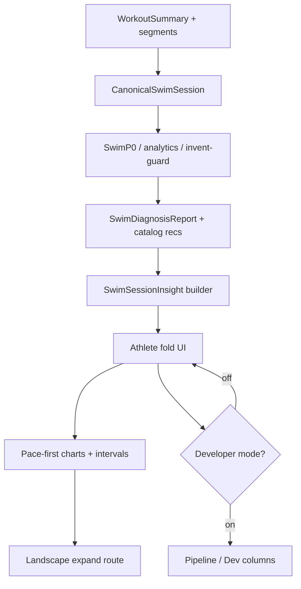
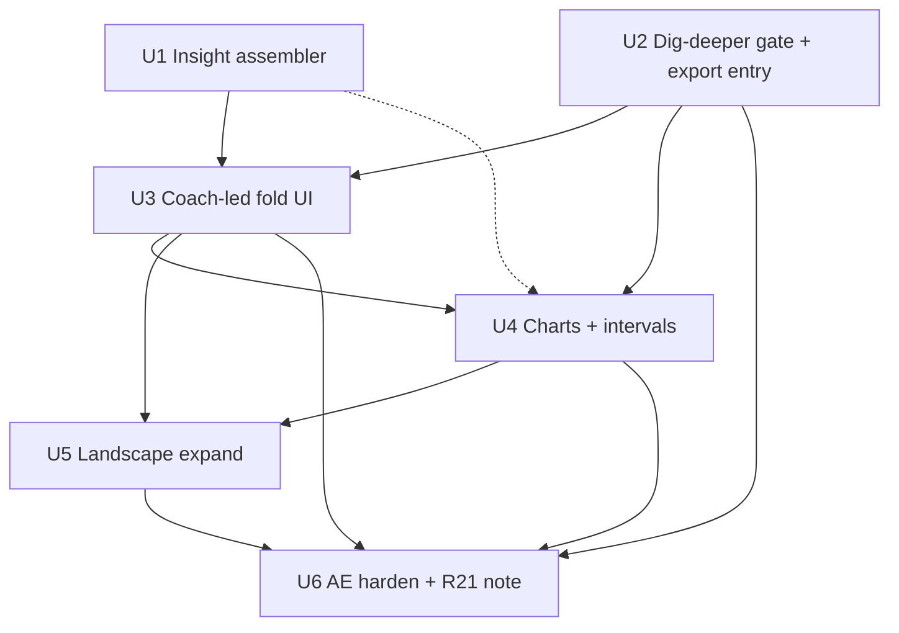
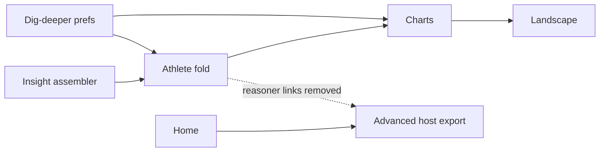

# feat: Pool swim detail coach-led redesign

## Summary

Rebuild the pool/open-water swim athlete path of workout detail into a coach-led analyze-and-improve surface: an athlete `SwimSessionInsight` assembler (story, focus-relative chips, primary tip, KPIs, secondary findings), UI ordered verdict → primary tip → KPIs → jump links → pace chart with progressive depth, landscape expanded chart analysis for dense sessions, a dig-deeper flag that quarantines pipeline chrome, and complete removal of Run reasoner / Qwen3 UI from swim detail. Swim Bible compute stays the source of truth; R21 is satisfied with a short non-goals note pointing at the assembler (Programs may consume later — not a second consumer in this cut).

---

## Problem Frame

Pool swim detail already computes valuable session truth but presents it as an instrument dump (enrichment counts, Sync lines, type IDs, P0 chrome, metric footers, Dev columns, Run reasoner). The owner-athlete needs a fast post-swim verdict and one next-session cue; dig-deeper plumbing must stay reachable without poisoning the default path. (see origin: `docs/brainstorms/2026-10-08-pool-swim-detail-redesign-requirements.md`)

---

## Requirements

**Coach fold IA**
- R1. Coach-led single scroll with light jump links — not a sticky multi-tab bar
- R2. First viewport: hybrid verdict → primary tip → compact KPI strip (+ jump-link row). Pace chart is the next section (in or abutting first viewport — visible without hunting / one thumb-scroll max), not jump-only
- R3. Hybrid verdict = plain-language story + up to 2–3 comparison chips; omit chip row when history is thin (&lt;2 comparable); no quality/readiness/0–100 score
- R6. Additional diagnoses under collapsed “More findings”; default shows one primary tip
- R7. Jump links scroll to Charts / Intervals / Findings without tab-only IA; omit a link when its section has no content; Findings jump auto-expands More findings

**Tip & KPIs**
- R4. One allow-listed primary tip with athlete-facing title/why; no model names, ranking labels, Bible refs, or metric-ID footers on the default path
- R5. KPI strip: distance, duration (prefer swim/moving vs rest when honest), avg pace, avg SWOLF; avg/max HR only when in-session HR locks; omit missing metrics
- R19. Athlete header uses human sport name only
- R20. Quiet confidence/coverage language; no High-sticker farms

**Charts & landscape**
- R8. Default chart series = pace by interval; rest/null pace never plotted as false-fast; other series secondary
- R9. Portrait ticks summarized for dense sessions; fine analysis in expanded mode
- R10. Expanded chart mode opens in landscape (or equivalent full-bleed landscape-oriented analysis)
- R11. Expanded mode available for the viewed series; prominent entry when interval count ≥ 10; shorter sessions may expand on demand
- R12. Expanded mode supports series switch among available series and dismiss back to portrait position left
- R13. Intervals table athletic columns only on athlete path (no Dev/wire-index)
- R14. Invent-guard default-hide garbage laps; include-filtered only when dig-deeper flag on / clearly secondary
- R15. In-session HR omit-over-invent; no empty tutorial chrome

**Athlete vs dig-deeper path**
- R16. Athlete default UI must not show banned debug strings/surfaces (enrichment counts, Sync lines, raw type codes, P0 naming, Evidence chrome, metric footers, Samples dumps, Dev columns)
- R17. Those dig-deeper surfaces available only when the dig-deeper flag is on (off by default)
- R18. Run reasoner / Qwen3 / offline-ranking UI removed from swim detail entirely (not relocated to dig-deeper)

**Cross-surface & validation**
- R21. Document athlete insight assembler + honesty rules for a future Programs consumer (short non-goals note; no Programs UI; no dual-consumer API design in this cut)
- R22. App Home remains chart-free (Home may host a dig-deeper entry that is not a workout chart)
- R23. Open-water (type 8) shares swim shell with omit for pool-specific copy; OW-specific coaching narratives may defer
- R24. Validation via fixture/widget acceptance coverage including tip-winning fixtures (no disposable HTML PoL gate)

**Origin actors:** A1 owner-athlete, A2 dig-deeper Developer mode, A3 future Programs consumer (seam only)
**Origin flows:** F1 post-swim glance, F2 chart analysis portrait→landscape, F3 depth review, F4 Developer verification
**Origin acceptance examples:** AE1 (first viewport + banned chrome), AE2 (HR lock/omit), AE3 (40-interval landscape), AE4 (one primary tip), AE5 (Dev columns), AE6 (jump-link scroll)

---

## Scope Boundaries

- No Programs / training-plan attachment UI, plan chips, or “add to plan” CTAs
- No charts or coaching cards on the Home tab
- No quality / readiness / HRV percentage scores
- No Run reasoner / on-device LLM ranking UI on swim detail (removed, not polished into Dev mode)
- No Gemini / FAB local-AI-coach work (separate track)
- No stroke Style coaching UI beyond existing capability gates
- Not a multi-user consumer SaaS redesign — dogfood owner-athlete remains primary
- Pixel-perfect FORM/MySwimPro cloning not required
- Disposable HTML PoL probe not a gate for this cut (fixture/widget verification instead)

### Deferred to Follow-Up Work

- Open-water-specific coaching narratives (beyond committed shared-shell omit parity for R23)
- Optional later: annotate rest gaps visually on pace charts (honesty first is gap/skip null pace)
- Qwen download / reasoner settings polish outside swim detail (keep reachable only if still needed for diagnostics; not athlete path)
- Promoting dig-deeper into an app-wide “Developer mode platform” beyond swim consumers

---

## Context & Research

### Relevant Code and Patterns

- Detail shell: `lib/features/workout_history/presentation/view/workout_detail_screen.dart` — residual `else` branch today serves **all** non-run/non-strength types; swim coach fold must gate on `isSwimWorkout` (6∥8), not rewrite the whole residual branch
- Charts: `lib/features/workout_history/presentation/widgets/swim_session_charts.dart` — four equal stacked `fl_chart` charts; null pace currently risks `toY: 0`
- Series-chip precedent: `lib/features/workout_history/presentation/widgets/run_session_charts.dart` (`_StoryFocus`)
- HR host (omit-over-invent): `lib/features/workout_history/presentation/widgets/in_session_hr_curve_host.dart` + `domain/in_session_hr_lock.dart`
- Compute SoT: `canonical_swim_session.dart`, `swim_p0_metrics.dart`, `swim_session_analytics.dart`, `swim_invent_guard.dart`, `swim_trends_diagnosis.dart`, `swim_recommendations.dart`
- Trends caveat: `buildSwimTrends` pace/SWOLF deltas are earliest→latest across history — **not** focus-relative; chips need new focus-relative baselines
- Duration: `WorkoutSummary.durationSec` only; moving time = Σ lap durations (internal to P0/trends) — derive + honesty-gate for KPI strip
- No Developer mode today; invent-guard include-filtered + Dev column currently on athlete path
- No landscape orientation helpers in Dart today; AndroidManifest already allows orientation configChanges
- Home chart-free lock: Home Today plans + brand IA; do not add swim charts to Home
- Widget test precedent: `test/features/workout_history/run_session_detail_test.dart` (product IA AEs); swim needs a comparable suite
- Existing swim tests: `swim_session_charts_test.dart`, `swim_invent_guard_test.dart`, `swim_trends_diagnosis_test.dart`, `swim_recommendations_test.dart`, `workout_detail_screen_test.dart`, HR lock/host tests

### Institutional Learnings

- No `docs/solutions/` tree; constraints live in brainstorms/plans/design
- Swim Bible compute + allow-listed recs + invent-guard + omit-over-invent remain hard locks
- Brand IA / swim product review chart-order and reasoner-on-tap are **superseded** by origin for this page; invent-guard default and Home chart-free stay
- HR-curve plan: lock peel ≠ `sampleCount`; silent omit; mount HR sibling of lap-gated charts
- Do not reintroduce reasoner under Developer mode “for dig-deeper”

### External References

- Skipped formal external research — local Flutter/`fl_chart` + Run series-chip patterns suffice; competitive patterns already captured in origin research inputs

---

## Key Technical Decisions

- **`SwimSessionInsight` athlete assembler:** Pure domain builder for the F1 fold (story, chips, primary tip, KPIs, secondary findings, empty-tip escape). R21 = short non-goals doc pointing at this assembler + honesty rules; do not design/verify a Programs API in this cut.
- **One winning diagnosis:** The same winning session diagnosis drives story + primary tip; secondaries are the remainder. Unit-test fails if tip source diagnosis ≠ story diagnosis.
- **Focus-relative comparison chips:** Non-interactive status chips. Pool (type 6): vs prior comparable type-6 with same `poolLengthM` when both known; omit when &lt;2 comparable, missing pool length on either side, or prior older than a simple lookback (implementation picks N, default last ~10 pool swims). Open-water (type 8): vs prior type-8 or omit chips in v1 (prefer omit if thin). Never reuse earliest→latest `buildSwimTrends` deltas as “vs recent.”
- **Primary tip without reasoner:** Prefer **session** diagnoses only for tip ranking (exclude global `trend_*` diagnoses from primary tip selection). Map winning diagnosis → allow-listed catalog rec. Default priority hypothesis: `fatigue_onset` &gt; `efficiency_decline` &gt; `pacing_uneven` &gt; steady/keep; coverage-only IDs (`insufficient_intervals`, `length_semantics_open`, `no_strong_signal`) are not primary tips. Athlete copy map keyed by diagnosis/rec id; strip bibleHint/metricIds/confidence badges. Validate with archetype fixtures that assert **which** tip wins.
- **Athlete diagnosis lap set:** Run athlete-path analytics/diagnoses on the same default invent-guarded lap set as charts/table (dig-deeper may re-run include-filtered).
- **Duration KPI honesty:** `movingSec = Σ invent-guarded lap durations`; show swim/rest split only when `0 < movingSec ≤ durationSec`; otherwise total only.
- **HR KPI input seam:** Presentation (or a thin helper over already-loaded pages) computes lock outcome once; passes optional locked HR KPIs into the insight builder. Watch totals alone never promote HR. Curve host and strip share that result.
- **Pace chart honesty:** Never plot null/non-positive `paceSecPer100m` as `0`; gap/skip those intervals.
- **Portrait chart IA:** Pace primary via Run-style series chips (`_StoryFocus` precedent); SWOLF / strokes / HR-when-locked as additional chips (omit absent series — no disabled stubs). Not four equal-height charts.
- **Athlete scroll stack:** story+chips → primary tip → KPI strip → jump links → pace chart (primary series) → progressive series/HR → Intervals → More findings.
- **Fold states:** (1) loading — header + KPI placeholders from `WorkoutSummary` only; (2) ready — full insight; (3) failed/partial — empty-tip escape + available scalars, quiet “coaching unavailable” optional. Ban skeleton copy that mirrors Sync/P0/Evidence labels.
- **KPI strip layout:** 2 primary (distance, duration/split) + secondary inline (pace/SWOLF/HR); collapse gaps when omitted — not an equal metric-card grid.
- **Landscape expand:** Full-screen route; `SystemChrome` landscape while open; restore on every exit; series chips; dismiss restores Charts anchor + last series; prominent CTA when ≥10 intervals. Portrait detail ignores device rotation (fine analysis via expand CTA only).
- **Swim-only coach fold:** Gate insight fold on `isSwimWorkout`; residual non-swim types keep a minimal non-coach dump/stub — do not apply swim IA to cycle/elliptical/etc.
- **Dig-deeper flag:** Swim dig-deeper boolean via `GateAPrefs` key (default off); consumers are swim detail/charts/intervals only. Neutral naming OK; do not build an app-wide Developer platform yet.
- **Permanent dig-deeper / export entry:** Before removing swim reasoner links, land a Home (or device) **Advanced / Dig deeper** entry that hosts the dig-deeper toggle + App Data Export (split from Qwen chrome). Leave `SwimReasonerService` / DI intact; remove swim reasoner UX only. Psychology AppBar removal scoped to swim athlete path.
- **Reasoner disposition:** Delete Run reasoner / Qwen3 / offline-ranking from swim athlete path. Do not quarantine into dig-deeper.
- **Open-water v1:** Shared swim shell; omit pool-length/laps copy when null; tip escape when analytics insufficient; degraded verdict = story always, no empty chip placeholders.
- **Validation posture:** Characterization-first banned-string / AE tests; tip-winning archetype fixtures; fixture dogfood of story+tip on ≥3 real sessions before treating polish complete; no disposable HTML PoL gate.
- **Single load for coaching fold:** One `loadSwimDiagnosisReport` (+ history for chips) feeding insight + UI; no dual-loader instrument flash.

---

## Open Questions

### Resolved During Planning

- **Developer mode entry:** Persisted Settings toggle, off by default (confirmed in scoping synthesis)
- **PoL gate:** Skip disposable HTML PoL; use fixture/widget AE coverage (confirmed)
- **Programs seam:** Dart `SwimSessionInsight` + short doc, no UI consumer (confirmed)
- **Swim vs rest duration:** Derive with honesty gate (research)
- **Open-water parity:** Shared shell with omit (research + origin R23)
- **Chip baselines:** Focus-relative prior comparable pool swim; omit when thin (flow analysis)
- **Null pace plotting:** Gap/skip; never `toY: 0` as pace (flow analysis)
- **Primary tip selection:** Severity-ordered diagnosis → allow-listed catalog (flow analysis)
- **HR strip vs curve:** Same lock predicate (flow analysis)

### Deferred to Implementation

- Exact athlete copy strings for story/tip tables (tune against archetype fixtures + ≥3 real-session dogfood during U1/U3)
- Exact lookback N and full diagnosis→priority map polish beyond the default hypothesis (keep coverage-only IDs non-primary)
- Exact thinned tick interval formula for dense portrait charts
- Whether landscape uses a dedicated named route vs modal full-screen page (dispose/restore parity must match either way)
- Minimal dig-deeper surface checklist polish (which parse/provenance rows earn space once quarantine lands)

---

## High-Level Technical Design

> *This illustrates the intended approach and is directional guidance for review, not implementation specification. The implementing agent should treat it as context, not code to reproduce.*



**Athlete fold (directional):**

```text
SwimSessionInsight
  story: String
  chips: [ { label, direction } ]  // 0–3 status chips; omit row when thin
  primaryTip: Tip?                 // null → empty-tip escape; same winning diagnosis as story
  kpis: { distance, duration, pace, swolf, hr? }
  secondaryFindings: [ Finding ]   // collapsed by default
```

---

## Implementation Units



Hard constraint: U3 must not remove swim→`/coach_settings` reasoner links until U2’s permanent dig-deeper/export entry exists.

### U1. SwimSessionInsight athlete assembler

**Goal:** Pure domain object + builder that turns invent-guarded session truth + session diagnoses (+ recent history + optional locked HR KPIs) into athlete-safe story, chips, primary tip, KPIs, and secondary findings — including empty-tip escape.

**Requirements:** R3, R4, R5, R6, R15, R20, R21, R23

**Dependencies:** None (consumes existing Bible compute)

**Files:**
- Create: `lib/features/workout_history/domain/swim_session_insight.dart`
- Modify: additive helpers near `swim_trends_diagnosis.dart` / analytics for focus-relative chips and invent-guarded session diagnosis input (do not change global `buildSwimTrends` semantics)
- Test: `test/features/workout_history/swim_session_insight_test.dart`

**Approach:**
- Pure domain builder — inputs: invent-guarded laps, session-scoped diagnoses/recs, `List<CanonicalSwimSession>` (or equivalent) for chips, optional precomputed locked HR KPIs; **no** prefs/orientation/Flutter types
- One winning session diagnosis drives story + primary tip; exclude `trend_*` from primary tip selection
- Focus-relative chips per Key Technical Decisions; omit rules over fabricate
- Duration honesty gate; HR only from passed-in lock result
- Secondary findings without sticker farms / metric-ID footers
- Open-water omit + chip omit when thin
- Athlete copy tables OK (catalog pattern); R21 doc later points here — do not overfit fields for Programs

**Execution note:** Implement domain behavior test-first; include tip-winning archetype fixtures.

**Patterns to follow:**
- `swim_recommendations.dart` catalog + invent-guard on IDs
- `swim_trends_diagnosis.dart` diagnosis IDs / report shape
- HR lock rules from `in_session_hr_lock.dart` (lock computed outside builder)

**Test scenarios:**
- Happy path: Multi-diagnosis pool swim with prior history → story present, chips when comparable, one primary tip, KPIs populated, secondaries listed
- Happy path: Archetype fixtures assert specific winning diagnosis id + tip id (not merely “one tip”)
- Happy path: Story diagnosis id equals tip source diagnosis id
- Happy path: Optional locked HR KPIs present → HR fields on insight; absent → omitted
- Edge case: Insufficient intervals / coverage-only diagnoses → primary tip null + empty-tip escape; KPIs still present when scalars exist
- Edge case: Thin history / missing pool length → chips omitted; no fabricated deltas
- Edge case: Focus workout mid-history → chips vs prior comparable; tip not driven by global `trend_*`
- Edge case: `movingSec` inconsistent with `durationSec` → duration KPI total-only
- Edge case: Type 8 → pool-specific fields omitted; chips omit or type-8 baseline; builder does not throw
- Error path: Missing canonical/analytics → honest empty/partial insight without inventing tip

**Verification:**
- Domain tests pass including tip-winning archetypes; insight has no banned pipeline vocabulary for athlete consumption

---

### U2. Dig-deeper gate + permanent export entry

**Goal:** Introduce a swim dig-deeper flag (off by default), gate dump widgets, and land a permanent non-reasoner entry for dig-deeper toggle + App Data Export before U3 removes swim reasoner links.

**Requirements:** R14, R16, R17, AE5

**Dependencies:** None

**Files:**
- Modify: `lib/features/device_pairing/domain/gate_a_prefs.dart` (add dig-deeper bool key; avoid a parallel prefs module)
- Create: dig-deeper / Advanced host screen + route under an existing feature (prefer Home overflow or device advanced — not Qwen-branded)
- Modify: Home (or device pairing) navigation to reach that host
- Modify: move or deep-link App Data Export onto the dig-deeper host (split from reasoner chrome)
- Modify: `lib/features/workout_history/presentation/view/workout_detail_screen.dart` (read flag; gate existing dump widgets only — no fold rewrite)
- Test: `test/features/workout_history/developer_mode_gate_test.dart` (and a small navigation/export reachability test)

**Approach:**
- Persisted swim dig-deeper boolean via `GateAPrefs`, default false
- Land prefs + dig-deeper host (toggle + export) **first**; then gate dump widgets
- When false: hide R16 surfaces + invent-guard include-filtered
- When true: show minimal dig-deeper set for pipeline honesty
- Do **not** expose Run reasoner on dig-deeper host
- Leave `SwimReasonerService` / DI / `CoachSettingsRoute` registered

**Patterns to follow:**
- `GateAPrefs` + `sl<SharedPreferences>()`
- Characterization gates on current dump — no coach-fold rewrite here

**Test scenarios:**
- Happy path: Flag off → swim detail lacks Dev column / enrichment / Sync line
- Happy path: Flag on → dig-deeper surfaces visible
- Edge case: Flag defaults false on fresh prefs
- Integration: From Home/device Advanced, owner reaches dig-deeper toggle + App Data Export without opening reasoner UI
- Integration: Toggling flag is observed on next swim detail open

**Verification:**
- Athlete path can hide R16 surfaces; export + dig-deeper toggle reachable without swim psychology AppBar

---

### U3. Coach-led athlete fold UI

**Goal:** Replace the swim instrument dump with the locked scroll stack; remove reasoner entry points from the swim path; consume `SwimSessionInsight`.

**Requirements:** R1–R7, R16, R18, R19, R20, AE1, AE4, AE6

**Dependencies:** U1, U2

**Files:**
- Modify: `lib/features/workout_history/presentation/view/workout_detail_screen.dart` (gate `isSwimWorkout` before coach fold; residual non-swim keeps stub/dump)
- Create: `lib/features/workout_history/presentation/widgets/swim_session_coaching_fold.dart` (extract early — not optional)
- Modify: remove psychology AppBar + in-body Qwen/reasoner controls on swim path only (after U2 entry exists)
- Test: `test/features/workout_history/swim_session_detail_test.dart`

**Approach:**
- **Owns** dump→fold rewrite for swim only; extract coaching fold widget before teardown
- One report load (+ history + HR lock) → `buildSwimSessionInsight` → fold states per Key Technical Decisions
- Scroll stack: story+chips → tip → KPIs → jump links → pace chart → depth; omit empty jump links; Findings auto-expands
- Chips non-interactive; KPI strip not equal-card grid
- Reasoner removal on swim path only; export via U2 dig-deeper host
- Dig-deeper remnants only when flag on

**Execution note:** Characterization banned-string / reasoner-absence tests before tearing dump order; dogfood story+tip on ≥3 real sessions before polish freeze.

**Patterns to follow:**
- `run_session_detail_test.dart` AE style
- Strength/run sport branches already product-shaped

**Test scenarios:**
- Covers AE1. Dig-deeper off + diagnoses/recs → story, chips (or omit), one tip, KPIs; no enrichment/Sync/Type: 6/metric footers/Run reasoner
- Covers AE4. Multiple diagnoses → one primary tip; More findings collapsed
- Covers AE6. Jump to Intervals scrolls without tab-only IA; empty-section links omitted
- Happy path: Empty-tip escape when insufficient intervals; KPIs still visible
- Happy path: Loading state shows summary KPI placeholders without banned chrome
- Edge case: Non-swim residual type does not render swim coach fold
- Edge case: Psychology/reasoner AppBar absent on swim; export still reachable via dig-deeper host
- Integration: Dig-deeper on shows quarantine surfaces without restoring reasoner

**Verification:**
- Fixture pool swim with dig-deeper off matches AE1/AE4; residual sports unaffected

---

### U4. Pace-first charts, progressive disclosure, athletic intervals

**Goal:** Make pace the default evidence chart; secondary series progressive; fix null-pace false-fast; athletic intervals columns on athlete path; invent-guard toggle only in Developer mode.

**Requirements:** R8, R9, R13, R14, R15, AE2 (HR expander), AE5

**Dependencies:** U2 (invent-guard / Dev column gate), U3 (fold structure / jump anchors — or extract charts/intervals widgets first to avoid fighting the ListView rewrite); align lap metrics with U1 honesty rules

**Files:**
- Modify: `lib/features/workout_history/presentation/widgets/swim_session_charts.dart`
- Modify: intervals table section in `workout_detail_screen.dart` (or extract widget)
- Modify: `lib/features/workout_history/presentation/widgets/in_session_hr_curve_host.dart` placement relative to new expanders if needed
- Test: `test/features/workout_history/swim_session_charts_test.dart`
- Test: update/extend `test/features/workout_history/swim_session_detail_test.dart`

**Approach:**
- Land after U3 fold/anchors (or extract charts/intervals widgets so U3 owns scroll alone)
- Series chips (Run `_StoryFocus`): default pace; omit absent series
- Gap/skip null or non-positive pace — never plot as 0
- Thin portrait x-axis labels for dense interval counts
- Series selection state liftable into U5 route args
- Athletic intervals columns; Dev/wire-index only when dig-deeper on
- Invent-guard synced; include-filtered only when dig-deeper on
- HR curve omit-over-invent sibling sharing lock result with KPI strip

**Patterns to follow:**
- `run_session_charts.dart` series chips
- Existing invent-guard shared filter in `_SwimChartsAndIntervals`
- HR host silent omit

**Test scenarios:**
- Happy path: Pace chart is the primary visible series; secondary series not all equal-height by default
- Happy path: Null/missing pace lengths are not rendered as zero-height “fast” bars
- Covers AE2. Locked HR → HR expander/series available; unlocked → omitted
- Covers AE5. Dig-deeper off → no Dev column; on → dig-deeper column may appear
- Edge case: Dense interval fixture → portrait tick labels do not require every index
- Edge case: Invent-guard filtered laps hidden by default; include-filtered absent when dig-deeper off
- Integration: Charts and table iterate the same filtered lap set

**Verification:**
- Chart tests updated (including removal/replacement of any “synced to table” athlete-facing assertions that conflict with R16); AE2/AE5 covered

---

### U5. Landscape expanded chart analysis

**Goal:** Full-bleed landscape-oriented expanded analysis with readable axes for 10+ interval sessions; series switch; dismiss restores portrait position.

**Requirements:** R10, R11, R12, AE3

**Dependencies:** U3, U4

**Files:**
- Create: `lib/features/workout_history/presentation/view/swim_chart_expanded_route.dart` (or widgets equivalent)
- Modify: `swim_session_charts.dart` / coaching fold to offer expand CTA (prominent when ≥10 intervals)
- Modify: app router registration if routes are centrally listed
- Test: `test/features/workout_history/swim_chart_expanded_test.dart`

**Approach:**
- Preferred home: `presentation/view/swim_chart_expanded_route.dart` + `lib/app/routing/route_registry.dart`; modal full-screen OK if dispose/restore parity matches
- Capture previous `SystemChrome` preferred orientations → landscape while mounted → restore on every exit path (dismiss + system back)
- Pass current series + filtered laps (+ HR availability) as route args — do not re-trigger diagnosis/insight loaders
- No orientation / `SystemChrome` calls in domain or insight builder
- On dismiss: portrait detail + Charts anchor (owned by U3 fold) + last series via result/callback
- Shorter sessions may still expand on demand; ≥10 intervals get prominent entry

**Patterns to follow:**
- Existing named routes under `workout_history/presentation/view/` + `CoachSettingsRoute.register` style
- Series switching from U4 / Run chips

**Test scenarios:**
- Covers AE3. 40-interval fixture → expand entry available → expanded view presents landscape-oriented analysis with readable interval inspection affordances
- Happy path: Series switcher omits absent series (e.g. HR unlocked)
- Happy path: Dismiss restores Charts section (scroll restore / anchor)
- Edge case: Session with &lt;10 intervals still can expand on demand
- Edge case: Orientation preferences restored after dismiss (widget/fake async verification as practical)

**Verification:**
- AE3 satisfied on dense fixture; no reliance on cramped portrait-only ticks for fine analysis

---

### U6. Acceptance hardening + R21 note

**Goal:** Close AE gaps, regressions, and a short R21 non-goals note; confirm product dogfood bar for story+tip.

**Requirements:** R21, R22, R24, AE1–AE6, Success Metrics

**Dependencies:** U2, U3, U4, U5

**Files:**
- Modify/extend: `test/features/workout_history/swim_session_detail_test.dart`
- Modify: `test/features/workout_history/swim_chart_expanded_test.dart` as needed
- Create: `docs/architecture/swim-session-insight-contract.md` (short: assembler fields, honesty rules, non-goals — Programs may consume later)
- Smoke: Home chart-free assertion if a light existing Home test can carry it

**Approach:**
- Fill any AE holes left by U3–U5; banned-string golden list from R16
- Type 8 smoke; reasoner absent; dig-deeper/export reachable
- R21 note is non-goals heavy — athlete assembler SoT today, not a Programs API
- Optional: one-line supersession note in swim product review is follow-up, not required here

**Test scenarios:**
- Integration: AE1–AE6 matrix + tip-winning archetype assertions
- Integration: Reasoner absent on swim; dig-deeper/export reachable from Advanced host
- Integration: Home remains without workout/swim charts
- Edge case: Type 8 detail smoke under athlete path

**Verification:**
- AE suite green; owner dogfood can state story + tip in ~30s on ≥3 real sessions; R21 note exists

---

## System-Wide Impact

- **Layering:** `SwimSessionInsight` stays a pure domain assembler. Presentation owns load, HR lock peel, and rendering. Dig-deeper flag and orientation never enter the builder.
- **Swim vs residual branch:** Coach fold only when `isSwimWorkout`; other residual sports keep non-coach UI.
- **Programs:** Short R21 note only; no Programs feature folder.
- **Dig-deeper ownership:** `GateAPrefs` bool; swim consumers; permanent Advanced host for toggle + export (Home/device), independent of Qwen.
- **coach_settings blast radius:** Remove swim reasoner entry points after Advanced host lands; leave reasoner service/DI registered.
- **AppBar gating:** Remove psychology affordance on swim path only.
- **Single report load + fold states:** No dual-loader flash; loading/ready/partial as specified.
- **Landscape lifecycle:** Presentation route; restore orientations on every exit; pass series/laps as args; portrait ignores rotate.
- **File contention:** U2 gates only; U3 extracts fold then rewrites swim path; U4 after anchors.
- **Error propagation:** Missing canonical/diagnosis → empty-tip escape + partial KPIs; never invent tips or HR
- **API surface parity:** Type 6 and 8 share swim shell — OW omit must not break pool IA
- **Integration coverage:** Insight → fold → charts → landscape; dig-deeper × invent-guard × Dev column; shared HR lock; export via Advanced host
- **Unchanged invariants:** Bible compute SoT, allow-listed catalog, invent-guard default-hide, Home chart-free (except dig-deeper nav entry), AGPL posture, run/strength IA



---

## Risks & Dependencies

| Risk | Mitigation |
|------|------------|
| `buildSwimTrends` earliest→latest misused as chip baseline | New focus-relative helpers; unit tests for mid-history focus |
| Null pace plotted as 0 (false-fast) | Explicit gap/skip in U4 tests |
| Reasoner AppBar affordance left behind | AE1 + dedicated AppBar assertion in U3 |
| App Data Export orphaned when swim→`/coach_settings` links removed | U2 lands Advanced host (toggle + export) before U3 AppBar removal |
| Swim fold applied to residual non-swim types | Gate on `isSwimWorkout` |
| Wrong tip still passes “one tip visible” AEs | Tip-winning archetype fixtures + dogfood bar |
| Story/tip diagnosis split | One winning diagnosis contract + unit test |
| Global `trend_*` tips on mid-history opens | Session diagnoses only for primary tip |
| “Delete reasoner” overread breaks diagnostics Qwen probe | Remove swim UX only; keep service/DI/route |
| Orientation leak after landscape | Capture→restore `SystemChrome` on every exit path |
| KPI vs chart / tip vs evidence lap set divergence | Shared invent-guarded laps for athlete KPIs, charts, diagnoses |
| U2+U3+U4 file contention | U2 gates; U3 extract+fold; U4 after anchors |
| Dual FutureBuilders flash banned chrome | Single report load + fold states in U3 |
| Open-water thin data | Omit pool copy/chips; tip escape; defer OW narratives |

---

## Documentation / Operational Notes

- Add short `docs/architecture/swim-session-insight-contract.md` (U6) — non-goals heavy
- Optional follow-up: note supersession of chart-order + reasoner-on-tap in `docs/design/SWIM_ANALYTICS_PRODUCT_REVIEW.md`
- No server/ops rollout; dogfood Android APK only
- Dig-deeper flag is an owner tool — not a consumer feature

---

## Alternative Approaches Considered

- **Verdict-only MVP slice first:** Rejected by origin Key Decision (full revamp); this plan covers full athlete IA, with tip-winning fixtures to keep the F1 bet honest
- **Quarantine-only (hide R16 chrome, keep dump order):** Rejected — origin F1 still fails if verdict/tip hierarchy is missing; chrome removal alone is not the product
- **Sticky tab bar IA:** Rejected by origin (coach-led scroll + jump links)
- **Quarantine reasoner into dig-deeper:** Rejected by origin R18 — remove entirely
- **Reuse `buildSwimTrends` deltas for chips:** Rejected — earliest→latest is not focus-relative
- **Disposable HTML PoL before Flutter:** Skipped as gate per confirmed synthesis; archetype fixtures + real-session dogfood carry copy risk instead
- **Portrait-only dense charts (no landscape route):** Rejected for AE3 / origin R10–R12; U4 still thins portrait ticks so landscape is not the only readable path

---

## Success Metrics

- AE1–AE6 green in widget tests, including tip-winning archetype assertions
- Banned R16 strings absent when dig-deeper off
- Dense 40-interval fixture usable in landscape expand
- Owner can paraphrase story + primary tip within ~30s on ≥3 real sessions without reading More findings (product dogfood bar — not optional)

---

## Sources & References

- **Origin document:** [docs/brainstorms/2026-10-08-pool-swim-detail-redesign-requirements.md](docs/brainstorms/2026-10-08-pool-swim-detail-redesign-requirements.md)
- Related: `docs/design/SWIM_ANALYTICS_PRODUCT_REVIEW.md`, `docs/design/swim-analytics.html`, `docs/brainstorms/2026-07-25-fathom-companion-brand-ia-requirements.md`
- Related: `docs/brainstorms/2026-09-19-gt5-swim-strength-hr-curve-requirements.md`, `docs/plans/2026-09-19-001-feat-gt5-swim-strength-hr-curve-plan.md`
- Related: `docs/plans/2026-07-23-001-product-roadmap-swim-bible-v0.md`, `docs/plans/2026-07-24-002-qwen3-on-device-reasoner-lock.md`
- Related code: `workout_detail_screen.dart`, `swim_session_charts.dart`, `swim_recommendations.dart`, `swim_trends_diagnosis.dart`, `in_session_hr_curve_host.dart`
