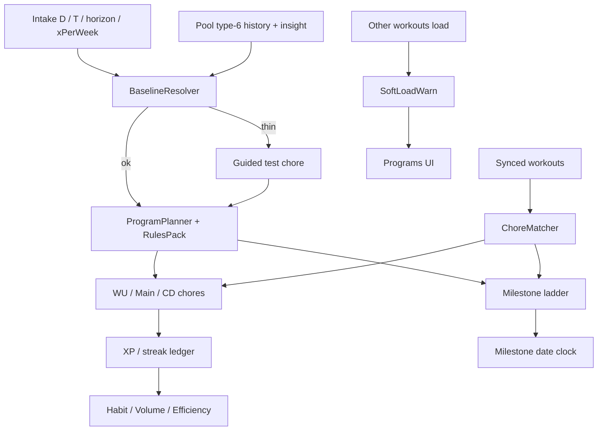

# feat: Pool swim Programs — milestone-led local plans

## Summary

Implement a new local-first `programs` feature module that creates pool-only training plans from intake (distance, target time, horizon, sessions/week): baseline cascade → milestone proof ladder → warm-up/main/cool-down session chores from a Fathom-owned rules pack, soft other-load warnings, and a full progress loop (forgiving weekly streaks/XP/levels + habit/volume/efficiency scorecards). No Local AI Coach dependency; plan craft is deterministic templates + rules.

---

## Problem Frame

Fathom already stores rich pool-swim history and session insight, but improvement still depends on unstructured self-pushing. Programs converts owned history into a sequenced, honest plan whose success clock is proof milestones (see origin: `docs/brainstorms/2026-10-09-pool-swim-programs-requirements.md`).

---

## Assumptions

*This plan was authored without a fresh synchronous plan-synthesis confirmation (overnight continuation after brainstorm confirm + explicit “go ahead with planning”). Review these bets before `/ce-work`.*

- Persist Programs state like Food: lean SharedPreferences index + optional `programs/` side files; wipe **with Forget** (privacy parity with other local athlete data) via diagnostics-composed extras + residue checks in device-pairing Forget verify — not sole-owned from `programs_di`.
- Entry surface: **Home calm card + pushed `/programs` route** (no 4th shell tab in v1 — avoids `app_shell_test` churn).
- Adopt research defaults for rules pack (CSS 400/200 anchor, +15–25% capacity rungs, ~20 set patterns, sessions/week roles) and gamification (weekly streak + Rest Passes, positive-only XP, level cost `100 × min(level, 8)`).
- Guided baseline / proof “continuous” swims rely on session totals + athlete confirm when length timestamps cannot prove continuity (lap rows have no rest timestamps — inventory G1).
- **Numbers from `CanonicalSwimSession` / guarded laps**; `buildSwimSessionInsight` only for story/tip/diagnosis ids (insight KPIs are partly strings and assembled in a widget today — inventory G9/G10).
- Soft-warn is **factual stacking** of owned durations/load (“strength 52 min · recovery est. 16 h”), never a recovery/readiness score (Hooper/insight locks); badminton type unknown → treat any non-swim as other-load until mapped.
- Level is **lifetime** across programs; milestone ledger is per program.
- Declared program pause slips milestone dates (same family as proof delay).
- Listen to `StoreInvalidation` after sync to rematch chores/proofs; show “as of last sync” so chores aren’t marked missed before a post-session sync.

---

## Requirements

Trace to origin R1–R26 and success criteria S1–S5.

**Intake / venue:** R1–R3  
**Baseline:** R4–R7  
**Plan craft:** R8–R11  
**Milestones:** R12–R16  
**Multi-sport soft-warn:** R17–R18  
**Progress loop:** R19–R22  
**Honesty / seam:** R23–R24  
**Non-goals wiring:** R25–R26  

**Origin actors:** A1 owner-athlete, A2 GT5, A3 Programs planner, A4 progress loop  
**Origin flows:** F1 create, F2 daily chore, F3 proof milestone, F4 baseline repair  
**Origin acceptance examples:** AE1–AE6  

---

## Scope Boundaries

- No Local AI Coach / LLM plan generation or narration
- No open-water program generation (disclose pool-only)
- No hard auto-downgrade of swim days from other sports
- No licensed MySwimPro/Garmin/USA Swimming workout feed
- No nutrition/lifestyle coaching product
- No leaderboards / leagues / purchased streak freezes
- Do not invent a second swim-insight pipeline — numeric evidence from canonical swim; insight for prose/ids only
- No opaque recovery score / hard easy-rest coaching from soft-warn copy

### Deferred to Follow-Up Work

- Multi-sport schedule co-planner (beyond soft-warn)
- Hooper-4 integration when that branch lands on main
- Open-water Programs
- Optional HTML PoL is design aid only — ship gate remains Flutter tests + dogfood (same posture as pool-swim-detail plan)

---

## Context & Research

### Relevant Code and Patterns

- Feature layout: `lib/features/food/` + `lib/features/home/` bloc/snapshot pattern; scaffold via `./create_feature.sh` then **hand-edit** injector + routes (brick does not fully wire)
- Manual shared touch list: `lib/core/di/injector.dart` (after workout/vitals/food, before home), `lib/app/routing/route_registry.dart`, `gate_a_prefs.dart`, `diagnostics_di.dart` wipe body, `device_pairing_repository_impl.dart` Forget residue verify, optional `app_data_export_service.dart` allow-list
- Forget wipe composition: `lib/features/diagnostics/data/diagnostics_di.dart` only assigns `onForgetWipeExtras`
- Pool constant: `poolSwimWorkoutType = 6` in `lib/features/workout_history/domain/in_session_hr_lock.dart` — prefer domain constant over `isSwimWorkout` (6∥8) in presentation formatters
- Swim numeric SoT: `WorkoutHistoryRepository.loadAllCanonicalSwims()` / `CanonicalSwimSession` + invent-guard; insight contract for prose only
- Home calm card: `home_screen.dart` `_todayStack` + `HomeSnapshot`; keep one-line CTA; avoid forbidden Home strings in `home_screen_test.dart`
- Sync rematch: subscribe `StoreInvalidation.stream` like Home/Vitals blocs
- Prefs keys: `lib/features/device_pairing/domain/gate_a_prefs.dart`
- No SQLite/Hive; `Either`/`Failure` hand-rolled; `always_use_package_imports`

### Institutional Learnings

- `docs/solutions/` — **none** in this repo; institutional knowledge is under brainstorms/plans/architecture/learnings
- Research packs (same wave):  
  - `docs/brainstorms/research/2026-10-09-swim-training-algorithms-datasets.md`  
  - `docs/brainstorms/research/2026-10-09-fathom-data-for-programs.md` (gap register G1–G21; deep rewrite)  
  - `docs/brainstorms/research/2026-10-09-programs-gamification-progress.md`  
  - `docs/brainstorms/research/2026-10-09-programs-pm-discovery-brief.md`
- Canonical swim side-files foundation: `docs/plans/2026-07-23-002-w1-canonical-swim-execution-packet.md`
- Invent-guard / omit-over-invent: insight contract + swim detail / stroke / run metrics plans
- Design prototype: `docs/design/programs-prototype/` (create → baseline cascade → active home → session → proof pass/fail → progress; rail toggles clock / other-load / game layer / theme)

### External References

- Distilled into rules pack provenance tags (CSS / Maglischo / Swim Smooth / USMS) — see algorithms research; no runtime network fetch

---

## Key Technical Decisions

| Decision | Choice | Rationale |
|---|---|---|
| Module | New `lib/features/programs/` | Net-new capability; keep workout_history as read SoT |
| Plan craft | Pure Dart rules pack + planner | Origin R8/R25; no Coach |
| Persistence | Prefs index + optional side files; append-only XP/chore ledgers; snapshot judged numbers at match time | Food pattern; survive re-sync honesty (`startTime` can change) |
| Forget | Wipe Programs with Forget + residue verify | Privacy parity; product bet in Assumptions |
| Milestone vs XP | Separate ledgers | Split rules (honest dates / forgiving streaks) |
| Proof match | Bind chore/proof to `(workoutNumber, startTime)` + manual confirm | No WU/CD or continuous proof in wire data |
| Evidence read | Canonical numerics + insight prose/ids | Avoid string KPIs / widget-only assembler as SoT |
| Pool filter | Type 6 only (`poolSwimWorkoutType`) | `isSwimWorkout` includes OW |
| Soft-warn copy | Factual other-load stack, no score | Hooper/insight recovery locks |
| Intensity | Pace vs CSS + RPE copy; never wrist HR zones | GT5 swim HR unreliable underwater |
| Navigation | Home card + pushed route | No 4th tab |
| UI first ship | Full feature surfaces for create → chore → proof → progress | Origin full loop; dogfood 1000→1200 |

---

## Open Questions

### Resolved During Planning

- Dataset strategy: build Fathom-owned rules pack (algorithms research)
- Gamification defaults: weekly streak + Rest Passes + positive XP (gamification research)
- Continuous distance: prefer non-stop guided/proof sessions + confirm (data inventory)

### Deferred to Implementation

- Exact “sufficient history” numeric thresholds after counting owner’s usable pool swims
- Badminton watch type code from a live sync sample (until then: any non-swim)
- Proof distance tolerance band (±m / near-pass ≥90%) final numbers after first dogfood fails
- Continuous-swim probe / length-vs-interval result (inventory open check)
- Whether pool rows carry load/TE (soft-warn may be other-sports-only)
- Optional App Data export allow-list for Programs keys

---

## Output Structure

```text
lib/features/programs/
  domain/
    program.dart
    milestone.dart
    chore_session.dart
    baseline.dart
    progress_ledger.dart
    rules_pack/          # versioned patterns + formulas
    program_planner.dart
    baseline_resolver.dart
    chore_matcher.dart
    soft_load_warn.dart
    scorecards.dart
  data/
    program_store.dart
    programs_di.dart
  presentation/
    view/                # create, active home, session, proof, progress
    bloc/                # or ChangeNotifier — match nearest feature style
    widgets/
test/features/programs/
docs/architecture/programs-rules-pack.md   # short provenance + version note
```

---

## High-Level Technical Design

> *Directional guidance for review, not implementation specification.*



**Capacity vs pace tracks:** capacity rungs move milestone spine; target time drives CSS development chores and intake feasibility warning when pace gap ≫ horizon.

---

## Implementation Units

### U1. Programs domain skeleton, store, DI, Forget wipe

**Goal:** Introduce the `programs` feature with durable local state for one active program, milestones, chores, and ledgers; wire DI; wipe on Forget.

**Requirements:** R3, R19–R22 (persistence spine), R25  

**Dependencies:** None  

**Files:**
- Create: `lib/features/programs/domain/*.dart` (core entities)
- Create: `lib/features/programs/data/program_store.dart`
- Create: `lib/features/programs/data/programs_di.dart`
- Modify: `lib/features/diagnostics/data/diagnostics_di.dart` (compose wipe)
- Modify: `lib/features/device_pairing/data/repositories/device_pairing_repository_impl.dart` (Forget residue verify for Programs keys/dirs)
- Modify: `lib/features/device_pairing/domain/gate_a_prefs.dart` (keys/dirs)
- Modify: `lib/core/di/injector.dart` (`_initPrograms` placement)
- Test: `test/features/programs/program_store_test.dart`
- Test: forget wipe integration patterned on `test/features/food/integration/forget_wipe_integration_test.dart`

**Approach:**
- Entities: Program (intake, baseline confidence, status), Milestone, ChoreSession (WU/main/CD structure + state), append-only XpEvent / ChoreEvent, derived streak/level helpers
- One active program constraint enforced in store activate/replace
- Schema version field for rules pack + store

**Patterns to follow:**
- `lib/features/food/data/food_meal_store.dart`, `food_di.dart`, diagnostics wipe composition

**Test scenarios:**
- Happy path: activate program → reload process → same milestones/chores
- Edge: replace active program archives prior; only one active
- Integration: Forget wipe clears programs index + side files
- Error: corrupt index → empty/safe recovery without crash

**Verification:** Store round-trip + wipe tests green; no Coach imports in `lib/features/programs/`.

---

### U2. Baseline resolver (history → guided test → self-report)

**Goal:** Estimate continuous-distance capacity and pace anchor; drive guided test or self-report when thin.

**Requirements:** R4–R7, F4, AE2, AE3  

**Dependencies:** U1  

**Files:**
- Create: `lib/features/programs/domain/baseline_resolver.dart`
- Create: `lib/features/programs/domain/baseline.dart`
- Test: `test/features/programs/baseline_resolver_test.dart`
- Modify: presentation create flow later in U7 (resolver callable from domain tests first)

**Approach:**
- Input: recent type-6 canonical swims / summaries only
- Output: `Baseline` with distance capacity estimate, optional CSS (if 200/400-like tests present or after guided test), confidence enum, athlete-visible reason when insufficient
- Guided test prescription: non-stop continuous swim at/near current capacity + optional 400/200 CSS protocol when pace goal present
- Self-report last resort with `confidence: low`

**Execution note:** Implement test-first with fixture swim histories (rich / sparse / empty).

**Patterns to follow:**
- Pool filtering discipline from data inventory; read canonical swim / P0 — do not mix OW

**Test scenarios:**
- Covers AE1 path: rich history → no forced test, confidence medium/high
- Covers AE2: sparse → requires guided test before lock
- Covers AE3: skip test → self-report accepted, confidence low
- Edge: OW-only history ignored for pool baseline
- Edge: long rest-heavy session (e.g. 500 m / 61 min) does not become false “pace capacity” without confirm

**Verification:** Resolver unit tests cover three cascade branches; reasons are stable strings/enums for UI.

---

### U3. Rules pack + program planner (milestones + sessions)

**Goal:** Deterministic generator: milestone ladder + week chores with warm-up/main/cool-down from curated patterns; intake feasibility warning for pace vs horizon.

**Requirements:** R1–R2, R8–R16, R26, S1–S2, S5, AE1  

**Dependencies:** U2  

**Files:**
- Create: `lib/features/programs/domain/rules_pack/` (version, patterns, formulas)
- Create: `lib/features/programs/domain/program_planner.dart`
- Create: `docs/architecture/programs-rules-pack.md` (provenance + version)
- Test: `test/features/programs/program_planner_test.dart`

**Approach:**
- Capacity rungs default +20% (clamp 15–25%), round to 50 m; short-horizon dogfood 1000→1200
- Session roles by sessions/week (2/3/4–5) per algorithms research
- Every chore: warm-up / main / cool-down structure with distances and rest guidance
- Forecast goal-day range recomputed when milestones move
- Near-pass / fail slip rules encoded here (chore miss does not call slip)

**Patterns to follow:**
- Algorithms research §6–7; keep pack data as Dart constants/JSON asset owned by repo

**Test scenarios:**
- Happy: 1000 m baseline, 1200 m / time / 3 weeks / 3× → first proof ~week 2–3, three weekly roles present, each session has WU/main/CD
- Edge: sessions/week = 2 → endurance + quality only
- Edge: aggressive pace vs short horizon → feasibility warning flag set
- Edge: pool-only disclosure flag always on generated program metadata
- Fail slip: proof fail → dates move; weekly volume bump ≤10%

**Verification:** Planner tests lock dogfood shape; rules pack version stamped on program.

---

### U4. Chore / proof matcher from sync

**Goal:** Match completed pool swims to chores and proofs; support manual done/skip/adjust; late sync window.

**Requirements:** R15, R19, R23–R24, F2–F3, AE5  

**Dependencies:** U1, U3  

**Files:**
- Create: `lib/features/programs/domain/chore_matcher.dart`
- Test: `test/features/programs/chore_matcher_test.dart`

**Approach:**
- Auto-match candidates: same local day (or ± configurable hours), type 6, distance/duration within tolerance for chore intent; bind `(workoutNumber, startTime)`
- Proofs: distance ≥ target (near-pass ≥90% separate outcome); continuous confirm required when continuity not computable
- States per gamification research: done synced/manual, adjusted, moved, skipped excused/other, lapsed, superseded
- Late sync rematch within 72 h

**Test scenarios:**
- Happy: synced swim matches today’s endurance chore → done(synced) + XP event eligible
- Covers AE5: proof fail → matcher returns fail; planner slip invoked by application layer
- Edge: OW swim never matches pool chore
- Edge: manual confirm continuous proof without perfect wire continuity
- Edge: skip does not emit milestone slip event

**Verification:** Matcher pure tests with fixture workouts; no UI required.

---

### U5. Progress loop — streaks, XP, levels, scorecards

**Goal:** Forgiving weekly streaks + Rest Passes; positive-only XP/levels; habit/volume/efficiency scorecards that never gate early proofs.

**Requirements:** R16, R19–R22, S4, AE4  

**Dependencies:** U1, U4  

**Files:**
- Create: `lib/features/programs/domain/progress_ledger.dart`
- Create: `lib/features/programs/domain/scorecards.dart`
- Test: `test/features/programs/progress_ledger_test.dart`
- Test: `test/features/programs/scorecards_test.dart`

**Approach:**
- Derive streak/level from append-only ledger (retunable)
- Weekly Mon–Sun; floor = ceil(sessionsPerWeek/2); Rest Passes start 2, +1/full week, cap 3; excused weeks free
- XP table from gamification research (tune constants in one file)
- Scorecards: habit = completed/prescribed (excused excluded); volume = longest continuous vs next proof + weekly distance; efficiency = matched-pace DPS + pace fade; SWOLF secondary; “Collecting” until enough data
- Setting flag to hide XP/levels/streaks (prefs)

**Test scenarios:**
- Happy: 3× week, complete 2 → streak holds
- Edge: break streak → best streak persists; no negative XP
- Edge: proof fail still grants attempt XP; level/streak untouched
- Edge: scorecards do not block proof eligibility
- Covers AE4 spirit: skip after soft-warn uses excused/other without milestone slip

**Verification:** Ledger/scorecard unit tests encode split rules.

---

### U6. Soft other-load warn

**Goal:** Surface soft warning when recent other-sport load looks heavy; never auto-cancel the swim chore.

**Requirements:** R17–R18, AE4  

**Dependencies:** U1  

**Files:**
- Create: `lib/features/programs/domain/soft_load_warn.dart`
- Test: `test/features/programs/soft_load_warn_test.dart`

**Approach:**
- Inputs: recent non-swim `WorkoutSummary` load/TE/duration/HR peaks + optional sleep duration
- Owner-relative thresholds (percentile / trailing median), not global constants alone
- Output: warn enum + short **factual** athlete copy (durations / recovery-time estimates when present); UI decides presentation; never a 0–100 recovery score

**Test scenarios:**
- Happy: heavy strength same day → warn true, chore still prescribed
- Edge: no other sports → warn false
- Edge: missing load fields → degrade to duration heuristic, never crash
- Edge: copy contains no “readiness” / scored recovery language

**Verification:** Pure unit tests; no schedule mutation.

---

### U7. Programs UI — create, active home, session, proof, progress

**Goal:** Ship athlete surfaces for F1–F4 with pool-only disclosure, soft-warn, proof pass/fail moments, and progress scorecards.

**Requirements:** R1–R2, R9, R12–R14, R17, R19–R22, S1–S4, AE1–AE6  

**Dependencies:** U2–U6  

**Files:**
- Create: `lib/features/programs/presentation/**`
- Modify: `lib/app/routing/route_registry.dart` (and Home entry)
- Modify: `lib/features/home/presentation/view/home_screen.dart` (Programs card / CTA)
- Test: `test/features/programs/programs_ui_test.dart` (widget)

**Approach:**
- Align IA with `docs/design/programs-prototype/` once stable
- Create: intake fields + disclosure + baseline branch UI
- Active home: next milestone, forecast, today’s chore, soft-warn banner
- Session detail: WU/main/CD checklist
- Proof: pass celebration / fail facts + retry/adjust (no shame copy)
- Progress: streak, XP/level, three scorecards; respect hide setting
- AE6: feature runs with Coach settings irrelevant / unused

**Patterns to follow:**
- Food tab / workout detail athlete-path copy discipline (no debug chrome)
- Prototype rail states as acceptance fixtures for widget tests where useful

**Test scenarios:**
- Covers AE1: create with rich history → active home shows milestone + structured chore
- Covers AE6: pump create/active with Coach disabled/absent → success
- Covers AE5 UI: fail proof screen shows distance fact + slipped date, no red-shame copy
- Edge: pool-only disclosure visible on create

**Verification:** Widget tests for create → active → proof fail/pass; dogfood checklist in Verification below.

---

### U8. Insight seam wiring + dogfood acceptance harness

**Goal:** Consume swim session insight/metrics for scorecards/copy; document Programs read of insight contract; add fixture-based acceptance covering AE1–AE6.

**Requirements:** R21, R23–R24, S1, S5  

**Dependencies:** U5, U7  

**Files:**
- Modify: `docs/architecture/swim-session-insight-contract.md` (Programs may read; still no dual DTO)
- Create: `test/features/programs/programs_acceptance_test.dart`
- Optional: fixture JSON under `test/fixtures/programs/`

**Approach:**
- Scorecards/efficiency pull from analytics/insight — never invent
- Acceptance test drives domain+store through create → chore match → proof without full app where possible; UI smoke for disclosure

**Test scenarios:**
- Integration: full domain path AE1 + AE5 without Coach
- Edge: insight tippless session still updates volume card from KPIs

**Verification:** Acceptance suite green; insight contract note updated; dogfood: owner can run 1000→1200 block.

---

## System-Wide Impact

- **Interaction graph:** Home CTA → Programs routes; workout sync completion may trigger rematch; Forget wipe extras gain Programs clear
- **Error propagation:** Planner/resolver failures surface as athlete-visible “couldn’t build plan” with retry; never partial-corrupt active program without version check
- **State lifecycle risks:** dual-write index vs side files — use Food-style temp rename; ledger append before derived cache
- **Unchanged invariants:** Swim Bible / insight builder remain SoT; Coach module untouched; workout_history athlete UI unchanged except optional deep-link later (out of scope)

---

## Risks & Dependencies

| Risk | Mitigation |
|---|---|
| Continuous distance not in wire data | Guided/proof confirm; non-stop test design |
| Rules pack feels generic | Provenance tags + dogfood calibration loop; intake honesty for pace |
| Full gamification distracts | Hide setting; PM kill/descope criteria; proofs remain success metric |
| Soft-warn wrong sport codes | Owner-relative heuristics; log unknown types for mapping |
| Scope size | Domain U1–U6 can merge-test before U7 UI polish |

---

## Phased Delivery

1. **Domain slice (U1–U6)** — planner + match + progress testable without polished UI  
2. **Athlete UI (U7)** — create through proof/progress  
3. **Acceptance + insight note (U8)** — dogfood gate  

---

## Success Metrics

- Dogfood first proof (~1200 m) attempted inside ~2–3 weeks from truthful ~1000 m baseline  
- ≥70% of prescribed sessions completed or excused in first block (PM brief)  
- Zero Coach imports in programs feature  
- Planner feasibility warning appears when pace goal is implausible for horizon  

---

## Documentation Plan

- `docs/architecture/programs-rules-pack.md` — version + provenance  
- Update insight contract non-goals → “Programs may read”  
- Keep research packs as citations; do not duplicate into PRD  

---

## Sources & References

- Origin: `docs/brainstorms/2026-10-09-pool-swim-programs-requirements.md`
- Research: `docs/brainstorms/research/2026-10-09-*.md`
- Design: `docs/design/programs-prototype/`
- Prior seam: `docs/architecture/swim-session-insight-contract.md`
