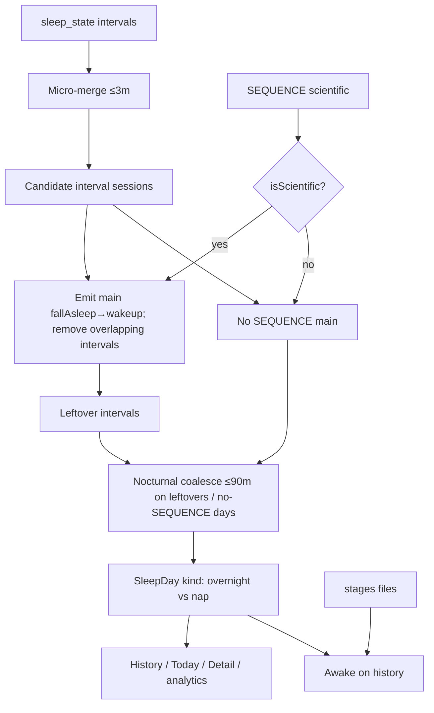

# fix: Overnight sleep session coalesce

## Summary

Stop showing overnight nights as multiple “nap” rows. Prefer TruSleep SEQUENCE scientific nights as the main overnight session, coalesce short mid-night `sleep_state` gaps as WASO inside one bout, classify with Huawei’s 20:00→20:00 sleep-day (not calendar midnight-crossing), and show awake minutes on history rows from stages.

---

## Problem Frame

Live Oct 2026 device data shows `sleep_state` fragments with 9–18m mid-night gaps. Product merge only joins ≤3m, then `sleepCrossesLocalMidnight` labels same-calendar-day nights (and every fragment) as naps. The watch / TruSleep SEQUENCE already has one scientific night (fallAsleep→wakeup, score, stages including awake). History reports “1 overnight · 18 naps” for a typical month of this pattern.

---

## Requirements

**Authority:** If a usable scientific SEQUENCE exists for the sleep-day overnight, **R1 wins**. Otherwise **R2** builds the overnight bout. Kind is binary: **overnight (main)** vs **nap (non-main)**.

### Session build & authority

- R1. When a scientific SEQUENCE session exists (`TruSleepSequenceSession.isScientific` / `sleepScore > 0`), it defines the **main overnight** window (fallAsleep→wakeup, else SEQUENCE begin/end) for that sleep-day. Overlapping nocturnal interval sessions are replaced by that window (see U2). Score=0 stubs never define main bounds (they may still attach stages/detail via existing usable-detail helpers).
- R2. **Nocturnal** mid-night `sleep_state` fragments (same Huawei sleep-day; not afternoon/non-nocturnal naps) separated by gaps ≤ **90 minutes** coalesce into one overnight bout (WASO inside the session, not new naps). Keep ≤ **3 minutes** as the first micro-merge step. Afternoon / non-nocturnal gaps stay on the ≤3m rule only. **R2 applies when no usable scientific SEQUENCE main covers that overnight**; when R1 applies, R1 bounds win over the coalesced interval union for the main session.
- R9. Re-sync must migrate feel-on-wake / stages / enrich by overlap when mergeKeys expand (existing migrate paths). Feel/stage migrate stays in as a coalesce dependency, not a new product feature.
- R10. Do not change watch TZ display; do not invent stages from `sleep_state` flags; do not let score=0 SEQUENCE stubs wipe prior detail.

### Sleep-day membership & classification

- R3. Sleep-day membership is local **`[D-1 20:00, D 20:00)`** (Huawei). Evening onset on/after 20:00 belongs to the next sleep-day.
- R4. Kind ∈ {**overnight (main)**, **nap (non-main)**}. Main = R1 SEQUENCE main when present, else the nocturnal-coalesced bout (R2). Scientific main stays overnight even if &lt;3h (domain kind must accept an explicit scientific-main flag — do not rely on hour/&lt;3h heuristics alone). Non-main members are naps.

### Surfaces & parity

- R5. Sleep history lists coalesced sessions: one overnight row per night when R1/R2 apply; overnight/nap **labels and counts** use the new classifier (not midnight-crossing). Month membership for the history list may remain end-calendar for this cut (sleep-day rekey deferred).
- R7. Today Sleep hero selects the current sleep-day’s **primary** via `SleepDay.resolve` as ported in U1 (main overnight preferred). Duration = **primary session span** only — do **not** wire `totalDurationSec`, `napsHint`, or hero `durationOverrideSec` day-total UX in this cut.
- R8. Sleep detail / feel-on-wake overnight eligibility / recent-overnight analytics use the same classifier as history (Oct 7-class same-day nights count as overnight).

### History awake display

- R6. History compact rows show **Awake Xm** when stages yield awake &gt; 0; omit when stages absent (do not invent awake from gaps alone).

---

## Scope Boundaries

- Watch / Health **+30m clock display** mismatch (IST vs UTC+5 presentation) — diagnose-only elsewhere
- Coach / Bug sleep-day history snapshot (absent on this branch base)
- Rewriting native SEQUENCE parser field set / persisting `stageMinutes` into enrich JSON (optional polish; stages files already carry awake)
- Changing Aug 11 micro-merge evidence for **non-nocturnal** gaps (afternoon naps stay separate)

### Deferred to Follow-Up Work

- Full Home sleep-strip day-total UX polish beyond shared primary picker consistency
- Persisting SEQUENCE `stageMinutes` on enrich `toSummaryJson` for score-path awake without loading stages
- History month filter keyed purely by sleep-day id (may keep end-month filter if sleep-day membership is enough for labels)

---

## Context & Research

### Relevant Code and Patterns

- Timing SoT today: `lib/features/vitals/domain/trusleep_sleep_sot.dart` (`mergeGapSec = 180`) → prefs via `vitals_repository_impl.dart` `_mergeFileSleepSot`
- Labeling today: `sleepCrossesLocalMidnight` in `lib/features/vitals/presentation/widgets/sleep_formatters.dart` (history, cards, Today picker, analytics)
- SEQUENCE summary + stages: `TruSleepSequenceSession`, enrich under `vitals/sleep_enrich/`, stages under `vitals/sleep_stages/`
- Prior art (not on main): commit `c7ebe22` — `lib/features/vitals/domain/sleep_day.dart` + `test/features/vitals/domain/sleep_day_test.dart` (20:00 day, 90m nocturnal coalesce, `resolve` / nap heuristics). Prefer this over thinner `feat/sleep-wake-day-total` (day totals without coalesce)
- Related requirements (branch): `docs/brainstorms/2026-08-13-sleep-wake-day-total-requirements.md` — day totals + 20:00 membership; this plan **extends** with nocturnal coalesce + SEQUENCE-main for the fragment/nap bug
- Wire / SoT handoffs: `docs/wire-specs/huawei-br-gt5-sleep-files.md`, `docs/handoffs/2026-08-11-trusleep-primary-sleep-handoff.md`, `docs/handoffs/2026-08-12-trusleep-file-sot-shipped-stages-handoff.md`

### Institutional Learnings

- Aug 11 locked **≤3m** gap-merge for Health duration fidelity on contiguous fragments — **keep as micro-merge**; nocturnal ≤90m is an additive WASO rule justified by Oct 2026 SEQUENCE/watch one-night evidence (9–18m gaps still one scientific night)
- SEQUENCE is stages/summary authority; intervals remain fragment geometry unless a scientific SEQUENCE window covers them — plan uses **hybrid**: SEQUENCE defines main when present; coalesce otherwise
- Anti-patterns still hold: no mega-span invent, no `longest=` hero, no stub SEQUENCE wipe, no stages from flags

### External References

- Huawei Health: sleep cycle 20:00→20:00; &lt;3h nap / ≥3h nighttime; re-sleep after wake merged into one night analysis ([support article](https://consumer.huawei.com/ie/support/content/en-gb00733908/))
- Fitbit: `dateOfSleep` + `isMainSleep` (longest); awake minutes inside one log
- Oura: sleep day ~6pm boundary; nap 15m–3h; longest continuous = scored sleep
- Industry consensus: mid-sleep wakes = awake **inside** one session, not new sessions

---

## Key Technical Decisions

- **Glossary:** **main** = overnight session for a sleep-day (SEQUENCE window when R1 applies, else nocturnal-coalesced bout). **primary** = `SleepDay.resolve`’s selected session for Today/hero (= main when one exists). Not a third concept.
- **Hybrid session authority (SEQUENCE-first carve):** (1) Micro-merge intervals ≤3m. (2) For each scientific SEQUENCE in a sleep-day, emit one main at fallAsleep→wakeup (else begin→end) and **remove** overlapping interval sessions. (3) Run nocturnal coalesce ≤90m only on **remaining** intervals / sleep-days without scientific SEQUENCE. Orphans outside the SEQUENCE window stay separate (never glue then shrink).
- **Port `SleepDay` from `c7ebe22`:** Domain source for 20:00 membership, nocturnal coalesce, and kind helpers — extend kind so scientific main is overnight even when &lt;3h / daytime-ish onset. Do **not** port coach_tools, Home day-totals, or hero napsHint from that commit.
- **Classifier blast radius:** Replace midnight-crossing at history, session cards, Today hero selection, detail overnight chrome, `recentOvernightSessions`, and feel-on-wake overnight gate. Home inherits via shared picker only — **no Home file edits** in this cut.
- **Read-path coalesce:** History / Today / analytics must run idempotent nocturnal coalesce even on pre-fix fragmented prefs; SoT write-path coalesce converges on next Sync.
- **Awake on history:** Load stages (or stage minutes) per row like scores today; display only when awake &gt; 0. Prefer stage awake over gap math.
- **Native:** Nocturnal coalesce is **Dart-only** (`TruSleepSleepSot` / `_mergeFileSleepSot`). Kotlin keeps `FILE_INTERVAL_MERGE_GAP_SEC = 180` micro-merge only.

---

## Open Questions

### Resolved During Planning

- Main session authority: **SEQUENCE-first when scientific**, else nocturnal coalesce (user-confirmed scope)
- Sleep-day bucket: **Huawei 20:00→20:00**
- Surfaces: history + detail + Today; awake on history rows **in**
- Coalesce gap: **90m** nocturnal / same sleep-day (matches `c7ebe22`)
- Watch TZ +30m: **out of scope**

### Deferred to Implementation

- Exact SEQUENCE↔fragment overlap matching threshold when SEQUENCE slightly disagrees with interval union (use existing overlap attach helpers; tune only if Oct fixtures fail)
- Whether history month filter needs sleep-day rekey vs end-calendar (prove with Oct month list; change only if mis-bucketing appears)

---

## High-Level Technical Design

> *This illustrates the intended approach and is directional guidance for review, not implementation specification. The implementing agent should treat it as context, not code to reproduce.*

Caption: Always micro-merge intervals first. Scientific SEQUENCE carve is a **post-step** that defines main and removes overlaps; nocturnal coalesce runs on leftovers only (never glue-then-shrink).

**Display rules (directional):**

- `kind(session)` → `overnight` if main; else `nap`
- History row duration → main SEQUENCE span when attached; else coalesced begin→end
- Awake → `stageMinutesOf(stages).awake` only

---

## Implementation Units

### U1. Port SleepDay domain + tests

**Goal:** Land Huawei sleep-day membership, nocturnal coalesce, and main/nap kind helpers as pure domain code.

**Requirements:** R2, R3, R4

**Dependencies:** None

**Files:**
- Create: `lib/features/vitals/domain/sleep_day.dart` (port from `c7ebe22` only — no coach/Home day-total wiring)
- Create/port: `test/features/vitals/domain/sleep_day_test.dart`
- Modify: `lib/features/vitals/domain/trusleep_sleep_sot.dart` (call nocturnal coalesce after micro-merge in `buildSessions`)
- Test: `test/features/vitals/domain/trusleep_sleep_sot_test.dart`

**Approach:**
- Port `SleepDay` / `SleepDayAggregate` API: `windowFor`, onset membership, `coalesceNocturnalSessions`, nap/main kind, `resolve`
- Extend kind so an explicit scientific-main flag forces overnight (R4) even when &lt;3h
- Keep constants: micro 180s, nocturnal 90m, nap max 3h
- Wire `TruSleepSleepSot.buildSessions` to micro-merge then nocturnal coalesce (leftovers path; U2 adds SEQUENCE carve before/around this)

**Execution note:** Port tests first; extend with Oct 8/9 gap fixtures (9m, 18m) and scientific &lt;3h → overnight.

**Patterns to follow:** `c7ebe22` `sleep_day.dart` / `sleep_day_test.dart`; existing `trusleep_sleep_sot_test.dart` style

**Test scenarios:**
- Happy path: 9m mid-night gap → one coalesced overnight; 18m gap → one overnight
- Happy path: afternoon nap after overnight → two sessions; nap classified intentional
- Edge case: gap 100m nocturnal without SEQUENCE → remain split
- Edge case: onset ≥20:00 attributed to next sleep-day
- Edge case: scientific-short night &lt;3h still main/overnight via kind rules used later in U3 (domain exposes hooks)
- Integration: `buildSessions` output length/bounds for three-fragment Oct 8-shaped input

**Verification:** Domain tests pass; `buildSessions` no longer emits three rows for ≤90m nocturnal gaps.

---

### U2. SEQUENCE-first main window in repository merge

**Goal:** When Sync provides scientific SEQUENCE sessions, carve main overnight SoT entries from SEQUENCE bounds; coalesce only leftovers; preserve stub non-wipe and feel/stage migrate.

**Requirements:** R1, R9, R10

**Dependencies:** U1

**Files:**
- Modify: `lib/features/vitals/data/repositories/vitals_repository_impl.dart` (`_mergeFileSleepSot` / SEQUENCE upsert helpers)
- Test: `test/features/vitals/vitals_repository_test.dart`
- Read-only as needed: `lib/core/huawei/huawei_link.dart`

**Approach:**
- Algorithm (directional): micro-merge intervals → for each `isScientific` SEQUENCE, emit main at fallAsleep→wakeup (else begin→end) and remove overlapping interval sessions → nocturnal-coalesce **remaining** intervals only → upsert prefs / rewrite enrich / attach stages → migrate feel by overlap
- Main-bounds authority = `isScientific` only; keep `_sequenceHasUsableDetail` for stages/summary attach and stub non-wipe (R10)
- SEQUENCE-only path (empty intervals): still emit scientific mains from fallAsleep/wakeup
- Multiple scientific SEQUENCEs same sleep-day: higher score, else longer (document in test)

**Execution note:** Characterization-first on existing repository sleep merge tests before changing precedence.

**Patterns to follow:** Existing `_bestUsableSequenceForWindow`, stage preference SEQUENCE &gt; message, feel migrate-by-overlap — but N→1 collapse is new vs today’s 1:1 file-window attach

**Test scenarios:**
- Happy path: two fragments + one scientific SEQUENCE spanning both → one persisted main with SEQUENCE bounds + score path intact
- Happy path: intervals only, no SEQUENCE → coalesced overnight from U1 rules
- Edge case: score=0 stub SEQUENCE → does not wipe prior scientific enrich/stages; does not define main bounds
- Edge case: post-wakeup orphan fragment ≤90m after SEQUENCE wakeup → remains separate row (no glue-then-shrink)
- Edge case: nap fragment outside SEQUENCE window remains separate session
- Integration: re-sync expanding mergeKey migrates feel/stages to new key (overlap)

**Verification:** Repository tests cover SEQUENCE-first carve + orphan retention; stub non-wipe still holds.

---

### U3. Replace midnight-crossing classifier across Sleep UI + analytics

**Goal:** History, cards, Today hero, detail chrome, recent-overnight helpers, and feel overnight gate use `SleepDay` kind / resolve — not `sleepCrossesLocalMidnight`.

**Requirements:** R5, R7, R8 (consumes R3/R4 via U1)

**Dependencies:** U1, U2

**Files:**
- Modify: `lib/features/vitals/presentation/widgets/sleep_formatters.dart`
- Modify: `lib/features/vitals/presentation/widgets/sleep_session_card.dart`
- Modify: `lib/features/vitals/presentation/widgets/sleep_tonight_hero.dart`
- Modify: `lib/features/vitals/presentation/view/sleep_history_screen.dart`
- Modify: `lib/features/vitals/presentation/view/sleep_tab_screen.dart`
- Modify: `lib/features/vitals/presentation/view/sleep_detail_screen.dart`
- Modify: `lib/features/vitals/domain/sleep_analytics.dart` (`recentOvernightSessions` and related)
- Test: `test/features/vitals/sleep_formatters_test.dart`
- Test: `test/features/vitals/presentation/sleep_tab_history_test.dart`
- Test: `test/features/vitals/presentation/sleep_detail_screen_test.dart`
- Test: `test/features/vitals/domain/sleep_analytics_test.dart`

**Approach:**
- `todaysSleepSession` / hero: prefer `SleepDay.resolve(...).primary` for current sleep-day; duration = primary span only (no day-total override / napsHint)
- History + analytics: **idempotent presentation coalesce** on loaded sessions (fixes stale prefs before Sync); overnight/nap counts via kind helpers
- Cards: overnight vs nap kind label
- Feel gate + `recentOvernightSessions`: main/overnight predicate from `SleepDay`, not midnight cross
- Detail header copy: overnight vs nap from kind; scientific score remains separate concern
- Home: verify shared picker only — **no Home file edits**

**Patterns to follow:** Classifier + primary picker only from `c7ebe22` (not hero/Home day-total presentation); keep Blueprint/Fathom card layout

**Test scenarios:**
- Happy path: Oct 7-shaped 01:36→08:11 same calendar day → overnight label + overnight count
- Happy path: Oct 9-shaped coalesced/SEQUENCE main → single history overnight row, score 74 on hero/history
- Happy path: afternoon nap same sleep-day → nap chip; does not replace primary
- Edge case: only naps in sleep-day → hero does not claim “overnight” falsely
- Edge case: fragmented prefs without re-Sync → history still shows one overnight after presentation coalesce
- Integration: feel-on-wake eligible for same-day overnight main

**Verification:** Widget/domain tests pass; history month no longer dominated by false naps for nocturnal fragments.

---

### U4. Awake minutes on sleep history rows

**Goal:** Compact history cards show awake from stages when available.

**Requirements:** R6

**Dependencies:** U3

**Files:**
- Modify: `lib/features/vitals/presentation/view/sleep_history_screen.dart`
- Modify: `lib/features/vitals/presentation/widgets/sleep_session_card.dart`
- Modify as needed: repository stage load helpers already used by detail/tab
- Test: `test/features/vitals/presentation/sleep_tab_history_test.dart` (or new focused card test)

**Approach:**
- Parallel-load stages (or stage minutes) when loading month scores
- Pass awake minutes into compact `SleepSessionCard`; show `Awake Xm` only if &gt; 0
- Do not synthesize awake from sleep_state gaps

**Patterns to follow:** Existing parallel `loadTruSleepSummary` score fetch on history; `stageMinutesOf` in `sleep_analytics.dart`; Today tab awake cells

**Test scenarios:**
- Happy path: stages with 18m awake → history shows Awake 18m
- Edge case: no stages → no awake chip; overnight label still correct
- Edge case: awake 0 → omit chip

**Verification:** History test asserts awake rendering; gap-only data never invents awake.

---

## System-Wide Impact

- **Interaction graph:** Sync merge → prefs sessions → VitalsBloc/loaders → Sleep tab, history, detail, feel-on-wake gate, sleep analytics recent list; Home strip only via shared picker
- **Error propagation:** Missing enrich/stages stays soft-fail (no score / no awake); must not drop coalesced main session or SEQUENCE orphans
- **State lifecycle risks:** mergeKey expansion orphans old enrich/stage files unless migrate-by-overlap runs; partial Sync (fragments before SEQUENCE) should converge on next Sync; presentation coalesce covers stale prefs
- **API surface parity:** No public package API; Flutter channel maps unchanged
- **Integration coverage:** Device acceptance Oct 7–9 after Sync on `fix/overnight-sleep-session-coalesce`
- **Unchanged invariants:** ≤3m micro-merge retained; SEQUENCE stub non-wipe; no PPG/`sleep_data` logging; coach untouched; Home day-totals untouched

---

## Risks & Dependencies

| Risk | Mitigation |
|------|------------|
| Widening coalesce vs Aug 11 ≤3m Health fidelity | Keep 3m micro-merge; 90m only nocturnal same sleep-day; fixture afternoon non-merge |
| SEQUENCE bounds ≠ fragment union | Prefer SEQUENCE for main when scientific; document duration = fallAsleep→wakeup |
| mergeKey churn breaks feel/stages | Existing overlap migrate; add regression test |
| Home strip surprises | Shared picker only; no Home day-total redesign |
| Institutional docs still say SEQUENCE ≠ window SoT | Plan documents hybrid supersession with Oct 2026 evidence; update handoff note in docs if needed |

---

## Documentation / Operational Notes

- Add a short handoff note under `docs/handoffs/` after ship: nocturnal coalesce + SEQUENCE-main vs Aug 11 3m-only timing SoT
- Manual verify on connected Pixel: Sync → Sleep history Oct 2026 → one overnight for 7/8/9 with awake on 9th

---

## Alternative Approaches Considered

- **Custom 9:30pm–7am + 20m rejoin rules:** Rejected — brittle late wakeups/early beds; worse than Huawei/Fitbit patterns
- **Presentation-only coalesce (no SoT write change):** Rejected as primary — prefs/history diverge and Sync reintroduces fragments; optional fallback if mergeKey migrate proves too risky
- **Pure gap-merge widen without SEQUENCE-first:** Rejected — weaker match to watch scientific night and score attach
- **Cherry-pick entire `feat/local-ai-coach-bug`:** Rejected — coach noise; port `SleepDay` slice only

---

## Sources & References

- Debug session (Oct 2026): live `sleep_state.bin` + enrich/stages for Oct 7–9 on device `com.example.fitness_os`
- Related code: `TruSleepSleepSot`, `sleepCrossesLocalMidnight`, `c7ebe22` `SleepDay`
- Related plans: `docs/plans/2026-08-11-001-feat-trusleep-primary-sleep-sot-plan.md`
- Branch for implementation: `fix/overnight-sleep-session-coalesce`
