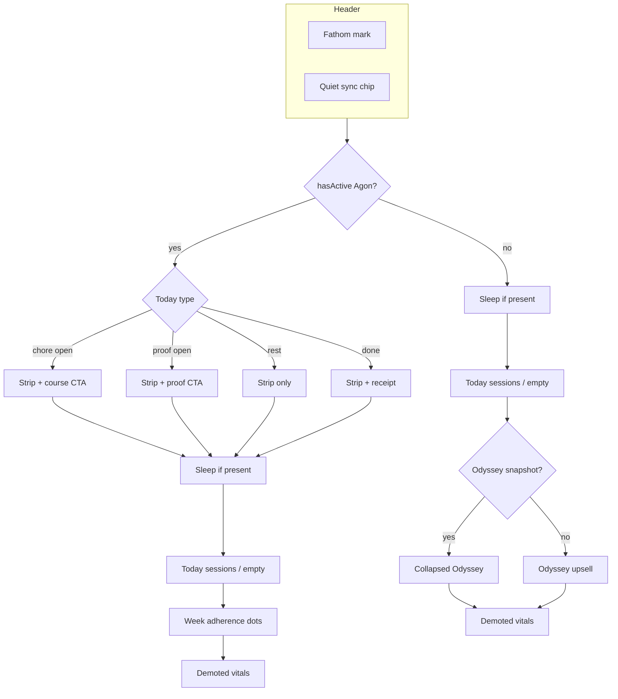

# feat: Home redesign — Agon hybrid stack

## Summary

Restructure Fathom Home to match Approach A and `docs/design/home-redesign-prototype/`: small brand mark + quiet sync chip; **active Agon** → hybrid hero (habit strip + one-tap course/proof) then sleep → sessions → week dots; **no Agon** → sleep + sessions lead, then Odyssey snapshot or upsell under that day lead; calories/steps/workout time (and body HR) demoted. Deep-link into Programs session/proof screens so the Programs hub is no longer required for today’s training. Soft-warn stays on the Programs hub after deep-link (not re-homed onto session/proof in this cut).

---

## Problem Frame

Home is skipped for swim history; Agon progress and today’s course cost an extra click; the current dock + calm Odyssey strip + instrument stack does not match the rewarding hybrid composition locked in brainstorm (see origin: `docs/brainstorms/2026-10-09-home-redesign-requirements.md`).

---

## Requirements

Trace to origin R1–R19 and success criteria S1–S5.

**Composition:** R1–R4  
**Header / brand / sync chip:** R5–R6  
**Hybrid hero (active):** R7–R9  
**No Agon:** R10–R12  
**Sleep / sessions / adherence:** R13–R17  
**Tone:** R18–R19  

**Origin actors:** A1 owner-athlete, A2 paired GT5  
**Origin flows:** F1 open Home active Agon, F2 open Home no Agon, F3 enter today’s session  

---

## Scope Boundaries

### Deferred for later

- Strength / running Agons on Home (same hybrid pattern when those programs exist)
- Optional hide-game-layer setting UX polish beyond existing `hideGameLayer` flag
- Expanding HTML prototype rail for every edge state (nice-to-have; Flutter tests own the matrix)

### Outside this product's identity

- Social feed Home, competitive leaderboards, punishing miss states
- Composite readiness / coach scores on Home

### Deferred to Follow-Up Work

- Sync reliability / destructive blanking loader (separate track — chip polish only here)
- Soft-warn surfacing on session/proof screens after Home deep-link (today soft-warn lives on Programs hub only; Home never shows it)

**Also out of Home surface:** Soft-warn chrome on Home itself (Programs ownership).

---

## Context & Research

### Relevant Code and Patterns

- Home stack: `lib/features/home/presentation/view/home_screen.dart` (`_HomeBody`, `_BrandHeader`, `_SyncPill`, `_HomeAgonDock`, `_HomeOdysseyStrip`, `_todayStack`)
- Snapshot / precedence: `lib/features/home/domain/home_precedence.dart` (`HomeSnapshot`, `HomeTodaySessionCard`)
- Bloc / repo: `lib/features/home/presentation/bloc/`, `lib/features/home/data/repositories/home_repository_impl.dart`
- Programs bridge today: `ProgramsController` listen pattern on Home; hub nav via `ProgramsRoute.go`
- Course formatting / chrome: `lib/features/programs/presentation/view/programs_format.dart`, `…/widgets/agon_chrome.dart`
- Programs home CTA → session: `ProgramsHomeScreen` + `ProgramsSessionScreen` / `ProgramsProofScreen` / `ProgramsCreateScreen` / `ProgramsProgressScreen`
- Week floor helpers: `ProgressEngine.weekKeyFor`, chore `dayIso` + `ChoreState`, intake `sessionsPerWeek`
- Design tokens / prototype: `docs/design/tokens.css`, `docs/design/home-redesign-prototype/`
- Tests: `test/features/home/home_screen_test.dart`, `home_agon_dock_test.dart`, `home_precedence_test.dart`

### Institutional Learnings

- `docs/solutions/` absent in this worktree — no compound Home UI learnings; follow current Home + Programs patterns.

### External References

- Skipped — strong local Home/Programs patterns; product research already in origin-linked briefs under `docs/brainstorms/research/`.

---

## Key Technical Decisions

| Decision | Choice | Rationale |
|---|---|---|
| Data seam | Keep dual-source: `HomeBloc`/`HomeSnapshot` for day instrument; `ProgramsController` listen for Agon hero / dots / Odyssey | Matches existing Home Agon dock/strip; avoids bloating snapshot |
| Deep link | Shared helper to open today’s course → `ProgramsSessionScreen` / proof → `ProgramsProofScreen`; create → `ProgramsCreateScreen`; Odyssey → `ProgramsProgressScreen` | Satisfies R8; no hub hop |
| Rest day (active Agon) | **Omit primary CTA**; progress strip only; do not label tomorrow’s fallback chore as “today” | Confirmed plan default; avoids lying about today |
| Proof / done | Proof day → proof screen CTA; chore/proof completed today → receipt / review secondary, not open “start” CTA | Flow analysis; Programs already distinguishes roles |
| Week dots | When Agon active: **Agon plan sessions/week only** (real planned chore days this Mon–Sun, not phantom slots). **Hide section when `!hasActive`.** | Confirmed plan default |
| `hideGameLayer` | Hide streak/Areté/Depth strip; **keep training CTA** when a real today action exists; keep week dots | Confirmed plan default |
| Sport dock | **Remove** `_HomeAgonDock` from Home (Strength/Run “Soon” must not occupy the hybrid viewport) | R2 + prototype |
| Sync card | Quiet chip + existing precedence; demote large `_SyncCard` dominance when data is available; unpaired/never-synced keep actionable chrome; if local Agon active, still show hybrid/idle surfaces | R6; blanking fix out of scope |
| Body HR / totals | Demote with calories/steps/workout time below fold (compact tertiary OK) | R3 + prototype |
| Soft-warn | Never on Home; after deep-link, hub-only soft-warn is acceptable this cut | Origin + Programs ownership |
| Idle Odyssey predicate | Snapshot if ledger shows meaningful history (non-empty chore/xp events and/or streak weeks / level above fresh defaults); else upsell | Feasibility lock |
| Today classification | Pure `classifyHomeToday` using **dayIso == local today only** — never raw `todaysChore` fallback as “today” | Flow analysis |
| Proof deep-link | Prefer today’s proof chore `milestoneId`; if missing, session-by-choreId or tested no-op | Feasibility lock |
| Paused / completed Agon | Treat as idle (snapshot/upsell), not hybrid | Matches `hasActive` = active-only |

---

## High-Level Technical Design

*This illustrates the intended approach and is directional guidance for review, not implementation specification.*

**Today-type guard:** Use `classifyHomeToday` — chore `dayIso` must match local today. If controller falls through to a future open chore, classify as **rest** on Home.

---

## Implementation Units

### U1. Week adherence + today classification pure functions

**Goal:** Compute Mon–Sun planned-vs-done dots and classify Home’s today type without UI.

**Requirements:** R16–R17, R8–R9  

**Dependencies:** None  

**Files:**
- Create: `lib/features/programs/domain/week_adherence.dart` (and/or sibling `home_today_classification.dart`)
- Test: `test/features/programs/week_adherence_test.dart` (plus classification cases)

**Approach:**
- **Adherence:** Input active `Program` + “now”; output ordered slots for **real planned chore days this week only** (no phantom `sessionsPerWeek` fillers), each `done | pending | today`. Agon chores only.
- **`classifyHomeToday`:** `rest | choreOpen | proofOpen | done` using dayIso == local today only (never raw `todaysChore` fallback).
- Reuse week-key helpers already used by progress/streak logic.

**Patterns to follow:** `ProgressEngine.weekKeyFor`, Programs scorecard pure helpers  

**Test scenarios:**
- Happy: 3×/week plan with Mon+Wed done, Fri pending → 2/3 done, Fri pending.
- Today marker: today’s planned chore slot flagged `today`.
- Edge: rest day mid-week with no chore today → dots still show other planned days; no invented today slot.
- Edge: empty active program chores → empty slots without crash.
- Edge: `todaysChore` returns tomorrow’s open chore → classify **rest**, not choreOpen.
- Boundary: week rollover Mon 00:00 local — previous week not mixed in.
- Happy: proof role chore today open → `proofOpen`; completed today → `done`.

**Verification:** Unit tests green; no Flutter dependency in the helpers.

---

### U2. Programs deep-link helper (no hub hop)

**Goal:** One-tap navigation from Home into course, proof, create, or Odyssey without requiring `ProgramsRoute` hub first.

**Requirements:** R8, R11–R12, S2  

**Dependencies:** None  

**Files:**
- Create or extend: `lib/features/programs/presentation/view/programs_navigation.dart` (name flexible)
- Modify: call sites that currently only use hub when a deeper target is known
- Test: `test/features/programs/programs_navigation_test.dart` (or widget pump with fake navigator)

**Approach:**
- API shape (directional): open session by `choreId`; open proof only with non-null `milestoneId` (else session-by-choreId or tested no-op); open create; open Odyssey progress.
- Mirror existing `MaterialPageRoute` usage from `ProgramsHomeScreen`.
- Home becomes a client of this helper; Programs home can optionally adopt it later (not required for this cut).
- Soft-warn after deep-link: not required on session/proof this cut (hub-only remains).

**Patterns to follow:** `ProgramsHomeScreen` navigation into `ProgramsSessionScreen` / proof  

**Test scenarios:**
- Happy: open session with known `choreId` pushes session route.
- Happy: open proof with `milestoneId` pushes proof route.
- Happy: open create pushes create screen.
- Edge: proof open with null `milestoneId` → documented fallback (session or no-op), no crash.
- Error: missing controller / inactive program → no crash; no-op or safe fallback documented in test.

**Verification:** Navigation helper covered; Home can call it without importing hub-only flows as the primary path.

---

### U3. Hybrid hero + idle Odyssey surfaces

**Goal:** Build the Agon hybrid hero and no-Agon Odyssey snapshot/upsell widgets driven by `ProgramsController`.

**Requirements:** R7–R12, R18–R19, S1, S4  

**Dependencies:** U1 (dots can be sibling), U2  

**Files:**
- Modify: `lib/features/home/presentation/view/home_screen.dart` (extract widgets as needed into `lib/features/home/presentation/widgets/`)
- Reuse: `programs_format.dart`, `agon_chrome.dart`, `ProgramsController`
- Test: extend `test/features/home/home_agon_dock_test.dart` and/or new `home_hybrid_hero_test.dart`

**Approach:**
- Active + game layer on: warm progress strip (streak / Areté / Depth) + primary CTA when `classifyHomeToday` is choreOpen/proofOpen.
- Active + rest: strip only (no primary CTA).
- Active + done today: strip + receipt / review secondary (not “start”).
- Active + `hideGameLayer`: hide strip; keep CTA when applicable.
- **No active:** do **not** place Odyssey above sleep/sessions — day instrument leads (U4). Odyssey snapshot/upsell widgets are composed under sessions.
- Snapshot vs upsell: use Key Technical Decisions predicate; paused/completed Agon → idle path.
- Proof CTA: U2 with today’s proof `milestoneId`.
- Keys: e.g. `home-hybrid-hero`, `home-chore-cta`, `home-odyssey-upsell`, `home-odyssey-snapshot`.

**Patterns to follow:** Existing `_HomeOdysseyStrip` listen/load; Programs `_TodayCourseCard` copy via formatters; prototype hero styling  

**Execution note:** Prefer widget tests with injected controller/fakes before polishing motion.

**Test scenarios:**
- Happy: active open chore shows CTA; tap invokes deep-link helper (verify callback/nav).
- Happy: proof-today shows proof-oriented CTA.
- Happy: rest-today shows strip without primary CTA; does not show tomorrow’s course as “Today’s course”.
- Happy: idle upsell visible when `!hasActive` and no snapshot.
- Happy: idle snapshot when ledger/history exists without active.
- Edge: `hideGameLayer` hides strip, CTA remains for open chore.
- Edge: chore completed today → no open “start” CTA.

**Verification:** State matrix cells above pass; no hub-only CTA as the primary training path.

---

### U4. Home body restructure to prototype order

**Goal:** Reorder `_HomeBody` to R2 composition; demote dock, oversized sync card (when data available), totals, and body HR; polish brand + quiet sync chip.

**Requirements:** R1–R6, R13–R15, R3, S3  

**Dependencies:** U3  

**Files:**
- Modify: `lib/features/home/presentation/view/home_screen.dart`
- Possibly: small copy helpers for sync chip combining status + relative time
- Test: `test/features/home/home_screen_test.dart`

**Approach:**
- **Active Agon order:** header → hybrid hero → sleep → sessions → week dots → demoted vitals (± body HR spark below fold).
- **No Agon order (origin R10–R12):** header → sleep → sessions → Odyssey snapshot **or** upsell → demoted vitals (no week dots).
- Missing sleep: skip sleep block; do not leave a blank placeholder claiming duration.
- Empty sessions: clear cue; when Agon rest is known, prefer rest-oriented empty copy over “not synced.”
- Unpaired / never synced: keep actionable pairing chrome; still show hybrid/idle Agon surfaces if controller has local data.
- Syncing / failed: chip reflects state; day stack stays visible (no blanking fix work).
- **Remove** `_HomeAgonDock` from Home.

**Patterns to follow:** `home-redesign-prototype` visual hierarchy; existing Keys for sleep/sessions  

**Test scenarios:**
- Happy: dataAvailable + active Agon → order assertions via keys (hero before sleep before sessions before dots before totals).
- Happy: sleep absent → sessions still render after hero.
- Happy: empty sessions cue present.
- Edge: syncInProgress / syncFailed still shows prior day content keys (regression against blank-only UI — chip may change).
- Integration: session card still opens `WorkoutDetailRoute` (F3).

**Verification:** Widget tests encode order and demotion; forbidden hypnogram/readiness/reasoner guards still pass.

---

### U5. Adherence dots UI + Home integration tests

**Goal:** Render week-adherence dots on Home and lock the end-to-end Home redesign matrix in tests.

**Requirements:** R16–R17, S1, S3  

**Dependencies:** U1, U4  

**Files:**
- Modify: `lib/features/home/presentation/view/home_screen.dart` (or widgets)
- Test: `test/features/home/home_screen_test.dart`, `test/features/home/home_adherence_test.dart` (optional split)

**Approach:**
- Bind U1 output under sessions when `hasActive` and planned slots > 0; **hide when `!hasActive`**.
- Visual: compact rings matching prototype; habit-warm styling OK for dots.
- Key: `home-week-adherence`.

**Test scenarios:**
- Happy: active Agon with 2/3 done shows two done rings and count text.
- Happy: `!hasActive` → adherence section absent.
- Edge: `hideGameLayer` does not remove adherence dots.
- Regression: forbidden sections still absent.

**Verification:** Adherence visible only when appropriate; dogfood can answer “how many plan sessions this week?” from Home.

---

## Risk Analysis & Mitigation

| Risk | Mitigation |
|---|---|
| `todaysChore` fallback mislabeled as today | Explicit dayIso guard in U3 |
| Layout regressions for unpaired chrome | Keep precedence branches; tests for unpaired/waiting |
| Dual CTA confusion (chore vs session card) | Different jobs: prescribe vs history; receipt state after done |
| Visual density / dashboard feel | Stick to prototype order; no extra charts beyond dots |
| Sync blanking still annoying | Explicitly out of scope; do not expand U4 into sync rewrite |

---

## Deferred to Implementation

- Exact widget file split / private vs public widget names
- Precise receipt copy strings for done/proof
- Whether demoted vitals are one row always visible after short scroll vs true below-fold spacer
- Optional adoption of deep-link helper inside Programs home (DRY later)

---

## Documentation Plan

- Origin already links this plan (`related` + `plan:`)
- Design hub already links `home-redesign-prototype/`
- No ONBOARDING rewrite required unless Home section drifts materially after ship

---

## Sources & References

- Origin: `docs/brainstorms/2026-10-09-home-redesign-requirements.md`
- Prototype: `docs/design/home-redesign-prototype/`
- Research: `docs/brainstorms/research/2026-10-09-home-reward-dopamine-gamification.md`, `…-home-redesign-competitive-community.md`, `…-home-redesign-pm-discovery-brief.md`, `…-home-redesign-pol-probes.md`
- Prior Home instrument (context only): `docs/brainstorms/2026-09-12-home-today-instrument-requirements.md`, `docs/plans/2026-09-13-001-feat-home-today-instrument-plan.md`
- Programs: `docs/brainstorms/2026-10-09-pool-swim-programs-requirements.md`, `docs/plans/2026-10-09-002-feat-pool-swim-programs-plan.md`

---

## Next Steps

`-> /ce-work` against this plan when ready to implement.
