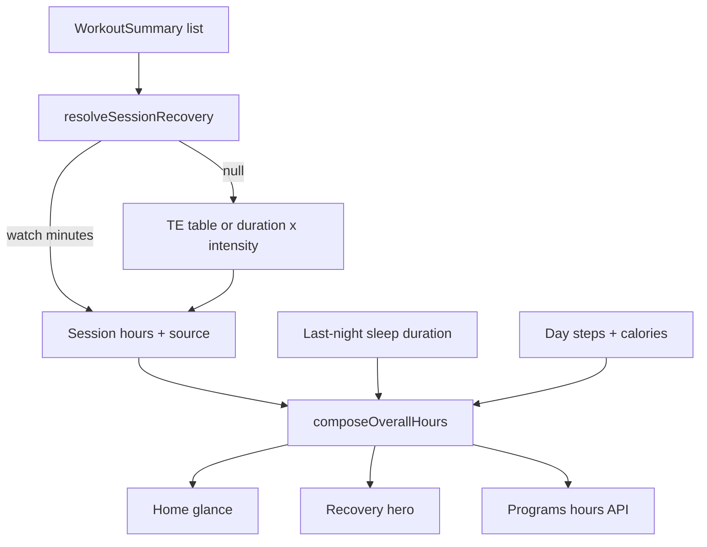

# feat: Session + overall recovery hours

## Summary

Implement a pure hybrid recovery engine (watch SoT per session, derived estimate when absent, overall hours with sleep/steps/calories modifiers), then surface a **Home Recovery time card** near sleep, a Recovery-tab top hero with the same **Recovery time** label, quiet estimated/watch cues on session detail, and a Programs-consumable hours API — without SoftLoadWarn redesign or a readiness score. Athlete copy is **Recovery time** + hours only (no “Fathom estimate / leftover + sleep” chrome).

---

## Problem Frame

Huawei often omits Recovery/Training load for swimming while strength/run carry `recoveryTime`. Those minutes stay session-local and never join sleep or day activity into “hours until hard work is sane,” so multi-sport dogfood and Programs soft-warn stay blind on swim/rest mornings. (see origin: `docs/brainstorms/2026-10-09-session-overall-recovery-requirements.md`)

---

## Requirements

- R1. Prefer watch session recovery; never overwrite with an estimate (origin R1).
- R2. When recovery is absent, estimate from duration + intensity proxies / sport defaults (origin R2, R4).
- R3. Quiet estimated/watch source on session detail only (origin R3).
- R4. Document hybrid estimator + Huawei swim-omission cite (origin R4).
- R5–R8. Single overall hours-remaining composition from stacked sessions + sleep + steps/calories; available with no sessions today; always Fathom composition (origin R5–R8).
- R9–R11. Home **Recovery time card** near sleep; Recovery top hero above subtabs; rest mornings keep empty session cue (origin R9–R11).
- R12–R14. Hours signal available to Programs; no readiness %/band; no muscle/DOMS claims (origin R12–R14).

**Origin actors:** A1 owner-athlete, A2 GT5, A3 Programs consumer  
**Origin flows:** F1 watch recovery, F2 estimate when absent, F3 no sessions today  
**Origin acceptance examples:** AE1–AE5

---

## Scope Boundaries

- No food input; no weekly multi-program sync
- No 0–100 readiness score or primary green/yellow/red band
- No muscle-group / DOMS maps; no overwriting watch `recoveryTime`
- No SoftLoadWarn UX redesign (duration path stays); no Hooper dependency
- No claiming Huawei internal reverse-engineer equivalence

### Deferred to Follow-Up Work

- Calibration UI / auto-fit TE→hours against owner history: later iteration after dogfood constants
- SoftLoadWarn threshold switch from duration to hours-remaining: separate cut after API ships
- North Star weekly multi-sport schedule: after Programs proves out (origin deferred)

---

## Context & Research

### Relevant Code and Patterns

- Watch minutes: `WorkoutSummary.recoveryTime` (`lib/core/huawei/huawei_link.dart`); native TLV `0x11` in `android/.../HuaweiWorkoutSync.kt`
- Format: `formatRecoveryMinutes` in `lib/features/workout_history/domain/strength_session_metrics.dart`
- Leftover promote (watch bytes only): `promoteStrengthScalarsFromLeftovers` — fill when null, never invent
- Pure domain precedent: `lib/features/programs/domain/soft_load_warn.dart`, `lib/features/vitals/domain/sleep_day.dart`
- Home day stack: `lib/features/home/presentation/view/home_screen.dart` (`_SleepStrip` then sessions); data via `HomeRepositoryImpl` / `HomeSnapshot`
- Agon hybrid is separate chrome (`home_agon_hybrid.dart`) — **do not** put hours in the chore hero
- Recovery host: `lib/features/vitals/presentation/view/recovery_tab_host.dart` — hero above `RecoverySubtabs`
- SoftLoadWarn: ignores `recoveryTime` today; supports optional `sleepDurationMin` but controller often omits it
- Tests to mirror: `test/features/programs/soft_load_warn_test.dart`, `test/features/home/home_screen_test.dart`, `test/features/vitals/presentation/recovery_tab_host_test.dart`, `test/features/workout_history/strength_session_metrics_test.dart`

### Institutional Learnings

- `docs/solutions/` empty; locks live in Recovery v1 / Home redesign / Programs soft-warn docs — hours = fatigue clock, not P4 composite or ANS invent
- Huawei Support: Recovery/Training load may be unavailable for swimming — estimate is expected fill

### External References

- Huawei Workout status / TruSport: recovery from intensity + duration + remaining prior recovery; swim often excluded
- Firstbeat/Garmin TE semantic bands → community recovery-hour ranges (no official public TE→hours table)
- Banister/Edwards TRIMP = load AU, weak for wrist-HR swim; prefer duration×intensity when TE/HR thin

---

## Key Technical Decisions

- **Derived overlay, not mutation:** Session estimates live in a derived result (`source: watch | estimated`) — never write into `WorkoutSummary.recoveryTime`. Watch field remains watch-only SoT. (`recoveryTime == 0` is watch SoT; only `null` triggers estimate.)
- **v0 session estimate:** Prefer TE→hours when aerobic/anaerobic effect present (**shared wire÷10 helper**, not strength Intensity display). Else if watch `load` present, map load via a simple linear/band helper. Else if reliable avg/peak HR present, light HR×duration intensity tier. Else `durationHours × intensityMult` with sport defaults (swim → moderate). **4–72h clamp applies to estimates only** — watch minutes/60 pass through uncapped (still subject to overall 96h cap when stacked). Refuse estimate when `durationSec` is null or ≤ 0 (soft-incomplete streams with valid duration still estimate).
- **v0 vs Approach C calibration:** Owner-history auto-fit is **explicitly out** this cut (named constants only). R4 doc comment cites Huawei swim omission + preferred→fallback path; calibration = follow-up.
- **Overall stacking:** Lookback = sessions whose recovery debt may still be active (walk back until remaining≈0 or **7 local days**, whichever first — not calendar-today alone). Huawei-shaped remaining + stress: `decay(remain, ΔtHours) = max(0, remain − ΔtHours)` (1:1 wall-clock hours), then on each session end chronologically `remain = min(96, remainAtStart + sessionHours)`. Sleep duration and day activity add small capped modifiers (sleep short → +hours; high steps/calories vs personal median → +hours; use max of steps/cal mods). Cap overall 0–96h.
- **Tick policy:** Compute `asOf` + remaining hours (or ready-at epoch); wall-clock decay between syncs; recompute when sessions/sleep/FT land. Stale sync uses last inputs + elapsed (existing Home sync chrome for honesty).
- **Empty vs zero:** Insufficient inputs → empty/`—` + `insufficientData` flag; true exhausted leftover → numeric `0h`. Never conflate.
- **Athlete-facing label:** Primary Home and Recovery chrome uses **“Recovery time”** + the hours value only (e.g. `14h`). Do **not** show “Fathom estimate”, “leftover + sleep”, “until hard work”, or composition explanations on those primary surfaces. Quiet estimated/watch stays on session detail only (R3). Internal/docs may still say Fathom composition.
- **Home placement:** Ship a dedicated **Recovery time card** adjacent to `_SleepStrip` (immediately after sleep), before today’s sessions — required on the day stack when hours are available (or honest `—` when insufficient). Never Agon hero; never readiness %. If sleep strip absent but hours computable, still show the card in that slot. Design SoT: `docs/design/recovery-hours-prototype/`.
- **Chrome-only Home:** Hide hours when sleep/sessions are suppressed (`notPaired` / `neverSynced`) — no invented clock.
- **Programs:** Compose hours **outside** SoftLoadWarn; pass optional `hoursRemaining` in. Keep duration SoftLoadWarn thresholds. Do **not** wire sleep into SoftLoadWarn as a side quest this cut.
- **Module home:** Per-session resolve in `workout_history/domain/`; overall composer in `vitals/domain/overall_recovery_hours.dart`. Shared read helper (pure compose + thin repository assembly) reused by Home, Recovery host, Programs — RecoveryTabHost gains a read seam (workouts + sleep + FT), not a new sync plane.
- **R14:** No muscle/DOMS copy on Home/Recovery/detail; enforced by boundaries + negative asserts on U2/U4/U5 surfaces.

---

## Open Questions

### Resolved During Planning

- Estimate storage: **derived overlay + source** (not persist into `recoveryTime`).
- SoftLoadWarn this cut: **hours API available**; duration heuristics unchanged; deep threshold redesign deferred.
- Home slot: **Recovery time card** after sleep strip, not Agon hero.
- Athlete copy: **Recovery time** + hours only on Home/Recovery primary chrome (no leftover/Fathom-estimate subtitles).
- Stacking: **remaining + stress + wall-clock decay**, not max-only or naive sum-without-decay.
- `recoveryTime == 0`: watch SoT (do not estimate).
- Chrome-only: **hide** hours with other day-stack data.

### Deferred to Implementation

- Exact TE band cut-points, load→hours map, and intensity multipliers: ship as named tunable constants; adjust after dogfood.
- Personal median window for steps/calories (14 vs 28 days): start with available local history length, document assumption.
- Whether SoftLoadWarn banner copy mentions hours in the same PR: only if zero product risk; else API-only.
- Exact shared assembler placement (home vs vitals use-case file): implementer chooses one reuse point.

---

## High-Level Technical Design

*This illustrates the intended approach and is directional guidance for review, not implementation specification. The implementing agent should treat it as context, not code to reproduce.*



**Directional compose sketch:**

```
for each session chronologically:
  h = watchMinutes/60 OR estimate(...)
  remain = decay(remain, now - lastMark)
  remain = min(96, remain + h)
remain = clamp(remain + sleepMod + activityMod, 0, 96)
```

---

## Output Structure

```
lib/features/workout_history/domain/
  session_recovery.dart          # resolve watch vs estimate + source
lib/features/vitals/domain/
  overall_recovery_hours.dart    # stack + modifiers + display helpers
test/features/workout_history/
  session_recovery_test.dart
test/features/vitals/domain/
  overall_recovery_hours_test.dart
```

(Presentation units modify existing Home / Recovery host / session detail / SoftLoadWarn wiring files.)

---

## Implementation Units

### U1. Session recovery resolve (pure)

**Goal:** Given a `WorkoutSummary` (and optional TE/load already on it), return resolved recovery hours + `watch` | `estimated` source without mutating the summary.

**Requirements:** R1, R2, R4

**Dependencies:** None

**Files:**
- Create: `lib/features/workout_history/domain/session_recovery.dart`
- Create: `test/features/workout_history/session_recovery_test.dart`
- Possibly reuse: `formatRecoveryMinutes` from `strength_session_metrics.dart`

**Approach:**
- If `recoveryTime != null` (including 0): hours = minutes/60, source = watch (no 4–72 clamp).
- Else: TE (wire÷10) → load band → HR tier → duration×sport default; refuse when `durationSec` null/≤0; clamp estimates 4–72h.
- Cite Huawei swim omission + v0 constants (no owner auto-fit) in module doc comment (R4).
- Named constants for TE bands, load map, and multipliers.

**Execution note:** Implement test-first for resolve branches.

**Test scenarios:**
- Covers AE1. Watch 960 minutes → 16h, source watch.
- Covers AE2. Swim null recovery, duration 45m, no TE → estimated hours in moderate band; source estimated.
- `recoveryTime == 0` → 0h watch, not estimated.
- TE present maps into expected band (table fixture).
- Duration 0 / null duration → omit / no estimate (no fabricated hours).
- Strength with watch value never altered by estimator path.

**Verification:** Unit tests green; no writes to `WorkoutSummary.recoveryTime`.

---

### U2. Overall hours remaining composer (pure)

**Goal:** Pure function composing overall hours remaining from resolved sessions + sleep duration + day steps/calories + `now`.

**Requirements:** R5–R8, R13, R14

**Dependencies:** U1

**Files:**
- Create: `lib/features/vitals/domain/overall_recovery_hours.dart`
- Create: `test/features/vitals/domain/overall_recovery_hours_test.dart`
- Optional thin assembler use-case colocated or under home/vitals data layer for shared Home/Recovery/Programs reads

**Approach:**
- Chronological remaining+stress stack with wall-clock decay; sleep/activity capped modifiers; clamp 0–96.
- Return minimal result: `hoursRemaining` (nullable when insufficient), `asOf`, `insufficientData`; never a readiness score. Add contributors later if a surface needs them.
- Lookback ≤7 days / until debt ~0 — not today-only.
- Decay: `max(0, remain − ΔtHours)`.
- Null sleep → neutral sleep mod; missing FT → unknown; explicit 0 after sync → 0 contribution.

**Execution note:** Test-first for stacking and modifiers.

**Test scenarios:**
- Covers AE3. Leftover from prior session + sleep, no sessions today → positive remaining before wall-clock exhausts.
- Covers AE4. All-watch sessions → result still labeled as Fathom composition fields (no “watch overall” claim in model).
- Same-day estimated swim then watch strength → remaining reflects both under remaining+stress (not naive double without decay).
- Wall-clock decay reduces remaining between `asOf` and later `now`.
- Short sleep adds capped hours; high steps OR calories add capped hours without stacking both fully.
- Insufficient inputs → `insufficientData` / null hours (not numeric 0); exhausted leftover → `0`.
- Cap at 96h.
- Lookback uses prior-day sessions when today is empty (AE3 leftover).

**Verification:** Pure unit tests encode AE3/AE4 and stacking rules.

---

### U3. Session detail quiet source + card display of resolved hours

**Goal:** Session cards/detail show resolved recovery (including estimates) with quiet source on detail only.

**Requirements:** R2, R3

**Dependencies:** U1

**Files:**
- Modify: strength/run/swim session analytics or shared recovery row helpers under `lib/features/workout_history/presentation/`
- Modify: `buildHomeTodaySessionCard` path in `home_repository_impl.dart` if cards should show estimated recovery
- Tests: extend strength/run detail tests and/or home KPI tests

**Approach:**
- Resolve via U1 at presentation/repository boundary; primary label uses same `formatRecoveryMinutes` style.
- Detail secondary cue: “watch” / “estimated” only.
- Do not persist estimate into prefs JSON `recoveryTime`.

**Test scenarios:**
- Covers AE1 / AE2. Detail shows quiet source; primary label looks identical style for watch vs estimated.
- Home session card shows recovery number when estimated (omit only when resolve refuses).
- Watch-backed session never shows “estimated.”

**Verification:** Widget/unit tests for labels; prefs dump still has null recovery for swim until watch sends it.

---

### U4. Home Recovery time card

**Goal:** Add a **Recovery time** card on Home immediately after sleep (before today’s sessions) when the day stack is shown.

**Requirements:** R9, R11, R13

**Dependencies:** U2

**Files:**
- Modify: `lib/features/home/domain/home_precedence.dart` (`HomeSnapshot` field for recovery time label)
- Modify: `lib/features/home/data/repositories/home_repository_impl.dart` (compose inputs)
- Modify: `lib/features/home/presentation/view/home_screen.dart` (card UI after `_SleepStrip`)
- Tests: `test/features/home/home_screen_test.dart`, `home_repository_kpi_test.dart`, `home_precedence_test.dart`
- Design SoT: `docs/design/recovery-hours-prototype/`

**Approach:**
- Load lookback workouts, overnight sleep duration, day FT steps/calories (same undercount policy as Home totals).
- Hide when chrome-only precedence suppresses sleep/sessions.
- Card label: **Recovery time**; value: hours (`14h` / `0h` / `—`). No subtitle explaining leftover/sleep/Fathom estimate.
- Null sleep: still show the card if overall computable; do not invent sleep strip.
- Match prototype card treatment (calm instrument card, not readiness dial).

**Test scenarios:**
- Covers AE3. Rest morning with leftover+sleep → **Recovery time card** visible after sleep; sessions empty cue intact.
- Card shows label “Recovery time” and hours only — no “Fathom estimate” / “leftover” copy in the widget tree.
- Chrome-only / unpaired → no Recovery time card.
- Covers AE4. No readiness % chrome.
- Syncing keeps prior snapshot hours consistent with existing mute/prior patterns.

**Verification:** Home tests cover card presence after sleep, chrome-only absence, empty sessions coexistence, label copy.

---

### U5. Recovery tab top hero

**Goal:** Hours remaining hero above Recovery subtabs.

**Requirements:** R10, R7, R8, R13, R14

**Dependencies:** U2

**Files:**
- Modify: `lib/features/vitals/presentation/view/recovery_tab_host.dart`
- Possibly small presentational widget under `lib/features/vitals/presentation/widgets/`
- Tests: `test/features/vitals/presentation/recovery_tab_host_test.dart`
- Wire data: shared assembler over existing workout history + vitals repos (workouts lookback + sleep + FT) — read seam only, no new sync plane

**Approach:**
- Column: hero → existing `RecoverySubtabs` → IndexedStack.
- Hero label: **Recovery time** + hours only (same copy rules as Home card).
- Same composer/assembler as Home (U2) for number identity.
- Insufficient → `—`; true 0h → `0h`; never green recovered / % chrome.
- Covers AE5: hero visible without new subtab.

**Test scenarios:**
- Covers AE5. Hero above subtabs; Vitals/Sleep/Food still switch.
- No inputs → empty/placeholder, not %.
- Matches Home hours for same fixture inputs (shared composer).

**Verification:** Recovery host widget tests + shared fixture parity with Home.

---

### U6. Programs hours API hook for SoftLoadWarn

**Goal:** Make overall hours remaining available to Programs without replacing duration SoftLoadWarn.

**Requirements:** R12

**Dependencies:** U2

**Files:**
- Modify: `lib/features/programs/domain/soft_load_warn.dart` and/or Programs controller to accept optional `hoursRemaining`
- Modify: `lib/features/programs/presentation/...` only if optional factual copy is in-scope and trivial
- Tests: `test/features/programs/soft_load_warn_test.dart` (+ controller test if wired)

**Approach:**
- SoftLoadWarn keeps duration/load thresholds.
- Programs controller (or adjacent) runs shared overall-hours assembler and passes optional `hoursRemaining` into SoftLoadWarn / banner model.
- Do not hard-block chores from hours; do not add SoftLoadWarn sleep wiring in this cut.

**Test scenarios:**
- SoftLoadWarn duration path unchanged for existing fixtures.
- When hoursRemaining provided, result exposes it for banner/consumer without inventing readiness score.
- Swim-only day: composer still yields hours from estimated swim; SoftLoadWarn duration samples may still exclude swim (document interaction).

**Verification:** Existing soft-warn tests pass; new optional-hours cases green.

---

## Alternative Approaches Considered

- **Persist estimates into `WorkoutSummary.recoveryTime`:** Rejected — watch null merge would lock estimates as SoT; conflicts with R1 and estimated→watch promotion.
- **Overall-only strain clock (no per-session swim fill):** Rejected in brainstorm — session cards stay blind on swim; weaker multi-sport eyeballing.
- **Replace SoftLoadWarn duration thresholds with hours-only:** Deferred — Programs already ships duration soft-warn; this cut exposes hours API first to avoid dual-model thrash.
- **Max-readyAt envelope without remaining+stress:** Rejected — under-penalizes hard-on-hard vs Huawei TruSport “prior remaining + new stress” framing chosen for stacking.

---

## Risk Analysis & Mitigation

| Risk | Mitigation |
|------|------------|
| Estimates disagree with watch on same-sport days | Watch always wins; tune constants offline; quiet source on detail |
| Additive stacking feels too harsh | Caps + decay; dogfood knobs; follow-up α-overlap if needed |
| Home Recovery time card reads as readiness score | Label “Recovery time” + hours only; no color bands; place after sleep not Agon progress |
| Writing estimates into `recoveryTime` poisons SoT | U1/U3 forbid mutation; tests assert prefs null for estimated swims |
| SoftLoadWarn + hours contradict | Duration path primary; hours optional; no dual contradictory hard blocks |

---

## Phased Delivery

1. **U1 → U2** — domain engine + tests (shippable as library without UI)
2. **U3 → U4 → U5** — athlete surfaces
3. **U6** — Programs hook

---

## Documentation Plan

- Origin requirements already cite Huawei swim gap; keep R4 cite in domain module docs
- No separate marketing doc; update ONBOARDING only if Recovery/Home map changes meaningfully

---

## System-Wide Impact

- **Home:** New **Recovery time** card in day stack after sleep; Agon hybrid unchanged
- **Recovery tab:** Hero labeled Recovery time above subtabs; Sleep/Vitals/Food unchanged
- **Workouts:** Detail quiet source; cards may show estimated recovery
- **Programs:** Optional hours on SoftLoadWarn path; chores not auto-rescheduled
- **Sync/native:** No protocol change; read existing Totals scalars + sleep + FT

---

## Sources & References

- Origin: `docs/brainstorms/2026-10-09-session-overall-recovery-requirements.md`
- Related: `docs/brainstorms/2026-10-09-home-redesign-requirements.md`, `docs/brainstorms/2026-10-09-pool-swim-programs-requirements.md`, `docs/brainstorms/2026-08-20-recovery-v1-timing-hooper-requirements.md`
- Huawei Support Workout status; Huawei TruSport recovery remaining+stress framing
