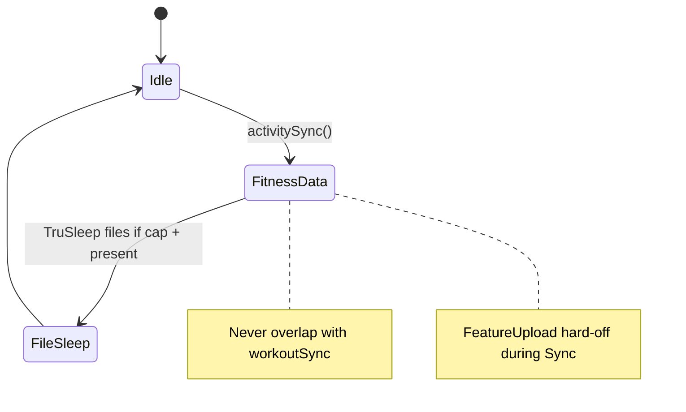

# Huawei BR / LPv2 wire-spec — GT5-A07 FitnessData (`0x07`)

Fitness OS–owned **pre-promotion** wire-spec for daily activity / vitals / sleep **messages** (not TruSleep files).

**Catalog:** `docs/catalogs/gt5-a07-full-metrics.md`  
**Probe matrix:** `docs/experiments/gt5-a07-full-metrics-probe-matrix.md`  
**Sleep files:** `docs/wire-specs/huawei-br-gt5-sleep-files.md` (deferred)

**Status (2026-07-18):** No Fitness OS activity Sync capture on GT5-A07 yet. Tables below are **oracle / claimed envelopes** for owner probe — do **not** promote catalog rows to score **4** until a section cites `capture:…` or `ABSENT-…`.

**Rules:** No AGPL paste. Privacy: presence rates + tag+len histograms only; never commit full HR/SpO2 series.

---

## Sync phase boundaries



Suggested follow-on order (idle before workout):

```text
activitySync:
  sleepCount → sleepData
  stepCount → stepData
  fitnessTotals
  battery (session side-fetch; also Gate A post-bind)
# idle
workoutSync: …
```

---

## Service `0x07` — command map (probe targets)

| CC | Name | Catalog role | Promotion |
|----|------|--------------|-----------|
| `0x03` | FitnessTotals (day) | Must — day rollup | Pre-promotion |
| `0x0A` | Step / activity count | Must | Pre-promotion |
| `0x0B` | Step / activity data | Must — steps/cal/dist; HR bitmap `0x40`; SpO2 bitmap2 `0x01` | Pre-promotion |
| `0x0C` | Sleep count | Must — sleep messages | Pre-promotion |
| `0x0D` | Sleep data | Must — intervals / stages | Pre-promotion |
| `0x16` | TruSleep enable | Sleep path | Pre-promotion |
| `0x17` | Auto-HR enable | Daily HR | Pre-promotion |
| `0x23` | Resting HR cap (GB) | Unknown / claimed | Pre-promotion |
| `0x24` | Auto-SpO2 enable | Must | Pre-promotion |
| `0x2a` | Skin temp enable | Should — catalog only | Pre-promotion |

Expand capability / temp `0x1d` and `truSleepNewSync` flag: dump during owner caps probe.

---

## Battery (promoted — DeviceConfig, not FitnessData)

Battery is **`0x01:0x08`** (DeviceConfig), documented here for companion vitals honesty because catalog S6 lists it with daily must metrics.

| Item | Value |
|------|-------|
| Capture | `POC-2026-07-18-gate-a-battery` |
| Request | Encrypted exchange during post-bind configure (and reconnect path) |
| Response TLV | `0x01` = level u8 (0–100) |
| Observation | `present` |
| Catalog score | **5** |
| Normative home | Also `huawei-br-gt5-gate-a.md` post-bind sequence |

Async battery notifications (if any) remain unobserved for separate promotion.

---

## Daily HR / SpO2 / steps (pre-promotion)

| Surface | Codes | Attempt budget | Catalog until probe |
|---------|-------|----------------|---------------------|
| Interval steps/cal/dist | `0x0B` | Caps → Sync | score **3** / `unobserved` |
| Interval HR | `0x0B` + enable `0x17` | Max 2 enable→wear≥4h→sync (+ reboot) | score **2** / `unobserved` |
| Interval SpO2 | `0x0B` + enable `0x24` | Same budget | score **3** / `unobserved` |
| FitnessTotals day | `0x03` | After step chain | score **2** / `unobserved` |

**Store split (follow-on):** vitals_history minute series ≠ workout sample HR. Never merge clocks.

When owner completes budget with empty HR: set observation `absent-in-observed-sessions`, keep score ≤2 — do **not** jump to **0**.

---

## Sleep messages (promoted — message path)

| Item | Value |
|------|-------|
| Capture | `POC-2026-07-18-activity-sync-sleep` |
| Count `0x0C` | Nested `0x81` → `0x02` u16 count; companion requests indices `1..N` via `0x0D` |
| Data `0x0D` | Nested `0x81` → `0x02` index; repeated **`0x83` stages** (not begin/end pairs) |
| Stage `0x83` | `0x04` type u8; `0x06` meta u8; `0x05` = timestamp_be_u32 + duration_be_u16 (**minutes**) |
| Timestamp | **UTC unix seconds** (not local-as-UTC). Cross-check: step `0x03` block anchors land on real IST midnights when phone TZ is Asia/Kolkata (`capture:POC-2026-07-18-activity-sync-sleep`). UI must `toLocal()` for display. |
| Session merge | **Collect stages across all `0x0D` pages**, then aggregate; gap **> 45 min** starts a new session. Indices are stage pages, not one-row-per-index product sleeps. Drop sessions **&lt; 15 min**. |
| Observation | `present` (overnight + nap-length clusters observed) |
| Catalog score | Promote S4 toward **4** after owner confirms UI vs watch |
| Enable `0x16` | Response `t=7f` RESULT_OK (`100000`) observed |

FileDownload sleep_state / sleep_data: see sleep-files stub — **not** promoted here.

---

## Daily HR / step samples (partial — capture)

| Item | Value |
|------|-------|
| Capture | `POC-2026-07-18-activity-sync-sleep` |
| Count `0x0A` | Same count shape as sleep (`0x81`/`0x02`) |
| Data `0x0B` | `0x02` index; **`0x03` dayStart u32**; repeated `0x84` minutes (`0x05` minute offset u8, `0x06` bitmap-led payload); trailing `0x08` |
| HR bit | Still **`0x40`** in sample bitmap (wire claim). This capture’s bitmaps were `{0x00,0x04,0x06,0x0a,0x0e,0x1e}` — **no `0x40`**, so companion correctly reports HR absent |
| Note | Fresh auto-HR consent may not backfill historical minutes; re-wear ≥4h then Sync |

---

## FitnessTotals day rollup (map started)

| Item | Value |
|------|-------|
| Capture | `capture:owner-2026-08-07-post-day-reset` — `activity-sync fitnessTotals capture=pending` + `frame ok svc=0x7 cmd=0x3` |
| Codes | Request `0x07:0x03` with window `0x81 → 0x03/0x04` (same window shape as sleep/step count) |
| Privacy | Default logs: **tag+len histogram + presence counts only**. Never commit raw series. |
| Day anchor | **Provisional** — TLV `0x83` order maps onto last N local calendar days ending at request `endUnix` local day (last slot = today). Same `toLocal()` dayKey helper as sleep/HR. Revisit after swim/high-burn capture. |
| Field map | Partial — see owned table below |
| Catalog | score **2** / `partial` — steps + calories locked vs watch; duration unit still open (`0x07` treated as **seconds** in parser provisionally) |

**Histogram (this capture):**

`hist=[t=81:len=233x1;nested[t=2:len=4x1,t=83:len=29x7,t=9:len=8x1,t=4:len=1x7,t=5:len=4x7,t=6:len=2x7,t=7:len=4x7,t=8:len=2x7,t=b:len=4x7]]`

**Owned TLV decode** (nested under outer `0x81`, same TLV framing as sleep):

| Tag | Len | Role (this capture) | Status |
|-----|-----|---------------------|--------|
| `0x02` | 4 | Header / count-like (`beU32=1`) | Unknown |
| `0x83` | 29 × 7 | Day/slot records | Structure locked |
| `0x09` | 8 | Trailer (zeros) | Unknown |
| `0x04` (in `0x83`) | 1 | Slot/type/weekday candidate (`{0,1,2,3,4,6,7}` — no `5`) | Provisional |
| `0x05` (in `0x83`) | 4 BE u32 | **Steps** — matched watch **27** | Locked vs watch |
| `0x06` (in `0x83`) | 2 BE u16 | **Calories (kcal)** — matched watch **1** | Locked vs watch |
| `0x07` (in `0x83`) | 4 BE u32 | Duration candidate (`15` on active slot) | **Provisional seconds** in native parser; confirm vs watch exercise minutes on swim capture |
| `0x08` / `0x0b` (in `0x83`) | 2 / 4 | Present, zero on this day | Unknown |

**Owner cross-check (local today after day reset):** watch Activity = **1 kcal**, **27 steps**. Only the `0x83` row with `0x04=1` was non-zero; remaining six rows were empty.

**Still open before U4:** confirm day-anchor (window-order provisional) and duration unit for `0x07` against a swim / higher-burn day. Prefer a second capture with higher burn / exercise minutes.

---


## Skin temp / deferred matrix claims

| Metric | Status |
|--------|--------|
| Skin temperature (`0x2a` + P2P) | Should — catalog score **3** only; no fetch this plan |
| Stress / HRV / emotions / PAI / sleep RR | Defer — catalog **0**; unknownTV probe only |

---

## Promotion checklist (owner)

- [ ] Caps dump recorded (cmd support + truSleepNewSync)
- [ ] Enable HR + SpO2; wear ≥4h; activity Sync
- [ ] Presence rates + unknownTV histogram (tag+len)
- [ ] Cite `capture:…` or `ABSENT-…` per row → then mint catalog **4**
- [ ] Link promoted sections from catalog S5/S6
