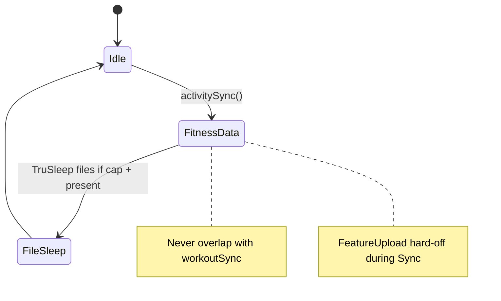

# Huawei BR / LPv2 wire-spec — GT5-A07 FitnessData (`0x07`)

Fitness OS–owned **pre-promotion** wire-spec for daily activity / vitals / sleep **messages** (not TruSleep files).

**Catalog:** `docs/catalogs/gt5-a07-full-metrics.md`  
**Probe matrix:** `docs/experiments/gt5-a07-full-metrics-probe-matrix.md`  
**Sleep files:** `docs/wire-specs/huawei-br-gt5-sleep-files.md` (deferred)

**Status (2026-07-18):** No Fitness OS activity Sync capture on GT5-A07 yet. Tables below are **oracle / claimed envelopes** for owner probe — do **not** promote catalog rows to score **4** until a section cites `capture:…` or `ABSENT-…`.

**Rules:** No AGPL paste. Privacy: presence rates + tag+len histograms only; never commit full HR/SpO2 series.

---

## Sync phase boundaries



Suggested follow-on order (idle before workout):

```text
activitySync:
  sleepCount → sleepData
  stepCount → stepData
  fitnessTotals
  battery (session side-fetch; also Gate A post-bind)
# idle
workoutSync: …
```

---

## Service `0x07` — command map (probe targets)

| CC | Name | Catalog role | Promotion |
|----|------|--------------|-----------|
| `0x03` | FitnessTotals (day) | Must — day rollup | Pre-promotion |
| `0x0A` | Step / activity count | Must | Pre-promotion |
| `0x0B` | Step / activity data | Must — steps/cal/dist; HR bitmap `0x40`; SpO2 bitmap2 `0x01` | Pre-promotion |
| `0x0C` | Sleep count | Must — sleep messages | Pre-promotion |
| `0x0D` | Sleep data | Must — intervals / stages | Pre-promotion |
| `0x16` | TruSleep enable | Sleep path | Pre-promotion |
| `0x17` | Auto-HR enable | Daily HR | Pre-promotion |
| `0x23` | Resting HR cap (GB) | Unknown / claimed | Pre-promotion |
| `0x24` | Auto-SpO2 enable | Must | Pre-promotion |
| `0x2a` | Skin temp enable | Should — catalog only | Pre-promotion |

Expand capability / temp `0x1d` and `truSleepNewSync` flag: dump during owner caps probe.

---

## Battery (promoted — DeviceConfig, not FitnessData)

Battery is **`0x01:0x08`** (DeviceConfig), documented here for companion vitals honesty because catalog S6 lists it with daily must metrics.

| Item | Value |
|------|-------|
| Capture | `POC-2026-07-18-gate-a-battery` |
| Request | Encrypted exchange during post-bind configure (and reconnect path) |
| Response TLV | `0x01` = level u8 (0–100) |
| Observation | `present` |
| Catalog score | **5** |
| Normative home | Also `huawei-br-gt5-gate-a.md` post-bind sequence |

Async battery notifications (if any) remain unobserved for separate promotion.

---

## Daily HR / SpO2 / steps (pre-promotion)

| Surface | Codes | Attempt budget | Catalog until probe |
|---------|-------|----------------|---------------------|
| Interval steps/cal/dist | `0x0B` | Caps → Sync | score **3** / `unobserved` |
| Interval HR | `0x0B` + enable `0x17` | Max 2 enable→wear≥4h→sync (+ reboot) | score **2** / `unobserved` |
| Interval SpO2 | `0x0B` + enable `0x24` | Same budget | score **3** / `unobserved` |
| FitnessTotals day | `0x03` | After step chain | score **2** / `unobserved` |

**Store split (follow-on):** vitals_history minute series ≠ workout sample HR. Never merge clocks.

When owner completes budget with empty HR: set observation `absent-in-observed-sessions`, keep score ≤2 — do **not** jump to **0**.

---

## Sleep messages (pre-promotion)

| Surface | Codes | Notes |
|---------|-------|-------|
| Sleep count/data | `0x0C` / `0x0D` | begin/end; stages depend on TruSleep mode |
| Enable | `0x16` | TruSleep ON preferred for file path |
| Night budget | max 2 full nights | Prefer night 2 before absent |

FileDownload sleep_state / sleep_data: see sleep-files stub — **not** promoted here.

---

## Skin temp / deferred matrix claims

| Metric | Status |
|--------|--------|
| Skin temperature (`0x2a` + P2P) | Should — catalog score **3** only; no fetch this plan |
| Stress / HRV / emotions / PAI / sleep RR | Defer — catalog **0**; unknownTV probe only |

---

## Promotion checklist (owner)

- [ ] Caps dump recorded (cmd support + truSleepNewSync)
- [ ] Enable HR + SpO2; wear ≥4h; activity Sync
- [ ] Presence rates + unknownTV histogram (tag+len)
- [ ] Cite `capture:…` or `ABSENT-…` per row → then mint catalog **4**
- [ ] Link promoted sections from catalog S5/S6
