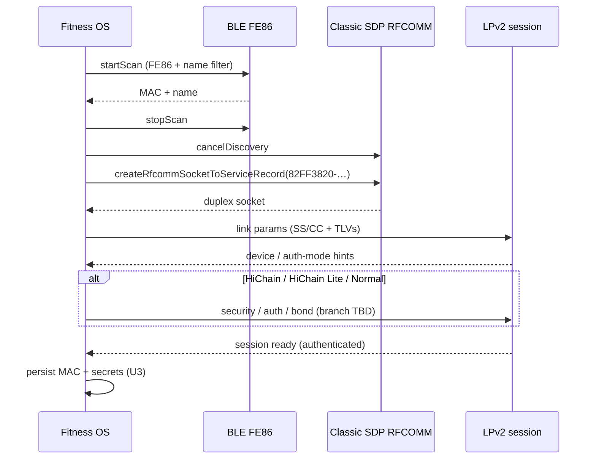

# Huawei BR / LPv2 wire-spec — Watch GT5-A07 Gate A

Fitness OS–owned clean-room wire-spec for Classic BR companion framing and Gate A session orchestration.

**Sources (behavioral / public only):**

- Public LPv2 wire docs: [zyv/huawei-lpv2 wiki — Wire protocol](https://github.com/zyv/huawei-lpv2/wiki/Wire-protocol)
- GB pairing behavior (oracle, not source): [Huawei/Honor pairing](https://gadgetbridge.org/basics/pairing/huawei-honor-pairing/)
- Plan sequence: `docs/plans/2026-07-17-001-feat-huawei-gt5-companion-mvp-plan.md` (Gadgetbridge pair flow)

**Rules:** No AGPL source paste. No secrets in this doc. GB class/method names are not implementation guides — GB is a behavioral oracle only. Raw HCI snoops stay off-repo; see `docs/experiments/2026-07-17-hci-capture-notes.md`.

**Related wire-specs (companion emission honesty):**

| Doc | Role |
|-----|------|
| `docs/catalogs/gt5-a07-full-metrics.md` | Scored catalog (dual-axis) |
| `docs/wire-specs/huawei-br-gt5-gate-b-enrichment.md` | Workout Data / Pace / Swim / GPS envelopes |
| `docs/wire-specs/huawei-br-gt5-fitness-data.md` | FitnessData `0x07` + battery honesty |
| `docs/wire-specs/huawei-br-gt5-sleep-files.md` | TruSleep FileDownload (deferred stub) |
| `docs/experiments/gt5-a07-full-metrics-probe-matrix.md` | Probe checklist + captures |

---

## Identifiers

| Role | Value |
|------|--------|
| BLE discovery / advertise filter UUID | `0000FE86-0000-1000-8000-00805F9B34FB` |
| Classic SDP session UUID | `82FF3820-8411-400C-B85A-55BDB32CF060` |
| Name pattern (case-insensitive) | `huawei watch gt 5` / `huawei watch gt 5-` / `huawei watch gt 5 pro-` |
| Packet magic | `0x5A` |
| Non-sliced flags byte | `0x00` |
| CRC | CRC-16/CCITT-FALSE (XMODEM): poly `0x1021`, init `0x0000`, no final XOR; covers `magic ‖ length ‖ flags[+slice] ‖ body` |

Protocol version negotiated inside link-params TLVs is typically `0x02` (LPv2). That is **not** the on-wire flags byte.

---

## Packet layout

### Non-sliced (single package)

```
0x5A | LLLL | 0x00 | BODY | CRC16
```

| Field | Width | Notes |
|-------|-------|--------|
| Magic | 1B | Always `0x5A` |
| LLLL | 2B BE | `len(BODY) + 1` |
| Flags | 1B | `0x00` = non-sliced |
| BODY | variable | Command (see below) |
| CRC16 | 2B BE | XMODEM over all preceding bytes |

Minimum on-wire size: `1 + 2 + 1 + 2 = 6` (empty BODY is unusual; BODY for a real command is at least `SS CC`).

### Sliced (fragmentation)

```
0x5A | LLLL | XX | YY | SLICE-BODY | CRC16
```

| Field | Width | Notes |
|-------|-------|--------|
| LLLL | 2B BE | `len(SLICE-BODY) + 2` |
| XX | 1B | Slice flag: `0x01` first, `0x02` middle, `0x03` last |
| YY | 1B | Slice index (0-based in public docs) |
| SLICE-BODY | variable | Fragment of the full BODY |
| CRC16 | 2B BE | Per slice, same XMODEM rule |

Concatenation of all `SLICE-BODY` parts yields the full BODY. Only the **first** slice carries `SS` / `CC`.

Fitness OS framing (`HuaweiFraming`) supports encode/parse of non-sliced frames and parse awareness of slice flags; reassembly across slices is session-layer work (U3+).

### Invalid frames

| Condition | Result |
|-----------|--------|
| Magic ≠ `0x5A` | Reject |
| Flags ∉ `{0x00, 0x01, 0x02, 0x03}` | Reject (unexpected version/flags) |
| CRC mismatch | Reject |
| Buffer shorter than declared frame | `IncompleteFrame` — do not crash; wait for more bytes |

---

## BODY: service / command / TLV

```
SS | CC | TLV₁ | TLV₂ | …
```

| Field | Width | Notes |
|-------|-------|--------|
| SS | 1B | Service ID |
| CC | 1B | Command ID |
| TLVs | ≥0 | ASN.1-like TLV list |

### TLV

```
TAG | LENGTH | VALUE
```

| Field | Width | Notes |
|-------|-------|--------|
| TAG | 1B | If MSB set (`tag & 0x80`), VALUE is nested TLV(s) |
| LENGTH | ≥1B | VarInt = `len(VALUE)` |
| VALUE | LENGTH bytes | Scalar bytes or nested TLVs |

### VarInt (length)

Public LPv2 docs: Variable-length quantity (7-bit groups). Continuation bit = MSB of each byte; value bits in the low 7. Multi-byte forms are big-endian (high group first). Independently reimplemented in `HuaweiFraming` — do not paste AGPL parsers.

---

## Gate A sequence (Fitness OS)



**Transport already in U1:** BLE discover → cancelDiscovery → SDP connect → raw byte duplex (`RfcommTransport`).

**U2 framing:** serialize/parse packets on that duplex.

**U3 session:** drive link-params + auth state machine; must not invent missing crypto (see inventory).

**Post-bind configure (encrypted, after HiChain3 bind):** product-info `0x07` → set-time `0x05` → battery `0x08` → supported-services `0x02` → timezone `0x32` → ExpandCapability `1:0x37` → locale `0x0C` → date-format `0x04` → setup-device-status `0x3E` (fire-and-forget) → accept-agreement `0x30` → connect-status `0x35` → (if mask has `0x25`) music-info-params `0x25:0x04` + extended-params `0x25:0x0D`.

**Dynamic init (GB order after supported-services):** SupportedCommands `1:0x03` (batched; builds per-cmd map) → ExpandCapability `1:0x37` → **Extended Account `0x1A:0x05`** (gated by cmds `0x05`+`0x06`) → SettingRelated `1:0x31` → AcceptAgreement `1:0x30` → ReverseCapabilities `1:0x3F` → ConnectStatus / Music → **Country Code `0x1A:0x0A` (late)**. Phone `session_ready` ≠ watch pairing UI; GB sets INITIALIZED only after the dynamic queue finishes.

**Async finalize:** watch pushes PhoneInfo `1:0x10` (reply required). DataSync `svc=0x37` / `featureManager` configAction=2: ConfigCommand `"01"` then FileUpload `0x28` of `feature_<CC>_device.txt` then action=`1` notify. Defer FeatureUpload until Extended Account/country have been sent. **Do not blanket-ACK DataSync with `t=7f:100000`**. Classic P2P `svc=0x34` ack `cmdId=3` + int `0xca`. Music: ACK `0x25:0x01` and real `0x25:0x03` only.

---

## Auth branch inventory (GT5-A07)

| Branch | Summary | GT5-A07 status |
|--------|---------|----------------|
| **HiChain** | HiChain key agreement | — |
| **HiChain Lite** | Lite then Normal-style auth | — |
| **HiChain3** | Security nego `0x33` then HiChain `0x28` | **Observed** — link-params `t=7:04` (deviceSupportType=4) |
| **Normal** | Auth `0x13` → BondParams `0x0F` → Bond `0x0E` | Wrong branch for this watch (returns `100004`) |

**Mode selector:** link-params tag **`0x07`** = `deviceSupportType` (not ServerNonce).  
ServerNonce first bytes are auth **crypto version** (V1) only.

**Observed branch:** **HiChain3**. Clean-room HiChain crypto still blocked; Fitness OS probes DeviceStatus + SecurityNegotiation then fail-closes.

---

## Crypto inventory

### Known (public MIT LPv2 + owner capture)

| Step | Status |
|------|--------|
| Framing / TLV / CRC | Done |
| Link-params exchange | Done on-device |
| Normal HMAC-SHA256 + AES-CBC bonding key (V1–V3) | Implemented clean-room from MIT `huawei-lpv2` |
| GT5-A07 auth version | **V1** (owner capture) |

### Open risks

| Risk | Mitigation |
|------|------------|
| Android privacy MAC `02:00:00:00:00:00` | Clear `r11_phone_mac` error; need real adapter address |
| Watch requires account-ID / HiChain despite V1 nonce | Fall back to R11 hints |

---

## Message IDs (Normal path)

| Service | Command | Role |
|---------|---------|------|
| `0x01` | `0x01` | Link params |
| `0x01` | `0x13` (19) | Auth |
| `0x01` | `0x0F` (15) | Bond params |
| `0x01` | `0x0E` (14) | Bond |

---

## Gate B — Workout history sync (`svc=0x17`)

Behavioral oracle: Gadgetbridge Workout Count → Totals (Data/Pace/Swim/GPS deferred). Clean-room only.

### Commands

| SS | CC | Role |
|----|----|------|
| `0x17` | `0x07` | WorkoutCount (time window) |
| `0x17` | `0x08` | WorkoutTotals (per workoutNumber) |
| `0x17` | `0x0a` / `0x0c` / `0x0e` | Data / Pace / Swim — **not** Gate B list |

No device ack/delete after totals. Sync end is local.

### Count request / response

Request nested under `0x81`:

| Tag | Width | Meaning |
|-----|-------|---------|
| `0x03` | u32 BE | startUnix (seconds) |
| `0x04` | u32 BE | endUnix (seconds) |

Response nested under `0x81`:

| Tag | Width | Meaning |
|-----|-------|---------|
| `0x02` | u16 BE | count |
| `0x85` | nested | repeated WorkoutNumbers |
| → `0x06` | u16 | workoutNumber |
| → `0x07` | u16 | dataCount (ignored for Gate B list) |
| → `0x08` | u16 | paceCount (ignored) |
| → `0x09` | u16 | segmentsCount (optional; ignored) |

Sort by `workoutNumber` ascending before fetching totals.

### Totals request / response (list minimum)

Request nested under `0x81`: tag `0x02` = workoutNumber (u16 BE).

Response fields used for Gate B list:

| Tag | Field | Width |
|-----|-------|-------|
| `0x02` | number | u16 |
| `0x04` | startTime | u32 unix |
| `0x05` | endTime | u32 unix |
| `0x12` | duration | u32 seconds |
| `0x14` | type | u8 (Huawei activity type) |

Optional (persist if present): calories `0x06`, distance `0x07`, steps `0x08`.

### Fitness OS sequence

```
gate_a_passed + session_ready
  → syncWorkouts(start=cursor|fallback, end=now)
  → Count 0x17:0x07
  → for each workoutNumber: Totals 0x17:0x08
  → emit DTO list to Flutter → persist prefs → update last_sync_cursor
```

**Window:** delta-only — `start = last_sync_cursor − 1d overlap` when cursor exists, else last 14 local days (same span as activity Sync). Partials may extend start back to the earliest partial workout. Forget Device clears cursor + local workout rows.

### Product gate

Sync button / channel call requires durable `gate_a_passed`. Phone `session_ready` alone is not enough (AE5).

---

## Fixtures

- Synthetic framing vectors: hex in Android unit tests (`HuaweiFramingTest`).
- Owner-captured / redacted golden frames: `test/fixtures/huawei/` (see README there).
- Raw `.pcap` / HCI snoops: **never commit**.
