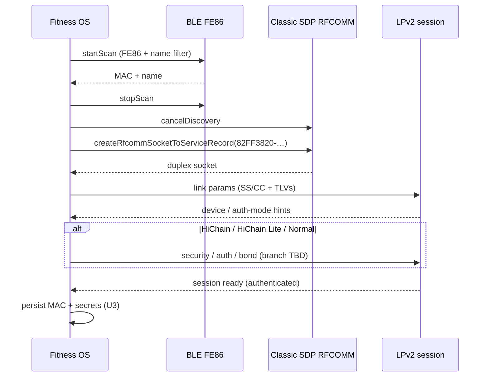

# Huawei BR / LPv2 wire-spec — Watch GT5-A07 Gate A

Fitness OS–owned clean-room wire-spec for Classic BR companion framing and Gate A session orchestration.

**Sources (behavioral / public only):**

- Public LPv2 wire docs: [zyv/huawei-lpv2 wiki — Wire protocol](https://github.com/zyv/huawei-lpv2/wiki/Wire-protocol)
- GB pairing behavior (oracle, not source): [Huawei/Honor pairing](https://gadgetbridge.org/basics/pairing/huawei-honor-pairing/)
- Plan sequence: `docs/plans/2026-07-17-001-feat-huawei-gt5-companion-mvp-plan.md` (Gadgetbridge pair flow)

**Rules:** No AGPL source paste. No secrets in this doc. GB class/method names are not implementation guides — GB is a behavioral oracle only. Raw HCI snoops stay off-repo; see `docs/experiments/2026-07-17-hci-capture-notes.md`.

---

## Identifiers

| Role | Value |
|------|--------|
| BLE discovery / advertise filter UUID | `0000FE86-0000-1000-8000-00805F9B34FB` |
| Classic SDP session UUID | `82FF3820-8411-400C-B85A-55BDB32CF060` |
| Name pattern (case-insensitive) | `huawei watch gt 5` / `huawei watch gt 5-` / `huawei watch gt 5 pro-` |
| Packet magic | `0x5A` |
| Non-sliced flags byte | `0x00` |
| CRC | CRC-16/CCITT-FALSE (XMODEM): poly `0x1021`, init `0x0000`, no final XOR; covers `magic ‖ length ‖ flags[+slice] ‖ body` |

Protocol version negotiated inside link-params TLVs is typically `0x02` (LPv2). That is **not** the on-wire flags byte.

---

## Packet layout

### Non-sliced (single package)

```
0x5A | LLLL | 0x00 | BODY | CRC16
```

| Field | Width | Notes |
|-------|-------|--------|
| Magic | 1B | Always `0x5A` |
| LLLL | 2B BE | `len(BODY) + 1` |
| Flags | 1B | `0x00` = non-sliced |
| BODY | variable | Command (see below) |
| CRC16 | 2B BE | XMODEM over all preceding bytes |

Minimum on-wire size: `1 + 2 + 1 + 2 = 6` (empty BODY is unusual; BODY for a real command is at least `SS CC`).

### Sliced (fragmentation)

```
0x5A | LLLL | XX | YY | SLICE-BODY | CRC16
```

| Field | Width | Notes |
|-------|-------|--------|
| LLLL | 2B BE | `len(SLICE-BODY) + 2` |
| XX | 1B | Slice flag: `0x01` first, `0x02` middle, `0x03` last |
| YY | 1B | Slice index (0-based in public docs) |
| SLICE-BODY | variable | Fragment of the full BODY |
| CRC16 | 2B BE | Per slice, same XMODEM rule |

Concatenation of all `SLICE-BODY` parts yields the full BODY. Only the **first** slice carries `SS` / `CC`.

Fitness OS framing (`HuaweiFraming`) supports encode/parse of non-sliced frames and parse awareness of slice flags; reassembly across slices is session-layer work (U3+).

### Invalid frames

| Condition | Result |
|-----------|--------|
| Magic ≠ `0x5A` | Reject |
| Flags ∉ `{0x00, 0x01, 0x02, 0x03}` | Reject (unexpected version/flags) |
| CRC mismatch | Reject |
| Buffer shorter than declared frame | `IncompleteFrame` — do not crash; wait for more bytes |

---

## BODY: service / command / TLV

```
SS | CC | TLV₁ | TLV₂ | …
```

| Field | Width | Notes |
|-------|-------|--------|
| SS | 1B | Service ID |
| CC | 1B | Command ID |
| TLVs | ≥0 | ASN.1-like TLV list |

### TLV

```
TAG | LENGTH | VALUE
```

| Field | Width | Notes |
|-------|-------|--------|
| TAG | 1B | If MSB set (`tag & 0x80`), VALUE is nested TLV(s) |
| LENGTH | ≥1B | VarInt = `len(VALUE)` |
| VALUE | LENGTH bytes | Scalar bytes or nested TLVs |

### VarInt (length)

Public LPv2 docs: Variable-length quantity (7-bit groups). Continuation bit = MSB of each byte; value bits in the low 7. Multi-byte forms are big-endian (high group first). Independently reimplemented in `HuaweiFraming` — do not paste AGPL parsers.

---

## Gate A sequence (Fitness OS)



**Transport already in U1:** BLE discover → cancelDiscovery → SDP connect → raw byte duplex (`RfcommTransport`).

**U2 framing:** serialize/parse packets on that duplex.

**U3 session:** drive link-params + auth state machine; must not invent missing crypto (see inventory).

---

## Auth branch inventory (GT5-A07)

Community / GB behavioral branches after link-params:

| Branch | Summary (behavioral) | GT5-A07 status |
|--------|----------------------|----------------|
| **HiChain** | Optional PIN then HiChain key agreement | **Pending owner HCI capture** |
| **HiChain Lite** | Lite challenge path then bond | **Pending owner HCI capture** |
| **Normal** | Auth challenge / response then bond params | **Pending owner HCI capture** |

**Observed branch for this watch:** unmarked until `gb_pair` HCI notes land. Do not assume a branch in production code.

Optional recovery material (GB pairing guide, behavioral): 17-digit Huawei account `userId` when the watch was previously Health-bound — entered by owner, stored only in EncryptedSharedPreferences (U3), never logged.

---

## Crypto inventory

### Independently known (public LPv2 RE + GB pairing docs)

| Step | What is known | Source class |
|------|---------------|--------------|
| Framing magic / CRC / TLV / VarInt | Fully specified for clean-room framing | Public wire wiki |
| Post-keying AES | After a session key exists, command bodies may be wrapped as AES-128-CBC + PKCS7 with dedicated crypto TLVs (IV + ciphertext). Fitness OS may implement **AES wrap/unwrap only after key material is obtained by a specified path** | Public LPv2 RE |
| 17-digit `userId` injection | Owner may supply account `userId` as auth-key material when Health previously owned the watch; used as an input to the auth path that GB documents behaviorally | GB pairing guide (behavior) |

### Not yet independently specified without captures (do not invent)

| Gap | Why blocked |
|-----|-------------|
| HiChain / HiChain Lite KDF | No owner-captured vectors; AGPL crypto must not be pasted |
| Challenge → response byte vectors for GT5-A07 | Need labeled HCI (`gb_pair`) + redacted fixtures |
| Exact auth-mode TLV values this firmware emits | Pending link-params response capture |
| Bond-parameter layout after successful auth | Pending capture |
| Whether reconnect reuses secrets vs full re-auth every time | Assume full session auth until proven otherwise |

### U2 → U3 gate verdict

**Proceed-with-gaps** for framing and session *orchestration*:

- U3 may implement link-params I/O, state machine scaffolding, secret persistence hooks, and fail-closed auth (`auth_failed` / R11 recovery hints).
- U3 **must not** invent HiChain KDF, forge challenge responses, or ship AGPL-derived crypto.
- Auth may fail closed until owner HCI captures unlock the crypto inventory and provide at least one challenge→response fixture.
- If captures later prove crypto cannot be specified clean-room → escalate to U8 **PIVOT/STOP** (do not paste AGPL).

---

## Message IDs (early / known from public LPv2)

| Service | Command | Role | Notes |
|---------|---------|------|--------|
| `0x01` | `0x01` | Link params | First exchange after socket open (public RE / community logs) |

Further SS/CC values for security/auth/bond on GT5-A07: **fill from redacted HCI fixtures** — do not copy from AGPL sources.

---

## Fixtures

- Synthetic framing vectors: hex in Android unit tests (`HuaweiFramingTest`).
- Owner-captured / redacted golden frames: `test/fixtures/huawei/` (see README there).
- Raw `.pcap` / HCI snoops: **never commit**.
