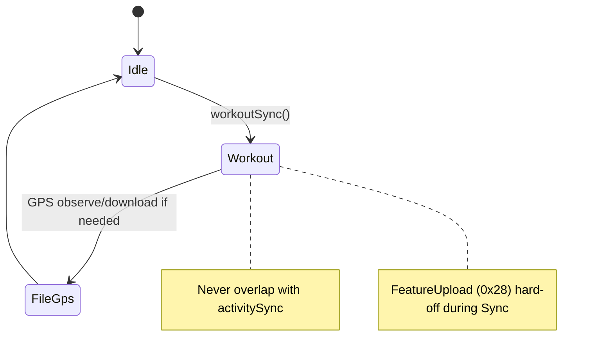

# Huawei BR / LPv2 wire-spec — GT5-A07 Gate B enrichment (workouts)

Fitness OS–owned clean-room wire-spec for workout Sync enrichment beyond Gate B Count→Totals list.

**Catalog:** `docs/catalogs/gt5-a07-full-metrics.md`  
**Probe matrix:** `docs/experiments/gt5-a07-full-metrics-probe-matrix.md`  
**Base list contract:** `docs/wire-specs/huawei-br-gt5-gate-a.md` (Gate B section)

**Rules:** No AGPL source paste. Promote only **observed** or **documented-absent** envelopes. GB = behavioral oracle only. Privacy: tag id + length only in captures; no GPS tracks or sample payloads in-repo.

---

## Sync phase boundaries

| Rule | Contract |
|------|----------|
| Serialize | `syncWorkouts` and future `syncActivity` share single-flight; native refuses overlap |
| FeatureUpload | Ignore `configAction=2` while Sync active (follow-on runtime) |
| FileDownload | Distinct SM (`0x0a` or `0x2c`); not FeatureUpload `0x28` |
| Gate | Durable `gate_a_passed` + encrypted `session_ready` |

---

## Service `0x17` — command map

| CC | Name | Promotion status | Cite |
|----|------|------------------|------|
| `0x07` | WorkoutCount | **Promoted** (list) | Gate A + `POC-2026-07-18-strength-totals` |
| `0x08` | WorkoutTotals | **Promoted** (list scalars) | same |
| `0x0a` | WorkoutData | **Pre-promotion** — envelope only | No GT5 sample capture this cut |
| `0x0c` | Pace (command) | **Pre-promotion** — envelope only | ≠ Totals TLV tag `0x0c` |
| `0x0e` | Swim segments | **Pre-promotion** — envelope only | Lap surface for swim; Pool seed pending |
| `0x17` | Live-ish overlay | **Out of scope** as history | score **0** |

### Hex disambiguation

| Looks like | Is |
|------------|-----|
| Totals TLV tag `0x0c` | HR peaks / related under cmd `0x17:0x08` |
| Pace **command** `0x17:0x0c` | Separate Pace blocks when paceCount>0 |
| Swim **command** `0x17:0x0e` | Lap/segment surface when segmentsCount>0 |

---

## Observed — Count / Totals list (Strength)

**Capture:** `POC-2026-07-18-strength-totals`  
**Mode:** Strength · `type=140` · `number=2` · `duration=112s` · Count window mid-2022→now

### Count `0x17:0x07`

Request nested under `0x81`:

| Tag | Width | Meaning | Observation |
|-----|-------|---------|-------------|
| `0x03` | u32 BE | startUnix | `present` |
| `0x04` | u32 BE | endUnix | `present` |

Response nested under `0x81`:

| Tag | Width | Meaning | Observation |
|-----|-------|---------|-------------|
| `0x02` | u16 BE | count | `present` (=1) |
| `0x85` → `0x06` | u16 | workoutNumber | `present` |
| `0x85` → `0x07` | u16 | dataCount | not logged this capture |
| `0x85` → `0x08` | u16 | paceCount | not logged |
| `0x85` → `0x09` | u16 | segmentsCount | not logged |

### Totals `0x17:0x08`

Request: tag `0x02` = workoutNumber (u16 BE).

| Tag | Field | Width | Observation | Score path |
|-----|-------|-------|-------------|------------|
| `0x02` | number | u16 | `present` (=2) | catalog **5** |
| `0x04` | startTime | u32 unix | `present` | **5** |
| `0x05` | endTime | u32 unix | `present` | **5** |
| `0x12` | duration | u32 seconds | `present` (=112) | **5** |
| `0x14` | type | u8 | `present` (=140) | **5** |
| `0x06` | calories | u32 | optional; not in POC log | catalog **3** until capture cites tag |
| `0x07` | distance | u32 | optional; not in POC log | catalog **3** until capture cites tag |
| `0x08` | steps | u32 | optional; not in POC log | catalog **3** until capture cites tag |

Enrichment TLV candidates (oracle / claim — **not** promoted until tag dump):

| Tag | Candidate | Status |
|-----|-----------|--------|
| `0x0c` | HR peaks (under Totals) | `unobserved` |
| `0x10` | maxMET / VO₂-like | `unobserved` |
| `0x15`–`0x1a` | Swim scalars | n/a Strength |
| `0x50`–`0x5a` | Run pace zones | n/a Strength |
| `0x66` | Recovery HR blob | `unobserved` |

---

## Pre-promotion envelopes (do not parse in product yet)

### WorkoutData `0x17:0x0a`

- **When:** Count hint `dataCount > 0` (or force-probe during owner sessions).
- **Expect (oracle):** Sample bitfields may include HR / speed / cadence / form / swim metrics by sport.
- **This cut:** No GT5 capture → do **not** mint catalog score **4** for Data fields.
- **Strength expectation:** May be empty; set-rep **0**.

### Pace command `0x17:0x0c`

- **When:** `paceCount > 0`.
- **Not** the swim lap source.
- **This cut:** Unobserved on Strength; Outdoor Run pending.

### Swim command `0x17:0x0e`

- **When:** `segmentsCount > 0` after Pool (must) or OW (opportunistic) seed.
- **Segment fields (oracle):** style, dist, time, strokes, swolf, pace — lengths only until capture.
- **This cut:** Pool unattempted → no promotion.

### GPS file

- **When:** Outdoor / OW observe after Totals.
- **Service:** FileDownload (`0x0a` or `0x2c` new-sync) — **not** FeatureUpload.
- **Ownership (R9b):** First follow-on consumer owns collaborator skeleton (U4 if GPS `present`, else U6 sleep).
- **This cut:** Unobserved; Indoor expect absent after probe.

---

## Mode status

| Mode | Type freeze | Enrichment promotion |
|------|-------------|----------------------|
| Strength | 140 (N=1 provisional) | List Totals promoted; Data/Pace/Swim/GPS pre-promotion |
| Outdoor Run | pending | Blocked on must-seed |
| Indoor Run | deferred opportunistic | — |
| Pool | pending | Blocked on must-seed; `0x0e` when segmentsCount>0 |
| Open water | deferred opportunistic | — |

---

## Follow-on fetch statuses (contract sketch — not this plan)

`ok` | `empty` | `partial_batch` | `stuck` | `error` | `not_ready`

Merge non-empty workouts on `ok` / `stuck` / `partial_batch`. Enrichment-monotonic: never clobber richer local row with Totals-only.
